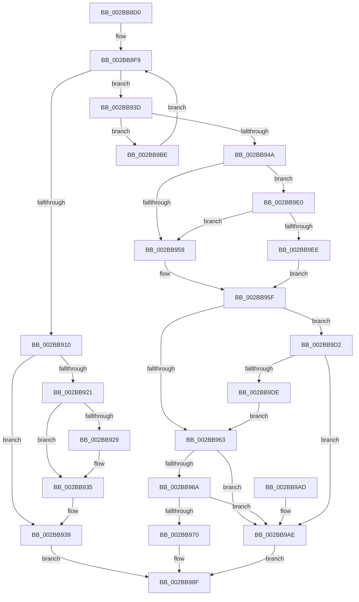

# MiComputeFlushRange

- RVA: `0x002BB8D0`–`0x002BBA04` (길이 `308` bytes)
- VA: `0x00000001402BB8D0`
- 실행 섹션: `.text`
- PDB 이름 있음: `예`; PDB Function 태그: `아니요`
- unwind 정보 RVA: `0x0006DDF8`
- 디코드: `84`개 명령, `308/308` bytes 표시
- 미해석 바이트: `0` (있으면 어셈블리에 `.byte`로 보존)

> 이 문서는 커널 이미지의 기계어와 PDB 기호를 분석해 생성했습니다. 4번과 5번은 함수 원형과 자료형을 바이너리 사용 방식에서 추정한 C 해석이며 원본 소스 복구 결과는 아닙니다.

## 1. Dependencies

- 직접 호출 지점: **9**; 고유 호출 대상: **8**
- 직접 호출자로 확인된 함수: **2**
- RIP 상대 이미지 참조: **5**

### Outgoing calls
- `0x002BB900` → [ExAcquireSpinLockExclusive](../24/ExAcquireSpinLockExclusive_function_00248690.md) (function, `0x00248690`)
- `0x002BB917` → [ExReleaseSpinLockExclusiveFromDpcLevel](../24/ExReleaseSpinLockExclusiveFromDpcLevel_function_002497E0.md) (function, `0x002497E0`)
- `0x002BB930` → [KiLowerIrqlProcessIrqlFlags](../4F/KiLowerIrqlProcessIrqlFlags_function_004F5698.md) (function, `0x004F5698`)
- `0x002BB941` → [ExTryAcquireSpinLockExclusiveAtDpcLevel](ExTryAcquireSpinLockExclusiveAtDpcLevel_function_002BB800.md) (function, `0x002BB800`)
- `0x002BB98A` → [MiComputeDataFlushRange](MiComputeDataFlushRange_function_002BBA10.md) (function, `0x002BBA10`)
- `0x002BB9B5` → [MiReleaseSpinLockExclusive](../24/MiReleaseSpinLockExclusive_function_002482C0.md) (function, `0x002482C0`)
- `0x002BB9C8` → [MiReleaseSpinLockExclusive](../24/MiReleaseSpinLockExclusive_function_002482C0.md) (function, `0x002482C0`)
- `0x002BB9D5` → [MiDoesControlAreaHaveUserWritableReferences](MiDoesControlAreaHaveUserWritableReferences_function_002BB830.md) (function, `0x002BB830`)
- `0x002BB9FA` → [ExpReleaseSpinLockExclusiveFromDpcLevelInstrumented](../2C/ExpReleaseSpinLockExclusiveFromDpcLevelInstrumented_function_002C0F44.md) (function, `0x002C0F44`)

### Direct callers
- [MmFlushSection](../23/MmFlushSection_function_002375E4.md) at `0x00237668`
- [MmTrimSection](../38/MmTrimSection_function_0038A4EC.md) at `0x0038A540`

### Static image references
- `0x002BB8F9` → RVA `0x00E2CD00` (`.data`; read)
- `0x002BB921` → RVA `0x00FC6D20` (`ALMOSTRO`; read)
- `0x002BB94C` → RVA `0x00FC6B06` (`ALMOSTRO`; read)
- `0x002BB959` → RVA `0x00E2CD00` (`.data`; write)
- `0x002BB9E0` → RVA `0x00F0DE58` (`.data`; read)

## 2. Other-region calls and transfers

- 다른 실행 섹션으로 향하는 call: **0**
- 별도 외부 분기/꼬리 이동을 확인하지 못했습니다.

## 3. Assembly (complete function range)

```asm
002BB8D0  48 89 5C 24 10                  mov qword ptr [rsp + 0x10], rbx
002BB8D5  48 89 6C 24 18                  mov qword ptr [rsp + 0x18], rbp
002BB8DA  48 89 74 24 20                  mov qword ptr [rsp + 0x20], rsi
002BB8DF  57                              push rdi
002BB8E0  41 54                           push r12
002BB8E2  41 57                           push r15
002BB8E4  48 83 EC 30                     sub rsp, 0x30
002BB8E8  41 8B E9                        mov ebp, r9d
002BB8EB  4C 89 74 24 50                  mov qword ptr [rsp + 0x50], r14
002BB8F0  4D 8B F8                        mov r15, r8
002BB8F3  4C 8B E2                        mov r12, rdx
002BB8F6  48 8B F1                        mov rsi, rcx
002BB8F9  48 8D 0D 00 14 B7 00            lea rcx, [rip + 0xb71400]
002BB900  E8 8B CD F8 FF                  call 0x140248690
002BB905  48 8B 3E                        mov rdi, qword ptr [rsi]
002BB908  0F B6 D8                        movzx ebx, al
002BB90B  48 85 FF                        test rdi, rdi
002BB90E  75 2D                           jne 0x1402bb93d
002BB910  48 8D 0D E9 13 B7 00            lea rcx, [rip + 0xb713e9]
002BB917  E8 C4 DE F8 FF                  call 0x1402497e0
002BB91C  80 FB 11                        cmp bl, 0x11
002BB91F  74 18                           je 0x1402bb939
002BB921  39 3D F9 B3 D0 00               cmp dword ptr [rip + 0xd0b3f9], edi
002BB927  74 0C                           je 0x1402bb935
002BB929  44 0F 20 C1                     mov rcx, cr8
002BB92D  0F B6 D3                        movzx edx, bl
002BB930  E8 63 9D 23 00                  call 0x1404f5698
002BB935  44 0F 22 C3                     mov cr8, rbx
002BB939  33 C0                           xor eax, eax
002BB93B  EB 52                           jmp 0x1402bb98f
002BB93D  48 8D 4F 48                     lea rcx, [rdi + 0x48]
002BB941  E8 BA FE FF FF                  call 0x1402bb800
002BB946  85 C0                           test eax, eax
002BB948  74 74                           je 0x1402bb9be
002BB94A  33 F6                           xor esi, esi
002BB94C  F6 05 B3 B1 D0 00 01            test byte ptr [rip + 0xd0b1b3], 1
002BB953  0F 85 87 00 00 00               jne 0x1402bb9e0
002BB959  89 35 A1 13 B7 00               mov dword ptr [rip + 0xb713a1], esi
002BB95F  85 ED                           test ebp, ebp
002BB961  75 6F                           jne 0x1402bb9d2
002BB963  8B 47 38                        mov eax, dword ptr [rdi + 0x38]
002BB966  A8 03                           test al, 3
002BB968  75 44                           jne 0x1402bb9ae
002BB96A  48 39 77 20                     cmp qword ptr [rdi + 0x20], rsi
002BB96E  74 3E                           je 0x1402bb9ae
002BB970  48 8B 44 24 70                  mov rax, qword ptr [rsp + 0x70]
002BB975  4D 8B CF                        mov r9, r15
002BB978  48 89 44 24 28                  mov qword ptr [rsp + 0x28], rax
002BB97D  4D 8B C4                        mov r8, r12
002BB980  0F B6 D3                        movzx edx, bl
002BB983  89 74 24 20                     mov dword ptr [rsp + 0x20], esi
002BB987  48 8B CF                        mov rcx, rdi
002BB98A  E8 81 00 00 00                  call 0x1402bba10
002BB98F  4C 8B 74 24 50                  mov r14, qword ptr [rsp + 0x50]
002BB994  48 8B 5C 24 58                  mov rbx, qword ptr [rsp + 0x58]
002BB999  48 8B 6C 24 60                  mov rbp, qword ptr [rsp + 0x60]
002BB99E  48 8B 74 24 68                  mov rsi, qword ptr [rsp + 0x68]
002BB9A3  48 83 C4 30                     add rsp, 0x30
002BB9A7  41 5F                           pop r15
002BB9A9  41 5C                           pop r12
002BB9AB  5F                              pop rdi
002BB9AC  C3                              ret
002BB9AD  CC                              int3
002BB9AE  0F B6 D3                        movzx edx, bl
002BB9B1  48 8D 4F 48                     lea rcx, [rdi + 0x48]
002BB9B5  E8 06 C9 F8 FF                  call 0x1402482c0
002BB9BA  33 C0                           xor eax, eax
002BB9BC  EB D1                           jmp 0x1402bb98f
002BB9BE  0F B6 D3                        movzx edx, bl
002BB9C1  48 8D 0D 38 13 B7 00            lea rcx, [rip + 0xb71338]
002BB9C8  E8 F3 C8 F8 FF                  call 0x1402482c0
002BB9CD  E9 27 FF FF FF                  jmp 0x1402bb8f9
002BB9D2  48 8B CF                        mov rcx, rdi
002BB9D5  E8 56 FE FF FF                  call 0x1402bb830
002BB9DA  85 C0                           test eax, eax
002BB9DC  74 D0                           je 0x1402bb9ae
002BB9DE  EB 83                           jmp 0x1402bb963
002BB9E0  8B 05 72 24 C5 00               mov eax, dword ptr [rip + 0xc52472]
002BB9E6  85 C0                           test eax, eax
002BB9E8  0F 85 6B FF FF FF               jne 0x1402bb959
002BB9EE  48 8B 54 24 48                  mov rdx, qword ptr [rsp + 0x48]
002BB9F3  48 8D 0D 06 13 B7 00            lea rcx, [rip + 0xb71306]
002BB9FA  E8 45 55 00 00                  call 0x1402c0f44
002BB9FF  E9 5B FF FF FF                  jmp 0x1402bb95f
```

## 4. C-style interpretation (structured pseudocode)

```c
__int64 __fastcall MiComputeFlushRange(__int64 a1, __int64 a2, __int64 a3, int a4, __int64 a5)
{
    __int64 result;
    __int64 v_rsi;
    __int64 v_rsp;
    unsigned __int64 v_stack_m20;
    unsigned int v_stack_m28;
    unsigned __int64 v_stack_p10;
    unsigned __int64 v_stack_p18;
    unsigned __int64 v_stack_p20;
    unsigned __int64 v_stack_p48;
    unsigned __int64 v_stack_p8;

    v_stack_p10 = v_rbx;
    v_stack_p18 = v_rbp;
    v_stack_p20 = v_rsi;
    v_rsp = (v_rsp) - (48);
    v_stack_p8 = v_r14;
loc_002BB8F9:
    result = ExAcquireSpinLockExclusive(v_rip + 11998208, a2, a3, a4);
    if (*(unsigned __int64 *)(a1) != 0) goto loc_002BB93D;
    result = ExReleaseSpinLockExclusiveFromDpcLevel(v_rip + 11998185, a2, a3, a4);
    if (((unsigned __int8)((unsigned __int8)(result))) == 17) goto loc_002BB939;
    if ((*(unsigned int *)(v_rip + 13677561)) != ((unsigned int)(*(unsigned __int64 *)(a1)))) {
        a1 = v_cr8;
        a2 = (unsigned __int8)((unsigned __int8)(result));
        result = KiLowerIrqlProcessIrqlFlags(a1, a2, a3, a4);
    }
loc_002BB939:
    result = 0;
    goto loc_002BB98F;
loc_002BB93D:
    result = ExTryAcquireSpinLockExclusiveAtDpcLevel(*(unsigned __int64 *)(a1) + 72, a2, a3, a4);
    if ((unsigned int)(result) == 0) goto loc_002BB9BE;
    v_rsi = 0;
    if (((*(unsigned __int8 *)(v_rip + 13676979)) & (1)) != 0) goto loc_002BB9E0;
loc_002BB959:
    *(unsigned int *)(v_rip + 11998113) = 0;
loc_002BB95F:
    if ((unsigned int)((unsigned int)(a4)) != 0) goto loc_002BB9D2;
loc_002BB963:
    if ((((unsigned __int8)((unsigned int)(*(unsigned int *)(*(unsigned __int64 *)(a1) + 56)))) & (3)) != 0) goto loc_002BB9AE;
    if ((*(unsigned __int64 *)(*(unsigned __int64 *)(a1) + 32)) == 0) goto loc_002BB9AE;
    v_stack_m20 = a5;
    v_stack_m28 = 0;
    result = MiComputeDataFlushRange(*(unsigned __int64 *)(a1), (unsigned __int8)((unsigned __int8)(result)), a2, a3);
loc_002BB98F:
    v_rsp = (v_rsp) + (48);
    return result;
loc_002BB9AE:
    result = MiReleaseSpinLockExclusive(*(unsigned __int64 *)(a1) + 72, (unsigned __int8)(v_stack_p10), a2, a3);
    result = 0;
    goto loc_002BB98F;
loc_002BB9BE:
    result = MiReleaseSpinLockExclusive(v_rip + 11998008, (unsigned __int8)(v_stack_p10), a2, a3);
    goto loc_002BB8F9;
loc_002BB9D2:
    result = MiDoesControlAreaHaveUserWritableReferences(*(unsigned __int64 *)(a1), (unsigned __int8)(v_stack_p10), a2, a3);
    if ((unsigned int)(result) == 0) goto loc_002BB9AE;
    goto loc_002BB963;
loc_002BB9E0:
    if ((unsigned int)((unsigned int)(*(unsigned int *)(v_rip + 12919922))) != 0) goto loc_002BB959;
    result = ExpReleaseSpinLockExclusiveFromDpcLevelInstrumented(v_rip + 11997958, v_stack_p48, a2, a3);
    goto loc_002BB95F;
}
```

## 5. (Beta) C Style

```c
int64_t MiComputeFlushRange(void *Arg1, int64_t Arg2, int64_t Arg3, int32_t Arg4, int64_t Arg5)
{
    uint8_t *arg1 = (uint8_t *)Arg1;

    int64_t result;
    int64_t local_rsi;
    int64_t local_rsp;
    uint64_t v_stack_m20;
    uint32_t v_stack_m28;
    uint64_t v_stack_p10;
    uint64_t v_stack_p18;
    uint64_t v_stack_p20;
    uint64_t v_stack_p48;
    uint64_t v_stack_p8;

    v_stack_p10 = local_rbx;
    v_stack_p18 = local_rbp;
    v_stack_p20 = local_rsi;
    local_rsp = (local_rsp) - (48);
    v_stack_p8 = local_r14;
loc_002BB8F9:
    result = ExAcquireSpinLockExclusive(v_rip + 11998208, Arg2, Arg3, Arg4);
    if (*(uint64_t *)(arg1) != 0) goto loc_002BB93D;
    result = ExReleaseSpinLockExclusiveFromDpcLevel(v_rip + 11998185, Arg2, Arg3, Arg4);
    if (((uint8_t)((uint8_t)(result))) == 17) goto loc_002BB939;
    if ((*(uint32_t *)(v_rip + 0xD0B3F9)) != ((uint32_t)(*(uint64_t *)(arg1)))) {
        Arg1 = v_cr8;
        Arg2 = (uint8_t)((uint8_t)(result));
        result = KiLowerIrqlProcessIrqlFlags(Arg1, Arg2, Arg3, Arg4);
    }
loc_002BB939:
    result = 0;
    goto loc_002BB98F;
loc_002BB93D:
    result = ExTryAcquireSpinLockExclusiveAtDpcLevel(*(uint64_t *)(arg1) + 72, Arg2, Arg3, Arg4);
    if ((uint32_t)(result) == 0) goto loc_002BB9BE;
    local_rsi = 0;
    if (((*(uint8_t *)(v_rip + 0xD0B1B3)) & (1)) != 0) goto loc_002BB9E0;
loc_002BB959:
    *(uint32_t *)(v_rip + 0xB713A1) = 0;
loc_002BB95F:
    if ((uint32_t)((uint32_t)(Arg4)) != 0) goto loc_002BB9D2;
loc_002BB963:
    if ((((uint8_t)((uint32_t)(*(uint32_t *)(*(uint64_t *)(arg1) + 0x38)))) & (3)) != 0) goto loc_002BB9AE;
    if ((*(uint64_t *)(*(uint64_t *)(arg1) + 0x20)) == 0) goto loc_002BB9AE;
    v_stack_m20 = Arg5;
    v_stack_m28 = 0;
    result = MiComputeDataFlushRange(*(uint64_t *)(arg1), (uint8_t)((uint8_t)(result)), Arg2, Arg3);
loc_002BB98F:
    local_rsp = (local_rsp) + (48);
    return result;
loc_002BB9AE:
    result = MiReleaseSpinLockExclusive(*(uint64_t *)(arg1) + 72, (uint8_t)(v_stack_p10), Arg2, Arg3);
    result = 0;
    goto loc_002BB98F;
loc_002BB9BE:
    result = MiReleaseSpinLockExclusive(v_rip + 11998008, (uint8_t)(v_stack_p10), Arg2, Arg3);
    goto loc_002BB8F9;
loc_002BB9D2:
    result = MiDoesControlAreaHaveUserWritableReferences(*(uint64_t *)(arg1), (uint8_t)(v_stack_p10), Arg2, Arg3);
    if ((uint32_t)(result) == 0) goto loc_002BB9AE;
    goto loc_002BB963;
loc_002BB9E0:
    if ((uint32_t)((uint32_t)(*(uint32_t *)(v_rip + 0xC52472))) != 0) goto loc_002BB959;
    result = ExpReleaseSpinLockExclusiveFromDpcLevelInstrumented(v_rip + 11997958, v_stack_p48, Arg2, Arg3);
    goto loc_002BB95F;
}
```

### 관측된 메모리 오프셋

구조체 형식이 확인되지 않은 접근은 인자 기준의 오프셋으로만 기록했습니다.

| 기준 인자 | 오프셋 표현 | 폭 (bit) | 접근 |
|---|---:|---:|---|
| `Arg1` | `+ 0x0` | `64` | `R` |

## 6. Execution-region graph

[열기: 2D/3D 그래프와 함수 탐색 컨트롤 패널](../../../control-panel.html?section=text&rva=0x002BB8D0&view=graph)

- 2D 그래프는 위에서 아래로 흐르고, 3D 그래프는 빈 공간을 드래그해 회전합니다. Shift+드래그는 이동, 휠은 확대·축소, 함수 노드 선택은 대상 보고서 이동입니다.

### Static fallback


