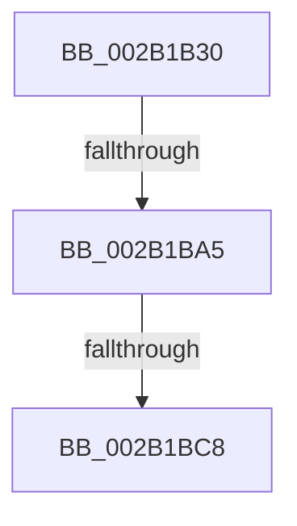

# MiCopyPage

- RVA: `0x002B1B30`–`0x002B1BCF` (길이 `159` bytes)
- VA: `0x00000001402B1B30`
- 실행 섹션: `.text`
- PDB 이름 있음: `예`; PDB Function 태그: `예`
- unwind 정보 RVA: `0x0006D66C`
- 디코드: `40`개 명령, `159/159` bytes 표시
- 미해석 바이트: `0` (있으면 어셈블리에 `.byte`로 보존)

> 이 문서는 커널 이미지의 기계어와 PDB 기호를 분석해 생성했습니다. 4번과 5번은 함수 원형과 자료형을 바이너리 사용 방식에서 추정한 C 해석이며 원본 소스 복구 결과는 아닙니다.

## 1. Dependencies

- 직접 호출 지점: **0**; 고유 호출 대상: **0**
- 직접 호출자로 확인된 함수: **15**
- RIP 상대 이미지 참조: **0**

### Outgoing calls
- 직접 디코드된 call 명령이 없습니다.

### Direct callers
- [MiMigratePfn](../28/MiMigratePfn_function_0028DBB0.md) at `0x0028DF5B`
- [MiSwapStackPageNoDpc](../2A/MiSwapStackPageNoDpc_function_002A0270.md) at `0x002A0365`
- [MiReplaceTransitionPage](MiReplaceTransitionPage_function_002B1120.md) at `0x002B12B5`
- [MiStealPage](MiStealPage_function_002B28D0.md) at `0x002B2E76`
- [MiCopyOnWrite](../36/MiCopyOnWrite_function_00362A0C.md) at `0x00362F00`
- [MiPrivateFixup](../36/MiPrivateFixup_function_003693E8.md) at `0x0036966B`
- [MiCopyFileOnlyGlobalSubsectionPage](../36/MiCopyFileOnlyGlobalSubsectionPage_function_0036A9EC.md) at `0x0036AD1C`
- [MiTradeActivePage](../37/MiTradeActivePage_function_00374424.md) at `0x00374587`
- [MiWaitForInPageComplete](../38/MiWaitForInPageComplete_function_00380AB8.md) at `0x00380FE0`
- [MiDuplicateCloneLeaf](../38/MiDuplicateCloneLeaf_function_003825F0.md) at `0x003826C3`
- [MiSwapNumaStandbyPage](../38/MiSwapNumaStandbyPage_function_00385144.md) at `0x0038546A`
- [MiCopyHeaderIfResident](../48/MiCopyHeaderIfResident_function_00482184.md) at `0x00482315`
- [MiSplitDirectMapPage](../4D/MiSplitDirectMapPage_function_004DAAA0.md) at `0x004DAC58`
- [MiIdealClusterPage](../4D/MiIdealClusterPage_function_004DB964.md) at `0x004DC111`
- [MiTradeBootImagePage](../../init/C6/MiTradeBootImagePage_function_00C6C554.md) at `0x00C6C753`
- [MiTradeBootImagePage](../../init/C6/MiTradeBootImagePage_function_00C6C554.md) at `0x00C6C77A`

### Static image references
- 디코드된 RIP-relative 메모리 참조가 없습니다.

## 2. Other-region calls and transfers

- 다른 실행 섹션으로 향하는 call: **0**
- call이 아닌 외부 분기/꼬리 이동: **2**
  - `0x002B1B9F` → [sub_002B1D26 + 0x10](Unknown_function_002B1D26.md) (`tail-transfer`)
  - `0x002B1BC2` → [sub_002B1D26](Unknown_function_002B1D26.md) (`tail-transfer`)

## 3. Assembly (complete function range)

```asm
002B1B30  48 89 54 24 10                  mov qword ptr [rsp + 0x10], rdx
002B1B35  48 89 4C 24 08                  mov qword ptr [rsp + 8], rcx
002B1B3A  53                              push rbx
002B1B3B  55                              push rbp
002B1B3C  57                              push rdi
002B1B3D  41 54                           push r12
002B1B3F  41 55                           push r13
002B1B41  41 56                           push r14
002B1B43  41 57                           push r15
002B1B45  48 81 EC A0 00 00 00            sub rsp, 0xa0
002B1B4C  48 8B C2                        mov rax, rdx
002B1B4F  0F 57 C0                        xorps xmm0, xmm0
002B1B52  33 D2                           xor edx, edx
002B1B54  45 8B F8                        mov r15d, r8d
002B1B57  48 89 94 24 80 00 00 00         mov qword ptr [rsp + 0x80], rdx
002B1B5F  33 DB                           xor ebx, ebx
002B1B61  48 89 54 24 50                  mov qword ptr [rsp + 0x50], rdx
002B1B66  48 8D 2C 40                     lea rbp, [rax + rax*2]
002B1B6A  48 BA 00 00 00 00 00 DE FF FF   movabs rdx, 0xffffde0000000000
002B1B74  48 C1 E5 04                     shl rbp, 4
002B1B78  0F 11 44 24 70                  movups xmmword ptr [rsp + 0x70], xmm0
002B1B7D  0F 11 44 24 60                  movups xmmword ptr [rsp + 0x60], xmm0
002B1B82  48 8B C2                        mov rax, rdx
002B1B85  4C 8D 2C 49                     lea r13, [rcx + rcx*2]
002B1B89  48 03 E8                        add rbp, rax
002B1B8C  49 C1 E5 04                     shl r13, 4
002B1B90  48 8B C2                        mov rax, rdx
002B1B93  4C 03 E8                        add r13, rax
002B1B96  BF 01 00 00 C0                  mov edi, 0xc0000001
002B1B9B  41 F6 C0 04                     test r8b, 4
002B1B9F  0F 84 91 01 00 00               je 0x1402b1d36
002B1BA5  C7 44 24 30 04 00 00 00         mov dword ptr [rsp + 0x30], 4
002B1BAD  41 0F BA EF 08                  bts r15d, 8
002B1BB2  B8 01 00 00 00                  mov eax, 1
002B1BB7  45 8B E7                        mov r12d, r15d
002B1BBA  44 8D 70 01                     lea r14d, [rax + 1]
002B1BBE  41 83 E4 04                     and r12d, 4
002B1BC2  0F 84 5E 01 00 00               je 0x1402b1d26
002B1BC8  8B D0                           mov edx, eax
002B1BCA  4C 8D 44 24 60                  lea r8, [rsp + 0x60]
```

## 4. C-style interpretation (structured pseudocode)

```c
__int64 __fastcall MiCopyPage(__int64 a1, __int64 a2, int a3)
{
    __int64 v_r12;
    __int64 v_r13;
    __int64 v_rbp;
    __int64 v_rbx;
    __int64 v_rsp;
    unsigned __int64 v_stack_m58;
    unsigned __int64 v_stack_m68;
    unsigned __int64 v_stack_m78;
    unsigned __int64 v_stack_m88;
    unsigned int v_stack_mA8;
    unsigned __int64 v_stack_p10;
    unsigned __int64 v_stack_p8;

    v_stack_p10 = a2;
    v_stack_p8 = a1;
    v_rsp = (v_rsp) - (160);
    a2 = 0;
    v_stack_m58 = 0;
    v_rbx = 0;
    v_stack_m88 = 0;
    v_rbp = (a2 + a2 * 2) << (4);
    v_stack_m68 = v_xmm0;
    v_stack_m78 = v_xmm0;
    v_rbp = (v_rbp) + (0);
    v_r13 = (a1 + a1 * 2) << (4);
    v_r13 = (v_r13) + (0);
    v_stack_mA8 = 4;
    v_r12 = (unsigned int)(((unsigned int)((unsigned int)((unsigned int)(a3)))) & (4));
    return 1;
}
```

## 5. (Beta) C Style

```c
int64_t MiCopyPage(void *Arg1, void *Arg2, int32_t Arg3)
{
    uint8_t *arg1 = (uint8_t *)Arg1;
    uint8_t *arg2 = (uint8_t *)Arg2;

    int64_t local_r12;
    int64_t local_r13;
    int64_t local_rbp;
    int64_t local_rbx;
    int64_t local_rsp;
    uint64_t v_stack_m58;
    uint64_t v_stack_m68;
    uint64_t v_stack_m78;
    uint64_t v_stack_m88;
    uint32_t v_stack_mA8;
    uint64_t v_stack_p10;
    uint64_t v_stack_p8;

    v_stack_p10 = Arg2;
    v_stack_p8 = Arg1;
    local_rsp = (local_rsp) - (160);
    Arg2 = 0;
    v_stack_m58 = 0;
    local_rbx = 0;
    v_stack_m88 = 0;
    local_rbp = (Arg2 + Arg2 * 2) << (4);
    v_stack_m68 = v_xmm0;
    v_stack_m78 = v_xmm0;
    local_rbp = (local_rbp) + (0);
    local_r13 = (Arg1 + Arg1 * 2) << (4);
    local_r13 = (local_r13) + (0);
    v_stack_mA8 = 4;
    local_r12 = (uint32_t)(((uint32_t)((uint32_t)((uint32_t)(Arg3)))) & (4));
    return 1;
}
```

### 관측된 메모리 오프셋

구조체 형식이 확인되지 않은 접근은 인자 기준의 오프셋으로만 기록했습니다.

| 기준 인자 | 오프셋 표현 | 폭 (bit) | 접근 |
|---|---:|---:|---|
| `Arg1` | `+ 0x0 + rcx*2` | `64` | `R` |
| `Arg2` | `+ 0x0 + rax*2` | `64` | `R` |

## 6. Execution-region graph

[열기: 2D/3D 그래프와 함수 탐색 컨트롤 패널](../../../control-panel.html?section=text&rva=0x002B1B30&view=graph)

- 2D 그래프는 위에서 아래로 흐르고, 3D 그래프는 빈 공간을 드래그해 회전합니다. Shift+드래그는 이동, 휠은 확대·축소, 함수 노드 선택은 대상 보고서 이동입니다.

### Static fallback


