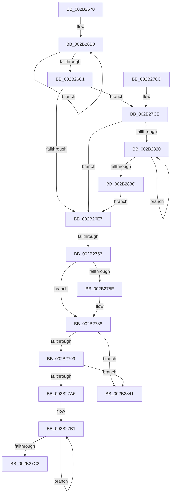

# MiCopyPfnEntryEx

- RVA: `0x002B2670`–`0x002B2847` (길이 `471` bytes)
- VA: `0x00000001402B2670`
- 실행 섹션: `.text`
- PDB 이름 있음: `예`; PDB Function 태그: `예`
- unwind 정보 RVA: `0x0006D750`
- 디코드: `129`개 명령, `471/471` bytes 표시
- 미해석 바이트: `0` (있으면 어셈블리에 `.byte`로 보존)

> 이 문서는 커널 이미지의 기계어와 PDB 기호를 분석해 생성했습니다. 4번과 5번은 함수 원형과 자료형을 바이너리 사용 방식에서 추정한 C 해석이며 원본 소스 복구 결과는 아닙니다.

## 1. Dependencies

- 직접 호출 지점: **1**; 고유 호출 대상: **1**
- 직접 호출자로 확인된 함수: **12**
- RIP 상대 이미지 참조: **0**

### Outgoing calls
- `0x002B278C` → [MiPfnIsPageTable](../4F/MiPfnIsPageTable_function_004F2D90.md) (function, `0x004F2D90`)

### Direct callers
- [MiReplacePageTablePage](../22/MiReplacePageTablePage_function_00229184.md) at `0x00229A07`
- [MiCombineInitialInstance](../22/MiCombineInitialInstance_function_0022BC0C.md) at `0x0022C15C`
- [MiMigratePfn](../28/MiMigratePfn_function_0028DBB0.md) at `0x0028DDFE`
- [MiSwapStackPageNoDpc](../2A/MiSwapStackPageNoDpc_function_002A0270.md) at `0x002A0354`
- [MiReplaceTransitionPage](MiReplaceTransitionPage_function_002B1120.md) at `0x002B1277`
- [MiStealPage](MiStealPage_function_002B28D0.md) at `0x002B2D79`
- [MiTradeActivePage](../37/MiTradeActivePage_function_00374424.md) at `0x00374574`
- [MiSwapNumaStandbyPage](../38/MiSwapNumaStandbyPage_function_00385144.md) at `0x00385349`
- [MiSwapHardFaultPage](../38/MiSwapHardFaultPage_function_00385F34.md) at `0x00385FCF`
- [MiSplitDirectMapPage](../4D/MiSplitDirectMapPage_function_004DAAA0.md) at `0x004DAC09`
- [MiSwitchKstackPages](../67/MiSwitchKstackPages_function_0067B464.md) at `0x0067B46D`
- [MiTradeBootImagePage](../../init/C6/MiTradeBootImagePage_function_00C6C554.md) at `0x00C6C60A`

### Static image references
- 디코드된 RIP-relative 메모리 참조가 없습니다.

## 2. Other-region calls and transfers

- 다른 실행 섹션으로 향하는 call: **0**
- call이 아닌 외부 분기/꼬리 이동: **1**
  - `0x002B274D` → [sub_006DB710](../6D/Unknown_function_006DB710.md) (`tail-transfer`)

## 3. Assembly (complete function range)

```asm
002B2670  44 89 44 24 18                  mov dword ptr [rsp + 0x18], r8d
002B2675  55                              push rbp
002B2676  56                              push rsi
002B2677  57                              push rdi
002B2678  48 8D 6C 24 B9                  lea rbp, [rsp - 0x47]
002B267D  48 81 EC B0 00 00 00            sub rsp, 0xb0
002B2684  0F 57 C0                        xorps xmm0, xmm0
002B2687  48 8B F1                        mov rsi, rcx
002B268A  48 8D 4D B7                     lea rcx, [rbp - 0x49]
002B268E  BF 06 00 00 00                  mov edi, 6
002B2693  48 2B CA                        sub rcx, rdx
002B2696  4C 8B D2                        mov r10, rdx
002B2699  0F 11 45 B7                     movups xmmword ptr [rbp - 0x49], xmm0
002B269D  4C 8B C2                        mov r8, rdx
002B26A0  44 8B CF                        mov r9d, edi
002B26A3  0F 11 45 C7                     movups xmmword ptr [rbp - 0x39], xmm0
002B26A7  0F 11 45 D7                     movups xmmword ptr [rbp - 0x29], xmm0
002B26AB  0F 1F 44 00 00                  nop dword ptr [rax + rax]
002B26B0  49 8B 00                        mov rax, qword ptr [r8]
002B26B3  4A 89 04 01                     mov qword ptr [rcx + r8], rax
002B26B7  4D 8D 40 08                     lea r8, [r8 + 8]
002B26BB  49 83 E9 01                     sub r9, 1
002B26BF  75 EF                           jne 0x1402b26b0
002B26C1  8B 4E 20                        mov ecx, dword ptr [rsi + 0x20]
002B26C4  0F B6 45 DA                     movzx eax, byte ptr [rbp - 0x26]
002B26C8  24 3F                           and al, 0x3f
002B26CA  C1 E9 18                        shr ecx, 0x18
002B26CD  80 E1 40                        and cl, 0x40
002B26D0  0A C8                           or cl, al
002B26D2  48 8B 45 DF                     mov rax, qword ptr [rbp - 0x21]
002B26D6  48 C1 E8 3C                     shr rax, 0x3c
002B26DA  24 07                           and al, 7
002B26DC  88 4D DA                        mov byte ptr [rbp - 0x26], cl
002B26DF  3C 03                           cmp al, 3
002B26E1  0F 84 E7 00 00 00               je 0x1402b27ce
002B26E7  8B 4E 20                        mov ecx, dword ptr [rsi + 0x20]
002B26EA  8B 45 D7                        mov eax, dword ptr [rbp - 0x29]
002B26ED  89 45 77                        mov dword ptr [rbp + 0x77], eax
002B26F0  C1 E8 10                        shr eax, 0x10
002B26F3  C1 E9 10                        shr ecx, 0x10
002B26F6  32 C1                           xor al, cl
002B26F8  24 3F                           and al, 0x3f
002B26FA  32 C1                           xor al, cl
002B26FC  88 45 79                        mov byte ptr [rbp + 0x79], al
002B26FF  8B 45 77                        mov eax, dword ptr [rbp + 0x77]
002B2702  89 45 D7                        mov dword ptr [rbp - 0x29], eax
002B2705  48 8B 46 28                     mov rax, qword ptr [rsi + 0x28]
002B2709  48 8B 4D DF                     mov rcx, qword ptr [rbp - 0x21]
002B270D  48 C1 E8 2B                     shr rax, 0x2b
002B2711  0F B7 D0                        movzx edx, ax
002B2714  48 C1 E2 2B                     shl rdx, 0x2b
002B2718  48 8B C2                        mov rax, rdx
002B271B  48 33 C1                        xor rax, rcx
002B271E  48 B9 FF FF FF FF FF 07 E0 FF   movabs rcx, 0xffe007ffffffffff
002B2728  48 23 C1                        and rax, rcx
002B272B  48 33 C2                        xor rax, rdx
002B272E  BA FF 03 00 00                  mov edx, 0x3ff
002B2733  48 89 45 DF                     mov qword ptr [rbp - 0x21], rax
002B2737  48 8B 46 28                     mov rax, qword ptr [rsi + 0x28]
002B273B  49 8B 4A 28                     mov rcx, qword ptr [r10 + 0x28]
002B273F  48 C1 E9 2B                     shr rcx, 0x2b
002B2743  48 C1 E8 2B                     shr rax, 0x2b
002B2747  66 33 C8                        xor cx, ax
002B274A  66 85 CA                        test dx, cx
002B274D  0F 85 BD 8F 42 00               jne 0x1406db710
002B2753  0F B6 45 D9                     movzx eax, byte ptr [rbp - 0x27]
002B2757  24 07                           and al, 7
002B2759  40 3A C7                        cmp al, dil
002B275C  74 2A                           je 0x1402b2788
002B275E  48 8B 4E 18                     mov rcx, qword ptr [rsi + 0x18]
002B2762  48 8B 45 CF                     mov rax, qword ptr [rbp - 0x31]
002B2766  48 C1 E9 3B                     shr rcx, 0x3b
002B276A  48 C1 E1 3B                     shl rcx, 0x3b
002B276E  48 8B D1                        mov rdx, rcx
002B2771  48 33 D0                        xor rdx, rax
002B2774  48 B8 FF FF FF FF FF FF FF C7   movabs rax, 0xc7ffffffffffffff
002B277E  48 23 D0                        and rdx, rax
002B2781  48 33 D1                        xor rdx, rcx
002B2784  48 89 55 CF                     mov qword ptr [rbp - 0x31], rdx
002B2788  48 8D 4D B7                     lea rcx, [rbp - 0x49]
002B278C  E8 FF 05 24 00                  call 0x1404f2d90
002B2791  85 C0                           test eax, eax
002B2793  0F 84 A8 00 00 00               je 0x1402b2841
002B2799  8B 45 DB                        mov eax, dword ptr [rbp - 0x25]
002B279C  0F BA E0 1A                     bt eax, 0x1a
002B27A0  0F 83 9B 00 00 00               jae 0x1402b2841
002B27A6  48 8D 4D B7                     lea rcx, [rbp - 0x49]
002B27AA  48 2B F1                        sub rsi, rcx
002B27AD  48 8D 45 B7                     lea rax, [rbp - 0x49]
002B27B1  48 8B 08                        mov rcx, qword ptr [rax]
002B27B4  48 89 0C 06                     mov qword ptr [rsi + rax], rcx
002B27B8  48 8D 40 08                     lea rax, [rax + 8]
002B27BC  48 83 EF 01                     sub rdi, 1
002B27C0  75 EF                           jne 0x1402b27b1
002B27C2  48 81 C4 B0 00 00 00            add rsp, 0xb0
002B27C9  5F                              pop rdi
002B27CA  5E                              pop rsi
002B27CB  5D                              pop rbp
002B27CC  C3                              ret
002B27CD  CC                              int3
002B27CE  48 8B 55 DF                     mov rdx, qword ptr [rbp - 0x21]
002B27D2  0F 57 C0                        xorps xmm0, xmm0
002B27D5  48 8B CA                        mov rcx, rdx
002B27D8  48 C7 45 E7 00 00 00 00         mov qword ptr [rbp - 0x19], 0
002B27E0  0F 57 C9                        xorps xmm1, xmm1
002B27E3  48 89 55 0F                     mov qword ptr [rbp + 0xf], rdx
002B27E7  49 B8 FF FF FF FF FF FF FF 8F   movabs r8, 0x8fffffffffffffff
002B27F1  48 8B C2                        mov rax, rdx
002B27F4  49 23 C8                        and rcx, r8
002B27F7  F3 0F 7F 45 EF                  movdqu xmmword ptr [rbp - 0x11], xmm0
002B27FC  F3 0F 7F 4D FF                  movdqu xmmword ptr [rbp - 1], xmm1
002B2801  0F 11 45 17                     movups xmmword ptr [rbp + 0x17], xmm0
002B2805  0F 11 45 27                     movups xmmword ptr [rbp + 0x27], xmm0
002B2809  0F 11 45 37                     movups xmmword ptr [rbp + 0x37], xmm0
002B280D  F0 48 0F B1 4D DF               lock cmpxchg qword ptr [rbp - 0x21], rcx
002B2813  48 89 45 3F                     mov qword ptr [rbp + 0x3f], rax
002B2817  48 3B D0                        cmp rdx, rax
002B281A  0F 84 C7 FE FF FF               je 0x1402b26e7
002B2820  48 8B C8                        mov rcx, rax
002B2823  48 89 45 0F                     mov qword ptr [rbp + 0xf], rax
002B2827  49 23 C8                        and rcx, r8
002B282A  48 8B D0                        mov rdx, rax
002B282D  F0 48 0F B1 4D DF               lock cmpxchg qword ptr [rbp - 0x21], rcx
002B2833  48 89 45 3F                     mov qword ptr [rbp + 0x3f], rax
002B2837  48 3B D0                        cmp rdx, rax
002B283A  75 E4                           jne 0x1402b2820
002B283C  E9 A6 FE FF FF                  jmp 0x1402b26e7
002B2841  0F B6 46 22                     movzx eax, byte ptr [rsi + 0x22]
002B2845  24 07                           and al, 7
```

## 4. C-style interpretation (structured pseudocode)

```c
__int64 __fastcall MiCopyPfnEntryEx(__int64 a1, __int64 a2, int a3)
{
    __int64 result;
    __int64 v_rdi;
    __int64 v_rsi;
    __int64 v_rsp;
    unsigned __int64 v_stack_m20;
    unsigned __int64 v_stack_m28;
    unsigned __int64 v_stack_m38;
    unsigned __int64 v_stack_m48;
    unsigned __int64 v_stack_m50;
    unsigned __int64 v_stack_m5F;
    unsigned __int64 v_stack_m60;
    unsigned __int64 v_stack_m70;
    unsigned __int64 v_stack_m78;
    unsigned __int64 v_stack_m80;
    unsigned int v_stack_m84;
    unsigned __int8 v_stack_m85;
    unsigned __int8 v_stack_m86;
    unsigned __int64 v_stack_m88;
    unsigned __int64 v_stack_m90;
    unsigned __int64 v_stack_m98;
    unsigned __int64 v_stack_mA8;
    unsigned int v_stack_p18;
    unsigned __int8 v_stack_p1A;

    v_stack_p18 = a3;
    v_rsp = (v_rsp) - (176);
    a1 = (v_stack_mA8) - (a2);
    v_stack_mA8 = v_xmm0;
    v_stack_m98 = v_xmm0;
    v_stack_m88 = v_xmm0;
loc_002B26B0:
    *(unsigned __int64 *)(a1 + a2 * 1) = *(unsigned __int64 *)(a2);
    a4 = (6) - (1);
    if (condition_is_not_equal) goto loc_002B26B0;
    result = (unsigned __int8)((v_stack_m85) & (63));
    a1 = (unsigned int)(((unsigned int)(*(unsigned int *)(a1 + 32))) >> (24));
    a1 = (unsigned __int8)((a1) & (64));
    a1 = (unsigned __int8)((a1) | ((unsigned __int8)(result)));
    result = (v_stack_m80) >> (60);
    result = (unsigned __int8)((result) & (7));
    v_stack_m85 = (unsigned __int8)(a1);
    if (((unsigned __int8)(result)) == 3) goto loc_002B27CE;
loc_002B26E7:
    v_stack_p18 = (unsigned int)((unsigned int)(v_stack_m88));
    result = (unsigned int)(((unsigned int)(v_stack_m88)) >> (16));
    a1 = (unsigned int)(((unsigned int)(*(unsigned int *)(a1 + 32))) >> (16));
    result = (unsigned __int8)((result) ^ ((unsigned __int8)(a1)));
    result = (unsigned __int8)((result) & (63));
    result = (unsigned __int8)((result) ^ ((unsigned __int8)(a1)));
    v_stack_p1A = (unsigned __int8)(result);
    v_stack_m88 = (unsigned int)((unsigned int)(v_stack_p18));
    result = (*(unsigned __int64 *)(a1 + 40)) >> (43);
    a2 = ((unsigned __int16)(result)) << (43);
    result = (a2) ^ (v_stack_m80);
    result = (result) & (v_stack_m80);
    result = (result) ^ (a2);
    v_stack_m80 = result;
    a1 = (*(unsigned __int64 *)(a2 + 40)) >> (43);
    result = (*(unsigned __int64 *)(a1 + 40)) >> (43);
    a1 = (unsigned __int16)((a1) ^ ((unsigned __int16)(result)));
    result = (unsigned __int8)((v_stack_m86) & (7));
    if (((unsigned __int8)(result)) != 6) {
        a1 = *(unsigned __int64 *)(a1 + 24);
        result = v_stack_m90;
        a1 = (a1) >> (59);
        a1 = (a1) << (59);
        a2 = a1;
        a2 = (a2) ^ (result);
        a2 = (a2) & (result);
        a2 = (a2) ^ (a1);
        v_stack_m90 = a2;
    }
    result = MiPfnIsPageTable(v_stack_mA8, a2, a2 + 8, a4);
    if ((unsigned int)(result) == 0) goto loc_002B2841;
    if (condition_is_above_or_equal) goto loc_002B2841;
    v_rsi = (a1) - (v_stack_mA8);
loc_002B27B1:
    *(unsigned __int64 *)(v_rsi + v_stack_mA8 * 1) = *(unsigned __int64 *)(v_stack_mA8);
    v_rdi = (6) - (1);
    if (condition_is_not_equal) goto loc_002B27B1;
    v_rsp = (v_rsp) + (176);
    return v_stack_mA8 + 8;
loc_002B27CE:
    v_stack_m78 = 0;
    v_stack_m50 = v_stack_m80;
    a1 = (v_stack_m80) & (a2 + 8);
    v_stack_m70 = v_xmm0;
    v_stack_m60 = v_xmm1;
    v_stack_m48 = v_xmm0;
    v_stack_m38 = v_xmm0;
    v_stack_m28 = v_xmm0;
    v_stack_m20 = v_stack_m80;
    if (v_stack_m80 == v_stack_m80) goto loc_002B26E7;
loc_002B2820:
    v_stack_m50 = v_stack_m80;
    a1 = (v_stack_m80) & (a2 + 8);
    v_stack_m20 = v_stack_m80;
    if (v_stack_m80 != v_stack_m80) goto loc_002B2820;
    goto loc_002B26E7;
loc_002B2841:
    result = (unsigned __int8)((*(unsigned __int8 *)(v_rsi + 34)) & (7));
    return result;
}
```

## 5. (Beta) C Style

```c
int64_t MiCopyPfnEntryEx(void *Arg1, void *Arg2, int32_t Arg3)
{
    uint8_t *arg1 = (uint8_t *)Arg1;
    uint8_t *arg2 = (uint8_t *)Arg2;

    int64_t result;
    int64_t local_rdi;
    int64_t local_rsi;
    int64_t local_rsp;
    uint64_t v_stack_m20;
    uint64_t v_stack_m28;
    uint64_t v_stack_m38;
    uint64_t v_stack_m48;
    uint64_t v_stack_m50;
    uint64_t v_stack_m5F;
    uint64_t v_stack_m60;
    uint64_t v_stack_m70;
    uint64_t v_stack_m78;
    uint64_t v_stack_m80;
    uint32_t v_stack_m84;
    uint8_t v_stack_m85;
    uint8_t v_stack_m86;
    uint64_t v_stack_m88;
    uint64_t v_stack_m90;
    uint64_t v_stack_m98;
    uint64_t v_stack_mA8;
    uint32_t v_stack_p18;
    uint8_t v_stack_p1A;

    v_stack_p18 = Arg3;
    local_rsp = (local_rsp) - (176);
    Arg1 = (v_stack_mA8) - (Arg2);
    v_stack_mA8 = v_xmm0;
    v_stack_m98 = v_xmm0;
    v_stack_m88 = v_xmm0;
loc_002B26B0:
    *(uint64_t *)(arg1 + arg2 * 1) = *(uint64_t *)(arg2);
    a4 = (6) - (1);
    if (condition_is_not_equal) goto loc_002B26B0;
    result = (uint8_t)((v_stack_m85) & (63));
    Arg1 = (uint32_t)(((uint32_t)(*(uint32_t *)(arg1 + 0x20))) >> (24));
    Arg1 = (uint8_t)((Arg1) & (64));
    Arg1 = (uint8_t)((Arg1) | ((uint8_t)(result)));
    result = (v_stack_m80) >> (60);
    result = (uint8_t)((result) & (7));
    v_stack_m85 = (uint8_t)(Arg1);
    if (((uint8_t)(result)) == 3) goto loc_002B27CE;
loc_002B26E7:
    v_stack_p18 = (uint32_t)((uint32_t)(v_stack_m88));
    result = (uint32_t)(((uint32_t)(v_stack_m88)) >> (16));
    Arg1 = (uint32_t)(((uint32_t)(*(uint32_t *)(arg1 + 0x20))) >> (16));
    result = (uint8_t)((result) ^ ((uint8_t)(Arg1)));
    result = (uint8_t)((result) & (63));
    result = (uint8_t)((result) ^ ((uint8_t)(Arg1)));
    v_stack_p1A = (uint8_t)(result);
    v_stack_m88 = (uint32_t)((uint32_t)(v_stack_p18));
    result = (*(uint64_t *)(arg1 + 0x28)) >> (43);
    Arg2 = ((uint16_t)(result)) << (43);
    result = (Arg2) ^ (v_stack_m80);
    result = (result) & (v_stack_m80);
    result = (result) ^ (Arg2);
    v_stack_m80 = result;
    Arg1 = (*(uint64_t *)(arg2 + 0x28)) >> (43);
    result = (*(uint64_t *)(arg1 + 0x28)) >> (43);
    Arg1 = (uint16_t)((Arg1) ^ ((uint16_t)(result)));
    result = (uint8_t)((v_stack_m86) & (7));
    if (((uint8_t)(result)) != 6) {
        Arg1 = *(uint64_t *)(arg1 + 0x18);
        result = v_stack_m90;
        Arg1 = (Arg1) >> (59);
        Arg1 = (Arg1) << (59);
        Arg2 = Arg1;
        Arg2 = (Arg2) ^ (result);
        Arg2 = (Arg2) & (result);
        Arg2 = (Arg2) ^ (Arg1);
        v_stack_m90 = Arg2;
    }
    result = MiPfnIsPageTable(v_stack_mA8, Arg2, Arg2 + 8, a4);
    if ((uint32_t)(result) == 0) goto loc_002B2841;
    if (condition_is_above_or_equal) goto loc_002B2841;
    local_rsi = (Arg1) - (v_stack_mA8);
loc_002B27B1:
    *(uint64_t *)(local_rsi + v_stack_mA8 * 1) = *(uint64_t *)(v_stack_mA8);
    local_rdi = (6) - (1);
    if (condition_is_not_equal) goto loc_002B27B1;
    local_rsp = (local_rsp) + (176);
    return v_stack_mA8 + 8;
loc_002B27CE:
    v_stack_m78 = 0;
    v_stack_m50 = v_stack_m80;
    Arg1 = (v_stack_m80) & (Arg2 + 8);
    v_stack_m70 = v_xmm0;
    v_stack_m60 = v_xmm1;
    v_stack_m48 = v_xmm0;
    v_stack_m38 = v_xmm0;
    v_stack_m28 = v_xmm0;
    v_stack_m20 = v_stack_m80;
    if (v_stack_m80 == v_stack_m80) goto loc_002B26E7;
loc_002B2820:
    v_stack_m50 = v_stack_m80;
    Arg1 = (v_stack_m80) & (Arg2 + 8);
    v_stack_m20 = v_stack_m80;
    if (v_stack_m80 != v_stack_m80) goto loc_002B2820;
    goto loc_002B26E7;
loc_002B2841:
    result = (uint8_t)((*(uint8_t *)(local_rsi + 0x22)) & (7));
    return result;
}
```

### 관측된 메모리 오프셋

구조체 형식이 확인되지 않은 접근은 인자 기준의 오프셋으로만 기록했습니다.

| 기준 인자 | 오프셋 표현 | 폭 (bit) | 접근 |
|---|---:|---:|---|
| `Arg1` | `+ 0x0 + rax*1` | `64` | `W` |
| `Arg1` | `+ 0x18` | `64` | `R` |
| `Arg1` | `+ 0x20` | `32` | `R` |
| `Arg1` | `+ 0x22` | `8` | `R` |
| `Arg1` | `+ 0x28` | `64` | `R` |
| `Arg2` | `+ 0x0` | `64` | `R` |
| `Arg2` | `+ 0x8` | `64` | `R` |
| `Arg2` | `+ 0x28` | `64` | `R` |

## 6. Execution-region graph

[열기: 2D/3D 그래프와 함수 탐색 컨트롤 패널](../../../control-panel.html?section=text&rva=0x002B2670&view=graph)

- 2D 그래프는 위에서 아래로 흐르고, 3D 그래프는 빈 공간을 드래그해 회전합니다. Shift+드래그는 이동, 휠은 확대·축소, 함수 노드 선택은 대상 보고서 이동입니다.

### Static fallback


