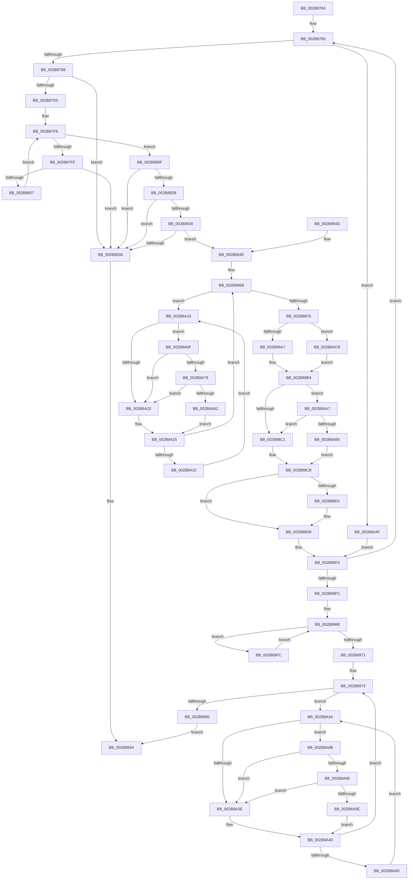

# MiCreateDecayPfn

- RVA: `0x002B8764`–`0x002B8AD4` (길이 `880` bytes)
- VA: `0x00000001402B8764`
- 실행 섹션: `.text`
- PDB 이름 있음: `예`; PDB Function 태그: `아니요`
- unwind 정보 RVA: `0x0006DBBC`
- 디코드: `223`개 명령, `880/880` bytes 표시
- 미해석 바이트: `0` (있으면 어셈블리에 `.byte`로 보존)

> 이 문서는 커널 이미지의 기계어와 PDB 기호를 분석해 생성했습니다. 4번과 5번은 함수 원형과 자료형을 바이너리 사용 방식에서 추정한 C 해석이며 원본 소스 복구 결과는 아닙니다.

## 1. Dependencies

- 직접 호출 지점: **10**; 고유 호출 대상: **8**
- 직접 호출자로 확인된 함수: **3**
- RIP 상대 이미지 참조: **11**

### Outgoing calls
- `0x002B8787` → [ExpInterlockedPopEntrySList](../6B/ExpInterlockedPopEntrySList_function_006BA570.md) (function, `0x006BA570`)
- `0x002B887F` → [ExAcquireSpinLockExclusiveAtDpcLevel](../24/ExAcquireSpinLockExclusiveAtDpcLevel_function_00248E80.md) (function, `0x00248E80`)
- `0x002B88D4` → [MiPrepareDecayNodeForReuse](MiPrepareDecayNodeForReuse_function_002B8ADC.md) (function, `0x002B8ADC`)
- `0x002B8939` → [MiSwizzleInvalidPte](../28/MiSwizzleInvalidPte_function_0028F5E0.md) (function, `0x0028F5E0`)
- `0x002B89E0` → [MiInsertPageInList](MiInsertPageInList_function_002BA000.md) (function, `0x002BA000`)
- `0x002B8A79` → [KiCheckVpBackingLongSpinWaitHypercall](../30/KiCheckVpBackingLongSpinWaitHypercall_function_0030F490.md) (function, `0x0030F490`)
- `0x002B8A84` → [HvlNotifyLongSpinWait](../30/HvlNotifyLongSpinWait_function_0030F460.md) (function, `0x0030F460`)
- `0x002B8A95` → [KiCheckVpBackingLongSpinWaitHypercall](../30/KiCheckVpBackingLongSpinWaitHypercall_function_0030F490.md) (function, `0x0030F490`)
- `0x002B8AA0` → [HvlNotifyLongSpinWait](../30/HvlNotifyLongSpinWait_function_0030F460.md) (function, `0x0030F460`)
- `0x002B8AC1` → [ExpReleaseSpinLockExclusiveFromDpcLevelInstrumented](../2C/ExpReleaseSpinLockExclusiveFromDpcLevelInstrumented_function_002C0F44.md) (function, `0x002C0F44`)

### Direct callers
- [MiFinishHardFault](MiFinishHardFault_function_002B6F10.md) at `0x002B7401`
- [MiWalkEntireImage](../36/MiWalkEntireImage_function_00365D70.md) at `0x003666FD`
- [MiDecommitSharedPageTail](../37/MiDecommitSharedPageTail_function_00370240.md) at `0x003706B5`

### Static image references
- `0x002B8780` → RVA `0x00E35C10` (`.data`; read)
- `0x002B8798` → RVA `0x00E35C28` (`.data`; read)
- `0x002B879F` → RVA `0x00E35C30` (`.data`; read)
- `0x002B884E` → RVA `0x00E35C00` (`.data`; read)
- `0x002B8878` → RVA `0x00E35C20` (`.data`; read)
- `0x002B88B4` → RVA `0x00FC6B06` (`ALMOSTRO`; read)
- `0x002B88C1` → RVA `0x00E35C20` (`.data`; write)
- `0x002B890C` → RVA `0x00E30088` (`.data`; read)
- `0x002B8A1B` → RVA `0x00FC52AC` (`ALMOSTRO`; reference)
- `0x002B8A6F` → RVA `0x00FC6AB8` (`ALMOSTRO`; read)
- `0x002B8AA7` → RVA `0x00F0DE58` (`.data`; read)

## 2. Other-region calls and transfers

- 다른 실행 섹션으로 향하는 call: **0**
- 별도 외부 분기/꼬리 이동을 확인하지 못했습니다.

## 3. Assembly (complete function range)

```asm
002B8764  48 89 5C 24 10                  mov qword ptr [rsp + 0x10], rbx
002B8769  48 89 6C 24 18                  mov qword ptr [rsp + 0x18], rbp
002B876E  56                              push rsi
002B876F  57                              push rdi
002B8770  41 56                           push r14
002B8772  48 83 EC 20                     sub rsp, 0x20
002B8776  48 BD 00 00 00 00 00 DE FF FF   movabs rbp, 0xffffde0000000000
002B8780  48 8D 0D 89 D4 B7 00            lea rcx, [rip + 0xb7d489]
002B8787  E8 E4 1D 40 00                  call 0x1406ba570
002B878C  48 8B D8                        mov rbx, rax
002B878F  48 85 C0                        test rax, rax
002B8792  0F 85 B7 02 00 00               jne 0x1402b8a4f
002B8798  44 8B 05 89 D4 B7 00            mov r8d, dword ptr [rip + 0xb7d489]
002B879F  4C 8B 0D 8A D4 B7 00            mov r9, qword ptr [rip + 0xb7d48a]
002B87A6  49 8B C9                        mov rcx, r9
002B87A9  83 E1 04                        and ecx, 4
002B87AC  8B C1                           mov eax, ecx
002B87AE  45 8D 58 FF                     lea r11d, [r8 - 1]
002B87B2  48 F7 D8                        neg rax
002B87B5  45 1B D2                        sbb r10d, r10d
002B87B8  41 83 E2 20                     and r10d, 0x20
002B87BC  48 F7 D9                        neg rcx
002B87BF  48 1B C0                        sbb rax, rax
002B87C2  21 5C 24 40                     and dword ptr [rsp + 0x40], ebx
002B87C6  83 E0 04                        and eax, 4
002B87C9  45 03 DA                        add r11d, r10d
002B87CC  4C 2B C8                        sub r9, rax
002B87CF  41 83 F8 01                     cmp r8d, 1
002B87D3  72 63                           jb 0x1402b8838
002B87D5  41 8B C3                        mov eax, r11d
002B87D8  8D 53 01                        lea edx, [rbx + 1]
002B87DB  48 C1 E8 06                     shr rax, 6
002B87DF  41 8B CA                        mov ecx, r10d
002B87E2  48 D3 E2                        shl rdx, cl
002B87E5  49 8B F9                        mov rdi, r9
002B87E8  48 FF CA                        dec rdx
002B87EB  4D 8D 04 C1                     lea r8, [r9 + rax*8]
002B87EF  49 8B 01                        mov rax, qword ptr [r9]
002B87F2  48 F7 D0                        not rax
002B87F5  48 0B D0                        or rdx, rax
002B87F8  48 83 FA FF                     cmp rdx, -1
002B87FC  75 11                           jne 0x1402b880f
002B87FE  48 83 C7 08                     add rdi, 8
002B8802  49 3B F8                        cmp rdi, r8
002B8805  77 31                           ja 0x1402b8838
002B8807  48 8B 17                        mov rdx, qword ptr [rdi]
002B880A  48 F7 D2                        not rdx
002B880D  EB E9                           jmp 0x1402b87f8
002B880F  49 2B F9                        sub rdi, r9
002B8812  48 F7 D2                        not rdx
002B8815  48 0F BC C2                     bsf rax, rdx
002B8819  48 C1 FF 03                     sar rdi, 3
002B881D  C1 E7 06                        shl edi, 6
002B8820  03 F8                           add edi, eax
002B8822  89 44 24 40                     mov dword ptr [rsp + 0x40], eax
002B8826  41 3B FB                        cmp edi, r11d
002B8829  77 0D                           ja 0x1402b8838
002B882B  83 FF FF                        cmp edi, -1
002B882E  74 08                           je 0x1402b8838
002B8830  41 2B FA                        sub edi, r10d
002B8833  83 FF FF                        cmp edi, -1
002B8836  75 16                           jne 0x1402b884e
002B8838  33 C0                           xor eax, eax
002B883A  48 8B 5C 24 48                  mov rbx, qword ptr [rsp + 0x48]
002B883F  48 8B 6C 24 50                  mov rbp, qword ptr [rsp + 0x50]
002B8844  48 83 C4 20                     add rsp, 0x20
002B8848  41 5E                           pop r14
002B884A  5F                              pop rdi
002B884B  5E                              pop rsi
002B884C  C3                              ret
002B884D  CC                              int3
002B884E  48 8B 35 AB D3 B7 00            mov rsi, qword ptr [rip + 0xb7d3ab]
002B8855  44 8B F7                        mov r14d, edi
002B8858  49 03 F6                        add rsi, r14
002B885B  48 8D 1C 76                     lea rbx, [rsi + rsi*2]
002B885F  48 C1 E3 04                     shl rbx, 4
002B8863  48 8B C5                        mov rax, rbp
002B8866  48 03 D8                        add rbx, rax
002B8869  33 ED                           xor ebp, ebp
002B886B  F0 48 0F BA 6B 18 3F            lock bts qword ptr [rbx + 0x18], 0x3f
002B8872  0F 82 A1 01 00 00               jb 0x1402b8a19
002B8878  48 8D 0D A1 D3 B7 00            lea rcx, [rip + 0xb7d3a1]
002B887F  E8 FC 05 F9 FF                  call 0x140248e80
002B8884  48 8B 15 A5 D3 B7 00            mov rdx, qword ptr [rip + 0xb7d3a5]
002B888B  40 8A CF                        mov cl, dil
002B888E  49 C1 EE 03                     shr r14, 3
002B8892  80 E1 07                        and cl, 7
002B8895  45 0F BE 04 16                  movsx r8d, byte ptr [r14 + rdx]
002B889A  41 8A C0                        mov al, r8b
002B889D  D2 F8                           sar al, cl
002B889F  A8 01                           test al, 1
002B88A1  0F 84 24 02 00 00               je 0x1402b8acb
002B88A7  41 8B C0                        mov eax, r8d
002B88AA  83 E7 07                        and edi, 7
002B88AD  0F B3 F8                        btr eax, edi
002B88B0  41 88 04 16                     mov byte ptr [r14 + rdx], al
002B88B4  F6 05 4B E2 D0 00 01            test byte ptr [rip + 0xd0e24b], 1
002B88BB  0F 85 E6 01 00 00               jne 0x1402b8aa7
002B88C1  C7 05 55 D3 B7 00 00 00 00 00   mov dword ptr [rip + 0xb7d355], 0
002B88CB  48 83 FE FF                     cmp rsi, -1
002B88CF  74 08                           je 0x1402b88d9
002B88D1  48 8B CE                        mov rcx, rsi
002B88D4  E8 03 02 00 00                  call 0x1402b8adc
002B88D9  48 B8 FF FF FF FF FF FF FF 7F   movabs rax, 0x7fffffffffffffff
002B88E3  F0 48 21 43 18                  lock and qword ptr [rbx + 0x18], rax
002B88E8  48 BD 00 00 00 00 00 DE FF FF   movabs rbp, 0xffffde0000000000
002B88F2  48 83 FE FF                     cmp rsi, -1
002B88F6  0F 84 84 FE FF FF               je 0x1402b8780
002B88FC  65 48 8B 04 25 88 01 00 00      mov rax, qword ptr gs:[0x188]
002B8905  48 8B 88 B8 00 00 00            mov rcx, qword ptr [rax + 0xb8]
002B890C  48 8B 05 75 77 B7 00            mov rax, qword ptr [rip + 0xb77775]
002B8913  0F B7 91 AE 04 00 00            movzx edx, word ptr [rcx + 0x4ae]
002B891A  48 8B CE                        mov rcx, rsi
002B891D  4C 8B 34 D0                     mov r14, qword ptr [rax + rdx*8]
002B8921  48 B8 FF FF FF FF FF 00 00 00   movabs rax, 0xffffffffff
002B892B  48 23 C8                        and rcx, rax
002B892E  48 C1 E1 0C                     shl rcx, 0xc
002B8932  48 81 C9 80 08 00 00            or rcx, 0x880
002B8939  E8 A2 6C FD FF                  call 0x14028f5e0
002B893E  48 89 43 10                     mov qword ptr [rbx + 0x10], rax
002B8942  49 B9 00 00 00 00 00 FF FF FF   movabs r9, 0xffffff0000000000
002B894C  48 8B 53 28                     mov rdx, qword ptr [rbx + 0x28]
002B8950  48 8B CA                        mov rcx, rdx
002B8953  48 8B C2                        mov rax, rdx
002B8956  48 33 CE                        xor rcx, rsi
002B8959  49 23 C9                        and rcx, r9
002B895C  48 33 CE                        xor rcx, rsi
002B895F  F0 48 0F B1 4B 28               lock cmpxchg qword ptr [rbx + 0x28], rcx
002B8965  48 3B D0                        cmp rdx, rax
002B8968  4C 8B C0                        mov r8, rax
002B896B  0F 85 8B 00 00 00               jne 0x1402b89fc
002B8971  33 FF                           xor edi, edi
002B8973  F0 48 0F BA 6B 18 3F            lock bts qword ptr [rbx + 0x18], 0x3f
002B897A  0F 82 B4 00 00 00               jb 0x1402b8a34
002B8980  8B 43 20                        mov eax, dword ptr [rbx + 0x20]
002B8983  BA 04 00 00 00                  mov edx, 4
002B8988  89 44 24 40                     mov dword ptr [rsp + 0x40], eax
002B898C  C1 E8 18                        shr eax, 0x18
002B898F  0C 08                           or al, 8
002B8991  88 44 24 43                     mov byte ptr [rsp + 0x43], al
002B8995  8B 44 24 40                     mov eax, dword ptr [rsp + 0x40]
002B8999  89 43 20                        mov dword ptr [rbx + 0x20], eax
002B899C  48 8B 43 28                     mov rax, qword ptr [rbx + 0x28]
002B89A0  45 0F B7 06                     movzx r8d, word ptr [r14]
002B89A4  49 C1 E0 2B                     shl r8, 0x2b
002B89A8  49 8B C8                        mov rcx, r8
002B89AB  48 33 C8                        xor rcx, rax
002B89AE  48 B8 FF FF FF FF FF 07 E0 FF   movabs rax, 0xffe007ffffffffff
002B89B8  48 23 C8                        and rcx, rax
002B89BB  49 33 C8                        xor rcx, r8
002B89BE  48 89 4B 28                     mov qword ptr [rbx + 0x28], rcx
002B89C2  8B 4B 20                        mov ecx, dword ptr [rbx + 0x20]
002B89C5  89 4C 24 40                     mov dword ptr [rsp + 0x40], ecx
002B89C9  C1 E9 18                        shr ecx, 0x18
002B89CC  80 E1 FD                        and cl, 0xfd
002B89CF  80 C9 05                        or cl, 5
002B89D2  88 4C 24 43                     mov byte ptr [rsp + 0x43], cl
002B89D6  8B 4C 24 40                     mov ecx, dword ptr [rsp + 0x40]
002B89DA  89 4B 20                        mov dword ptr [rbx + 0x20], ecx
002B89DD  48 8B CB                        mov rcx, rbx
002B89E0  E8 1B 16 00 00                  call 0x1402ba000
002B89E5  48 B8 FF FF FF FF FF FF FF 7F   movabs rax, 0x7fffffffffffffff
002B89EF  F0 48 21 43 18                  lock and qword ptr [rbx + 0x18], rax
002B89F4  48 8B C3                        mov rax, rbx
002B89F7  E9 3E FE FF FF                  jmp 0x1402b883a
002B89FC  49 8B C8                        mov rcx, r8
002B89FF  4C 33 C6                        xor r8, rsi
002B8A02  4D 23 C1                        and r8, r9
002B8A05  48 8B C1                        mov rax, rcx
002B8A08  4C 33 C6                        xor r8, rsi
002B8A0B  F0 4C 0F B1 43 28               lock cmpxchg qword ptr [rbx + 0x28], r8
002B8A11  48 3B C8                        cmp rcx, rax
002B8A14  E9 4F FF FF FF                  jmp 0x1402b8968
002B8A19  FF C5                           inc ebp
002B8A1B  85 2D 8B C8 D0 00               test dword ptr [rip + 0xd0c88b], ebp
002B8A21  74 4C                           je 0x1402b8a6f
002B8A23  F3 90                           pause
002B8A25  48 8B 43 18                     mov rax, qword ptr [rbx + 0x18]
002B8A29  48 85 C0                        test rax, rax
002B8A2C  0F 89 39 FE FF FF               jns 0x1402b886b
002B8A32  EB E5                           jmp 0x1402b8a19
002B8A34  FF C7                           inc edi
002B8A36  85 3D 70 C8 D0 00               test dword ptr [rip + 0xd0c870], edi
002B8A3C  74 4D                           je 0x1402b8a8b
002B8A3E  F3 90                           pause
002B8A40  48 8B 43 18                     mov rax, qword ptr [rbx + 0x18]
002B8A44  48 85 C0                        test rax, rax
002B8A47  0F 89 26 FF FF FF               jns 0x1402b8973
002B8A4D  EB E5                           jmp 0x1402b8a34
002B8A4F  48 8B C5                        mov rax, rbp
002B8A52  48 8B F3                        mov rsi, rbx
002B8A55  48 2B F0                        sub rsi, rax
002B8A58  48 B8 AB AA AA AA AA AA AA AA   movabs rax, 0xaaaaaaaaaaaaaaab
002B8A62  48 C1 FE 04                     sar rsi, 4
002B8A66  48 0F AF F0                     imul rsi, rax
002B8A6A  E9 83 FE FF FF                  jmp 0x1402b88f2
002B8A6F  8B 05 43 E0 D0 00               mov eax, dword ptr [rip + 0xd0e043]
002B8A75  A8 40                           test al, 0x40
002B8A77  74 AA                           je 0x1402b8a23
002B8A79  E8 12 6A 05 00                  call 0x14030f490
002B8A7E  84 C0                           test al, al
002B8A80  74 A1                           je 0x1402b8a23
002B8A82  8B CD                           mov ecx, ebp
002B8A84  E8 D7 69 05 00                  call 0x14030f460
002B8A89  EB 9A                           jmp 0x1402b8a25
002B8A8B  8B 05 27 E0 D0 00               mov eax, dword ptr [rip + 0xd0e027]
002B8A91  A8 40                           test al, 0x40
002B8A93  74 A9                           je 0x1402b8a3e
002B8A95  E8 F6 69 05 00                  call 0x14030f490
002B8A9A  84 C0                           test al, al
002B8A9C  74 A0                           je 0x1402b8a3e
002B8A9E  8B CF                           mov ecx, edi
002B8AA0  E8 BB 69 05 00                  call 0x14030f460
002B8AA5  EB 99                           jmp 0x1402b8a40
002B8AA7  8B 05 AB 53 C5 00               mov eax, dword ptr [rip + 0xc553ab]
002B8AAD  85 C0                           test eax, eax
002B8AAF  0F 85 0C FE FF FF               jne 0x1402b88c1
002B8AB5  48 8B 54 24 38                  mov rdx, qword ptr [rsp + 0x38]
002B8ABA  48 8D 0D 5F D1 B7 00            lea rcx, [rip + 0xb7d15f]
002B8AC1  E8 7E 84 00 00                  call 0x1402c0f44
002B8AC6  E9 00 FE FF FF                  jmp 0x1402b88cb
002B8ACB  48 83 CE FF                     or rsi, 0xffffffffffffffff
002B8ACF  E9 E0 FD FF FF                  jmp 0x1402b88b4
```

## 4. C-style interpretation (structured pseudocode)

```c
__int64 __fastcall MiCreateDecayPfn(void)
{
    __int64 result;
    __int64 v_r10;
    __int64 v_r11;
    __int64 v_r14;
    __int64 v_rbp;
    __int64 v_rbx;
    __int64 v_rdi;
    __int64 v_rsi;
    __int64 v_rsp;
    unsigned __int64 v_stack_p10;
    unsigned __int64 v_stack_p18;
    unsigned __int64 v_stack_p38;
    unsigned int v_stack_p40;
    unsigned __int8 v_stack_p43;
    unsigned int v_stack_p8;

    v_stack_p10 = v_rbx;
    v_stack_p18 = v_rbp;
    v_rsp = (v_rsp) - (32);
loc_002B8780:
    result = ExpInterlockedPopEntrySList(v_rip + 12047497, a2, a3, a4);
    if (result != 0) goto loc_002B8A4F;
    a1 = (unsigned int)((*(unsigned __int64 *)(v_rip + 12047498)) & (4));
    result = -((unsigned int)((unsigned int)(a1)));
    v_r10 = (unsigned int)((v_r10) & (32));
    a1 = -(a1);
    result = (unsigned int)((result) & (4));
    v_r11 = (unsigned int)(((unsigned int)(*(unsigned int *)(v_rip + 12047497)) - 1) + ((unsigned int)(v_r10)));
    a4 = (*(unsigned __int64 *)(v_rip + 12047498)) - (result);
    if (((unsigned int)((unsigned int)(*(unsigned int *)(v_rip + 12047497)))) < 1) goto loc_002B8838;
    result = ((unsigned int)((unsigned int)(v_r11))) >> (6);
    a2 = (result + 1) << ((unsigned __int8)((unsigned int)((unsigned int)(v_r10))));
    a2 = (a2) - 1;
    result = ~(*(unsigned __int64 *)(a4));
    a2 = (a2) | (result);
loc_002B87F8:
    if (a2 != -1) goto loc_002B880F;
    v_rdi = (a4) + (8);
    if (v_rdi > (a4 + result * 8)) goto loc_002B8838;
    a2 = ~(*(unsigned __int64 *)(v_rdi));
    goto loc_002B87F8;
loc_002B880F:
    v_rdi = (v_rdi) - (a4);
    a2 = ~(a2);
    v_rdi = (v_rdi) >> (3);
    v_rdi = (unsigned int)((v_rdi) << (6));
    v_rdi = (unsigned int)((v_rdi) + ((unsigned int)(result)));
    v_stack_p8 = (unsigned int)(result);
    if (((unsigned int)(v_rdi)) > ((unsigned int)(v_r11))) goto loc_002B8838;
    if (((unsigned int)(v_rdi)) == -1) goto loc_002B8838;
    v_rdi = (unsigned int)((v_rdi) - ((unsigned int)(v_r10)));
    if (((unsigned int)(v_rdi)) != -1) goto loc_002B884E;
loc_002B8838:
    result = 0;
loc_002B883A:
    v_rsp = (v_rsp) + (32);
    return result;
loc_002B884E:
    v_rsi = (*(unsigned __int64 *)(v_rip + 12047275)) + ((unsigned int)((unsigned int)(v_rdi)));
    v_rbx = (v_rsi + v_rsi * 2) << (4);
    v_rbx = (v_rbx) + (v_stack_p18);
    v_rbp = 0;
loc_002B886B:
    if (condition_is_below) goto loc_002B8A19;
    result = ExAcquireSpinLockExclusiveAtDpcLevel(v_rip + 12047265, a2, a4 + result * 8, a4);
    v_r14 = ((unsigned int)((unsigned int)(v_rdi))) >> (3);
    a1 = (unsigned __int8)(((unsigned __int8)(v_rdi)) & (7));
    result = (unsigned __int8)(((unsigned __int8)((__int8)(*(unsigned __int8 *)(v_r14 + *(unsigned __int64 *)(v_rip + 12047269) * 1)))) >> ((unsigned __int8)(a1)));
    if ((((unsigned __int8)(result)) & (1)) == 0) goto loc_002B8ACB;
    v_rdi = (unsigned int)((v_rdi) & (7));
    *(unsigned __int8 *)(v_r14 + *(unsigned __int64 *)(v_rip + 12047269) * 1) = (unsigned __int8)((unsigned int)((unsigned int)((__int8)(*(unsigned __int8 *)(v_r14 + *(unsigned __int64 *)(v_rip + 12047269) * 1)))));
loc_002B88B4:
    if (((*(unsigned __int8 *)(v_rip + 13689419)) & (1)) != 0) goto loc_002B8AA7;
loc_002B88C1:
    *(unsigned int *)(v_rip + 12047189) = 0;
loc_002B88CB:
    result = (unsigned int)((unsigned int)((__int8)(*(unsigned __int8 *)(v_r14 + *(unsigned __int64 *)(v_rip + 12047269) * 1))));
    if (v_rsi != -1) {
        a1 = v_rsi;
        result = MiPrepareDecayNodeForReuse(a1, *(unsigned __int64 *)(v_rip + 12047269), (__int8)(*(unsigned __int8 *)(v_r14 + *(unsigned __int64 *)(v_rip + 12047269) * 1)), a4);
    }
loc_002B88F2:
    if (v_rsi == -1) goto loc_002B8780;
    a1 = (v_rsi) & (*(unsigned __int64 *)(v_rip + 12023669));
    a1 = (a1) << (12);
    a1 = (a1) | (0x880ULL);
    result = MiSwizzleInvalidPte(a1, *(unsigned __int16 *)(*(unsigned __int64 *)(*(unsigned __int64 *)(gs_base + (0 + 392)) + 184) + 1198), (__int8)(*(unsigned __int8 *)(v_r14 + *(unsigned __int64 *)(v_rip + 12047269) * 1)), a4);
    *(unsigned __int64 *)(v_rbx + 16) = result;
    a1 = (*(unsigned __int64 *)(v_rbx + 40)) ^ (v_rsi);
    a1 = (a1) & (a4);
    a1 = (a1) ^ (v_rsi);
loc_002B8968:
    if ((*(unsigned __int64 *)(v_rbx + 40)) != (*(unsigned __int64 *)(v_rbx + 40))) goto loc_002B89FC;
    v_rdi = 0;
loc_002B8973:
    if (condition_is_below) goto loc_002B8A34;
    v_stack_p40 = (unsigned int)((unsigned int)(*(unsigned int *)(v_rbx + 32)));
    result = (unsigned int)(((unsigned int)(*(unsigned int *)(v_rbx + 32))) >> (24));
    result = (unsigned __int8)((result) | (8));
    v_stack_p43 = (unsigned __int8)(result);
    *(unsigned int *)(v_rbx + 32) = (unsigned int)((unsigned int)(v_stack_p40));
    a3 = (*(unsigned __int16 *)(*(unsigned __int64 *)(*(unsigned __int64 *)(v_rip + 12023669) + *(unsigned __int16 *)(*(unsigned __int64 *)(*(unsigned __int64 *)(gs_base + (0 + 392)) + 184) + 1198) * 8))) << (43);
    a1 = (a3) ^ (*(unsigned __int64 *)(v_rbx + 40));
    a1 = (a1) & (*(unsigned __int64 *)(v_rbx + 40));
    a1 = (a1) ^ (a3);
    *(unsigned __int64 *)(v_rbx + 40) = a1;
    v_stack_p40 = (unsigned int)((unsigned int)(*(unsigned int *)(v_rbx + 32)));
    a1 = (unsigned int)(((unsigned int)(*(unsigned int *)(v_rbx + 32))) >> (24));
    a1 = (unsigned __int8)((a1) & (253));
    a1 = (unsigned __int8)((a1) | (5));
    v_stack_p43 = (unsigned __int8)(a1);
    *(unsigned int *)(v_rbx + 32) = (unsigned int)((unsigned int)(v_stack_p40));
    result = MiInsertPageInList(v_rbx, 4, a3, a4);
    goto loc_002B883A;
loc_002B89FC:
    a3 = (a3) ^ (v_rsi);
    a3 = (a3) & (a4);
    a3 = (a3) ^ (v_rsi);
    goto loc_002B8968;
loc_002B8A19:
    v_rbp = (unsigned int)((v_rbp) + 1);
    if (((*(unsigned int *)(v_rip + 13682827)) & ((unsigned int)(v_rbp))) == 0) goto loc_002B8A6F;
loc_002B8A23:
loc_002B8A25:
    if (!sign_flag) goto loc_002B886B;
    goto loc_002B8A19;
loc_002B8A34:
    v_rdi = (unsigned int)((v_rdi) + 1);
    if (((*(unsigned int *)(v_rip + 13682800)) & ((unsigned int)(v_rdi))) == 0) goto loc_002B8A8B;
loc_002B8A3E:
loc_002B8A40:
    if (!sign_flag) goto loc_002B8973;
    goto loc_002B8A34;
loc_002B8A4F:
    v_rsi = (v_rbx) - (v_rbp);
    v_rsi = (v_rsi) >> (4);
    v_rsi = (v_rsi) * (v_rbp);
    goto loc_002B88F2;
loc_002B8A6F:
    if ((((unsigned __int8)((unsigned int)(*(unsigned int *)(v_rip + 13688899)))) & (64)) == 0) goto loc_002B8A23;
    result = KiCheckVpBackingLongSpinWaitHypercall(a3, 4, a3, a4);
    if ((unsigned __int8)(result) == 0) goto loc_002B8A23;
    result = HvlNotifyLongSpinWait((unsigned int)((unsigned int)(v_rbp)), 4, a3, a4);
    goto loc_002B8A25;
loc_002B8A8B:
    if ((((unsigned __int8)((unsigned int)(*(unsigned int *)(v_rip + 13688871)))) & (64)) == 0) goto loc_002B8A3E;
    result = KiCheckVpBackingLongSpinWaitHypercall((unsigned int)((unsigned int)(v_rbp)), 4, a3, a4);
    if ((unsigned __int8)(result) == 0) goto loc_002B8A3E;
    result = HvlNotifyLongSpinWait((unsigned int)((unsigned int)(v_rdi)), 4, a3, a4);
    goto loc_002B8A40;
loc_002B8AA7:
    if ((unsigned int)((unsigned int)(*(unsigned int *)(v_rip + 12932011))) != 0) goto loc_002B88C1;
    result = ExpReleaseSpinLockExclusiveFromDpcLevelInstrumented(v_rip + 12046687, v_stack_p38, a3, a4);
    goto loc_002B88CB;
loc_002B8ACB:
    v_rsi = (v_rsi) | (-1);
    goto loc_002B88B4;
}
```

## 5. (Beta) C Style

```c
void MiCreateDecayPfn(void)
{
    int64_t result;
    int64_t local_r10;
    int64_t local_r11;
    int64_t local_r14;
    int64_t local_rbp;
    int64_t local_rbx;
    int64_t local_rdi;
    int64_t local_rsi;
    int64_t local_rsp;
    uint64_t v_stack_p10;
    uint64_t v_stack_p18;
    uint64_t v_stack_p38;
    uint32_t v_stack_p40;
    uint8_t v_stack_p43;
    uint32_t v_stack_p8;

    v_stack_p10 = local_rbx;
    v_stack_p18 = local_rbp;
    local_rsp = (local_rsp) - (32);
loc_002B8780:
    result = ExpInterlockedPopEntrySList(v_rip + 12047497, a2, a3, a4);
    if (result != 0) goto loc_002B8A4F;
    a1 = (uint32_t)((*(uint64_t *)(v_rip + 0xB7D48A)) & (4));
    result = -((uint32_t)((uint32_t)(a1)));
    local_r10 = (uint32_t)((local_r10) & (32));
    a1 = -(a1);
    result = (uint32_t)((result) & (4));
    local_r11 = (uint32_t)(((uint32_t)(*(uint32_t *)(v_rip + 0xB7D489)) - 1) + ((uint32_t)(local_r10)));
    a4 = (*(uint64_t *)(v_rip + 0xB7D48A)) - (result);
    if (((uint32_t)((uint32_t)(*(uint32_t *)(v_rip + 0xB7D489)))) < 1) goto loc_002B8838;
    result = ((uint32_t)((uint32_t)(local_r11))) >> (6);
    a2 = (result + 1) << ((uint8_t)((uint32_t)((uint32_t)(local_r10))));
    a2 = (a2) - 1;
    result = ~(*(uint64_t *)(a4));
    a2 = (a2) | (result);
loc_002B87F8:
    if (a2 != -1) goto loc_002B880F;
    local_rdi = (a4) + (8);
    if (local_rdi > (a4 + result * 8)) goto loc_002B8838;
    a2 = ~(*(uint64_t *)(local_rdi));
    goto loc_002B87F8;
loc_002B880F:
    local_rdi = (local_rdi) - (a4);
    a2 = ~(a2);
    local_rdi = (local_rdi) >> (3);
    local_rdi = (uint32_t)((local_rdi) << (6));
    local_rdi = (uint32_t)((local_rdi) + ((uint32_t)(result)));
    v_stack_p8 = (uint32_t)(result);
    if (((uint32_t)(local_rdi)) > ((uint32_t)(local_r11))) goto loc_002B8838;
    if (((uint32_t)(local_rdi)) == -1) goto loc_002B8838;
    local_rdi = (uint32_t)((local_rdi) - ((uint32_t)(local_r10)));
    if (((uint32_t)(local_rdi)) != -1) goto loc_002B884E;
loc_002B8838:
    result = 0;
loc_002B883A:
    local_rsp = (local_rsp) + (32);
    return result;
loc_002B884E:
    local_rsi = (*(uint64_t *)(v_rip + 0xB7D3AB)) + ((uint32_t)((uint32_t)(local_rdi)));
    local_rbx = (local_rsi + local_rsi * 2) << (4);
    local_rbx = (local_rbx) + (v_stack_p18);
    local_rbp = 0;
loc_002B886B:
    if (condition_is_below) goto loc_002B8A19;
    result = ExAcquireSpinLockExclusiveAtDpcLevel(v_rip + 12047265, a2, a4 + result * 8, a4);
    local_r14 = ((uint32_t)((uint32_t)(local_rdi))) >> (3);
    a1 = (uint8_t)(((uint8_t)(local_rdi)) & (7));
    result = (uint8_t)(((uint8_t)((int8_t)(*(uint8_t *)(local_r14 + *(uint64_t *)(v_rip + 0xB7D3A5) * 1)))) >> ((uint8_t)(a1)));
    if ((((uint8_t)(result)) & (1)) == 0) goto loc_002B8ACB;
    local_rdi = (uint32_t)((local_rdi) & (7));
    *(uint8_t *)(local_r14 + *(uint64_t *)(v_rip + 0xB7D3A5) * 1) = (uint8_t)((uint32_t)((uint32_t)((int8_t)(*(uint8_t *)(local_r14 + *(uint64_t *)(v_rip + 0xB7D3A5) * 1)))));
loc_002B88B4:
    if (((*(uint8_t *)(v_rip + 0xD0E24B)) & (1)) != 0) goto loc_002B8AA7;
loc_002B88C1:
    *(uint32_t *)(v_rip + 0xB7D355) = 0;
loc_002B88CB:
    result = (uint32_t)((uint32_t)((int8_t)(*(uint8_t *)(local_r14 + *(uint64_t *)(v_rip + 0xB7D3A5) * 1))));
    if (local_rsi != -1) {
        a1 = local_rsi;
        result = MiPrepareDecayNodeForReuse(a1, *(uint64_t *)(v_rip + 0xB7D3A5), (int8_t)(*(uint8_t *)(local_r14 + *(uint64_t *)(v_rip + 0xB7D3A5) * 1)), a4);
    }
loc_002B88F2:
    if (local_rsi == -1) goto loc_002B8780;
    a1 = (local_rsi) & (*(uint64_t *)(v_rip + 0xB77775));
    a1 = (a1) << (12);
    a1 = (a1) | (0x880ULL);
    result = MiSwizzleInvalidPte(a1, *(uint16_t *)(*(uint64_t *)(*(uint64_t *)(gs_base + (0 + 0x188)) + 0xB8) + 0x4AE), (int8_t)(*(uint8_t *)(local_r14 + *(uint64_t *)(v_rip + 0xB7D3A5) * 1)), a4);
    *(uint64_t *)(local_rbx + 0x10) = result;
    a1 = (*(uint64_t *)(local_rbx + 0x28)) ^ (local_rsi);
    a1 = (a1) & (a4);
    a1 = (a1) ^ (local_rsi);
loc_002B8968:
    if ((*(uint64_t *)(local_rbx + 0x28)) != (*(uint64_t *)(local_rbx + 0x28))) goto loc_002B89FC;
    local_rdi = 0;
loc_002B8973:
    if (condition_is_below) goto loc_002B8A34;
    v_stack_p40 = (uint32_t)((uint32_t)(*(uint32_t *)(local_rbx + 0x20)));
    result = (uint32_t)(((uint32_t)(*(uint32_t *)(local_rbx + 0x20))) >> (24));
    result = (uint8_t)((result) | (8));
    v_stack_p43 = (uint8_t)(result);
    *(uint32_t *)(local_rbx + 0x20) = (uint32_t)((uint32_t)(v_stack_p40));
    a3 = (*(uint16_t *)(*(uint64_t *)(*(uint64_t *)(v_rip + 0xB77775) + *(uint16_t *)(*(uint64_t *)(*(uint64_t *)(gs_base + (0 + 0x188)) + 0xB8) + 0x4AE) * 8))) << (43);
    a1 = (a3) ^ (*(uint64_t *)(local_rbx + 0x28));
    a1 = (a1) & (*(uint64_t *)(local_rbx + 0x28));
    a1 = (a1) ^ (a3);
    *(uint64_t *)(local_rbx + 0x28) = a1;
    v_stack_p40 = (uint32_t)((uint32_t)(*(uint32_t *)(local_rbx + 0x20)));
    a1 = (uint32_t)(((uint32_t)(*(uint32_t *)(local_rbx + 0x20))) >> (24));
    a1 = (uint8_t)((a1) & (253));
    a1 = (uint8_t)((a1) | (5));
    v_stack_p43 = (uint8_t)(a1);
    *(uint32_t *)(local_rbx + 0x20) = (uint32_t)((uint32_t)(v_stack_p40));
    result = MiInsertPageInList(local_rbx, 4, a3, a4);
    goto loc_002B883A;
loc_002B89FC:
    a3 = (a3) ^ (local_rsi);
    a3 = (a3) & (a4);
    a3 = (a3) ^ (local_rsi);
    goto loc_002B8968;
loc_002B8A19:
    local_rbp = (uint32_t)((local_rbp) + 1);
    if (((*(uint32_t *)(v_rip + 0xD0C88B)) & ((uint32_t)(local_rbp))) == 0) goto loc_002B8A6F;
loc_002B8A23:
loc_002B8A25:
    if (!sign_flag) goto loc_002B886B;
    goto loc_002B8A19;
loc_002B8A34:
    local_rdi = (uint32_t)((local_rdi) + 1);
    if (((*(uint32_t *)(v_rip + 0xD0C870)) & ((uint32_t)(local_rdi))) == 0) goto loc_002B8A8B;
loc_002B8A3E:
loc_002B8A40:
    if (!sign_flag) goto loc_002B8973;
    goto loc_002B8A34;
loc_002B8A4F:
    local_rsi = (local_rbx) - (local_rbp);
    local_rsi = (local_rsi) >> (4);
    local_rsi = (local_rsi) * (local_rbp);
    goto loc_002B88F2;
loc_002B8A6F:
    if ((((uint8_t)((uint32_t)(*(uint32_t *)(v_rip + 0xD0E043)))) & (64)) == 0) goto loc_002B8A23;
    result = KiCheckVpBackingLongSpinWaitHypercall(a3, 4, a3, a4);
    if ((uint8_t)(result) == 0) goto loc_002B8A23;
    result = HvlNotifyLongSpinWait((uint32_t)((uint32_t)(local_rbp)), 4, a3, a4);
    goto loc_002B8A25;
loc_002B8A8B:
    if ((((uint8_t)((uint32_t)(*(uint32_t *)(v_rip + 0xD0E027)))) & (64)) == 0) goto loc_002B8A3E;
    result = KiCheckVpBackingLongSpinWaitHypercall((uint32_t)((uint32_t)(local_rbp)), 4, a3, a4);
    if ((uint8_t)(result) == 0) goto loc_002B8A3E;
    result = HvlNotifyLongSpinWait((uint32_t)((uint32_t)(local_rdi)), 4, a3, a4);
    goto loc_002B8A40;
loc_002B8AA7:
    if ((uint32_t)((uint32_t)(*(uint32_t *)(v_rip + 0xC553AB))) != 0) goto loc_002B88C1;
    result = ExpReleaseSpinLockExclusiveFromDpcLevelInstrumented(v_rip + 12046687, v_stack_p38, a3, a4);
    goto loc_002B88CB;
loc_002B8ACB:
    local_rsi = (local_rsi) | (-1);
    goto loc_002B88B4;
}
```

## 6. Execution-region graph

[열기: 2D/3D 그래프와 함수 탐색 컨트롤 패널](../../../control-panel.html?section=text&rva=0x002B8764&view=graph)

- 2D 그래프는 위에서 아래로 흐르고, 3D 그래프는 빈 공간을 드래그해 회전합니다. Shift+드래그는 이동, 휠은 확대·축소, 함수 노드 선택은 대상 보고서 이동입니다.

### Static fallback


