# MiCreateSharedZeroPages

- RVA: `0x002B6318`–`0x002B66F7` (길이 `991` bytes)
- VA: `0x00000001402B6318`
- 실행 섹션: `.text`
- PDB 이름 있음: `예`; PDB Function 태그: `예`
- unwind 정보 RVA: `0x0006D9A0`
- 디코드: `246`개 명령, `991/991` bytes 표시
- 미해석 바이트: `0` (있으면 어셈블리에 `.byte`로 보존)

> 이 문서는 커널 이미지의 기계어와 PDB 기호를 분석해 생성했습니다. 4번과 5번은 함수 원형과 자료형을 바이너리 사용 방식에서 추정한 C 해석이며 원본 소스 복구 결과는 아닙니다.

## 1. Dependencies

- 직접 호출 지점: **12**; 고유 호출 대상: **12**
- 직접 호출자로 확인된 함수: **1**
- RIP 상대 이미지 참조: **5**

### Outgoing calls
- `0x002B6381` → [memset](../6C/memset_function_006C6C40.md) (function, `0x006C6C40`)
- `0x002B638A` → [MI_READ_PTE_LOCK_FREE](../28/MI_READ_PTE_LOCK_FREE_function_002828A0.md) (function, `0x002828A0`)
- `0x002B639E` → [MiSharedVaToPartition](MiSharedVaToPartition_function_002B6700.md) (function, `0x002B6700`)
- `0x002B63EA` → [MiInitializePageColorBase](../32/MiInitializePageColorBase_function_00320410.md) (function, `0x00320410`)
- `0x002B63F1` → [MiProtectionToCacheAttribute](MiProtectionToCacheAttribute_function_002B8530.md) (function, `0x002B8530`)
- `0x002B6440` → [MiGetPageChain](../33/MiGetPageChain_function_00330130.md) (function, `0x00330130`)
- `0x002B6540` → [MiInitializePfn](../33/MiInitializePfn_function_00331E60.md) (function, `0x00331E60`)
- `0x002B6552` → [MiMakeValidPte](../2C/MiMakeValidPte_function_002C5590.md) (function, `0x002C5590`)
- `0x002B65FA` → [MiAdvanceFaultList](../36/MiAdvanceFaultList_function_003637A0.md) (function, `0x003637A0`)
- `0x002B6636` → [MiCheckLinearProtectedPteAccessedBit](../29/MiCheckLinearProtectedPteAccessedBit_function_00292D80.md) (function, `0x00292D80`)
- `0x002B66D6` → [MiArePageContentsZero](../4D/MiArePageContentsZero_function_004D4278.md) (function, `0x004D4278`)
- `0x002B66ED` → [MiLockAndDecrementShareCount](../2A/MiLockAndDecrementShareCount_function_002A2854.md) (function, `0x002A2854`)

### Direct callers
- [sub_002B5D4A](Unknown_function_002B5D4A.md) at `0x002B5D87`

### Static image references
- `0x002B6505` → RVA `0x00FC6A88` (`ALMOSTRO`; read)
- `0x002B6677` → RVA `0x00014578` (`.rdata`; read)
- `0x002B66B9` → RVA `0x00E30270` (`.data`; read)
- `0x002B66C1` → RVA `0x00FC5054` (`ALMOSTRO`; reference)
- `0x002B66C7` → RVA `0x00E30270` (`.data`; write)

## 2. Other-region calls and transfers

- 다른 실행 섹션으로 향하는 call: **0**
- call이 아닌 외부 분기/꼬리 이동: **1**
  - `0x002B668C` → [sub_006DBA48](../6D/Unknown_function_006DBA48.md) (`tail-transfer`)

## 3. Assembly (complete function range)

```asm
002B6318  48 89 5C 24 10                  mov qword ptr [rsp + 0x10], rbx
002B631D  55                              push rbp
002B631E  56                              push rsi
002B631F  57                              push rdi
002B6320  41 54                           push r12
002B6322  41 55                           push r13
002B6324  41 56                           push r14
002B6326  41 57                           push r15
002B6328  48 8D 6C 24 D9                  lea rbp, [rsp - 0x27]
002B632D  48 81 EC D0 00 00 00            sub rsp, 0xd0
002B6334  4C 8B 61 18                     mov r12, qword ptr [rcx + 0x18]
002B6338  4C 8B F1                        mov r14, rcx
002B633B  33 C9                           xor ecx, ecx
002B633D  0F 57 C0                        xorps xmm0, xmm0
002B6340  4C 8B EA                        mov r13, rdx
002B6343  49 8B 1C 24                     mov rbx, qword ptr [r12]
002B6347  49 8B 76 40                     mov rsi, qword ptr [r14 + 0x40]
002B634B  8D 79 01                        lea edi, [rcx + 1]
002B634E  4D 8B 7E 10                     mov r15, qword ptr [r14 + 0x10]
002B6352  48 C1 EB 05                     shr rbx, 5
002B6356  83 E3 1F                        and ebx, 0x1f
002B6359  48 89 4D A7                     mov qword ptr [rbp - 0x59], rcx
002B635D  48 89 75 67                     mov qword ptr [rbp + 0x67], rsi
002B6361  0F 11 45 97                     movups xmmword ptr [rbp - 0x69], xmm0
002B6365  48 85 F6                        test rsi, rsi
002B6368  0F 85 F8 02 00 00               jne 0x1402b6666
002B636E  48 85 C9                        test rcx, rcx
002B6371  0F 85 12 01 00 00               jne 0x1402b6489
002B6377  44 8D 41 70                     lea r8d, [rcx + 0x70]
002B637B  33 D2                           xor edx, edx
002B637D  48 8D 4D B7                     lea rcx, [rbp - 0x49]
002B6381  E8 BA 08 41 00                  call 0x1406c6c40
002B6386  49 8B 4E 18                     mov rcx, qword ptr [r14 + 0x18]
002B638A  E8 11 C5 FC FF                  call 0x1402828a0
002B638F  49 8B 4E 08                     mov rcx, qword ptr [r14 + 8]
002B6393  49 8B D7                        mov rdx, r15
002B6396  4D 8B 46 18                     mov r8, qword ptr [r14 + 0x18]
002B639A  48 8B 49 38                     mov rcx, qword ptr [rcx + 0x38]
002B639E  E8 5D 03 00 00                  call 0x1402b6700
002B63A3  49 8B 56 08                     mov rdx, qword ptr [r14 + 8]
002B63A7  45 8B 46 30                     mov r8d, dword ptr [r14 + 0x30]
002B63AB  49 8B 75 00                     mov rsi, qword ptr [r13]
002B63AF  48 89 45 B7                     mov qword ptr [rbp - 0x49], rax
002B63B3  44 0F B6 4A 45                  movzx r9d, byte ptr [rdx + 0x45]
002B63B8  8B 45 D3                        mov eax, dword ptr [rbp - 0x2d]
002B63BB  41 83 E1 01                     and r9d, 1
002B63BF  48 8B 4A 38                     mov rcx, qword ptr [rdx + 0x38]
002B63C3  83 E0 CF                        and eax, 0xffffffcf
002B63C6  48 8B 7A 60                     mov rdi, qword ptr [rdx + 0x60]
002B63CA  BA 03 00 00 00                  mov edx, 3
002B63CF  41 C1 E1 04                     shl r9d, 4
002B63D3  44 0B C8                        or r9d, eax
002B63D6  48 89 4D BF                     mov qword ptr [rbp - 0x41], rcx
002B63DA  44 89 4D D3                     mov dword ptr [rbp - 0x2d], r9d
002B63DE  4C 8D 4D DF                     lea r9, [rbp - 0x21]
002B63E2  4C 89 7D C7                     mov qword ptr [rbp - 0x39], r15
002B63E6  44 89 45 CF                     mov dword ptr [rbp - 0x31], r8d
002B63EA  E8 21 A0 06 00                  call 0x140320410
002B63EF  8B CB                           mov ecx, ebx
002B63F1  E8 3A 21 00 00                  call 0x1402b8530
002B63F6  8B 4D E7                        mov ecx, dword ptr [rbp - 0x19]
002B63F9  83 E0 03                        and eax, 3
002B63FC  48 83 4D EF FF                  or qword ptr [rbp - 0x11], 0xffffffffffffffff
002B6401  81 E1 FF FF F3 FF               and ecx, 0xfff3ffff
002B6407  48 83 65 FF 00                  and qword ptr [rbp - 1], 0
002B640C  0F 57 C0                        xorps xmm0, xmm0
002B640F  C1 E0 12                        shl eax, 0x12
002B6412  0B C1                           or eax, ecx
002B6414  C7 45 D7 39 00 00 00            mov dword ptr [rbp - 0x29], 0x39
002B641B  89 45 E7                        mov dword ptr [rbp - 0x19], eax
002B641E  48 8D 4D B7                     lea rcx, [rbp - 0x49]
002B6422  8B 45 D3                        mov eax, dword ptr [rbp - 0x2d]
002B6425  83 E0 F9                        and eax, 0xfffffff9
002B6428  48 89 7D F7                     mov qword ptr [rbp - 9], rdi
002B642C  83 C8 09                        or eax, 9
002B642F  48 89 75 07                     mov qword ptr [rbp + 7], rsi
002B6433  89 45 D3                        mov dword ptr [rbp - 0x2d], eax
002B6436  33 C0                           xor eax, eax
002B6438  48 89 45 1F                     mov qword ptr [rbp + 0x1f], rax
002B643C  0F 11 45 0F                     movups xmmword ptr [rbp + 0xf], xmm0
002B6440  E8 EB 9C 07 00                  call 0x140330130
002B6445  48 8B 55 1F                     mov rdx, qword ptr [rbp + 0x1f]
002B6449  48 85 D2                        test rdx, rdx
002B644C  0F 84 EE 01 00 00               je 0x1402b6640
002B6452  48 83 7D 97 00                  cmp qword ptr [rbp - 0x69], 0
002B6457  49 89 55 00                     mov qword ptr [r13], rdx
002B645B  0F 85 E9 01 00 00               jne 0x1402b664a
002B6461  0F 10 4D 0F                     movups xmm1, xmmword ptr [rbp + 0xf]
002B6465  F2 0F 10 45 1F                  movsd xmm0, qword ptr [rbp + 0x1f]
002B646A  0F 11 4D 97                     movups xmmword ptr [rbp - 0x69], xmm1
002B646E  F2 0F 11 45 A7                  movsd qword ptr [rbp - 0x59], xmm0
002B6473  48 8B 55 A7                     mov rdx, qword ptr [rbp - 0x59]
002B6477  66 0F D6 4D 97                  movq qword ptr [rbp - 0x69], xmm1
002B647C  48 85 D2                        test rdx, rdx
002B647F  0F 84 BB 01 00 00               je 0x1402b6640
002B6485  48 8B 75 67                     mov rsi, qword ptr [rbp + 0x67]
002B6489  49 8B 46 38                     mov rax, qword ptr [r14 + 0x38]
002B648D  BF 12 21 00 00                  mov edi, 0x2112
002B6492  48 89 45 7F                     mov qword ptr [rbp + 0x7f], rax
002B6496  48 85 F6                        test rsi, rsi
002B6499  0F 85 F2 01 00 00               jne 0x1402b6691
002B649F  83 65 67 00                     and dword ptr [rbp + 0x67], 0
002B64A3  49 81 E7 00 F0 FF FF            and r15, 0xfffffffffffff000
002B64AA  49 83 7D 00 00                  cmp qword ptr [r13], 0
002B64AF  0F 86 EB 00 00 00               jbe 0x1402b65a0
002B64B5  48 8B 4D 97                     mov rcx, qword ptr [rbp - 0x69]
002B64B9  BA 01 00 00 00                  mov edx, 1
002B64BE  48 89 4D 77                     mov qword ptr [rbp + 0x77], rcx
002B64C2  48 85 C9                        test rcx, rcx
002B64C5  74 1C                           je 0x1402b64e3
002B64C7  48 8B 01                        mov rax, qword ptr [rcx]
002B64CA  48 89 45 97                     mov qword ptr [rbp - 0x69], rax
002B64CE  48 8B 45 A7                     mov rax, qword ptr [rbp - 0x59]
002B64D2  48 2B C2                        sub rax, rdx
002B64D5  48 89 45 A7                     mov qword ptr [rbp - 0x59], rax
002B64D9  48 F7 D8                        neg rax
002B64DC  48 1B C0                        sbb rax, rax
002B64DF  48 21 45 9F                     and qword ptr [rbp - 0x61], rax
002B64E3  48 B8 00 00 00 00 00 DE FF FF   movabs rax, 0xffffde0000000000
002B64ED  48 8B F1                        mov rsi, rcx
002B64F0  48 2B F0                        sub rsi, rax
002B64F3  48 B8 AB AA AA AA AA AA AA AA   movabs rax, 0xaaaaaaaaaaaaaaab
002B64FD  48 C1 FE 04                     sar rsi, 4
002B6501  48 0F AF F0                     imul rsi, rax
002B6505  8A 05 7D 05 D1 00               mov al, byte ptr [rip + 0xd1057d]
002B650B  84 C0                           test al, al
002B650D  0F 88 A6 01 00 00               js 0x1402b66b9
002B6513  49 8B 1C 24                     mov rbx, qword ptr [r12]
002B6517  B8 01 00 00 00                  mov eax, 1
002B651C  48 C1 EB 05                     shr rbx, 5
002B6520  83 E3 1F                        and ebx, 0x1f
002B6523  83 FB 18                        cmp ebx, 0x18
002B6526  0F 44 D8                        cmove ebx, eax
002B6529  41 8B 06                        mov eax, dword ptr [r14]
002B652C  A8 02                           test al, 2
002B652E  0F 84 8D 00 00 00               je 0x1402b65c1
002B6534  83 CF 20                        or edi, 0x20
002B6537  44 8B CF                        mov r9d, edi
002B653A  44 8B C3                        mov r8d, ebx
002B653D  49 8B D4                        mov rdx, r12
002B6540  E8 1B B9 07 00                  call 0x140331e60
002B6545  0F BA EB 1D                     bts ebx, 0x1d
002B6549  48 8B D6                        mov rdx, rsi
002B654C  44 8B C3                        mov r8d, ebx
002B654F  49 8B CC                        mov rcx, r12
002B6552  E8 39 F0 00 00                  call 0x1402c5590
002B6557  48 0F BA 25 28 05 D1 00 24      bt qword ptr [rip + 0xd10528], 0x24
002B6560  48 8B D8                        mov rbx, rax
002B6563  0F 82 98 00 00 00               jb 0x1402b6601
002B6569  49 89 1C 24                     mov qword ptr [r12], rbx
002B656D  41 8B 06                        mov eax, dword ptr [r14]
002B6570  A8 10                           test al, 0x10
002B6572  0F 85 6C 01 00 00               jne 0x1402b66e4
002B6578  4C 8B 45 7F                     mov r8, qword ptr [rbp + 0x7f]
002B657C  4D 85 C0                        test r8, r8
002B657F  75 53                           jne 0x1402b65d4
002B6581  8B 55 67                        mov edx, dword ptr [rbp + 0x67]
002B6584  49 81 C7 00 10 00 00            add r15, 0x1000
002B658B  FF C2                           inc edx
002B658D  49 83 C4 08                     add r12, 8
002B6591  8B C2                           mov eax, edx
002B6593  89 55 67                        mov dword ptr [rbp + 0x67], edx
002B6596  49 3B 45 00                     cmp rax, qword ptr [r13]
002B659A  0F 82 15 FF FF FF               jb 0x1402b64b5
002B65A0  B8 11 01 00 00                  mov eax, 0x111
002B65A5  48 8B 9C 24 18 01 00 00         mov rbx, qword ptr [rsp + 0x118]
002B65AD  48 81 C4 D0 00 00 00            add rsp, 0xd0
002B65B4  41 5F                           pop r15
002B65B6  41 5E                           pop r14
002B65B8  41 5D                           pop r13
002B65BA  41 5C                           pop r12
002B65BC  5F                              pop rdi
002B65BD  5E                              pop rsi
002B65BE  5D                              pop rbp
002B65BF  C3                              ret
002B65C0  CC                              int3
002B65C1  8D 43 FC                        lea eax, [rbx - 4]
002B65C4  A9 FD FF FF FF                  test eax, 0xfffffffd
002B65C9  0F 84 68 FF FF FF               je 0x1402b6537
002B65CF  E9 60 FF FF FF                  jmp 0x1402b6534
002B65D4  41 8B 06                        mov eax, dword ptr [r14]
002B65D7  A8 20                           test al, 0x20
002B65D9  75 A6                           jne 0x1402b6581
002B65DB  49 8B 50 18                     mov rdx, qword ptr [r8 + 0x18]
002B65DF  49 8B 40 08                     mov rax, qword ptr [r8 + 8]
002B65E3  48 03 D2                        add rdx, rdx
002B65E6  49 8B 48 20                     mov rcx, qword ptr [r8 + 0x20]
002B65EA  48 C1 E1 0C                     shl rcx, 0xc
002B65EE  48 03 0C D0                     add rcx, qword ptr [rax + rdx*8]
002B65F2  4C 3B F9                        cmp r15, rcx
002B65F5  75 8A                           jne 0x1402b6581
002B65F7  49 8B C8                        mov rcx, r8
002B65FA  E8 A1 D1 0A 00                  call 0x1403637a0
002B65FF  EB 80                           jmp 0x1402b6581
002B6601  F6 C3 20                        test bl, 0x20
002B6604  0F 85 5F FF FF FF               jne 0x1402b6569
002B660A  48 B8 00 00 00 00 80 F6 FF FF   movabs rax, 0xfffff68000000000
002B6614  48 B9 00 00 00 00 40 00 00 00   movabs rcx, 0x4000000000
002B661E  48 03 C1                        add rax, rcx
002B6621  4C 3B E0                        cmp r12, rax
002B6624  0F 82 3F FF FF FF               jb 0x1402b6569
002B662A  41 B8 80 00 00 00               mov r8d, 0x80
002B6630  48 8B D3                        mov rdx, rbx
002B6633  49 8B CC                        mov rcx, r12
002B6636  E8 45 C7 FD FF                  call 0x140292d80
002B663B  E9 29 FF FF FF                  jmp 0x1402b6569
002B6640  B8 17 00 00 C0                  mov eax, 0xc0000017
002B6645  E9 5B FF FF FF                  jmp 0x1402b65a5
002B664A  48 8B 4D 9F                     mov rcx, qword ptr [rbp - 0x61]
002B664E  48 8B 45 0F                     mov rax, qword ptr [rbp + 0xf]
002B6652  48 89 55 A7                     mov qword ptr [rbp - 0x59], rdx
002B6656  48 89 01                        mov qword ptr [rcx], rax
002B6659  48 8B 45 17                     mov rax, qword ptr [rbp + 0x17]
002B665D  48 89 45 9F                     mov qword ptr [rbp - 0x61], rax
002B6661  E9 16 FE FF FF                  jmp 0x1402b647c
002B6666  8B 46 30                        mov eax, dword ptr [rsi + 0x30]
002B6669  0F BA E0 15                     bt eax, 0x15
002B666D  0F 82 FB FC FF FF               jb 0x1402b636e
002B6673  48 C1 E8 13                     shr rax, 0x13
002B6677  48 8D 15 FA DE D5 FF            lea rdx, [rip - 0x2a2106]
002B667E  83 E0 03                        and eax, 3
002B6681  48 83 3C C2 10                  cmp qword ptr [rdx + rax*8], 0x10
002B6686  0F 85 E2 FC FF FF               jne 0x1402b636e
002B668C  E9 B7 53 42 00                  jmp 0x1406dba48
002B6691  8B 4E 34                        mov ecx, dword ptr [rsi + 0x34]
002B6694  48 B8 FE FF FF FF 07 00 00 00   movabs rax, 0x7fffffffe
002B669E  0F B6 56 22                     movzx edx, byte ptr [rsi + 0x22]
002B66A2  48 C1 E2 20                     shl rdx, 0x20
002B66A6  48 0B D1                        or rdx, rcx
002B66A9  B9 52 21 00 00                  mov ecx, 0x2152
002B66AE  48 3B D0                        cmp rdx, rax
002B66B1  0F 44 F9                        cmove edi, ecx
002B66B4  E9 E6 FD FF FF                  jmp 0x1402b649f
002B66B9  8B 05 B1 9B B7 00               mov eax, dword ptr [rip + 0xb79bb1]
002B66BF  03 C2                           add eax, edx
002B66C1  85 05 8D E9 D0 00               test dword ptr [rip + 0xd0e98d], eax
002B66C7  89 05 A3 9B B7 00               mov dword ptr [rip + 0xb79ba3], eax
002B66CD  0F 85 40 FE FF FF               jne 0x1402b6513
002B66D3  48 8B CE                        mov rcx, rsi
002B66D6  E8 9D DB 21 00                  call 0x1404d4278
002B66DB  48 8B 4D 77                     mov rcx, qword ptr [rbp + 0x77]
002B66DF  E9 2F FE FF FF                  jmp 0x1402b6513
002B66E4  48 8B 4D 77                     mov rcx, qword ptr [rbp + 0x77]
002B66E8  BA 02 00 00 00                  mov edx, 2
002B66ED  E8 62 C1 FE FF                  call 0x1402a2854
002B66F2  E9 81 FE FF FF                  jmp 0x1402b6578
```

## 4. C-style interpretation (structured pseudocode)

```c
__int64 __fastcall MiCreateSharedZeroPages(__int64 a1, __int64 a2)
{
    __int64 result;
    __int64 v_r12;
    __int64 v_r15;
    __int64 v_rbx;
    __int64 v_rdi;
    __int64 v_rsi;
    __int64 v_rsp;
    unsigned __int64 v_stack_m40;
    unsigned __int64 v_stack_m48;
    unsigned __int64 v_stack_m50;
    unsigned __int64 v_stack_m58;
    unsigned __int64 v_stack_m5F;
    unsigned __int64 v_stack_m60;
    unsigned __int64 v_stack_m68;
    unsigned __int64 v_stack_m70;
    unsigned int v_stack_m78;
    unsigned __int64 v_stack_m80;
    unsigned int v_stack_m88;
    unsigned int v_stack_m8C;
    unsigned int v_stack_m90;
    unsigned __int64 v_stack_m98;
    unsigned __int64 v_stack_mA0;
    unsigned __int64 v_stack_mA8;
    unsigned __int64 v_stack_mB8;
    unsigned __int64 v_stack_mC0;
    unsigned __int64 v_stack_mC8;
    unsigned __int64 v_stack_p10;
    unsigned __int64 v_stack_p18;
    unsigned __int64 v_stack_p20;
    unsigned __int64 v_stack_p8;

    v_stack_p10 = v_rbx;
    v_rsp = (v_rsp) - (208);
    a1 = 0;
    v_rbx = (*(unsigned __int64 *)(*(unsigned __int64 *)(a1 + 24))) >> (5);
    v_rbx = (unsigned int)((v_rbx) & (31));
    v_stack_mB8 = 0;
    v_stack_p8 = *(unsigned __int64 *)(a1 + 64);
    v_stack_mC8 = v_xmm0;
    if (*(unsigned __int64 *)(a1 + 64) != 0) goto loc_002B6666;
loc_002B636E:
    if (0 != 0) goto loc_002B6489;
    a2 = 0;
    result = memset(v_stack_mA8, a2, a1 + 112, a4);
    result = MI_READ_PTE_LOCK_FREE(*(unsigned __int64 *)(a1 + 24), a2, a1 + 112, a4);
    result = MiSharedVaToPartition(*(unsigned __int64 *)(*(unsigned __int64 *)(a1 + 8) + 56), *(unsigned __int64 *)(a1 + 16), *(unsigned __int64 *)(a1 + 24), a4);
    v_stack_mA8 = result;
    a4 = (unsigned int)((*(unsigned __int8 *)(*(unsigned __int64 *)(a1 + 8) + 69)) & (1));
    result = (unsigned int)(((unsigned int)(v_stack_m8C)) & (0xFFFFFFCFULL));
    a4 = (unsigned int)((a4) << (4));
    a4 = (unsigned int)((a4) | ((unsigned int)(result)));
    v_stack_mA0 = *(unsigned __int64 *)(*(unsigned __int64 *)(a1 + 8) + 56);
    v_stack_m8C = (unsigned int)(a4);
    v_stack_m98 = *(unsigned __int64 *)(a1 + 16);
    v_stack_m90 = (unsigned int)((unsigned int)(*(unsigned int *)(a1 + 48)));
    result = MiInitializePageColorBase(*(unsigned __int64 *)(*(unsigned __int64 *)(a1 + 8) + 56), 3, (unsigned int)(*(unsigned int *)(a1 + 48)), v_stack_m80);
    result = MiProtectionToCacheAttribute((unsigned int)((unsigned int)(v_rbx)), 3, (unsigned int)(*(unsigned int *)(a1 + 48)), v_stack_m80);
    result = (unsigned int)((result) & (3));
    a1 = (unsigned int)(((unsigned int)(v_stack_m78)) & (0xFFF3FFFFULL));
    result = (unsigned int)((result) << (18));
    result = (unsigned int)((result) | ((unsigned int)(a1)));
    v_stack_m88 = 57;
    v_stack_m78 = (unsigned int)(result);
    result = (unsigned int)(((unsigned int)(v_stack_m8C)) & (0xFFFFFFF9ULL));
    v_stack_m68 = *(unsigned __int64 *)(*(unsigned __int64 *)(a1 + 8) + 96);
    result = (unsigned int)((result) | (9));
    v_stack_m58 = *(unsigned __int64 *)(a2);
    v_stack_m8C = (unsigned int)(result);
    result = 0;
    v_stack_m40 = 0;
    v_stack_m50 = v_xmm0;
    result = MiGetPageChain(v_stack_mA8, 3, (unsigned int)(*(unsigned int *)(a1 + 48)), v_stack_m80);
    if (v_stack_m40 == 0) goto loc_002B6640;
    *(unsigned __int64 *)(a2) = v_stack_m40;
    if (v_stack_mC8 != 0) goto loc_002B664A;
    v_stack_mC8 = v_xmm1;
    v_stack_mB8 = v_xmm0;
    v_stack_mC8 = v_xmm1;
loc_002B647C:
    if (v_stack_mB8 == 0) goto loc_002B6640;
loc_002B6489:
    v_stack_p20 = *(unsigned __int64 *)(a1 + 56);
    if (v_stack_p8 != 0) goto loc_002B6691;
loc_002B649F:
    v_r15 = (*(unsigned __int64 *)(a1 + 16)) & (0xFFFFFFFFFFFFF000ULL);
    if ((*(unsigned __int64 *)(a2)) <= 0) goto loc_002B65A0;
loc_002B64B5:
    v_stack_p18 = v_stack_mC8;
    result = *(unsigned __int64 *)(a1 + 56);
    if (v_stack_mC8 != 0) {
        result = *(unsigned __int64 *)(v_stack_mC8);
        v_stack_mC8 = result;
        result = v_stack_mB8;
        result = (result) - (1);
        v_stack_mB8 = result;
        result = -(result);
    }
    v_rsi = (v_stack_mC8) - (result);
    v_rsi = (v_rsi) >> (4);
    v_rsi = (v_rsi) * (result);
    if (sign_flag) goto loc_002B66B9;
loc_002B6513:
    v_rbx = (*(unsigned __int64 *)(*(unsigned __int64 *)(a1 + 24))) >> (5);
    v_rbx = (unsigned int)((v_rbx) & (31));
    if (((unsigned int)(v_rbx)) == 24) { v_rbx = 1; }
    if ((((unsigned __int8)((unsigned int)(*(unsigned int *)(a1)))) & (2)) == 0) goto loc_002B65C1;
loc_002B6534:
    v_rdi = (unsigned int)(((unsigned int)(0x2112ULL)) | (32));
loc_002B6537:
    result = MiInitializePfn(v_stack_mC8, *(unsigned __int64 *)(a1 + 24), (unsigned int)((unsigned int)(v_rbx)), (unsigned int)((unsigned int)(v_rdi)));
    result = MiMakeValidPte(*(unsigned __int64 *)(a1 + 24), v_rsi, (unsigned int)((unsigned int)(v_rbx)), (unsigned int)((unsigned int)(v_rdi)));
    if (condition_is_below) goto loc_002B6601;
loc_002B6569:
    *(unsigned __int64 *)(*(unsigned __int64 *)(a1 + 24)) = result;
    if ((((unsigned __int8)((unsigned int)(*(unsigned int *)(a1)))) & (16)) != 0) goto loc_002B66E4;
loc_002B6578:
    if (v_stack_p20 != 0) goto loc_002B65D4;
loc_002B6581:
    v_r15 = (v_r15) + (0x1000ULL);
    a2 = (unsigned int)(((unsigned int)(v_stack_p8)) + 1);
    v_r12 = (*(unsigned __int64 *)(a1 + 24)) + (8);
    v_stack_p8 = (unsigned int)(a2);
    if (((unsigned int)((unsigned int)(a2))) < (*(unsigned __int64 *)(a2))) goto loc_002B64B5;
loc_002B65A0:
loc_002B65A5:
    v_rsp = (v_rsp) + (208);
    return 273;
loc_002B65C1:
    if ((((unsigned int)(v_stack_p10 - 4)) & (0xFFFFFFFDULL)) == 0) goto loc_002B6537;
    goto loc_002B6534;
loc_002B65D4:
    if ((((unsigned __int8)((unsigned int)(*(unsigned int *)(a1)))) & (32)) != 0) goto loc_002B6581;
    a2 = (*(unsigned __int64 *)(v_stack_p20 + 24)) + (*(unsigned __int64 *)(v_stack_p20 + 24));
    a1 = (*(unsigned __int64 *)(v_stack_p20 + 32)) << (12);
    a1 = (a1) + (*(unsigned __int64 *)(*(unsigned __int64 *)(v_stack_p20 + 8) + a2 * 8));
    if (v_r15 != a1) goto loc_002B6581;
    result = MiAdvanceFaultList(v_stack_p20, a2, v_stack_p20, (unsigned int)((unsigned int)(v_rdi)));
    goto loc_002B6581;
loc_002B6601:
    if ((((unsigned __int8)(v_stack_p10)) & (32)) != 0) goto loc_002B6569;
    result = (result) + (v_stack_p20);
    if (v_r12 < result) goto loc_002B6569;
    result = MiCheckLinearProtectedPteAccessedBit(v_r12, v_stack_p10, 128, (unsigned int)((unsigned int)(v_rdi)));
    goto loc_002B6569;
loc_002B6640:
    goto loc_002B65A5;
loc_002B664A:
    v_stack_mB8 = v_stack_p10;
    *(unsigned __int64 *)(v_stack_mC0) = v_stack_m50;
    v_stack_mC0 = v_stack_m48;
    goto loc_002B647C;
loc_002B6666:
    if (v_r12 < result) goto loc_002B636E;
    result = ((unsigned int)(*(unsigned int *)(v_rsi + 48))) >> (19);
    result = (unsigned int)((result) & (3));
    if ((*(unsigned __int64 *)(v_rip - 2760966 + result * 8)) != 16) goto loc_002B636E;
loc_002B6691:
    a2 = (*(unsigned __int8 *)(v_rsi + 34)) << (32);
    a2 = (a2) | ((unsigned int)(*(unsigned int *)(v_rsi + 52)));
    if (a2 == result) { v_rdi = (unsigned int)((unsigned int)(0x2152ULL)); }
    goto loc_002B649F;
loc_002B66B9:
    result = (unsigned int)(((unsigned int)(*(unsigned int *)(v_rip + 12032945))) + ((unsigned int)(a2)));
    *(unsigned int *)(v_rip + 12032931) = (unsigned int)(result);
    if (((*(unsigned int *)(v_rip + 13691277)) & ((unsigned int)(result))) != 0) goto loc_002B6513;
    result = MiArePageContentsZero(v_rsi, a2, 128, (unsigned int)((unsigned int)(v_rdi)));
    goto loc_002B6513;
loc_002B66E4:
    result = MiLockAndDecrementShareCount(v_stack_p18, 2, 128, (unsigned int)((unsigned int)(v_rdi)));
    goto loc_002B6578;
}
```

## 5. (Beta) C Style

```c
int64_t MiCreateSharedZeroPages(void *Arg1, void *Arg2)
{
    uint8_t *arg1 = (uint8_t *)Arg1;
    uint8_t *arg2 = (uint8_t *)Arg2;

    int64_t result;
    int64_t local_r12;
    int64_t local_r15;
    int64_t local_rbx;
    int64_t local_rdi;
    int64_t local_rsi;
    int64_t local_rsp;
    uint64_t v_stack_m40;
    uint64_t v_stack_m48;
    uint64_t v_stack_m50;
    uint64_t v_stack_m58;
    uint64_t v_stack_m5F;
    uint64_t v_stack_m60;
    uint64_t v_stack_m68;
    uint64_t v_stack_m70;
    uint32_t v_stack_m78;
    uint64_t v_stack_m80;
    uint32_t v_stack_m88;
    uint32_t v_stack_m8C;
    uint32_t v_stack_m90;
    uint64_t v_stack_m98;
    uint64_t v_stack_mA0;
    uint64_t v_stack_mA8;
    uint64_t v_stack_mB8;
    uint64_t v_stack_mC0;
    uint64_t v_stack_mC8;
    uint64_t v_stack_p10;
    uint64_t v_stack_p18;
    uint64_t v_stack_p20;
    uint64_t v_stack_p8;

    v_stack_p10 = local_rbx;
    local_rsp = (local_rsp) - (208);
    Arg1 = 0;
    local_rbx = (*(uint64_t *)(*(uint64_t *)(arg1 + 0x18))) >> (5);
    local_rbx = (uint32_t)((local_rbx) & (31));
    v_stack_mB8 = 0;
    v_stack_p8 = *(uint64_t *)(arg1 + 0x40);
    v_stack_mC8 = v_xmm0;
    if (*(uint64_t *)(arg1 + 0x40) != 0) goto loc_002B6666;
loc_002B636E:
    if (0 != 0) goto loc_002B6489;
    Arg2 = 0;
    result = memset(v_stack_mA8, Arg2, Arg1 + 112, a4);
    result = MI_READ_PTE_LOCK_FREE(*(uint64_t *)(arg1 + 0x18), Arg2, Arg1 + 112, a4);
    result = MiSharedVaToPartition(*(uint64_t *)(*(uint64_t *)(arg1 + 0x8) + 0x38), *(uint64_t *)(arg1 + 0x10), *(uint64_t *)(arg1 + 0x18), a4);
    v_stack_mA8 = result;
    a4 = (uint32_t)((*(uint8_t *)(*(uint64_t *)(arg1 + 0x8) + 0x45)) & (1));
    result = (uint32_t)(((uint32_t)(v_stack_m8C)) & (0xFFFFFFCFULL));
    a4 = (uint32_t)((a4) << (4));
    a4 = (uint32_t)((a4) | ((uint32_t)(result)));
    v_stack_mA0 = *(uint64_t *)(*(uint64_t *)(arg1 + 0x8) + 0x38);
    v_stack_m8C = (uint32_t)(a4);
    v_stack_m98 = *(uint64_t *)(arg1 + 0x10);
    v_stack_m90 = (uint32_t)((uint32_t)(*(uint32_t *)(arg1 + 0x30)));
    result = MiInitializePageColorBase(*(uint64_t *)(*(uint64_t *)(arg1 + 0x8) + 0x38), 3, (uint32_t)(*(uint32_t *)(arg1 + 0x30)), v_stack_m80);
    result = MiProtectionToCacheAttribute((uint32_t)((uint32_t)(local_rbx)), 3, (uint32_t)(*(uint32_t *)(arg1 + 0x30)), v_stack_m80);
    result = (uint32_t)((result) & (3));
    Arg1 = (uint32_t)(((uint32_t)(v_stack_m78)) & (0xFFF3FFFFULL));
    result = (uint32_t)((result) << (18));
    result = (uint32_t)((result) | ((uint32_t)(Arg1)));
    v_stack_m88 = 57;
    v_stack_m78 = (uint32_t)(result);
    result = (uint32_t)(((uint32_t)(v_stack_m8C)) & (0xFFFFFFF9ULL));
    v_stack_m68 = *(uint64_t *)(*(uint64_t *)(arg1 + 0x8) + 0x60);
    result = (uint32_t)((result) | (9));
    v_stack_m58 = *(uint64_t *)(arg2);
    v_stack_m8C = (uint32_t)(result);
    result = 0;
    v_stack_m40 = 0;
    v_stack_m50 = v_xmm0;
    result = MiGetPageChain(v_stack_mA8, 3, (uint32_t)(*(uint32_t *)(arg1 + 0x30)), v_stack_m80);
    if (v_stack_m40 == 0) goto loc_002B6640;
    *(uint64_t *)(arg2) = v_stack_m40;
    if (v_stack_mC8 != 0) goto loc_002B664A;
    v_stack_mC8 = v_xmm1;
    v_stack_mB8 = v_xmm0;
    v_stack_mC8 = v_xmm1;
loc_002B647C:
    if (v_stack_mB8 == 0) goto loc_002B6640;
loc_002B6489:
    v_stack_p20 = *(uint64_t *)(arg1 + 0x38);
    if (v_stack_p8 != 0) goto loc_002B6691;
loc_002B649F:
    local_r15 = (*(uint64_t *)(arg1 + 0x10)) & (0xFFFFFFFFFFFFF000ULL);
    if ((*(uint64_t *)(arg2)) <= 0) goto loc_002B65A0;
loc_002B64B5:
    v_stack_p18 = v_stack_mC8;
    result = *(uint64_t *)(arg1 + 0x38);
    if (v_stack_mC8 != 0) {
        result = *(uint64_t *)(v_stack_mC8);
        v_stack_mC8 = result;
        result = v_stack_mB8;
        result = (result) - (1);
        v_stack_mB8 = result;
        result = -(result);
    }
    local_rsi = (v_stack_mC8) - (result);
    local_rsi = (local_rsi) >> (4);
    local_rsi = (local_rsi) * (result);
    if (sign_flag) goto loc_002B66B9;
loc_002B6513:
    local_rbx = (*(uint64_t *)(*(uint64_t *)(arg1 + 0x18))) >> (5);
    local_rbx = (uint32_t)((local_rbx) & (31));
    if (((uint32_t)(local_rbx)) == 24) { local_rbx = 1; }
    if ((((uint8_t)((uint32_t)(*(uint32_t *)(arg1)))) & (2)) == 0) goto loc_002B65C1;
loc_002B6534:
    local_rdi = (uint32_t)(((uint32_t)(0x2112ULL)) | (32));
loc_002B6537:
    result = MiInitializePfn(v_stack_mC8, *(uint64_t *)(arg1 + 0x18), (uint32_t)((uint32_t)(local_rbx)), (uint32_t)((uint32_t)(local_rdi)));
    result = MiMakeValidPte(*(uint64_t *)(arg1 + 0x18), local_rsi, (uint32_t)((uint32_t)(local_rbx)), (uint32_t)((uint32_t)(local_rdi)));
    if (condition_is_below) goto loc_002B6601;
loc_002B6569:
    *(uint64_t *)(*(uint64_t *)(arg1 + 0x18)) = result;
    if ((((uint8_t)((uint32_t)(*(uint32_t *)(arg1)))) & (16)) != 0) goto loc_002B66E4;
loc_002B6578:
    if (v_stack_p20 != 0) goto loc_002B65D4;
loc_002B6581:
    local_r15 = (local_r15) + (0x1000ULL);
    Arg2 = (uint32_t)(((uint32_t)(v_stack_p8)) + 1);
    local_r12 = (*(uint64_t *)(arg1 + 0x18)) + (8);
    v_stack_p8 = (uint32_t)(Arg2);
    if (((uint32_t)((uint32_t)(Arg2))) < (*(uint64_t *)(arg2))) goto loc_002B64B5;
loc_002B65A0:
loc_002B65A5:
    local_rsp = (local_rsp) + (208);
    return 273;
loc_002B65C1:
    if ((((uint32_t)(v_stack_p10 - 4)) & (0xFFFFFFFDULL)) == 0) goto loc_002B6537;
    goto loc_002B6534;
loc_002B65D4:
    if ((((uint8_t)((uint32_t)(*(uint32_t *)(arg1)))) & (32)) != 0) goto loc_002B6581;
    Arg2 = (*(uint64_t *)(v_stack_p20 + 0x18)) + (*(uint64_t *)(v_stack_p20 + 0x18));
    Arg1 = (*(uint64_t *)(v_stack_p20 + 0x20)) << (12);
    Arg1 = (Arg1) + (*(uint64_t *)(*(uint64_t *)(v_stack_p20 + 0x8) + arg2 * 8));
    if (local_r15 != Arg1) goto loc_002B6581;
    result = MiAdvanceFaultList(v_stack_p20, Arg2, v_stack_p20, (uint32_t)((uint32_t)(local_rdi)));
    goto loc_002B6581;
loc_002B6601:
    if ((((uint8_t)(v_stack_p10)) & (32)) != 0) goto loc_002B6569;
    result = (result) + (v_stack_p20);
    if (local_r12 < result) goto loc_002B6569;
    result = MiCheckLinearProtectedPteAccessedBit(local_r12, v_stack_p10, 128, (uint32_t)((uint32_t)(local_rdi)));
    goto loc_002B6569;
loc_002B6640:
    goto loc_002B65A5;
loc_002B664A:
    v_stack_mB8 = v_stack_p10;
    *(uint64_t *)(v_stack_mC0) = v_stack_m50;
    v_stack_mC0 = v_stack_m48;
    goto loc_002B647C;
loc_002B6666:
    if (local_r12 < result) goto loc_002B636E;
    result = ((uint32_t)(*(uint32_t *)(local_rsi + 0x30))) >> (19);
    result = (uint32_t)((result) & (3));
    if ((*(uint64_t *)(v_rip - 0x2A2106 + result * 8)) != 16) goto loc_002B636E;
loc_002B6691:
    Arg2 = (*(uint8_t *)(local_rsi + 0x22)) << (32);
    Arg2 = (Arg2) | ((uint32_t)(*(uint32_t *)(local_rsi + 0x34)));
    if (Arg2 == result) { local_rdi = (uint32_t)((uint32_t)(0x2152ULL)); }
    goto loc_002B649F;
loc_002B66B9:
    result = (uint32_t)(((uint32_t)(*(uint32_t *)(v_rip + 0xB79BB1))) + ((uint32_t)(Arg2)));
    *(uint32_t *)(v_rip + 0xB79BA3) = (uint32_t)(result);
    if (((*(uint32_t *)(v_rip + 0xD0E98D)) & ((uint32_t)(result))) != 0) goto loc_002B6513;
    result = MiArePageContentsZero(local_rsi, Arg2, 128, (uint32_t)((uint32_t)(local_rdi)));
    goto loc_002B6513;
loc_002B66E4:
    result = MiLockAndDecrementShareCount(v_stack_p18, 2, 128, (uint32_t)((uint32_t)(local_rdi)));
    goto loc_002B6578;
}
```

### 관측된 메모리 오프셋

구조체 형식이 확인되지 않은 접근은 인자 기준의 오프셋으로만 기록했습니다.

| 기준 인자 | 오프셋 표현 | 폭 (bit) | 접근 |
|---|---:|---:|---|
| `Arg1` | `+ 0x0` | `32` | `R` |
| `Arg1` | `+ 0x8` | `64` | `R` |
| `Arg1` | `+ 0x10` | `64` | `R` |
| `Arg1` | `+ 0x18` | `64` | `R` |
| `Arg1` | `+ 0x30` | `32` | `R` |
| `Arg1` | `+ 0x38` | `64` | `R` |
| `Arg1` | `+ 0x40` | `64` | `R` |
| `Arg2` | `+ 0x0` | `64` | `R` |
| `Arg2` | `+ 0x0` | `64` | `W` |

## 6. Execution-region graph

[열기: 2D/3D 그래프와 함수 탐색 컨트롤 패널](../../../control-panel.html?section=text&rva=0x002B6318&view=graph)

- 2D 그래프는 위에서 아래로 흐르고, 3D 그래프는 빈 공간을 드래그해 회전합니다. Shift+드래그는 이동, 휠은 확대·축소, 함수 노드 선택은 대상 보고서 이동입니다.

### Static fallback

```mermaid
flowchart TD
  bb_002B6318[BB_002B6318]
  bb_002B636E[BB_002B636E]
  bb_002B6377[BB_002B6377]
  bb_002B6452[BB_002B6452]
  bb_002B6461[BB_002B6461]
  bb_002B647C[BB_002B647C]
  bb_002B6485[BB_002B6485]
  bb_002B6489[BB_002B6489]
  bb_002B649F[BB_002B649F]
  bb_002B64B5[BB_002B64B5]
  bb_002B64C7[BB_002B64C7]
  bb_002B64E3[BB_002B64E3]
  bb_002B6513[BB_002B6513]
  bb_002B6534[BB_002B6534]
  bb_002B6537[BB_002B6537]
  bb_002B6569[BB_002B6569]
  bb_002B6578[BB_002B6578]
  bb_002B6581[BB_002B6581]
  bb_002B65A0[BB_002B65A0]
  bb_002B65A5[BB_002B65A5]
  bb_002B65C0[BB_002B65C0]
  bb_002B65C1[BB_002B65C1]
  bb_002B65CF[BB_002B65CF]
  bb_002B65D4[BB_002B65D4]
  bb_002B65DB[BB_002B65DB]
  bb_002B65F7[BB_002B65F7]
  bb_002B6601[BB_002B6601]
  bb_002B660A[BB_002B660A]
  bb_002B662A[BB_002B662A]
  bb_002B6640[BB_002B6640]
  bb_002B664A[BB_002B664A]
  bb_002B6666[BB_002B6666]
  bb_002B6673[BB_002B6673]
  bb_002B668C[BB_002B668C]
  bb_002B6691[BB_002B6691]
  bb_002B66B9[BB_002B66B9]
  bb_002B66D3[BB_002B66D3]
  bb_002B66E4[BB_002B66E4]
  bb_002B6318 -->|branch| bb_002B6666
  bb_002B6318 -->|fallthrough| bb_002B636E
  bb_002B636E -->|branch| bb_002B6489
  bb_002B636E -->|fallthrough| bb_002B6377
  bb_002B6377 -->|branch| bb_002B6640
  bb_002B6377 -->|fallthrough| bb_002B6452
  bb_002B6452 -->|branch| bb_002B664A
  bb_002B6452 -->|fallthrough| bb_002B6461
  bb_002B6461 -->|flow| bb_002B647C
  bb_002B647C -->|branch| bb_002B6640
  bb_002B647C -->|fallthrough| bb_002B6485
  bb_002B6485 -->|flow| bb_002B6489
  bb_002B6489 -->|branch| bb_002B6691
  bb_002B6489 -->|fallthrough| bb_002B649F
  bb_002B649F -->|branch| bb_002B65A0
  bb_002B649F -->|fallthrough| bb_002B64B5
  bb_002B64B5 -->|branch| bb_002B64E3
  bb_002B64B5 -->|fallthrough| bb_002B64C7
  bb_002B64C7 -->|flow| bb_002B64E3
  bb_002B64E3 -->|branch| bb_002B66B9
  bb_002B64E3 -->|fallthrough| bb_002B6513
  bb_002B6513 -->|branch| bb_002B65C1
  bb_002B6513 -->|fallthrough| bb_002B6534
  bb_002B6534 -->|flow| bb_002B6537
  bb_002B6537 -->|branch| bb_002B6601
  bb_002B6537 -->|fallthrough| bb_002B6569
  bb_002B6569 -->|branch| bb_002B66E4
  bb_002B6569 -->|fallthrough| bb_002B6578
  bb_002B6578 -->|branch| bb_002B65D4
  bb_002B6578 -->|fallthrough| bb_002B6581
  bb_002B6581 -->|branch| bb_002B64B5
  bb_002B6581 -->|fallthrough| bb_002B65A0
  bb_002B65A0 -->|flow| bb_002B65A5
  bb_002B65C0 -->|flow| bb_002B65C1
  bb_002B65C1 -->|branch| bb_002B6537
  bb_002B65C1 -->|fallthrough| bb_002B65CF
  bb_002B65CF -->|branch| bb_002B6534
  bb_002B65D4 -->|branch| bb_002B6581
  bb_002B65D4 -->|fallthrough| bb_002B65DB
  bb_002B65DB -->|branch| bb_002B6581
  bb_002B65DB -->|fallthrough| bb_002B65F7
  bb_002B65F7 -->|branch| bb_002B6581
  bb_002B6601 -->|branch| bb_002B6569
  bb_002B6601 -->|fallthrough| bb_002B660A
  bb_002B660A -->|branch| bb_002B6569
  bb_002B660A -->|fallthrough| bb_002B662A
  bb_002B662A -->|branch| bb_002B6569
  bb_002B6640 -->|branch| bb_002B65A5
  bb_002B664A -->|branch| bb_002B647C
  bb_002B6666 -->|branch| bb_002B636E
  bb_002B6666 -->|fallthrough| bb_002B6673
  bb_002B6673 -->|branch| bb_002B636E
  bb_002B6673 -->|fallthrough| bb_002B668C
  bb_002B6691 -->|branch| bb_002B649F
  bb_002B66B9 -->|branch| bb_002B6513
  bb_002B66B9 -->|fallthrough| bb_002B66D3
  bb_002B66D3 -->|branch| bb_002B6513
  bb_002B66E4 -->|branch| bb_002B6578
```


