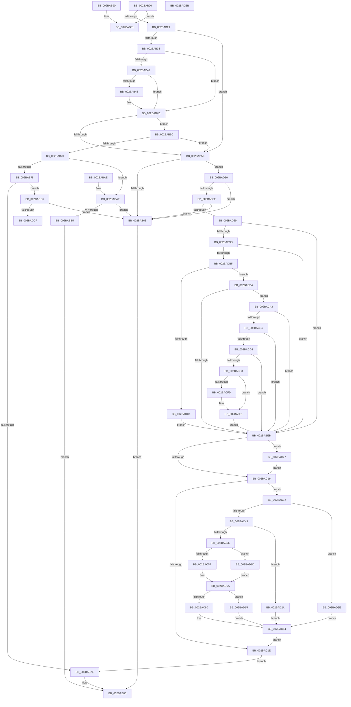

# MiDetermineModifiedPageListHead

- RVA: `0x002BAB00`–`0x002BADEC` (길이 `748` bytes)
- VA: `0x00000001402BAB00`
- 실행 섹션: `.text`
- PDB 이름 있음: `예`; PDB Function 태그: `아니요`
- unwind 정보 RVA: `0x0006DD6C`
- 디코드: `178`개 명령, `748/748` bytes 표시
- 미해석 바이트: `0` (있으면 어셈블리에 `.byte`로 보존)

> 이 문서는 커널 이미지의 기계어와 PDB 기호를 분석해 생성했습니다. 4번과 5번은 함수 원형과 자료형을 바이너리 사용 방식에서 추정한 C 해석이며 원본 소스 복구 결과는 아닙니다.

## 1. Dependencies

- 직접 호출 지점: **2**; 고유 호출 대상: **2**
- 직접 호출자로 확인된 함수: **5**
- RIP 상대 이미지 참조: **2**

### Outgoing calls
- `0x002BABC2` → [MiSetStoreVirtualPagefileValue](../37/MiSetStoreVirtualPagefileValue_function_00373B80.md) (function, `0x00373B80`)
- `0x002BAD43` → [MiMakePageFilePte](../38/MiMakePageFilePte_function_003823C8.md) (function, `0x003823C8`)

### Direct callers
- [sub_00287A62](../28/Unknown_function_00287A62.md) at `0x00287B54`
- [MiReplaceTransitionPage](MiReplaceTransitionPage_function_002B1120.md) at `0x002B18B3`
- [MiInsertPageInList](MiInsertPageInList_function_002BA000.md) at `0x002BA1B9`
- [MiZeroCfgSystemWideBitmapWorker](../36/MiZeroCfgSystemWideBitmapWorker_function_00367060.md) at `0x003674F7`
- [sub_006F5292](../6F/Unknown_function_006F5292.md) at `0x006F5298`

### Static image references
- `0x002BAB35` → RVA `0x00E2DC80` (`.data`; read)
- `0x002BACA4` → RVA `0x00FC6A88` (`ALMOSTRO`; read)

## 2. Other-region calls and transfers

- 다른 실행 섹션으로 향하는 call: **0**
- 별도 외부 분기/꼬리 이동을 확인하지 못했습니다.

## 3. Assembly (complete function range)

```asm
002BAB00  48 89 5C 24 10                  mov qword ptr [rsp + 0x10], rbx
002BAB05  57                              push rdi
002BAB06  48 83 EC 30                     sub rsp, 0x30
002BAB0A  48 8B 41 10                     mov rax, qword ptr [rcx + 0x10]
002BAB0E  48 8B DA                        mov rbx, rdx
002BAB11  44 0F B6 C8                     movzx r9d, al
002BAB15  48 8B F9                        mov rdi, rcx
002BAB18  41 D0 E9                        shr r9b, 1
002BAB1B  41 F6 C1 01                     test r9b, 1
002BAB1F  75 70                           jne 0x1402bab91
002BAB21  8B 92 B4 04 00 00               mov edx, dword ptr [rdx + 0x4b4]
002BAB27  48 8B C8                        mov rcx, rax
002BAB2A  48 C1 E9 0C                     shr rcx, 0xc
002BAB2E  83 E1 0F                        and ecx, 0xf
002BAB31  3B CA                           cmp ecx, edx
002BAB33  75 24                           jne 0x1402bab59
002BAB35  48 8B 0D 44 31 B7 00            mov rcx, qword ptr [rip + 0xb73144]
002BAB3C  48 85 C9                        test rcx, rcx
002BAB3F  74 0A                           je 0x1402bab4b
002BAB41  A8 10                           test al, 0x10
002BAB43  75 06                           jne 0x1402bab4b
002BAB45  48 F7 D1                        not rcx
002BAB48  48 23 C1                        and rax, rcx
002BAB4B  48 C1 E8 20                     shr rax, 0x20
002BAB4F  48 8D 48 FE                     lea rcx, [rax - 2]
002BAB53  48 83 F9 02                     cmp rcx, 2
002BAB57  76 13                           jbe 0x1402bab6c
002BAB59  41 F6 C0 01                     test r8b, 1
002BAB5D  0F 85 ED 01 00 00               jne 0x1402bad50
002BAB63  48 8D 83 80 0F 00 00            lea rax, [rbx + 0xf80]
002BAB6A  EB 19                           jmp 0x1402bab85
002BAB6C  85 C0                           test eax, eax
002BAB6E  74 E9                           je 0x1402bab59
002BAB70  83 F8 04                        cmp eax, 4
002BAB73  74 3A                           je 0x1402babaf
002BAB75  83 F8 03                        cmp eax, 3
002BAB78  0F 85 48 02 00 00               jne 0x1402badc6
002BAB7E  48 8D 83 00 10 00 00            lea rax, [rbx + 0x1000]
002BAB85  48 8B 5C 24 48                  mov rbx, qword ptr [rsp + 0x48]
002BAB8A  48 83 C4 30                     add rsp, 0x30
002BAB8E  5F                              pop rdi
002BAB8F  C3                              ret
002BAB90  CC                              int3
002BAB91  48 C1 E8 0C                     shr rax, 0xc
002BAB95  83 E0 0F                        and eax, 0xf
002BAB98  48 83 C0 30                     add rax, 0x30
002BAB9C  48 6B C0 58                     imul rax, rax, 0x58
002BABA0  48 03 C3                        add rax, rbx
002BABA3  48 8B 5C 24 48                  mov rbx, qword ptr [rsp + 0x48]
002BABA8  48 83 C4 30                     add rsp, 0x30
002BABAC  5F                              pop rdi
002BABAD  C3                              ret
002BABAE  CC                              int3
002BABAF  41 F6 C0 02                     test r8b, 2
002BABB3  74 AE                           je 0x1402bab63
002BABB5  48 8B 57 10                     mov rdx, qword ptr [rdi + 0x10]
002BABB9  41 B8 03 00 00 00               mov r8d, 3
002BABBF  48 8B CB                        mov rcx, rbx
002BABC2  E8 B9 8F 0B 00                  call 0x140373b80
002BABC7  48 89 47 10                     mov qword ptr [rdi + 0x10], rax
002BABCB  48 8D 83 80 0F 00 00            lea rax, [rbx + 0xf80]
002BABD2  EB B1                           jmp 0x1402bab85
002BABD4  F6 C1 42                        test cl, 0x42
002BABD7  41 0F 95 C1                     setne r9b
002BABDB  F6 C1 20                        test cl, 0x20
002BABDE  41 0F 95 C0                     setne r8b
002BABE2  45 84 C8                        test r8b, r9b
002BABE5  0F 84 B9 00 00 00               je 0x1402baca4
002BABEB  48 0F BA E1 0A                  bt rcx, 0xa
002BABF0  48 C7 C0 F7 FF FF FF            mov rax, 0xfffffffffffffff7
002BABF7  49 C7 C0 FF F7 FF FF            mov r8, 0xfffffffffffff7ff
002BABFE  49 0F 42 C0                     cmovb rax, r8
002BAC02  48 23 C1                        and rax, rcx
002BAC05  48 8D 4C 24 20                  lea rcx, [rsp + 0x20]
002BAC0A  48 89 01                        mov qword ptr [rcx], rax
002BAC0D  48 8B 44 24 20                  mov rax, qword ptr [rsp + 0x20]
002BAC12  48 0F BA E2 0A                  bt rdx, 0xa
002BAC17  73 0E                           jae 0x1402bac27
002BAC19  4D 85 D2                        test r10, r10
002BAC1C  75 14                           jne 0x1402bac32
002BAC1E  48 89 47 10                     mov qword ptr [rdi + 0x10], rax
002BAC22  E9 57 FF FF FF                  jmp 0x1402bab7e
002BAC27  48 83 E0 F9                     and rax, 0xfffffffffffffff9
002BAC2B  48 89 44 24 20                  mov qword ptr [rsp + 0x20], rax
002BAC30  EB E7                           jmp 0x1402bac19
002BAC32  45 0F B7 82 AC 00 00 00         movzx r8d, word ptr [r10 + 0xac]
002BAC3A  48 85 C0                        test rax, rax
002BAC3D  0F 84 FB 00 00 00               je 0x1402bad3e
002BAC43  48 8B 0D 36 30 B7 00            mov rcx, qword ptr [rip + 0xb73036]
002BAC4A  48 8B D0                        mov rdx, rax
002BAC4D  48 85 C9                        test rcx, rcx
002BAC50  0F 84 D4 00 00 00               je 0x1402bad2a
002BAC56  F6 C2 10                        test dl, 0x10
002BAC59  0F 85 BE 00 00 00               jne 0x1402bad1d
002BAC5F  48 8B C1                        mov rax, rcx
002BAC62  48 F7 D0                        not rax
002BAC65  48 23 D0                        and rdx, rax
002BAC68  8B D2                           mov edx, edx
002BAC6A  48 B8 00 00 00 00 03 00 00 00   movabs rax, 0x300000000
002BAC74  48 0B D0                        or rdx, rax
002BAC77  48 85 CA                        test rdx, rcx
002BAC7A  0F 84 95 00 00 00               je 0x1402bad15
002BAC80  48 83 CA 10                     or rdx, 0x10
002BAC84  49 8B C8                        mov rcx, r8
002BAC87  48 C1 E1 0C                     shl rcx, 0xc
002BAC8B  48 8B C1                        mov rax, rcx
002BAC8E  48 33 C2                        xor rax, rdx
002BAC91  48 25 FF 0F FF FF               and rax, 0xffffffffffff0fff
002BAC97  48 33 C1                        xor rax, rcx
002BAC9A  48 89 44 24 20                  mov qword ptr [rsp + 0x20], rax
002BAC9F  E9 7A FF FF FF                  jmp 0x1402bac1e
002BACA4  48 F7 05 D9 BD D0 00 00 00 60 00  test qword ptr [rip + 0xd0bdd9], 0x600000
002BACAF  0F 84 36 FF FF FF               je 0x1402babeb
002BACB5  65 4C 8B 04 25 88 01 00 00      mov r8, qword ptr gs:[0x188]
002BACBE  4D 8B 88 B8 00 00 00            mov r9, qword ptr [r8 + 0xb8]
002BACC5  41 80 B9 60 01 00 00 01         cmp byte ptr [r9 + 0x160], 1
002BACCD  0F 84 18 FF FF FF               je 0x1402babeb
002BACD3  4D 8B 99 08 05 00 00            mov r11, qword ptr [r9 + 0x508]
002BACDA  4D 85 DB                        test r11, r11
002BACDD  0F 84 08 FF FF FF               je 0x1402babeb
002BACE3  4C 8D 44 24 20                  lea r8, [rsp + 0x20]
002BACE8  49 C1 E8 03                     shr r8, 3
002BACEC  41 81 E0 FF 01 00 00            and r8d, 0x1ff
002BACF3  4F 8B 04 C3                     mov r8, qword ptr [r11 + r8*8]
002BACF7  41 F6 C0 20                     test r8b, 0x20
002BACFB  74 04                           je 0x1402bad01
002BACFD  48 83 C8 20                     or rax, 0x20
002BAD01  48 8B C8                        mov rcx, rax
002BAD04  48 83 C9 42                     or rcx, 0x42
002BAD08  41 F6 C0 42                     test r8b, 0x42
002BAD0C  48 0F 44 C8                     cmove rcx, rax
002BAD10  E9 D6 FE FF FF                  jmp 0x1402babeb
002BAD15  48 0B D1                        or rdx, rcx
002BAD18  E9 67 FF FF FF                  jmp 0x1402bac84
002BAD1D  B8 EF FF FF FF                  mov eax, 0xffffffef
002BAD22  48 23 D0                        and rdx, rax
002BAD25  E9 40 FF FF FF                  jmp 0x1402bac6a
002BAD2A  8B D2                           mov edx, edx
002BAD2C  48 B8 00 00 00 00 03 00 00 00   movabs rax, 0x300000000
002BAD36  48 0B D0                        or rdx, rax
002BAD39  E9 46 FF FF FF                  jmp 0x1402bac84
002BAD3E  B9 03 00 00 00                  mov ecx, 3
002BAD43  E8 80 76 0C 00                  call 0x1403823c8
002BAD48  48 8B D0                        mov rdx, rax
002BAD4B  E9 34 FF FF FF                  jmp 0x1402bac84
002BAD50  8B 83 B4 04 00 00               mov eax, dword ptr [rbx + 0x4b4]
002BAD56  83 F8 FF                        cmp eax, -1
002BAD59  0F 84 04 FE FF FF               je 0x1402bab63
002BAD5F  F6 47 22 08                     test byte ptr [rdi + 0x22], 8
002BAD63  0F 85 FA FD FF FF               jne 0x1402bab63
002BAD69  8B 83 B4 04 00 00               mov eax, dword ptr [rbx + 0x4b4]
002BAD6F  48 8B 57 10                     mov rdx, qword ptr [rdi + 0x10]
002BAD73  48 89 54 24 20                  mov qword ptr [rsp + 0x20], rdx
002BAD78  48 8B 4C 24 20                  mov rcx, qword ptr [rsp + 0x20]
002BAD7D  4C 8B 94 C3 60 48 00 00         mov r10, qword ptr [rbx + rax*8 + 0x4860]
002BAD85  49 B8 00 D0 BE 7D FB F6 FF FF   movabs r8, 0xfffff6fb7dbed000
002BAD8F  48 8D 44 24 20                  lea rax, [rsp + 0x20]
002BAD94  49 3B C0                        cmp rax, r8
002BAD97  0F 82 4E FE FF FF               jb 0x1402babeb
002BAD9D  49 B8 F8 D7 BE 7D FB F6 FF FF   movabs r8, 0xfffff6fb7dbed7f8
002BADA7  48 8D 44 24 20                  lea rax, [rsp + 0x20]
002BADAC  49 3B C0                        cmp rax, r8
002BADAF  0F 87 36 FE FF FF               ja 0x1402babeb
002BADB5  48 8B C1                        mov rax, rcx
002BADB8  F6 C1 01                        test cl, 1
002BADBB  0F 85 13 FE FF FF               jne 0x1402babd4
002BADC1  E9 25 FE FF FF                  jmp 0x1402babeb
002BADC6  83 F8 02                        cmp eax, 2
002BADC9  0F 85 94 FD FF FF               jne 0x1402bab63
002BADCF  8B 8B B4 04 00 00               mov ecx, dword ptr [rbx + 0x4b4]
002BADD5  48 83 C1 30                     add rcx, 0x30
002BADD9  48 6B C1 58                     imul rax, rcx, 0x58
002BADDD  48 03 C3                        add rax, rbx
002BADE0  48 8B 5C 24 48                  mov rbx, qword ptr [rsp + 0x48]
002BADE5  48 83 C4 30                     add rsp, 0x30
002BADE9  5F                              pop rdi
002BADEA  C3                              ret
002BADEB  CC                              int3
```

## 4. C-style interpretation (structured pseudocode)

```c
__int64 __fastcall MiDetermineModifiedPageListHead(__int64 a1, __int64 a2, unsigned __int8 a3)
{
    __int64 result;
    __int64 v_rsp;
    unsigned __int64 v_stack_p10;
    unsigned __int64 v_stack_p48;
    unsigned __int64 v_stack_p58;
    unsigned __int64 v_stack_p80;

    v_stack_p10 = v_rbx;
    v_rsp = (v_rsp) - (48);
    a4 = (unsigned __int8)(((unsigned __int8)(*(unsigned __int64 *)(a1 + 16))) >> (1));
    if ((((unsigned __int8)(a4)) & (1)) != 0) goto loc_002BAB91;
    a1 = (*(unsigned __int64 *)(a1 + 16)) >> (12);
    a1 = (unsigned int)((a1) & (15));
    if (((unsigned int)(a1)) != ((unsigned int)((unsigned int)(*(unsigned int *)(a2 + 1204))))) goto loc_002BAB59;
    if (*(unsigned __int64 *)(v_rip + 12005700) == 0) goto loc_002BAB4B;
    result = *(unsigned __int64 *)(a1 + 16);
    if ((((unsigned __int8)(*(unsigned __int64 *)(a1 + 16))) & (16)) == 0) {
        a1 = ~(*(unsigned __int64 *)(v_rip + 12005700));
        result = (*(unsigned __int64 *)(a1 + 16)) & (a1);
    }
    result = (result) >> (32);
    if ((result - 2) <= 2) goto loc_002BAB6C;
loc_002BAB59:
    if (((a3) & (1)) != 0) goto loc_002BAD50;
loc_002BAB63:
    goto loc_002BAB85;
loc_002BAB6C:
    if ((unsigned int)(a2 + 3968) == 0) goto loc_002BAB59;
    if (((unsigned int)(a2 + 3968)) == 4) goto loc_002BABAF;
    if (((unsigned int)(a2 + 3968)) != 3) goto loc_002BADC6;
loc_002BAB7E:
loc_002BAB85:
    v_rsp = (v_rsp) + (48);
    return a2 + 4096;
loc_002BAB91:
    result = (a2 + 4096) >> (12);
    result = (unsigned int)((result) & (15));
    result = (result) + (48);
    result = (result) * (result);
    result = (result) + (v_stack_p10);
    v_rsp = (v_rsp) + (48);
    return result;
loc_002BABAF:
    if (((a3) & (2)) == 0) goto loc_002BAB63;
    result = MiSetStoreVirtualPagefileValue(v_stack_p48, *(unsigned __int64 *)(a1 + 16), 3, a4);
    *(unsigned __int64 *)(a1 + 16) = result;
    goto loc_002BAB85;
loc_002BABD4:
    a4 = ((((unsigned __int8)(v_stack_p48)) & (66)) != 0) ? 1 : 0;
    a3 = ((((unsigned __int8)(v_stack_p48)) & (32)) != 0) ? 1 : 0;
    if (((a3) & ((unsigned __int8)(a4))) == 0) goto loc_002BACA4;
loc_002BABEB:
    result = -9;
    if (condition_is_below) { result = 0xFFFFFFFFFFFFF7FFULL; }
    result = (result) & (v_stack_p48);
    *(unsigned __int64 *)(v_stack_p58) = result;
    if (condition_is_above_or_equal) goto loc_002BAC27;
loc_002BAC19:
    if (v_r10 != 0) goto loc_002BAC32;
loc_002BAC1E:
    *(unsigned __int64 *)(a1 + 16) = v_stack_p58;
    goto loc_002BAB7E;
loc_002BAC27:
    result = (v_stack_p58) & (-7);
    v_stack_p58 = result;
    goto loc_002BAC19;
loc_002BAC32:
    if (result == 0) goto loc_002BAD3E;
    if (*(unsigned __int64 *)(v_rip + 12005430) == 0) goto loc_002BAD2A;
    if ((((unsigned __int8)(result)) & (16)) != 0) goto loc_002BAD1D;
    result = ~(*(unsigned __int64 *)(v_rip + 12005430));
    a2 = (result) & (result);
loc_002BAC6A:
    a2 = ((unsigned int)((unsigned int)(a2))) | (result);
    if (((a2) & (*(unsigned __int64 *)(v_rip + 12005430))) == 0) goto loc_002BAD15;
    a2 = (a2) | (16);
loc_002BAC84:
    a1 = (*(unsigned __int16 *)(v_r10 + 172)) << (12);
    result = (a1) ^ (a2);
    result = (result) & (0xFFFFFFFFFFFF0FFFULL);
    result = (result) ^ (a1);
    v_stack_p58 = result;
    goto loc_002BAC1E;
loc_002BACA4:
    if (((*(unsigned __int64 *)(v_rip + 13680089)) & (0x600000ULL)) == 0) goto loc_002BABEB;
    if ((*(unsigned __int8 *)(*(unsigned __int64 *)(*(unsigned __int64 *)(gs_base + (0 + 392)) + 184) + 352)) == 1) goto loc_002BABEB;
    if (*(unsigned __int64 *)(*(unsigned __int64 *)(*(unsigned __int64 *)(gs_base + (0 + 392)) + 184) + 1288) == 0) goto loc_002BABEB;
    a3 = (v_stack_p58) >> (3);
    a3 = (unsigned int)((a3) & (511));
    if ((((unsigned __int8)(*(unsigned __int64 *)(*(unsigned __int64 *)(*(unsigned __int64 *)(*(unsigned __int64 *)(gs_base + (0 + 392)) + 184) + 1288) + a3 * 8))) & (32)) != 0) {
        result = (result) | (32);
    }
    a1 = (result) | (66);
    if ((((unsigned __int8)(*(unsigned __int64 *)(*(unsigned __int64 *)(*(unsigned __int64 *)(*(unsigned __int64 *)(gs_base + (0 + 392)) + 184) + 1288) + a3 * 8))) & (66)) == 0) { a1 = result; }
    goto loc_002BABEB;
loc_002BAD15:
    a2 = (a2) | (a1);
    goto loc_002BAC84;
loc_002BAD1D:
    a2 = (a2) & ((unsigned int)(0xFFFFFFEFULL));
    goto loc_002BAC6A;
loc_002BAD2A:
    a2 = ((unsigned int)((unsigned int)(a2))) | ((unsigned int)(0xFFFFFFEFULL));
    goto loc_002BAC84;
loc_002BAD3E:
    result = MiMakePageFilePte(3, a2, *(unsigned __int64 *)(*(unsigned __int64 *)(*(unsigned __int64 *)(*(unsigned __int64 *)(gs_base + (0 + 392)) + 184) + 1288) + a3 * 8), *(unsigned __int64 *)(*(unsigned __int64 *)(gs_base + (0 + 392)) + 184));
    goto loc_002BAC84;
loc_002BAD50:
    if (((unsigned int)((unsigned int)(*(unsigned int *)(v_stack_p48 + 1204)))) == -1) goto loc_002BAB63;
    if (((*(unsigned __int8 *)(a1 + 34)) & (8)) != 0) goto loc_002BAB63;
    v_stack_p58 = *(unsigned __int64 *)(a1 + 16);
    if (v_stack_p58 < (*(unsigned __int64 *)(*(unsigned __int64 *)(*(unsigned __int64 *)(*(unsigned __int64 *)(gs_base + (0 + 392)) + 184) + 1288) + a3 * 8))) goto loc_002BABEB;
    if (v_stack_p58 > (*(unsigned __int64 *)(*(unsigned __int64 *)(*(unsigned __int64 *)(*(unsigned __int64 *)(gs_base + (0 + 392)) + 184) + 1288) + a3 * 8))) goto loc_002BABEB;
    if ((((unsigned __int8)(v_stack_p58)) & (1)) != 0) goto loc_002BABD4;
    goto loc_002BABEB;
loc_002BADC6:
    if (((unsigned int)(v_stack_p58)) != 2) goto loc_002BAB63;
    a1 = ((unsigned int)(*(unsigned int *)(v_stack_p48 + 1204))) + (48);
    result = (v_stack_p58) * (a1);
    result = (result) + (v_stack_p48);
    v_rsp = (v_rsp) + (48);
    return result;
}
```

## 5. (Beta) C Style

```c
void *MiDetermineModifiedPageListHead(void *Arg1, void *Arg2, uint8_t Arg3)
{
    uint8_t *arg1 = (uint8_t *)Arg1;
    uint8_t *arg2 = (uint8_t *)Arg2;

    int64_t result;
    int64_t local_rsp;
    uint64_t v_stack_p10;
    uint64_t v_stack_p48;
    uint64_t v_stack_p58;
    uint64_t v_stack_p80;

    v_stack_p10 = local_rbx;
    local_rsp = (local_rsp) - (48);
    a4 = (uint8_t)(((uint8_t)(*(uint64_t *)(arg1 + 0x10))) >> (1));
    if ((((uint8_t)(a4)) & (1)) != 0) goto loc_002BAB91;
    Arg1 = (*(uint64_t *)(arg1 + 0x10)) >> (12);
    Arg1 = (uint32_t)((Arg1) & (15));
    if (((uint32_t)(Arg1)) != ((uint32_t)((uint32_t)(*(uint32_t *)(arg2 + 0x4B4))))) goto loc_002BAB59;
    if (*(uint64_t *)(v_rip + 0xB73144) == 0) goto loc_002BAB4B;
    result = *(uint64_t *)(arg1 + 0x10);
    if ((((uint8_t)(*(uint64_t *)(arg1 + 0x10))) & (16)) == 0) {
        Arg1 = ~(*(uint64_t *)(v_rip + 0xB73144));
        result = (*(uint64_t *)(arg1 + 0x10)) & (Arg1);
    }
    result = (result) >> (32);
    if ((result - 2) <= 2) goto loc_002BAB6C;
loc_002BAB59:
    if (((Arg3) & (1)) != 0) goto loc_002BAD50;
loc_002BAB63:
    goto loc_002BAB85;
loc_002BAB6C:
    if ((uint32_t)(Arg2 + 3968) == 0) goto loc_002BAB59;
    if (((uint32_t)(Arg2 + 3968)) == 4) goto loc_002BABAF;
    if (((uint32_t)(Arg2 + 3968)) != 3) goto loc_002BADC6;
loc_002BAB7E:
loc_002BAB85:
    local_rsp = (local_rsp) + (48);
    return Arg2 + 4096;
loc_002BAB91:
    result = (Arg2 + 4096) >> (12);
    result = (uint32_t)((result) & (15));
    result = (result) + (48);
    result = (result) * (result);
    result = (result) + (v_stack_p10);
    local_rsp = (local_rsp) + (48);
    return result;
loc_002BABAF:
    if (((Arg3) & (2)) == 0) goto loc_002BAB63;
    result = MiSetStoreVirtualPagefileValue(v_stack_p48, *(uint64_t *)(arg1 + 0x10), 3, a4);
    *(uint64_t *)(arg1 + 0x10) = result;
    goto loc_002BAB85;
loc_002BABD4:
    a4 = ((((uint8_t)(v_stack_p48)) & (66)) != 0) ? 1 : 0;
    Arg3 = ((((uint8_t)(v_stack_p48)) & (32)) != 0) ? 1 : 0;
    if (((Arg3) & ((uint8_t)(a4))) == 0) goto loc_002BACA4;
loc_002BABEB:
    result = -9;
    if (condition_is_below) { result = 0xFFFFFFFFFFFFF7FFULL; }
    result = (result) & (v_stack_p48);
    *(uint64_t *)(v_stack_p58) = result;
    if (condition_is_above_or_equal) goto loc_002BAC27;
loc_002BAC19:
    if (local_r10 != 0) goto loc_002BAC32;
loc_002BAC1E:
    *(uint64_t *)(arg1 + 0x10) = v_stack_p58;
    goto loc_002BAB7E;
loc_002BAC27:
    result = (v_stack_p58) & (-7);
    v_stack_p58 = result;
    goto loc_002BAC19;
loc_002BAC32:
    if (result == 0) goto loc_002BAD3E;
    if (*(uint64_t *)(v_rip + 0xB73036) == 0) goto loc_002BAD2A;
    if ((((uint8_t)(result)) & (16)) != 0) goto loc_002BAD1D;
    result = ~(*(uint64_t *)(v_rip + 0xB73036));
    Arg2 = (result) & (result);
loc_002BAC6A:
    Arg2 = ((uint32_t)((uint32_t)(Arg2))) | (result);
    if (((Arg2) & (*(uint64_t *)(v_rip + 0xB73036))) == 0) goto loc_002BAD15;
    Arg2 = (Arg2) | (16);
loc_002BAC84:
    Arg1 = (*(uint16_t *)(local_r10 + 0xAC)) << (12);
    result = (Arg1) ^ (Arg2);
    result = (result) & (0xFFFFFFFFFFFF0FFFULL);
    result = (result) ^ (Arg1);
    v_stack_p58 = result;
    goto loc_002BAC1E;
loc_002BACA4:
    if (((*(uint64_t *)(v_rip + 0xD0BDD9)) & (0x600000ULL)) == 0) goto loc_002BABEB;
    if ((*(uint8_t *)(*(uint64_t *)(*(uint64_t *)(gs_base + (0 + 0x188)) + 0xB8) + 0x160)) == 1) goto loc_002BABEB;
    if (*(uint64_t *)(*(uint64_t *)(*(uint64_t *)(gs_base + (0 + 0x188)) + 0xB8) + 0x508) == 0) goto loc_002BABEB;
    Arg3 = (v_stack_p58) >> (3);
    Arg3 = (uint32_t)((Arg3) & (511));
    if ((((uint8_t)(*(uint64_t *)(*(uint64_t *)(*(uint64_t *)(*(uint64_t *)(gs_base + (0 + 0x188)) + 0xB8) + 0x508) + Arg3 * 8))) & (32)) != 0) {
        result = (result) | (32);
    }
    Arg1 = (result) | (66);
    if ((((uint8_t)(*(uint64_t *)(*(uint64_t *)(*(uint64_t *)(*(uint64_t *)(gs_base + (0 + 0x188)) + 0xB8) + 0x508) + Arg3 * 8))) & (66)) == 0) { Arg1 = result; }
    goto loc_002BABEB;
loc_002BAD15:
    Arg2 = (Arg2) | (Arg1);
    goto loc_002BAC84;
loc_002BAD1D:
    Arg2 = (Arg2) & ((uint32_t)(0xFFFFFFEFULL));
    goto loc_002BAC6A;
loc_002BAD2A:
    Arg2 = ((uint32_t)((uint32_t)(Arg2))) | ((uint32_t)(0xFFFFFFEFULL));
    goto loc_002BAC84;
loc_002BAD3E:
    result = MiMakePageFilePte(3, Arg2, *(uint64_t *)(*(uint64_t *)(*(uint64_t *)(*(uint64_t *)(gs_base + (0 + 0x188)) + 0xB8) + 0x508) + Arg3 * 8), *(uint64_t *)(*(uint64_t *)(gs_base + (0 + 0x188)) + 0xB8));
    goto loc_002BAC84;
loc_002BAD50:
    if (((uint32_t)((uint32_t)(*(uint32_t *)(v_stack_p48 + 0x4B4)))) == -1) goto loc_002BAB63;
    if (((*(uint8_t *)(arg1 + 0x22)) & (8)) != 0) goto loc_002BAB63;
    v_stack_p58 = *(uint64_t *)(arg1 + 0x10);
    if (v_stack_p58 < (*(uint64_t *)(*(uint64_t *)(*(uint64_t *)(*(uint64_t *)(gs_base + (0 + 0x188)) + 0xB8) + 0x508) + Arg3 * 8))) goto loc_002BABEB;
    if (v_stack_p58 > (*(uint64_t *)(*(uint64_t *)(*(uint64_t *)(*(uint64_t *)(gs_base + (0 + 0x188)) + 0xB8) + 0x508) + Arg3 * 8))) goto loc_002BABEB;
    if ((((uint8_t)(v_stack_p58)) & (1)) != 0) goto loc_002BABD4;
    goto loc_002BABEB;
loc_002BADC6:
    if (((uint32_t)(v_stack_p58)) != 2) goto loc_002BAB63;
    Arg1 = ((uint32_t)(*(uint32_t *)(v_stack_p48 + 0x4B4))) + (48);
    result = (v_stack_p58) * (Arg1);
    result = (result) + (v_stack_p48);
    local_rsp = (local_rsp) + (48);
    return result;
}
```

### 관측된 메모리 오프셋

구조체 형식이 확인되지 않은 접근은 인자 기준의 오프셋으로만 기록했습니다.

| 기준 인자 | 오프셋 표현 | 폭 (bit) | 접근 |
|---|---:|---:|---|
| `Arg1` | `+ 0x10` | `64` | `R` |
| `Arg1` | `+ 0x10` | `64` | `W` |
| `Arg1` | `+ 0x22` | `8` | `R` |
| `Arg2` | `+ 0x4B4` | `32` | `R` |
| `Arg2` | `+ 0xF80` | `64` | `R` |
| `Arg2` | `+ 0x1000` | `64` | `R` |
| `Arg2` | `+ 0x4860 + rax*8` | `64` | `R` |

## 6. Execution-region graph

[열기: 2D/3D 그래프와 함수 탐색 컨트롤 패널](../../../control-panel.html?section=text&rva=0x002BAB00&view=graph)

- 2D 그래프는 위에서 아래로 흐르고, 3D 그래프는 빈 공간을 드래그해 회전합니다. Shift+드래그는 이동, 휠은 확대·축소, 함수 노드 선택은 대상 보고서 이동입니다.

### Static fallback


