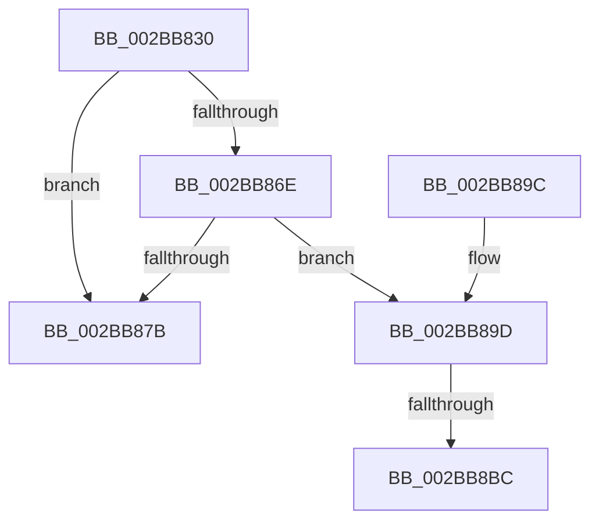

# MiDoesControlAreaHaveUserWritableReferences

- RVA: `0x002BB830`–`0x002BB8C7` (길이 `151` bytes)
- VA: `0x00000001402BB830`
- 실행 섹션: `.text`
- PDB 이름 있음: `예`; PDB Function 태그: `예`
- unwind 정보 RVA: `0x0006DDC8`
- 디코드: `42`개 명령, `151/151` bytes 표시
- 미해석 바이트: `0` (있으면 어셈블리에 `.byte`로 보존)

> 이 문서는 커널 이미지의 기계어와 PDB 기호를 분석해 생성했습니다. 4번과 5번은 함수 원형과 자료형을 바이너리 사용 방식에서 추정한 C 해석이며 원본 소스 복구 결과는 아닙니다.

## 1. Dependencies

- 직접 호출 지점: **1**; 고유 호출 대상: **1**
- 직접 호출자로 확인된 함수: **2**
- RIP 상대 이미지 참조: **1**

### Outgoing calls
- `0x002BB8A7` → [ExAcquireSpinLockSharedAtDpcLevel](../24/ExAcquireSpinLockSharedAtDpcLevel_function_00248E30.md) (function, `0x00248E30`)

### Direct callers
- [MmDoesFileHaveUserWritableReferences](MmDoesFileHaveUserWritableReferences_function_002BB690.md) at `0x002BB742`
- [MiComputeFlushRange](MiComputeFlushRange_function_002BB8D0.md) at `0x002BB9D5`

### Static image references
- `0x002BB853` → RVA `0x00E30088` (`.data`; read)

## 2. Other-region calls and transfers

- 다른 실행 섹션으로 향하는 call: **0**
- call이 아닌 외부 분기/꼬리 이동: **2**
  - `0x002BB8B6` → [sub_006DBEFE + 0x15](../6D/Unknown_function_006DBEFE.md) (`tail-transfer`)
  - `0x002BB8C2` → [sub_006DBEFE](../6D/Unknown_function_006DBEFE.md) (`tail-transfer`)

## 3. Assembly (complete function range)

```asm
002BB830  48 8B C4                        mov rax, rsp
002BB833  48 89 58 08                     mov qword ptr [rax + 8], rbx
002BB837  48 89 68 10                     mov qword ptr [rax + 0x10], rbp
002BB83B  48 89 70 18                     mov qword ptr [rax + 0x18], rsi
002BB83F  48 89 78 20                     mov qword ptr [rax + 0x20], rdi
002BB843  41 54                           push r12
002BB845  41 56                           push r14
002BB847  41 57                           push r15
002BB849  48 83 EC 20                     sub rsp, 0x20
002BB84D  0F B7 51 3C                     movzx edx, word ptr [rcx + 0x3c]
002BB851  33 F6                           xor esi, esi
002BB853  48 8B 05 2E 48 B7 00            mov rax, qword ptr [rip + 0xb7482e]
002BB85A  81 E2 FF 03 00 00               and edx, 0x3ff
002BB860  8B 59 5C                        mov ebx, dword ptr [rcx + 0x5c]
002BB863  48 8B E9                        mov rbp, rcx
002BB866  4C 8B 34 D0                     mov r14, qword ptr [rax + rdx*8]
002BB86A  85 DB                           test ebx, ebx
002BB86C  75 0D                           jne 0x1402bb87b
002BB86E  48 8B 79 70                     mov rdi, qword ptr [rcx + 0x70]
002BB872  44 8D 63 01                     lea r12d, [rbx + 1]
002BB876  49 3B FC                        cmp rdi, r12
002BB879  77 22                           ja 0x1402bb89d
002BB87B  48 8B 6C 24 48                  mov rbp, qword ptr [rsp + 0x48]
002BB880  8B C3                           mov eax, ebx
002BB882  48 8B 5C 24 40                  mov rbx, qword ptr [rsp + 0x40]
002BB887  48 8B 74 24 50                  mov rsi, qword ptr [rsp + 0x50]
002BB88C  48 8B 7C 24 58                  mov rdi, qword ptr [rsp + 0x58]
002BB891  48 83 C4 20                     add rsp, 0x20
002BB895  41 5F                           pop r15
002BB897  41 5E                           pop r14
002BB899  41 5C                           pop r12
002BB89B  C3                              ret
002BB89C  CC                              int3
002BB89D  4D 8D BE C0 06 00 00            lea r15, [r14 + 0x6c0]
002BB8A4  49 8B CF                        mov rcx, r15
002BB8A7  E8 84 D5 F8 FF                  call 0x140248e30
002BB8AC  49 8B 86 30 08 00 00            mov rax, qword ptr [r14 + 0x830]
002BB8B3  48 85 C0                        test rax, rax
002BB8B6  0F 84 57 06 42 00               je 0x1406dbf13
002BB8BC  8B 08                           mov ecx, dword ptr [rax]
002BB8BE  48 83 C0 60                     add rax, 0x60
002BB8C2  E9 37 06 42 00                  jmp 0x1406dbefe
```

## 4. C-style interpretation (structured pseudocode)

```c
__int64 __fastcall MiDoesControlAreaHaveUserWritableReferences(__int64 a1)
{
    __int64 result;
    __int64 v_rsi;
    __int64 v_rsp;
    unsigned __int64 v_stack_p10;
    unsigned __int64 v_stack_p18;
    unsigned __int64 v_stack_p20;
    unsigned __int64 v_stack_p8;

    *(unsigned __int64 *)(v_rsp + 8) = v_rbx;
    *(unsigned __int64 *)(v_rsp + 16) = v_rbp;
    *(unsigned __int64 *)(v_rsp + 24) = v_rsi;
    *(unsigned __int64 *)(v_rsp + 32) = v_rdi;
    v_rsp = (v_rsp) - (32);
    v_rsi = 0;
    a2 = (unsigned int)((*(unsigned __int16 *)(a1 + 60)) & (0x3FFULL));
    if ((unsigned int)((unsigned int)(*(unsigned int *)(a1 + 92))) != 0) goto loc_002BB87B;
    if ((*(unsigned __int64 *)(a1 + 112)) > ((unsigned int)(*(unsigned int *)(a1 + 92)) + 1)) goto loc_002BB89D;
loc_002BB87B:
    v_rsp = (v_rsp) + (32);
    return (unsigned int)((unsigned int)((unsigned int)(*(unsigned int *)(a1 + 92))));
loc_002BB89D:
    result = ExAcquireSpinLockSharedAtDpcLevel(*(unsigned __int64 *)(*(unsigned __int64 *)(v_rip + 12011566) + a2 * 8) + 1728, a2, a3, a4);
    result = (*(unsigned __int64 *)(*(unsigned __int64 *)(*(unsigned __int64 *)(v_rip + 12011566) + a2 * 8) + 2096)) + (96);
}
```

## 5. (Beta) C Style

```c
int64_t MiDoesControlAreaHaveUserWritableReferences(void *Arg1)
{
    uint8_t *arg1 = (uint8_t *)Arg1;

    int64_t result;
    int64_t local_rsi;
    int64_t local_rsp;
    uint64_t v_stack_p10;
    uint64_t v_stack_p18;
    uint64_t v_stack_p20;
    uint64_t v_stack_p8;

    *(uint64_t *)(local_rsp + 0x8) = local_rbx;
    *(uint64_t *)(local_rsp + 0x10) = local_rbp;
    *(uint64_t *)(local_rsp + 0x18) = local_rsi;
    *(uint64_t *)(local_rsp + 0x20) = local_rdi;
    local_rsp = (local_rsp) - (32);
    local_rsi = 0;
    a2 = (uint32_t)((*(uint16_t *)(arg1 + 0x3C)) & (0x3FFULL));
    if ((uint32_t)((uint32_t)(*(uint32_t *)(arg1 + 0x5C))) != 0) goto loc_002BB87B;
    if ((*(uint64_t *)(arg1 + 0x70)) > ((uint32_t)(*(uint32_t *)(arg1 + 0x5C)) + 1)) goto loc_002BB89D;
loc_002BB87B:
    local_rsp = (local_rsp) + (32);
    return (uint32_t)((uint32_t)((uint32_t)(*(uint32_t *)(arg1 + 0x5C))));
loc_002BB89D:
    result = ExAcquireSpinLockSharedAtDpcLevel(*(uint64_t *)(*(uint64_t *)(v_rip + 0xB7482E) + a2 * 8) + 1728, a2, a3, a4);
    result = (*(uint64_t *)(*(uint64_t *)(*(uint64_t *)(v_rip + 0xB7482E) + a2 * 8) + 0x830)) + (96);
}
```

### 관측된 메모리 오프셋

구조체 형식이 확인되지 않은 접근은 인자 기준의 오프셋으로만 기록했습니다.

| 기준 인자 | 오프셋 표현 | 폭 (bit) | 접근 |
|---|---:|---:|---|
| `Arg1` | `+ 0x3C` | `16` | `R` |
| `Arg1` | `+ 0x5C` | `32` | `R` |
| `Arg1` | `+ 0x70` | `64` | `R` |

## 6. Execution-region graph

[열기: 2D/3D 그래프와 함수 탐색 컨트롤 패널](../../../control-panel.html?section=text&rva=0x002BB830&view=graph)

- 2D 그래프는 위에서 아래로 흐르고, 3D 그래프는 빈 공간을 드래그해 회전합니다. Shift+드래그는 이동, 휠은 확대·축소, 함수 노드 선택은 대상 보고서 이동입니다.

### Static fallback


