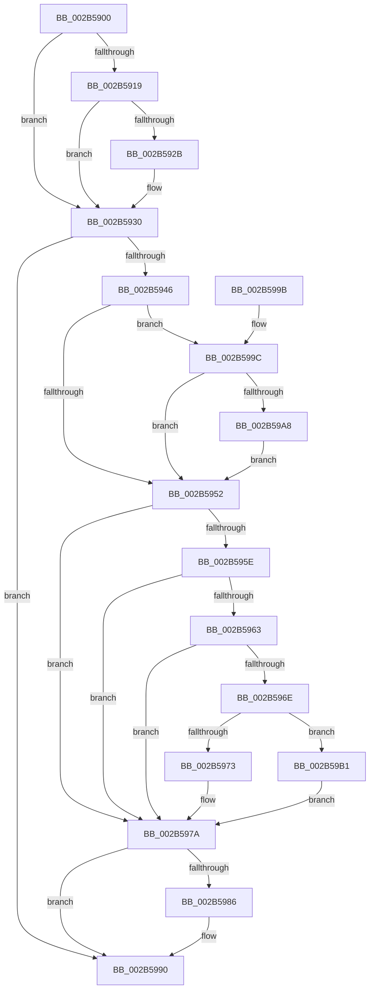

# MiFreeInPageSupportBlock

- RVA: `0x002B5900`–`0x002B59BA` (길이 `186` bytes)
- VA: `0x00000001402B5900`
- 실행 섹션: `.text`
- PDB 이름 있음: `예`; PDB Function 태그: `아니요`
- unwind 정보 RVA: `0x00065944`
- 디코드: `52`개 명령, `186/186` bytes 표시
- 미해석 바이트: `0` (있으면 어셈블리에 `.byte`로 보존)

> 이 문서는 커널 이미지의 기계어와 PDB 기호를 분석해 생성했습니다. 4번과 5번은 함수 원형과 자료형을 바이너리 사용 방식에서 추정한 C 해석이며 원본 소스 복구 결과는 아닙니다.

## 1. Dependencies

- 직접 호출 지점: **5**; 고유 호출 대상: **3**
- 직접 호출자로 확인된 함수: **16**
- RIP 상대 이미지 참조: **0**

### Outgoing calls
- `0x002B592B` → [KeAbPostRelease](../2E/KeAbPostRelease_function_002E1600.md) (function, `0x002E1600`)
- `0x002B5975` → [ExFreePoolWithTag](../../poolcode/B8/ExFreePoolWithTag_function_00B82870.md) (function, `0x00B82870`)
- `0x002B597D` → [MiInsertInPageBlock](MiInsertInPageBlock_function_002B59C0.md) (function, `0x002B59C0`)
- `0x002B598B` → [ExFreePoolWithTag](../../poolcode/B8/ExFreePoolWithTag_function_00B82870.md) (function, `0x00B82870`)
- `0x002B59AA` → [ExFreePoolWithTag](../../poolcode/B8/ExFreePoolWithTag_function_00B82870.md) (function, `0x00B82870`)

### Direct callers
- [MiResolveTransitionFault](../28/MiResolveTransitionFault_function_00282940.md) at `0x002836CD`
- [sub_00283850](../28/Unknown_function_00283850.md) at `0x00283A0B`
- [MiFinishHardFault](MiFinishHardFault_function_002B6F10.md) at `0x002B72AC`
- [MiPfPutPagesInTransition](../36/MiPfPutPagesInTransition_function_003640EC.md) at `0x00364871`
- [MiPfPutPagesInTransition](../36/MiPfPutPagesInTransition_function_003640EC.md) at `0x00364AAC`
- [MiPrivateFixup](../36/MiPrivateFixup_function_003693E8.md) at `0x00369846`
- [MiWaitForCollidedFaultComplete](../36/MiWaitForCollidedFaultComplete_function_00369EDC.md) at `0x0036A029`
- [MiResolveMappedFileFault](../36/MiResolveMappedFileFault_function_0036B640.md) at `0x0036BB2F`
- [MiResolveMappedFileFault](../36/MiResolveMappedFileFault_function_0036B640.md) at `0x0036BE41`
- [MiResolveMappedFileFault](../36/MiResolveMappedFileFault_function_0036B640.md) at `0x0036BFAF`
- [MiResolvePageFileFault](../36/MiResolvePageFileFault_function_0036D968.md) at `0x0036E897`
- [MiAllocateInPageSupport](../36/MiAllocateInPageSupport_function_0036F100.md) at `0x0036F1C8`
- [MiFaultGetFileExtents](../47/MiFaultGetFileExtents_function_00479758.md) at `0x00479824`
- [sub_006E3BD0](../6E/Unknown_function_006E3BD0.md) at `0x006E3BEC`
- [MiPfAllocateMdls](../../page/93/MiPfAllocateMdls_function_0093E45C.md) at `0x0093E6D0`
- [sub_009BB26D](../../page/9B/Unknown_function_009BB26D.md) at `0x009BB26D`
- [MiFreeRotateVadEvent](../../page/A9/MiFreeRotateVadEvent_function_00A95140.md) at `0x00A9516D`
- [MiGetReadyInPageBlock](../../page/AB/MiGetReadyInPageBlock_function_00ABB398.md) at `0x00ABB3E9`
- [sub_00B25182](../../page/B2/Unknown_function_00B25182.md) at `0x00B251C2`

### Static image references
- 디코드된 RIP-relative 메모리 참조가 없습니다.

## 2. Other-region calls and transfers

- 다른 실행 섹션으로 향하는 call: **3**
  - `0x002B5975` → [ExFreePoolWithTag](../../poolcode/B8/ExFreePoolWithTag_function_00B82870.md) (`.text` → `POOLCODE`)
  - `0x002B598B` → [ExFreePoolWithTag](../../poolcode/B8/ExFreePoolWithTag_function_00B82870.md) (`.text` → `POOLCODE`)
  - `0x002B59AA` → [ExFreePoolWithTag](../../poolcode/B8/ExFreePoolWithTag_function_00B82870.md) (`.text` → `POOLCODE`)
- 별도 외부 분기/꼬리 이동을 확인하지 못했습니다.

## 3. Assembly (complete function range)

```asm
002B5900  48 89 5C 24 08                  mov qword ptr [rsp + 8], rbx
002B5905  57                              push rdi
002B5906  48 83 EC 20                     sub rsp, 0x20
002B590A  48 8B D9                        mov rbx, rcx
002B590D  48 8B 89 D8 00 00 00            mov rcx, qword ptr [rcx + 0xd8]
002B5914  48 3B CB                        cmp rcx, rbx
002B5917  75 17                           jne 0x1402b5930
002B5919  65 48 8B 04 25 88 01 00 00      mov rax, qword ptr gs:[0x188]
002B5922  48 39 83 98 00 00 00            cmp qword ptr [rbx + 0x98], rax
002B5929  75 05                           jne 0x1402b5930
002B592B  E8 D0 BC 02 00                  call 0x1402e1600
002B5930  48 C7 C7 FF FF FF FF            mov rdi, 0xffffffffffffffff
002B5937  8B C7                           mov eax, edi
002B5939  F0 0F C1 83 B0 00 00 00         lock xadd dword ptr [rbx + 0xb0], eax
002B5941  83 F8 01                        cmp eax, 1
002B5944  75 4A                           jne 0x1402b5990
002B5946  48 8B 8B 00 01 00 00            mov rcx, qword ptr [rbx + 0x100]
002B594D  48 85 C9                        test rcx, rcx
002B5950  75 4A                           jne 0x1402b599c
002B5952  48 8B 8B D8 00 00 00            mov rcx, qword ptr [rbx + 0xd8]
002B5959  48 85 C9                        test rcx, rcx
002B595C  74 1C                           je 0x1402b597a
002B595E  48 3B CB                        cmp rcx, rbx
002B5961  74 17                           je 0x1402b597a
002B5963  F0 48 0F C1 39                  lock xadd qword ptr [rcx], rdi
002B5968  48 83 EF 01                     sub rdi, 1
002B596C  7F 0C                           jg 0x1402b597a
002B596E  48 85 FF                        test rdi, rdi
002B5971  75 3E                           jne 0x1402b59b1
002B5973  33 D2                           xor edx, edx
002B5975  E8 F6 CE 8C 00                  call 0x140b82870
002B597A  48 8B CB                        mov rcx, rbx
002B597D  E8 3E 00 00 00                  call 0x1402b59c0
002B5982  85 C0                           test eax, eax
002B5984  75 0A                           jne 0x1402b5990
002B5986  33 D2                           xor edx, edx
002B5988  48 8B CB                        mov rcx, rbx
002B598B  E8 E0 CE 8C 00                  call 0x140b82870
002B5990  48 8B 5C 24 30                  mov rbx, qword ptr [rsp + 0x30]
002B5995  48 83 C4 20                     add rsp, 0x20
002B5999  5F                              pop rdi
002B599A  C3                              ret
002B599B  CC                              int3
002B599C  48 8D 83 10 01 00 00            lea rax, [rbx + 0x110]
002B59A3  48 3B C8                        cmp rcx, rax
002B59A6  74 AA                           je 0x1402b5952
002B59A8  33 D2                           xor edx, edx
002B59AA  E8 C1 CE 8C 00                  call 0x140b82870
002B59AF  EB A1                           jmp 0x1402b5952
002B59B1  B9 0E 00 00 00                  mov ecx, 0xe
002B59B6  CD 29                           int 0x29
002B59B8  EB C0                           jmp 0x1402b597a
```

## 4. C-style interpretation (structured pseudocode)

```c
__int64 __fastcall MiFreeInPageSupportBlock(__int64 a1, int a2)
{
    __int64 result;
    __int64 v_rdi;
    __int64 v_rsp;
    unsigned __int64 v_stack_p8;

    v_stack_p8 = v_rbx;
    v_rsp = (v_rsp) - (32);
    if ((*(unsigned __int64 *)(a1 + 216)) != a1) goto loc_002B5930;
    result = *(unsigned __int64 *)(gs_base + (0 + 392));
    if ((*(unsigned __int64 *)(a1 + 152)) == (*(unsigned __int64 *)(gs_base + (0 + 392)))) {
        result = KeAbPostRelease(*(unsigned __int64 *)(a1 + 216), a2, a3, a4);
    }
    if (-1 != 1) goto loc_002B5990;
    if (*(unsigned __int64 *)(a1 + 256) != 0) goto loc_002B599C;
loc_002B5952:
    if (*(unsigned __int64 *)(a1 + 216) == 0) goto loc_002B597A;
    if ((*(unsigned __int64 *)(a1 + 216)) == a1) goto loc_002B597A;
    v_rdi = (-1) - (1);
    if (condition_is_greater) goto loc_002B597A;
    if (v_rdi != 0) goto loc_002B59B1;
    a2 = 0;
    result = ExFreePoolWithTag(*(unsigned __int64 *)(a1 + 216), a2, a3, a4);
loc_002B597A:
    result = MiInsertInPageBlock(a1, a2, a3, a4);
    if ((unsigned int)(result) == 0) {
        a2 = 0;
        a1 = a1;
        result = ExFreePoolWithTag(a1, a2, a3, a4);
    }
    v_rsp = (v_rsp) + (32);
    return result;
loc_002B599C:
    if (a1 == (v_stack_p8 + 272)) goto loc_002B5952;
    a2 = 0;
    result = ExFreePoolWithTag(a1, a2, a3, a4);
    goto loc_002B5952;
loc_002B59B1:
    goto loc_002B597A;
}
```

## 5. (Beta) C Style

```c
int64_t MiFreeInPageSupportBlock(void *Arg1, int32_t Arg2)
{
    uint8_t *arg1 = (uint8_t *)Arg1;

    int64_t result;
    int64_t local_rdi;
    int64_t local_rsp;
    uint64_t v_stack_p8;

    v_stack_p8 = local_rbx;
    local_rsp = (local_rsp) - (32);
    if ((*(uint64_t *)(arg1 + 0xD8)) != Arg1) goto loc_002B5930;
    result = *(uint64_t *)(gs_base + (0 + 0x188));
    if ((*(uint64_t *)(arg1 + 0x98)) == (*(uint64_t *)(gs_base + (0 + 0x188)))) {
        result = KeAbPostRelease(*(uint64_t *)(arg1 + 0xD8), Arg2, a3, a4);
    }
    if (-1 != 1) goto loc_002B5990;
    if (*(uint64_t *)(arg1 + 0x100) != 0) goto loc_002B599C;
loc_002B5952:
    if (*(uint64_t *)(arg1 + 0xD8) == 0) goto loc_002B597A;
    if ((*(uint64_t *)(arg1 + 0xD8)) == Arg1) goto loc_002B597A;
    local_rdi = (-1) - (1);
    if (condition_is_greater) goto loc_002B597A;
    if (local_rdi != 0) goto loc_002B59B1;
    Arg2 = 0;
    result = ExFreePoolWithTag(*(uint64_t *)(arg1 + 0xD8), Arg2, a3, a4);
loc_002B597A:
    result = MiInsertInPageBlock(Arg1, Arg2, a3, a4);
    if ((uint32_t)(result) == 0) {
        Arg2 = 0;
        Arg1 = Arg1;
        result = ExFreePoolWithTag(Arg1, Arg2, a3, a4);
    }
    local_rsp = (local_rsp) + (32);
    return result;
loc_002B599C:
    if (Arg1 == (v_stack_p8 + 272)) goto loc_002B5952;
    Arg2 = 0;
    result = ExFreePoolWithTag(Arg1, Arg2, a3, a4);
    goto loc_002B5952;
loc_002B59B1:
    goto loc_002B597A;
}
```

### 관측된 메모리 오프셋

구조체 형식이 확인되지 않은 접근은 인자 기준의 오프셋으로만 기록했습니다.

| 기준 인자 | 오프셋 표현 | 폭 (bit) | 접근 |
|---|---:|---:|---|
| `Arg1` | `+ 0x98` | `64` | `R` |
| `Arg1` | `+ 0xB0` | `32` | `R/W` |
| `Arg1` | `+ 0xD8` | `64` | `R` |
| `Arg1` | `+ 0x100` | `64` | `R` |
| `Arg1` | `+ 0x110` | `64` | `R` |

## 6. Execution-region graph

[열기: 2D/3D 그래프와 함수 탐색 컨트롤 패널](../../../control-panel.html?section=text&rva=0x002B5900&view=graph)

- 2D 그래프는 위에서 아래로 흐르고, 3D 그래프는 빈 공간을 드래그해 회전합니다. Shift+드래그는 이동, 휠은 확대·축소, 함수 노드 선택은 대상 보고서 이동입니다.

### Static fallback


