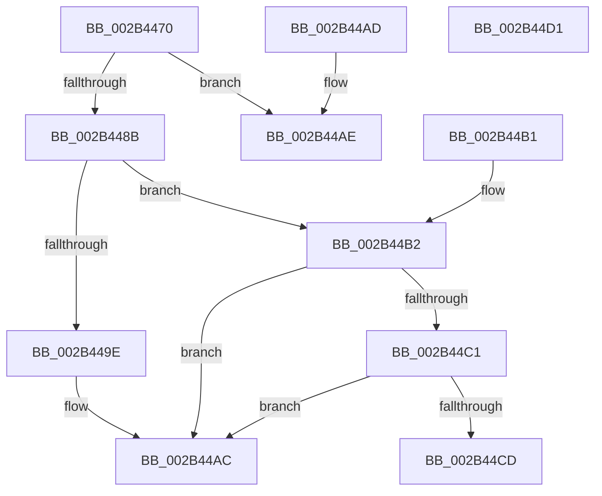

# MiGetPageTablePfnBuddyRaw

- RVA: `0x002B4470`–`0x002B44D2` (길이 `98` bytes)
- VA: `0x00000001402B4470`
- 실행 섹션: `.text`
- PDB 이름 있음: `예`; PDB Function 태그: `아니요`
- unwind 정보 RVA: `0x000DB714`
- 디코드: `29`개 명령, `98/98` bytes 표시
- 미해석 바이트: `0` (있으면 어셈블리에 `.byte`로 보존)

> 이 문서는 커널 이미지의 기계어와 PDB 기호를 분석해 생성했습니다. 4번과 5번은 함수 원형과 자료형을 바이너리 사용 방식에서 추정한 C 해석이며 원본 소스 복구 결과는 아닙니다.

## 1. Dependencies

- 직접 호출 지점: **0**; 고유 호출 대상: **0**
- 직접 호출자로 확인된 함수: **10**
- RIP 상대 이미지 참조: **2**

### Outgoing calls
- 직접 디코드된 call 명령이 없습니다.

### Direct callers
- [MiRecheckCombineVm](../22/MiRecheckCombineVm_function_0022A1FC.md) at `0x0022A22F`
- [sub_0023DED5](../23/Unknown_function_0023DED5.md) at `0x0023E0D4`
- [MiLegitimatePageForDriversToMap](../23/MiLegitimatePageForDriversToMap_function_0023ECE0.md) at `0x0023EDC2`
- [sub_00285639](../28/Unknown_function_00285639.md) at `0x0028565E`
- [MiLockStealUserVm](MiLockStealUserVm_function_002B3EDC.md) at `0x002B3F9F`
- [MiStoreCheckCandidatePage](MiStoreCheckCandidatePage_function_002B54E8.md) at `0x002B55AC`
- [MiFillSystemPtes](../31/MiFillSystemPtes_function_00319850.md) at `0x0031A04E`
- [MiRestoreTransitionPte](../33/MiRestoreTransitionPte_function_0033DD90.md) at `0x0033E15A`
- [MiCapturePfnVm](../46/MiCapturePfnVm_function_00465570.md) at `0x00465655`
- [MiStoreDiscardPoisonedPage](../69/MiStoreDiscardPoisonedPage_function_00692858.md) at `0x00692954`

### Static image references
- `0x002B44A5` → RVA `0x00E38BB8` (`.data`; read)
- `0x002B44C1` → RVA `0x00FC6AB0` (`ALMOSTRO`; read)

## 2. Other-region calls and transfers

- 다른 실행 섹션으로 향하는 call: **0**
- 별도 외부 분기/꼬리 이동을 확인하지 못했습니다.

## 3. Assembly (complete function range)

```asm
002B4470  48 8B 11                        mov rdx, qword ptr [rcx]
002B4473  8B 41 24                        mov eax, dword ptr [rcx + 0x24]
002B4476  25 00 00 FF 03                  and eax, 0x3ff0000
002B447B  48 D1 EA                        shr rdx, 1
002B447E  48 C1 E0 0F                     shl rax, 0xf
002B4482  0F BA F2 1F                     btr edx, 0x1f
002B4486  48 0B C2                        or rax, rdx
002B4489  74 23                           je 0x1402b44ae
002B448B  48 B9 00 00 00 00 00 FF FF FF   movabs rcx, 0xffffff0000000000
002B4495  48 03 C8                        add rcx, rax
002B4498  48 83 F9 01                     cmp rcx, 1
002B449C  76 14                           jbe 0x1402b44b2
002B449E  48 FF C8                        dec rax
002B44A1  48 C1 E0 04                     shl rax, 4
002B44A5  48 03 05 0C 47 B8 00            add rax, qword ptr [rip + 0xb8470c]
002B44AC  C3                              ret
002B44AD  CC                              int3
002B44AE  33 C0                           xor eax, eax
002B44B0  C3                              ret
002B44B1  CC                              int3
002B44B2  48 B9 01 00 00 00 00 01 00 00   movabs rcx, 0x10000000001
002B44BC  48 3B C1                        cmp rax, rcx
002B44BF  75 EB                           jne 0x1402b44ac
002B44C1  48 8B 0D E8 25 D1 00            mov rcx, qword ptr [rip + 0xd125e8]
002B44C8  48 85 C9                        test rcx, rcx
002B44CB  74 DF                           je 0x1402b44ac
002B44CD  48 8B C1                        mov rax, rcx
002B44D0  C3                              ret
002B44D1  CC                              int3
```

## 4. C-style interpretation (structured pseudocode)

```c
__int64 __fastcall MiGetPageTablePfnBuddyRaw(__int64 a1)
{
    __int64 result;

    result = (unsigned int)(((unsigned int)(*(unsigned int *)(a1 + 36))) & (0x3FF0000ULL));
    a2 = (*(unsigned __int64 *)(a1)) >> (1);
    result = (result) << (15);
    result = (result) | (a2);
    if (condition_is_equal) goto loc_002B44AE;
    a1 = (a1) + (result);
    if (a1 <= 1) goto loc_002B44B2;
    result = (result) - 1;
    result = (result) << (4);
    result = (result) + (*(unsigned __int64 *)(v_rip + 12076812));
loc_002B44AC:
    return result;
loc_002B44AE:
    result = 0;
    return result;
loc_002B44B2:
    if (0 != a1) goto loc_002B44AC;
    if (*(unsigned __int64 *)(v_rip + 13706728) == 0) goto loc_002B44AC;
    return *(unsigned __int64 *)(v_rip + 13706728);
}
```

## 5. (Beta) C Style

```c
int64_t MiGetPageTablePfnBuddyRaw(void *Arg1)
{
    uint8_t *arg1 = (uint8_t *)Arg1;

    int64_t result;

    result = (uint32_t)(((uint32_t)(*(uint32_t *)(arg1 + 0x24))) & (0x3FF0000ULL));
    a2 = (*(uint64_t *)(arg1)) >> (1);
    result = (result) << (15);
    result = (result) | (a2);
    if (condition_is_equal) goto loc_002B44AE;
    Arg1 = (Arg1) + (result);
    if (Arg1 <= 1) goto loc_002B44B2;
    result = (result) - 1;
    result = (result) << (4);
    result = (result) + (*(uint64_t *)(v_rip + 0xB8470C));
loc_002B44AC:
    return result;
loc_002B44AE:
    result = 0;
    return result;
loc_002B44B2:
    if (0 != Arg1) goto loc_002B44AC;
    if (*(uint64_t *)(v_rip + 0xD125E8) == 0) goto loc_002B44AC;
    return *(uint64_t *)(v_rip + 0xD125E8);
}
```

### 관측된 메모리 오프셋

구조체 형식이 확인되지 않은 접근은 인자 기준의 오프셋으로만 기록했습니다.

| 기준 인자 | 오프셋 표현 | 폭 (bit) | 접근 |
|---|---:|---:|---|
| `Arg1` | `+ 0x0` | `64` | `R` |
| `Arg1` | `+ 0x24` | `32` | `R` |

## 6. Execution-region graph

[열기: 2D/3D 그래프와 함수 탐색 컨트롤 패널](../../../control-panel.html?section=text&rva=0x002B4470&view=graph)

- 2D 그래프는 위에서 아래로 흐르고, 3D 그래프는 빈 공간을 드래그해 회전합니다. Shift+드래그는 이동, 휠은 확대·축소, 함수 노드 선택은 대상 보고서 이동입니다.

### Static fallback


