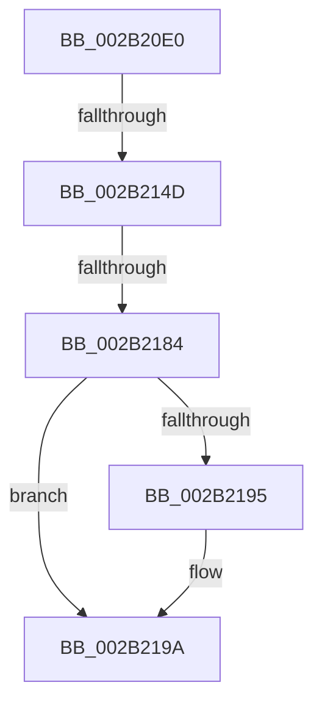

# MiGetPteFromCopyList

- RVA: `0x002B20E0`–`0x002B21A1` (길이 `193` bytes)
- VA: `0x00000001402B20E0`
- 실행 섹션: `.text`
- PDB 이름 있음: `예`; PDB Function 태그: `예`
- unwind 정보 RVA: `0x0006D6D4`
- 디코드: `50`개 명령, `193/193` bytes 표시
- 미해석 바이트: `0` (있으면 어셈블리에 `.byte`로 보존)

> 이 문서는 커널 이미지의 기계어와 PDB 기호를 분석해 생성했습니다. 4번과 5번은 함수 원형과 자료형을 바이너리 사용 방식에서 추정한 C 해석이며 원본 소스 복구 결과는 아닙니다.

## 1. Dependencies

- 직접 호출 지점: **1**; 고유 호출 대상: **1**
- 직접 호출자로 확인된 함수: **3**
- RIP 상대 이미지 참조: **2**

### Outgoing calls
- `0x002B211A` → [memset](../6C/memset_function_006C6C40.md) (function, `0x006C6C40`)

### Direct callers
- [sub_002B1BCF](Unknown_function_002B1BCF.md) at `0x002B1CAE`
- [MiCopyFilePage](../68/MiCopyFilePage_function_00680790.md) at `0x006807D0`
- [MiCopyPagesIntoEnclave](../../page/A4/MiCopyPagesIntoEnclave_function_00A472AC.md) at `0x00A47779`

### Static image references
- `0x002B20F2` → RVA `0x00E0A740` (`.data`; read)
- `0x002B219A` → RVA `0x00010990` (`.rdata`; read)

## 2. Other-region calls and transfers

- 다른 실행 섹션으로 향하는 call: **0**
- call이 아닌 외부 분기/꼬리 이동: **2**
  - `0x002B2147` → [sub_006DB6A6](../6D/Unknown_function_006DB6A6.md) (`tail-transfer`)
  - `0x002B217E` → [sub_002B25C9](Unknown_function_002B25C9.md) (`tail-transfer`)

## 3. Assembly (complete function range)

```asm
002B20E0  40 53                           push rbx
002B20E2  55                              push rbp
002B20E3  56                              push rsi
002B20E4  57                              push rdi
002B20E5  41 54                           push r12
002B20E7  41 56                           push r14
002B20E9  41 57                           push r15
002B20EB  48 81 EC 10 01 00 00            sub rsp, 0x110
002B20F2  48 8B 05 47 86 B5 00            mov rax, qword ptr [rip + 0xb58647]
002B20F9  48 33 C4                        xor rax, rsp
002B20FC  48 89 84 24 00 01 00 00         mov qword ptr [rsp + 0x100], rax
002B2104  4D 8B F8                        mov r15, r8
002B2107  48 8B FA                        mov rdi, rdx
002B210A  48 8B E9                        mov rbp, rcx
002B210D  33 D2                           xor edx, edx
002B210F  41 B8 C8 00 00 00               mov r8d, 0xc8
002B2115  48 8D 4C 24 30                  lea rcx, [rsp + 0x30]
002B211A  E8 21 4B 41 00                  call 0x1406c6c40
002B211F  8B 55 00                        mov edx, dword ptr [rbp]
002B2122  45 33 F6                        xor r14d, r14d
002B2125  49 83 FF FF                     cmp r15, -1
002B2129  49 B8 00 00 00 00 80 F6 FF FF   movabs r8, 0xfffff68000000000
002B2133  41 BC 01 00 00 00               mov r12d, 1
002B2139  41 0F 95 C6                     setne r14b
002B213D  41 FF C6                        inc r14d
002B2140  42 8D 04 32                     lea eax, [rdx + r14]
002B2144  3B 45 04                        cmp eax, dword ptr [rbp + 4]
002B2147  0F 87 59 95 42 00               ja 0x1406db6a6
002B214D  48 8B 45 10                     mov rax, qword ptr [rbp + 0x10]
002B2151  8B CA                           mov ecx, edx
002B2153  48 8D 34 C8                     lea rsi, [rax + rcx*8]
002B2157  41 8D 04 16                     lea eax, [r14 + rdx]
002B215B  48 8D 0C 7F                     lea rcx, [rdi + rdi*2]
002B215F  89 45 00                        mov dword ptr [rbp], eax
002B2162  48 B8 00 00 00 00 00 DE FF FF   movabs rax, 0xffffde0000000000
002B216C  48 C1 E1 04                     shl rcx, 4
002B2170  48 8B C0                        mov rax, rax
002B2173  48 03 C8                        add rcx, rax
002B2176  8B 41 20                        mov eax, dword ptr [rcx + 0x20]
002B2179  C1 E8 10                        shr eax, 0x10
002B217C  3C 40                           cmp al, 0x40
002B217E  0F 82 45 04 00 00               jb 0x1402b25c9
002B2184  8B 41 20                        mov eax, dword ptr [rcx + 0x20]
002B2187  BB 04 00 00 00                  mov ebx, 4
002B218C  C1 E8 10                        shr eax, 0x10
002B218F  24 C0                           and al, 0xc0
002B2191  3C 80                           cmp al, 0x80
002B2193  75 05                           jne 0x1402b219a
002B2195  BB 1C 00 00 00                  mov ebx, 0x1c
002B219A  48 8D 05 EF E7 D5 FF            lea rax, [rip - 0x2a1811]
```

## 4. C-style interpretation (structured pseudocode)

```c
__int64 __fastcall MiGetPteFromCopyList(__int64 a1, __int64 a2, __int64 a3)
{
    __int64 result;
    __int64 v_r14;
    __int64 v_rbx;
    __int64 v_rsp;
    unsigned __int64 v_stack_m118;
    unsigned __int64 v_stack_m48;

    v_rsp = (v_rsp) - (272);
    result = (*(unsigned __int64 *)(v_rip + 11896391)) ^ (v_rsp);
    v_stack_m48 = result;
    a2 = 0;
    result = memset(v_stack_m118, a2, 200, a4);
    v_r14 = 0;
    v_r14 = (a3 != -1) ? 1 : 0;
    v_r14 = (unsigned int)((v_r14) + 1);
    *(unsigned int *)(a1) = (unsigned int)(v_r14 + (unsigned int)(*(unsigned int *)(a1)) * 1);
    a1 = (a2 + a2 * 2) << (4);
    a1 = (a1) + (v_r14 + (unsigned int)(*(unsigned int *)(a1)) * 1);
    result = (unsigned int)(((unsigned int)(*(unsigned int *)(a1 + 32))) >> (16));
    result = (unsigned int)(((unsigned int)(*(unsigned int *)(a1 + 32))) >> (16));
    result = (unsigned __int8)((result) & (192));
    v_rbx = 4;
    if (((unsigned __int8)(result)) == 128) {
        v_rbx = 28;
    }
    return v_rip - 2758673;
}
```

## 5. (Beta) C Style

```c
int64_t MiGetPteFromCopyList(void *Arg1, void *Arg2, int64_t Arg3)
{
    uint8_t *arg1 = (uint8_t *)Arg1;
    uint8_t *arg2 = (uint8_t *)Arg2;

    int64_t result;
    int64_t local_r14;
    int64_t local_rbx;
    int64_t local_rsp;
    uint64_t v_stack_m118;
    uint64_t v_stack_m48;

    local_rsp = (local_rsp) - (272);
    result = (*(uint64_t *)(v_rip + 0xB58647)) ^ (local_rsp);
    v_stack_m48 = result;
    Arg2 = 0;
    result = memset(v_stack_m118, Arg2, 200, a4);
    local_r14 = 0;
    local_r14 = (Arg3 != -1) ? 1 : 0;
    local_r14 = (uint32_t)((local_r14) + 1);
    *(uint32_t *)(arg1) = (uint32_t)(local_r14 + (uint32_t)(*(uint32_t *)(arg1)) * 1);
    Arg1 = (Arg2 + Arg2 * 2) << (4);
    Arg1 = (Arg1) + (local_r14 + (uint32_t)(*(uint32_t *)(arg1)) * 1);
    result = (uint32_t)(((uint32_t)(*(uint32_t *)(arg1 + 0x20))) >> (16));
    result = (uint32_t)(((uint32_t)(*(uint32_t *)(arg1 + 0x20))) >> (16));
    result = (uint8_t)((result) & (192));
    local_rbx = 4;
    if (((uint8_t)(result)) == 128) {
        local_rbx = 28;
    }
    return v_rip - 2758673;
}
```

### 관측된 메모리 오프셋

구조체 형식이 확인되지 않은 접근은 인자 기준의 오프셋으로만 기록했습니다.

| 기준 인자 | 오프셋 표현 | 폭 (bit) | 접근 |
|---|---:|---:|---|
| `Arg1` | `+ 0x0` | `32` | `R` |
| `Arg1` | `+ 0x0` | `32` | `W` |
| `Arg1` | `+ 0x4` | `32` | `R` |
| `Arg1` | `+ 0x10` | `64` | `R` |
| `Arg2` | `+ 0x0 + rdi*2` | `64` | `R` |

## 6. Execution-region graph

[열기: 2D/3D 그래프와 함수 탐색 컨트롤 패널](../../../control-panel.html?section=text&rva=0x002B20E0&view=graph)

- 2D 그래프는 위에서 아래로 흐르고, 3D 그래프는 빈 공간을 드래그해 회전합니다. Shift+드래그는 이동, 휠은 확대·축소, 함수 노드 선택은 대상 보고서 이동입니다.

### Static fallback


