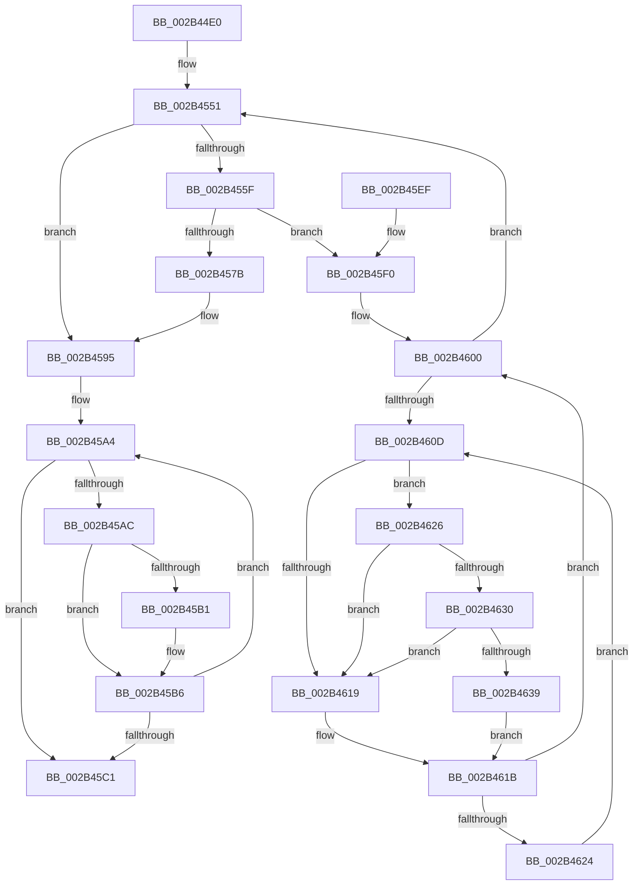

# MiGetTopLevelPfn

- RVA: `0x002B44E0`–`0x002B4643` (길이 `355` bytes)
- VA: `0x00000001402B44E0`
- 실행 섹션: `.text`
- PDB 이름 있음: `예`; PDB Function 태그: `아니요`
- unwind 정보 RVA: `0x0006D7FC`
- 디코드: `98`개 명령, `355/355` bytes 표시
- 미해석 바이트: `0` (있으면 어셈블리에 `.byte`로 보존)

> 이 문서는 커널 이미지의 기계어와 PDB 기호를 분석해 생성했습니다. 4번과 5번은 함수 원형과 자료형을 바이너리 사용 방식에서 추정한 C 해석이며 원본 소스 복구 결과는 아닙니다.

## 1. Dependencies

- 직접 호출 지점: **4**; 고유 호출 대상: **4**
- 직접 호출자로 확인된 함수: **9**
- RIP 상대 이미지 참조: **3**

### Outgoing calls
- `0x002B458F` → [KeBugCheckEx](../4F/KeBugCheckEx_function_004FD660.md) (function, `0x004FD660`)
- `0x002B45CC` → [_security_check_cookie](../6A/_security_check_cookie_function_006AC640.md) (function, `0x006AC640`)
- `0x002B4630` → [KiCheckVpBackingLongSpinWaitHypercall](../30/KiCheckVpBackingLongSpinWaitHypercall_function_0030F490.md) (function, `0x0030F490`)
- `0x002B463C` → [HvlNotifyLongSpinWait](../30/HvlNotifyLongSpinWait_function_0030F460.md) (function, `0x0030F460`)

### Direct callers
- [MiRecheckCombineVm](../22/MiRecheckCombineVm_function_0022A1FC.md) at `0x0022A224`
- [sub_00285639](../28/Unknown_function_00285639.md) at `0x00285653`
- [MiLockStealUserVm](MiLockStealUserVm_function_002B3EDC.md) at `0x002B3F94`
- [MiStoreCheckCandidatePage](MiStoreCheckCandidatePage_function_002B54E8.md) at `0x002B5598`
- [sub_0031CD16](../31/Unknown_function_0031CD16.md) at `0x0031CF2D`
- [MiRestoreTransitionPte](../33/MiRestoreTransitionPte_function_0033DD90.md) at `0x0033E14F`
- [MiCapturePfnVm](../46/MiCapturePfnVm_function_00465570.md) at `0x0046564A`
- [MiStoreDiscardPoisonedPage](../69/MiStoreDiscardPoisonedPage_function_00692858.md) at `0x00692944`
- [sub_006E1546](../6E/Unknown_function_006E1546.md) at `0x006E1624`

### Static image references
- `0x002B44FC` → RVA `0x00E0A740` (`.data`; read)
- `0x002B4610` → RVA `0x00FC52AC` (`ALMOSTRO`; reference)
- `0x002B4626` → RVA `0x00FC6AB8` (`ALMOSTRO`; read)

## 2. Other-region calls and transfers

- 다른 실행 섹션으로 향하는 call: **0**
- 별도 외부 분기/꼬리 이동을 확인하지 못했습니다.

## 3. Assembly (complete function range)

```asm
002B44E0  48 89 5C 24 10                  mov qword ptr [rsp + 0x10], rbx
002B44E5  48 89 6C 24 18                  mov qword ptr [rsp + 0x18], rbp
002B44EA  48 89 74 24 20                  mov qword ptr [rsp + 0x20], rsi
002B44EF  57                              push rdi
002B44F0  41 54                           push r12
002B44F2  41 55                           push r13
002B44F4  41 56                           push r14
002B44F6  41 57                           push r15
002B44F8  48 83 EC 60                     sub rsp, 0x60
002B44FC  48 8B 05 3D 62 B5 00            mov rax, qword ptr [rip + 0xb5623d]
002B4503  48 33 C4                        xor rax, rsp
002B4506  48 89 44 24 50                  mov qword ptr [rsp + 0x50], rax
002B450B  0F 57 C0                        xorps xmm0, xmm0
002B450E  49 BD 00 00 00 00 00 DE FF FF   movabs r13, 0xffffde0000000000
002B4518  0F 11 44 24 30                  movups xmmword ptr [rsp + 0x30], xmm0
002B451D  48 8B D9                        mov rbx, rcx
002B4520  4C 8B F9                        mov r15, rcx
002B4523  0F 11 44 24 40                  movups xmmword ptr [rsp + 0x40], xmm0
002B4528  49 8B C5                        mov rax, r13
002B452B  48 8B F9                        mov rdi, rcx
002B452E  49 BC FF FF FF FF FF 00 00 00   movabs r12, 0xffffffffff
002B4538  48 2B F8                        sub rdi, rax
002B453B  48 B8 AB AA AA AA AA AA AA AA   movabs rax, 0xaaaaaaaaaaaaaaab
002B4545  48 C1 FF 04                     sar rdi, 4
002B4549  48 0F AF F8                     imul rdi, rax
002B454D  33 F6                           xor esi, esi
002B454F  8B EE                           mov ebp, esi
002B4551  48 8B 43 28                     mov rax, qword ptr [rbx + 0x28]
002B4555  49 23 C4                        and rax, r12
002B4558  8B CD                           mov ecx, ebp
002B455A  48 3B C7                        cmp rax, rdi
002B455D  74 36                           je 0x1402b4595
002B455F  48 8B 7B 28                     mov rdi, qword ptr [rbx + 0x28]
002B4563  49 23 FC                        and rdi, r12
002B4566  48 8D 1C 7F                     lea rbx, [rdi + rdi*2]
002B456A  48 C1 E3 04                     shl rbx, 4
002B456E  49 8B C5                        mov rax, r13
002B4571  48 03 D8                        add rbx, rax
002B4574  FF C5                           inc ebp
002B4576  83 FD 04                        cmp ebp, 4
002B4579  76 75                           jbe 0x1402b45f0
002B457B  45 33 C9                        xor r9d, r9d
002B457E  48 89 74 24 20                  mov qword ptr [rsp + 0x20], rsi
002B4583  4D 8B C7                        mov r8, r15
002B4586  BA 96 96 00 00                  mov edx, 0x9696
002B458B  41 8D 49 1A                     lea ecx, [r9 + 0x1a]
002B458F  E8 CC 90 24 00                  call 0x1404fd660
002B4594  CC                              int3
002B4595  48 8D 4C 24 30                  lea rcx, [rsp + 0x30]
002B459A  48 BA FF FF FF FF FF FF FF 7F   movabs rdx, 0x7fffffffffffffff
002B45A4  48 8B 01                        mov rax, qword ptr [rcx]
002B45A7  48 85 C0                        test rax, rax
002B45AA  74 15                           je 0x1402b45c1
002B45AC  48 3B C3                        cmp rax, rbx
002B45AF  74 05                           je 0x1402b45b6
002B45B1  F0 48 21 50 18                  lock and qword ptr [rax + 0x18], rdx
002B45B6  FF C6                           inc esi
002B45B8  48 83 C1 08                     add rcx, 8
002B45BC  83 FE 04                        cmp esi, 4
002B45BF  72 E3                           jb 0x1402b45a4
002B45C1  48 8B C3                        mov rax, rbx
002B45C4  48 8B 4C 24 50                  mov rcx, qword ptr [rsp + 0x50]
002B45C9  48 33 CC                        xor rcx, rsp
002B45CC  E8 6F 80 3F 00                  call 0x1406ac640
002B45D1  4C 8D 5C 24 60                  lea r11, [rsp + 0x60]
002B45D6  49 8B 5B 38                     mov rbx, qword ptr [r11 + 0x38]
002B45DA  49 8B 6B 40                     mov rbp, qword ptr [r11 + 0x40]
002B45DE  49 8B 73 48                     mov rsi, qword ptr [r11 + 0x48]
002B45E2  49 8B E3                        mov rsp, r11
002B45E5  41 5F                           pop r15
002B45E7  41 5E                           pop r14
002B45E9  41 5D                           pop r13
002B45EB  41 5C                           pop r12
002B45ED  5F                              pop rdi
002B45EE  C3                              ret
002B45EF  CC                              int3
002B45F0  48 89 5C CC 30                  mov qword ptr [rsp + rcx*8 + 0x30], rbx
002B45F5  44 8B F6                        mov r14d, esi
002B45F8  0F 1F 84 00 00 00 00 00         nop dword ptr [rax + rax]
002B4600  F0 48 0F BA 6B 18 3F            lock bts qword ptr [rbx + 0x18], 0x3f
002B4607  0F 83 44 FF FF FF               jae 0x1402b4551
002B460D  41 FF C6                        inc r14d
002B4610  44 85 35 95 0C D1 00            test dword ptr [rip + 0xd10c95], r14d
002B4617  74 0D                           je 0x1402b4626
002B4619  F3 90                           pause
002B461B  48 8B 43 18                     mov rax, qword ptr [rbx + 0x18]
002B461F  48 85 C0                        test rax, rax
002B4622  79 DC                           jns 0x1402b4600
002B4624  EB E7                           jmp 0x1402b460d
002B4626  8B 05 8C 24 D1 00               mov eax, dword ptr [rip + 0xd1248c]
002B462C  A8 40                           test al, 0x40
002B462E  74 E9                           je 0x1402b4619
002B4630  E8 5B AE 05 00                  call 0x14030f490
002B4635  84 C0                           test al, al
002B4637  74 E0                           je 0x1402b4619
002B4639  41 8B CE                        mov ecx, r14d
002B463C  E8 1F AE 05 00                  call 0x14030f460
002B4641  EB D8                           jmp 0x1402b461b
```

## 4. C-style interpretation (structured pseudocode)

```c
__int64 __fastcall MiGetTopLevelPfn(__int64 a1, __int64 a2, __int64 a3, int a4)
{
    __int64 result;
    __int64 v_r14;
    __int64 v_rbp;
    __int64 v_rbx;
    __int64 v_rdi;
    __int64 v_rsi;
    __int64 v_rsp;
    unsigned __int64 v_stack_m28;
    unsigned __int64 v_stack_m38;
    unsigned __int64 v_stack_m48;
    unsigned __int64 v_stack_m58;
    unsigned __int64 v_stack_m68;
    unsigned __int64 v_stack_p10;
    unsigned __int64 v_stack_p18;
    unsigned __int64 v_stack_p20;

    v_stack_p10 = v_rbx;
    v_stack_p18 = v_rbp;
    v_stack_p20 = v_rsi;
    v_rsp = (v_rsp) - (96);
    result = (*(unsigned __int64 *)(v_rip + 11887165)) ^ (v_rsp);
    v_stack_m38 = result;
    v_stack_m58 = v_xmm0;
    v_stack_m48 = v_xmm0;
    v_rdi = (a1) - (v_r13);
    v_rdi = (v_rdi) >> (4);
    v_rdi = (v_rdi) * (v_r13);
    v_rsi = 0;
loc_002B4551:
    result = (*(unsigned __int64 *)(a1 + 40)) & (v_r12);
    if (result == v_rdi) goto loc_002B4595;
    v_rdi = (*(unsigned __int64 *)(a1 + 40)) & (v_r12);
    v_rbx = (v_rdi + v_rdi * 2) << (4);
    v_rbx = (v_rbx) + (v_r13);
    v_rbp = (unsigned int)((0) + 1);
    if (((unsigned int)(v_rbp)) <= 4) goto loc_002B45F0;
    a4 = 0;
    v_stack_m68 = 0;
    result = KeBugCheckEx(a4 + 26, (unsigned int)(0x9696ULL), a1, a4);
loc_002B4595:
loc_002B45A4:
    if (*(unsigned __int64 *)(v_stack_m58) == 0) goto loc_002B45C1;
    if ((*(unsigned __int64 *)(v_stack_m58)) != v_rbx) {
    }
    v_rsi = (unsigned int)((v_rsi) + 1);
    a1 = (v_stack_m58) + (8);
    if (((unsigned int)(v_rsi)) < 4) goto loc_002B45A4;
loc_002B45C1:
    a1 = (v_stack_m38) ^ (v_rsp);
    result = _security_check_cookie(a1, (unsigned int)(0x9696ULL), a1, a4);
    return result;
loc_002B45F0:
    *(unsigned __int64 *)(v_stack_m28 + a1 * 8 + 48) = *(unsigned __int64 *)(v_stack_m28 + 56);
loc_002B4600:
    if (condition_is_above_or_equal) goto loc_002B4551;
loc_002B460D:
    v_r14 = (unsigned int)(((unsigned int)((unsigned int)(*(unsigned __int64 *)(v_stack_m28 + 72)))) + 1);
    if (((*(unsigned int *)(v_rip + 13700245)) & ((unsigned int)(v_r14))) == 0) goto loc_002B4626;
loc_002B4619:
loc_002B461B:
    if (!sign_flag) goto loc_002B4600;
    goto loc_002B460D;
loc_002B4626:
    if ((((unsigned __int8)((unsigned int)(*(unsigned int *)(v_rip + 13706380)))) & (64)) == 0) goto loc_002B4619;
    result = KiCheckVpBackingLongSpinWaitHypercall(a1, (unsigned int)(0x9696ULL), a1, a4);
    if ((unsigned __int8)(result) == 0) goto loc_002B4619;
    result = HvlNotifyLongSpinWait((unsigned int)((unsigned int)(v_r14)), (unsigned int)(0x9696ULL), a1, a4);
    goto loc_002B461B;
}
```

## 5. (Beta) C Style

```c
int64_t MiGetTopLevelPfn(int64_t Arg1, int64_t Arg2, int64_t Arg3, int32_t Arg4)
{
    int64_t result;
    int64_t local_r14;
    int64_t local_rbp;
    int64_t local_rbx;
    int64_t local_rdi;
    int64_t local_rsi;
    int64_t local_rsp;
    uint64_t v_stack_m28;
    uint64_t v_stack_m38;
    uint64_t v_stack_m48;
    uint64_t v_stack_m58;
    uint64_t v_stack_m68;
    uint64_t v_stack_p10;
    uint64_t v_stack_p18;
    uint64_t v_stack_p20;

    v_stack_p10 = local_rbx;
    v_stack_p18 = local_rbp;
    v_stack_p20 = local_rsi;
    local_rsp = (local_rsp) - (96);
    result = (*(uint64_t *)(v_rip + 0xB5623D)) ^ (local_rsp);
    v_stack_m38 = result;
    v_stack_m58 = v_xmm0;
    v_stack_m48 = v_xmm0;
    local_rdi = (Arg1) - (local_r13);
    local_rdi = (local_rdi) >> (4);
    local_rdi = (local_rdi) * (local_r13);
    local_rsi = 0;
loc_002B4551:
    result = (*(uint64_t *)(Arg1 + 0x28)) & (local_r12);
    if (result == local_rdi) goto loc_002B4595;
    local_rdi = (*(uint64_t *)(Arg1 + 0x28)) & (local_r12);
    local_rbx = (local_rdi + local_rdi * 2) << (4);
    local_rbx = (local_rbx) + (local_r13);
    local_rbp = (uint32_t)((0) + 1);
    if (((uint32_t)(local_rbp)) <= 4) goto loc_002B45F0;
    Arg4 = 0;
    v_stack_m68 = 0;
    result = KeBugCheckEx(Arg4 + 26, (uint32_t)(0x9696ULL), Arg1, Arg4);
loc_002B4595:
loc_002B45A4:
    if (*(uint64_t *)(v_stack_m58) == 0) goto loc_002B45C1;
    if ((*(uint64_t *)(v_stack_m58)) != local_rbx) {
    }
    local_rsi = (uint32_t)((local_rsi) + 1);
    Arg1 = (v_stack_m58) + (8);
    if (((uint32_t)(local_rsi)) < 4) goto loc_002B45A4;
loc_002B45C1:
    Arg1 = (v_stack_m38) ^ (local_rsp);
    result = _security_check_cookie(Arg1, (uint32_t)(0x9696ULL), Arg1, Arg4);
    return result;
loc_002B45F0:
    *(uint64_t *)(v_stack_m28 + Arg1 * 8 + 0x30) = *(uint64_t *)(v_stack_m28 + 0x38);
loc_002B4600:
    if (condition_is_above_or_equal) goto loc_002B4551;
loc_002B460D:
    local_r14 = (uint32_t)(((uint32_t)((uint32_t)(*(uint64_t *)(v_stack_m28 + 0x48)))) + 1);
    if (((*(uint32_t *)(v_rip + 0xD10C95)) & ((uint32_t)(local_r14))) == 0) goto loc_002B4626;
loc_002B4619:
loc_002B461B:
    if (!sign_flag) goto loc_002B4600;
    goto loc_002B460D;
loc_002B4626:
    if ((((uint8_t)((uint32_t)(*(uint32_t *)(v_rip + 0xD1248C)))) & (64)) == 0) goto loc_002B4619;
    result = KiCheckVpBackingLongSpinWaitHypercall(Arg1, (uint32_t)(0x9696ULL), Arg1, Arg4);
    if ((uint8_t)(result) == 0) goto loc_002B4619;
    result = HvlNotifyLongSpinWait((uint32_t)((uint32_t)(local_r14)), (uint32_t)(0x9696ULL), Arg1, Arg4);
    goto loc_002B461B;
}
```

## 6. Execution-region graph

[열기: 2D/3D 그래프와 함수 탐색 컨트롤 패널](../../../control-panel.html?section=text&rva=0x002B44E0&view=graph)

- 2D 그래프는 위에서 아래로 흐르고, 3D 그래프는 빈 공간을 드래그해 회전합니다. Shift+드래그는 이동, 휠은 확대·축소, 함수 노드 선택은 대상 보고서 이동입니다.

### Static fallback


