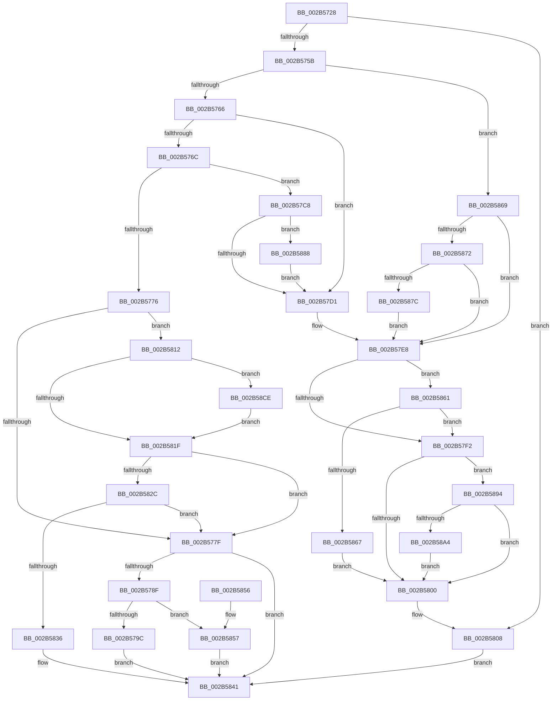

# MiHardFaultPageRelease

- RVA: `0x002B5728`–`0x002B58F7` (길이 `463` bytes)
- VA: `0x00000001402B5728`
- 실행 섹션: `.text`
- PDB 이름 있음: `예`; PDB Function 태그: `아니요`
- unwind 정보 RVA: `0x0006D870`
- 디코드: `112`개 명령, `463/463` bytes 표시
- 미해석 바이트: `0` (있으면 어셈블리에 `.byte`로 보존)

> 이 문서는 커널 이미지의 기계어와 PDB 기호를 분석해 생성했습니다. 4번과 5번은 함수 원형과 자료형을 바이너리 사용 방식에서 추정한 C 해석이며 원본 소스 복구 결과는 아닙니다.

## 1. Dependencies

- 직접 호출 지점: **9**; 고유 호출 대상: **9**
- 직접 호출자로 확인된 함수: **2**
- RIP 상대 이미지 참조: **1**

### Outgoing calls
- `0x002B5782` → [MiRemoveLockedPageCharge](../24/MiRemoveLockedPageCharge_function_00246950.md) (function, `0x00246950`)
- `0x002B57C1` → [MiPfnReferenceCountIsZero](MiPfnReferenceCountIsZero_function_002B9E40.md) (function, `0x002B9E40`)
- `0x002B5803` → [MiHandleInPageError](../36/MiHandleInPageError_function_00368EBC.md) (function, `0x00368EBC`)
- `0x002B580B` → [MiRemoveLockedPageChargeAndDecRef](../24/MiRemoveLockedPageChargeAndDecRef_function_002459D0.md) (function, `0x002459D0`)
- `0x002B583C` → [MiMakeFaultPfnActive](../36/MiMakeFaultPfnActive_function_00361D00.md) (function, `0x00361D00`)
- `0x002B585A` → [MiInsertProtectedStandbyPage](../45/MiInsertProtectedStandbyPage_function_004527D8.md) (function, `0x004527D8`)
- `0x002B5897` → [MiIsPfnCommitNotCharged](../31/MiIsPfnCommitNotCharged_function_00317370.md) (function, `0x00317370`)
- `0x002B58C4` → [MiChargeCommit](../28/MiChargeCommit_function_00286EB0.md) (function, `0x00286EB0`)
- `0x002B58DB` → [MiSwapHardFaultPage](../38/MiSwapHardFaultPage_function_00385F34.md) (function, `0x00385F34`)

### Direct callers
- [MiAddPageToInsertList](../24/MiAddPageToInsertList_function_0024A950.md) at `0x0024AC51`
- [MiFinishHardFault](MiFinishHardFault_function_002B6F10.md) at `0x002B71E8`

### Static image references
- `0x002B58B3` → RVA `0x00E30088` (`.data`; read)

## 2. Other-region calls and transfers

- 다른 실행 섹션으로 향하는 call: **0**
- 별도 외부 분기/꼬리 이동을 확인하지 못했습니다.

## 3. Assembly (complete function range)

```asm
002B5728  48 89 5C 24 10                  mov qword ptr [rsp + 0x10], rbx
002B572D  48 89 6C 24 18                  mov qword ptr [rsp + 0x18], rbp
002B5732  48 89 74 24 20                  mov qword ptr [rsp + 0x20], rsi
002B5737  57                              push rdi
002B5738  48 83 EC 20                     sub rsp, 0x20
002B573C  48 8B 31                        mov rsi, qword ptr [rcx]
002B573F  48 8B F9                        mov rdi, rcx
002B5742  48 8B 42 18                     mov rax, qword ptr [rdx + 0x18]
002B5746  48 8B DA                        mov rbx, rdx
002B5749  48 0F BA E0 3E                  bt rax, 0x3e
002B574E  48 8B 8E F8 00 00 00            mov rcx, qword ptr [rsi + 0xf8]
002B5755  0F 82 AD 00 00 00               jb 0x1402b5808
002B575B  B2 10                           mov dl, 0x10
002B575D  84 53 23                        test byte ptr [rbx + 0x23], dl
002B5760  0F 85 03 01 00 00               jne 0x1402b5869
002B5766  83 7E 50 00                     cmp dword ptr [rsi + 0x50], 0
002B576A  7C 65                           jl 0x1402b57d1
002B576C  48 8B 47 18                     mov rax, qword ptr [rdi + 0x18]
002B5770  48 39 47 10                     cmp qword ptr [rdi + 0x10], rax
002B5774  73 52                           jae 0x1402b57c8
002B5776  48 3B D9                        cmp rbx, rcx
002B5779  0F 84 93 00 00 00               je 0x1402b5812
002B577F  48 8B CB                        mov rcx, rbx
002B5782  E8 C9 11 F9 FF                  call 0x140246950
002B5787  85 C0                           test eax, eax
002B5789  0F 84 B2 00 00 00               je 0x1402b5841
002B578F  48 8B 4F 38                     mov rcx, qword ptr [rdi + 0x38]
002B5793  48 85 C9                        test rcx, rcx
002B5796  0F 85 BB 00 00 00               jne 0x1402b5857
002B579C  48 B8 00 00 00 00 00 DE FF FF   movabs rax, 0xffffde0000000000
002B57A6  48 8B D3                        mov rdx, rbx
002B57A9  48 8B CB                        mov rcx, rbx
002B57AC  48 2B D0                        sub rdx, rax
002B57AF  48 B8 AB AA AA AA AA AA AA AA   movabs rax, 0xaaaaaaaaaaaaaaab
002B57B9  48 C1 FA 04                     sar rdx, 4
002B57BD  48 0F AF D0                     imul rdx, rax
002B57C1  E8 7A 46 00 00                  call 0x1402b9e40
002B57C6  EB 79                           jmp 0x1402b5841
002B57C8  48 3B D9                        cmp rbx, rcx
002B57CB  0F 84 B7 00 00 00               je 0x1402b5888
002B57D1  8B 43 20                        mov eax, dword ptr [rbx + 0x20]
002B57D4  89 44 24 30                     mov dword ptr [rsp + 0x30], eax
002B57D8  C1 E8 18                        shr eax, 0x18
002B57DB  0A C2                           or al, dl
002B57DD  88 44 24 33                     mov byte ptr [rsp + 0x33], al
002B57E1  8B 44 24 30                     mov eax, dword ptr [rsp + 0x30]
002B57E5  89 43 20                        mov dword ptr [rbx + 0x20], eax
002B57E8  8B 86 C0 00 00 00               mov eax, dword ptr [rsi + 0xc0]
002B57EE  A8 40                           test al, 0x40
002B57F0  75 6F                           jne 0x1402b5861
002B57F2  8B 43 10                        mov eax, dword ptr [rbx + 0x10]
002B57F5  48 0F BA E0 0A                  bt rax, 0xa
002B57FA  0F 83 94 00 00 00               jae 0x1402b5894
002B5800  48 8B CB                        mov rcx, rbx
002B5803  E8 B4 36 0B 00                  call 0x140368ebc
002B5808  48 8B CB                        mov rcx, rbx
002B580B  E8 C0 01 F9 FF                  call 0x1402459d0
002B5810  EB 2F                           jmp 0x1402b5841
002B5812  48 8B 6E 68                     mov rbp, qword ptr [rsi + 0x68]
002B5816  48 85 ED                        test rbp, rbp
002B5819  0F 85 AF 00 00 00               jne 0x1402b58ce
002B581F  C6 47 28 01                     mov byte ptr [rdi + 0x28], 1
002B5823  48 3B D9                        cmp rbx, rcx
002B5826  0F 85 53 FF FF FF               jne 0x1402b577f
002B582C  83 7F 08 00                     cmp dword ptr [rdi + 8], 0
002B5830  0F 8C 49 FF FF FF               jl 0x1402b577f
002B5836  48 8B D3                        mov rdx, rbx
002B5839  48 8B CF                        mov rcx, rdi
002B583C  E8 BF C4 0A 00                  call 0x140361d00
002B5841  48 8B 5C 24 38                  mov rbx, qword ptr [rsp + 0x38]
002B5846  48 8B 6C 24 40                  mov rbp, qword ptr [rsp + 0x40]
002B584B  48 8B 74 24 48                  mov rsi, qword ptr [rsp + 0x48]
002B5850  48 83 C4 20                     add rsp, 0x20
002B5854  5F                              pop rdi
002B5855  C3                              ret
002B5856  CC                              int3
002B5857  48 8B D3                        mov rdx, rbx
002B585A  E8 79 CF 19 00                  call 0x1404527d8
002B585F  EB E0                           jmp 0x1402b5841
002B5861  80 7F 29 00                     cmp byte ptr [rdi + 0x29], 0
002B5865  75 8B                           jne 0x1402b57f2
002B5867  EB 97                           jmp 0x1402b5800
002B5869  48 3B D9                        cmp rbx, rcx
002B586C  0F 85 76 FF FF FF               jne 0x1402b57e8
002B5872  83 7E 50 00                     cmp dword ptr [rsi + 0x50], 0
002B5876  0F 8C 6C FF FF FF               jl 0x1402b57e8
002B587C  C7 46 50 3F 00 00 C0            mov dword ptr [rsi + 0x50], 0xc000003f
002B5883  E9 60 FF FF FF                  jmp 0x1402b57e8
002B5888  C7 47 08 34 04 00 C0            mov dword ptr [rdi + 8], 0xc0000434
002B588F  E9 3D FF FF FF                  jmp 0x1402b57d1
002B5894  48 8B CB                        mov rcx, rbx
002B5897  E8 D4 1A 06 00                  call 0x140317370
002B589C  85 C0                           test eax, eax
002B589E  0F 85 5C FF FF FF               jne 0x1402b5800
002B58A4  48 8B 4B 28                     mov rcx, qword ptr [rbx + 0x28]
002B58A8  8D 50 01                        lea edx, [rax + 1]
002B58AB  48 C1 E9 2B                     shr rcx, 0x2b
002B58AF  44 8D 40 04                     lea r8d, [rax + 4]
002B58B3  48 8B 05 CE A7 B7 00            mov rax, qword ptr [rip + 0xb7a7ce]
002B58BA  81 E1 FF 03 00 00               and ecx, 0x3ff
002B58C0  48 8B 0C C8                     mov rcx, qword ptr [rax + rcx*8]
002B58C4  E8 E7 15 FD FF                  call 0x140286eb0
002B58C9  E9 32 FF FF FF                  jmp 0x1402b5800
002B58CE  48 8B 8E E8 00 00 00            mov rcx, qword ptr [rsi + 0xe8]
002B58D5  4C 8B C5                        mov r8, rbp
002B58D8  48 8B D3                        mov rdx, rbx
002B58DB  E8 54 06 0D 00                  call 0x140385f34
002B58E0  48 83 66 68 00                  and qword ptr [rsi + 0x68], 0
002B58E5  48 8B CD                        mov rcx, rbp
002B58E8  48 8B DD                        mov rbx, rbp
002B58EB  48 89 AE F8 00 00 00            mov qword ptr [rsi + 0xf8], rbp
002B58F2  E9 28 FF FF FF                  jmp 0x1402b581f
```

## 4. C-style interpretation (structured pseudocode)

```c
__int64 __fastcall MiHardFaultPageRelease(__int64 a1, __int64 a2)
{
    __int64 result;
    __int64 v_rsp;
    unsigned __int64 v_stack_p10;
    unsigned __int64 v_stack_p18;
    unsigned __int64 v_stack_p20;
    unsigned int v_stack_p8;
    unsigned __int8 v_stack_pB;

    v_stack_p10 = v_rbx;
    v_stack_p18 = v_rbp;
    v_stack_p20 = v_rsi;
    v_rsp = (v_rsp) - (32);
    if (condition_is_below) goto loc_002B5808;
    if (((*(unsigned __int8 *)(a2 + 35)) & (16)) != 0) goto loc_002B5869;
    if ((*(unsigned int *)(*(unsigned __int64 *)(a1) + 80)) < 0) goto loc_002B57D1;
    if ((*(unsigned __int64 *)(a1 + 16)) >= (*(unsigned __int64 *)(a1 + 24))) goto loc_002B57C8;
    if (a2 == (*(unsigned __int64 *)(*(unsigned __int64 *)(a1) + 248))) goto loc_002B5812;
loc_002B577F:
    result = MiRemoveLockedPageCharge(a2, 16, a3, a4);
    if ((unsigned int)(result) == 0) goto loc_002B5841;
    if (*(unsigned __int64 *)(a1 + 56) != 0) goto loc_002B5857;
    a2 = (a2) - (result);
    a2 = (a2) >> (4);
    a2 = (a2) * (result);
    result = MiPfnReferenceCountIsZero(a2, a2, a3, a4);
    goto loc_002B5841;
loc_002B57C8:
    if (a2 == a2) goto loc_002B5888;
loc_002B57D1:
    v_stack_p8 = (unsigned int)((unsigned int)(*(unsigned int *)(a2 + 32)));
    result = (unsigned int)(((unsigned int)(*(unsigned int *)(a2 + 32))) >> (24));
    result = (unsigned __int8)((result) | ((unsigned __int8)(a2)));
    v_stack_pB = (unsigned __int8)(result);
    *(unsigned int *)(a2 + 32) = (unsigned int)((unsigned int)(v_stack_p8));
loc_002B57E8:
    if ((((unsigned __int8)((unsigned int)(*(unsigned int *)(*(unsigned __int64 *)(a1) + 192)))) & (64)) != 0) goto loc_002B5861;
loc_002B57F2:
    if (condition_is_above_or_equal) goto loc_002B5894;
loc_002B5800:
    result = MiHandleInPageError(a2, a2, a3, a4);
loc_002B5808:
    result = MiRemoveLockedPageChargeAndDecRef(a2, a2, a3, a4);
    goto loc_002B5841;
loc_002B5812:
    if (*(unsigned __int64 *)(*(unsigned __int64 *)(a1) + 104) != 0) goto loc_002B58CE;
loc_002B581F:
    *(unsigned __int8 *)(a1 + 40) = 1;
    if (a2 != a2) goto loc_002B577F;
    if ((*(unsigned int *)(a1 + 8)) < 0) goto loc_002B577F;
    result = MiMakeFaultPfnActive(a1, a2, a3, a4);
loc_002B5841:
    v_rsp = (v_rsp) + (32);
    return result;
loc_002B5857:
    result = MiInsertProtectedStandbyPage(a1, v_stack_p10, a3, a4);
    goto loc_002B5841;
loc_002B5861:
    if ((*(unsigned __int8 *)(a1 + 41)) != 0) goto loc_002B57F2;
    goto loc_002B5800;
loc_002B5869:
    if (v_stack_p10 != a1) goto loc_002B57E8;
    if ((*(unsigned int *)(v_stack_p20 + 80)) < 0) goto loc_002B57E8;
    *(unsigned int *)(v_stack_p20 + 80) = 0xC000003FULL;
    goto loc_002B57E8;
loc_002B5888:
    *(unsigned int *)(a1 + 8) = 0xC0000434ULL;
    goto loc_002B57D1;
loc_002B5894:
    result = MiIsPfnCommitNotCharged(v_stack_p10, v_stack_p10, a3, a4);
    if ((unsigned int)(result) != 0) goto loc_002B5800;
    a1 = (*(unsigned __int64 *)(v_stack_p10 + 40)) >> (43);
    a1 = (unsigned int)((a1) & (0x3FFULL));
    result = MiChargeCommit(*(unsigned __int64 *)(*(unsigned __int64 *)(v_rip + 12036046) + a1 * 8), result + 1, result + 4, a4);
    goto loc_002B5800;
loc_002B58CE:
    result = MiSwapHardFaultPage(*(unsigned __int64 *)(v_stack_p20 + 232), v_stack_p10, v_stack_p18, a4);
    *(unsigned __int64 *)(v_stack_p20 + 248) = v_stack_p18;
    goto loc_002B581F;
}
```

## 5. (Beta) C Style

```c
int64_t MiHardFaultPageRelease(void *Arg1, void *Arg2)
{
    uint8_t *arg1 = (uint8_t *)Arg1;
    uint8_t *arg2 = (uint8_t *)Arg2;

    int64_t result;
    int64_t local_rsp;
    uint64_t v_stack_p10;
    uint64_t v_stack_p18;
    uint64_t v_stack_p20;
    uint32_t v_stack_p8;
    uint8_t v_stack_pB;

    v_stack_p10 = local_rbx;
    v_stack_p18 = local_rbp;
    v_stack_p20 = local_rsi;
    local_rsp = (local_rsp) - (32);
    if (condition_is_below) goto loc_002B5808;
    if (((*(uint8_t *)(arg2 + 0x23)) & (16)) != 0) goto loc_002B5869;
    if ((*(uint32_t *)(*(uint64_t *)(arg1) + 0x50)) < 0) goto loc_002B57D1;
    if ((*(uint64_t *)(arg1 + 0x10)) >= (*(uint64_t *)(arg1 + 0x18))) goto loc_002B57C8;
    if (Arg2 == (*(uint64_t *)(*(uint64_t *)(arg1) + 0xF8))) goto loc_002B5812;
loc_002B577F:
    result = MiRemoveLockedPageCharge(Arg2, 16, a3, a4);
    if ((uint32_t)(result) == 0) goto loc_002B5841;
    if (*(uint64_t *)(arg1 + 0x38) != 0) goto loc_002B5857;
    Arg2 = (Arg2) - (result);
    Arg2 = (Arg2) >> (4);
    Arg2 = (Arg2) * (result);
    result = MiPfnReferenceCountIsZero(Arg2, Arg2, a3, a4);
    goto loc_002B5841;
loc_002B57C8:
    if (Arg2 == Arg2) goto loc_002B5888;
loc_002B57D1:
    v_stack_p8 = (uint32_t)((uint32_t)(*(uint32_t *)(arg2 + 0x20)));
    result = (uint32_t)(((uint32_t)(*(uint32_t *)(arg2 + 0x20))) >> (24));
    result = (uint8_t)((result) | ((uint8_t)(Arg2)));
    v_stack_pB = (uint8_t)(result);
    *(uint32_t *)(arg2 + 0x20) = (uint32_t)((uint32_t)(v_stack_p8));
loc_002B57E8:
    if ((((uint8_t)((uint32_t)(*(uint32_t *)(*(uint64_t *)(arg1) + 0xC0)))) & (64)) != 0) goto loc_002B5861;
loc_002B57F2:
    if (condition_is_above_or_equal) goto loc_002B5894;
loc_002B5800:
    result = MiHandleInPageError(Arg2, Arg2, a3, a4);
loc_002B5808:
    result = MiRemoveLockedPageChargeAndDecRef(Arg2, Arg2, a3, a4);
    goto loc_002B5841;
loc_002B5812:
    if (*(uint64_t *)(*(uint64_t *)(arg1) + 0x68) != 0) goto loc_002B58CE;
loc_002B581F:
    *(uint8_t *)(arg1 + 0x28) = 1;
    if (Arg2 != Arg2) goto loc_002B577F;
    if ((*(uint32_t *)(arg1 + 0x8)) < 0) goto loc_002B577F;
    result = MiMakeFaultPfnActive(Arg1, Arg2, a3, a4);
loc_002B5841:
    local_rsp = (local_rsp) + (32);
    return result;
loc_002B5857:
    result = MiInsertProtectedStandbyPage(Arg1, v_stack_p10, a3, a4);
    goto loc_002B5841;
loc_002B5861:
    if ((*(uint8_t *)(arg1 + 0x29)) != 0) goto loc_002B57F2;
    goto loc_002B5800;
loc_002B5869:
    if (v_stack_p10 != Arg1) goto loc_002B57E8;
    if ((*(uint32_t *)(v_stack_p20 + 0x50)) < 0) goto loc_002B57E8;
    *(uint32_t *)(v_stack_p20 + 0x50) = 0xC000003FULL;
    goto loc_002B57E8;
loc_002B5888:
    *(uint32_t *)(arg1 + 0x8) = 0xC0000434ULL;
    goto loc_002B57D1;
loc_002B5894:
    result = MiIsPfnCommitNotCharged(v_stack_p10, v_stack_p10, a3, a4);
    if ((uint32_t)(result) != 0) goto loc_002B5800;
    Arg1 = (*(uint64_t *)(v_stack_p10 + 0x28)) >> (43);
    Arg1 = (uint32_t)((Arg1) & (0x3FFULL));
    result = MiChargeCommit(*(uint64_t *)(*(uint64_t *)(v_rip + 0xB7A7CE) + arg1 * 8), result + 1, result + 4, a4);
    goto loc_002B5800;
loc_002B58CE:
    result = MiSwapHardFaultPage(*(uint64_t *)(v_stack_p20 + 0xE8), v_stack_p10, v_stack_p18, a4);
    *(uint64_t *)(v_stack_p20 + 0xF8) = v_stack_p18;
    goto loc_002B581F;
}
```

### 관측된 메모리 오프셋

구조체 형식이 확인되지 않은 접근은 인자 기준의 오프셋으로만 기록했습니다.

| 기준 인자 | 오프셋 표현 | 폭 (bit) | 접근 |
|---|---:|---:|---|
| `Arg1` | `+ 0x0` | `64` | `R` |
| `Arg1` | `+ 0x8` | `32` | `R` |
| `Arg1` | `+ 0x8` | `32` | `W` |
| `Arg1` | `+ 0x10` | `64` | `R` |
| `Arg1` | `+ 0x18` | `64` | `R` |
| `Arg1` | `+ 0x28` | `8` | `W` |
| `Arg1` | `+ 0x29` | `8` | `R` |
| `Arg1` | `+ 0x38` | `64` | `R` |
| `Arg2` | `+ 0x18` | `64` | `R` |
| `Arg2` | `+ 0x23` | `8` | `R` |

## 6. Execution-region graph

[열기: 2D/3D 그래프와 함수 탐색 컨트롤 패널](../../../control-panel.html?section=text&rva=0x002B5728&view=graph)

- 2D 그래프는 위에서 아래로 흐르고, 3D 그래프는 빈 공간을 드래그해 회전합니다. Shift+드래그는 이동, 휠은 확대·축소, 함수 노드 선택은 대상 보고서 이동입니다.

### Static fallback


