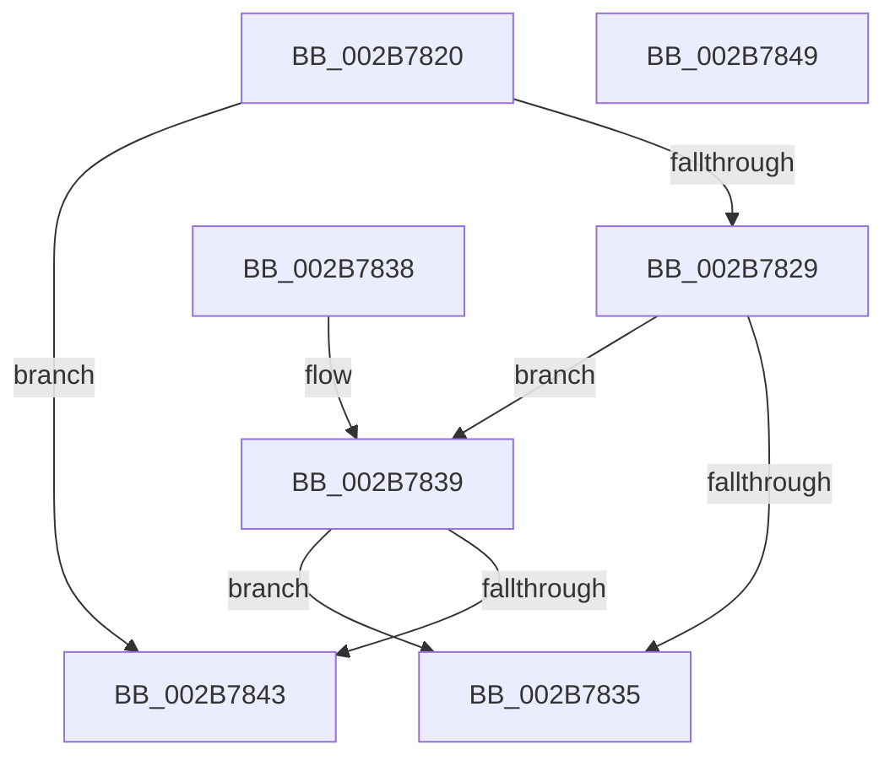

# MiInPageSkipPage

- RVA: `0x002B7820`–`0x002B784A` (길이 `42` bytes)
- VA: `0x00000001402B7820`
- 실행 섹션: `.text`
- PDB 이름 있음: `예`; PDB Function 태그: `아니요`
- unwind 정보 RVA: `0x000DB714`
- 디코드: `16`개 명령, `42/42` bytes 표시
- 미해석 바이트: `0` (있으면 어셈블리에 `.byte`로 보존)

> 이 문서는 커널 이미지의 기계어와 PDB 기호를 분석해 생성했습니다. 4번과 5번은 함수 원형과 자료형을 바이너리 사용 방식에서 추정한 C 해석이며 원본 소스 복구 결과는 아닙니다.

## 1. Dependencies

- 직접 호출 지점: **0**; 고유 호출 대상: **0**
- 직접 호출자로 확인된 함수: **3**
- RIP 상대 이미지 참조: **1**

### Outgoing calls
- 직접 디코드된 call 명령이 없습니다.

### Direct callers
- [MiInitializeReadInProgressPfn](MiInitializeReadInProgressPfn_function_002B6990.md) at `0x002B6A0E`
- [MiFinishHardFault](MiFinishHardFault_function_002B6F10.md) at `0x002B714F`
- [MiValidateInPage](../38/MiValidateInPage_function_00382E0C.md) at `0x00382FE4`

### Static image references
- `0x002B7820` → RVA `0x00E37430` (`.data`; read)

## 2. Other-region calls and transfers

- 다른 실행 섹션으로 향하는 call: **0**
- 별도 외부 분기/꼬리 이동을 확인하지 못했습니다.

## 3. Assembly (complete function range)

```asm
002B7820  48 3B 0D 09 FC B7 00            cmp rcx, qword ptr [rip + 0xb7fc09]
002B7827  74 1A                           je 0x1402b7843
002B7829  8B 41 20                        mov eax, dword ptr [rcx + 0x20]
002B782C  C1 E8 10                        shr eax, 0x10
002B782F  24 07                           and al, 7
002B7831  3C 07                           cmp al, 7
002B7833  74 04                           je 0x1402b7839
002B7835  33 C0                           xor eax, eax
002B7837  C3                              ret
002B7838  CC                              int3
002B7839  48 8B 41 08                     mov rax, qword ptr [rcx + 8]
002B783D  48 83 F8 FD                     cmp rax, -3
002B7841  75 F2                           jne 0x1402b7835
002B7843  B8 01 00 00 00                  mov eax, 1
002B7848  C3                              ret
002B7849  CC                              int3
```

## 4. C-style interpretation (structured pseudocode)

```c
__int64 __fastcall MiInPageSkipPage(__int64 a1)
{
    __int64 result;

    if (a1 == (*(unsigned __int64 *)(v_rip + 12057609))) goto loc_002B7843;
    result = (unsigned int)(((unsigned int)(*(unsigned int *)(a1 + 32))) >> (16));
    result = (unsigned __int8)((result) & (7));
    if (((unsigned __int8)(result)) == 7) goto loc_002B7839;
loc_002B7835:
    result = 0;
    return result;
loc_002B7839:
    if ((*(unsigned __int64 *)(a1 + 8)) != -3) goto loc_002B7835;
loc_002B7843:
    return 1;
}
```

## 5. (Beta) C Style

```c
int64_t MiInPageSkipPage(int64_t Arg1)
{
    int64_t result;

    if (Arg1 == (*(uint64_t *)(v_rip + 0xB7FC09))) goto loc_002B7843;
    result = (uint32_t)(((uint32_t)(*(uint32_t *)(Arg1 + 0x20))) >> (16));
    result = (uint8_t)((result) & (7));
    if (((uint8_t)(result)) == 7) goto loc_002B7839;
loc_002B7835:
    result = 0;
    return result;
loc_002B7839:
    if ((*(uint64_t *)(Arg1 + 0x8)) != -3) goto loc_002B7835;
loc_002B7843:
    return 1;
}
```

## 6. Execution-region graph

[열기: 2D/3D 그래프와 함수 탐색 컨트롤 패널](../../../control-panel.html?section=text&rva=0x002B7820&view=graph)

- 2D 그래프는 위에서 아래로 흐르고, 3D 그래프는 빈 공간을 드래그해 회전합니다. Shift+드래그는 이동, 휠은 확대·축소, 함수 노드 선택은 대상 보고서 이동입니다.

### Static fallback


