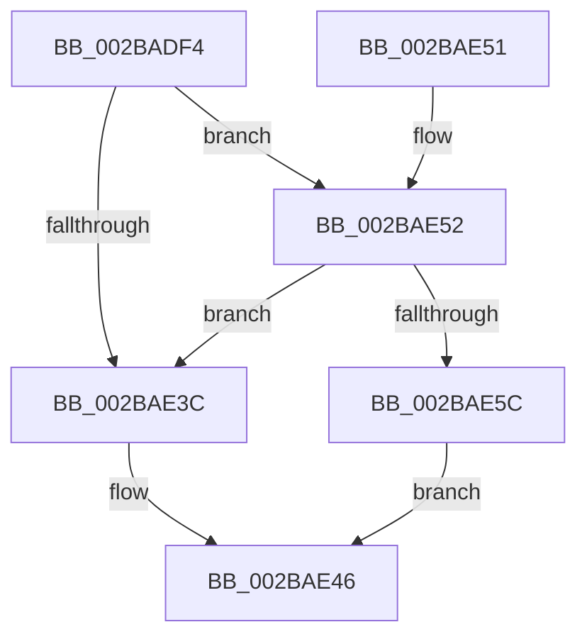

# MiInsertDecayClusterTimer

- RVA: `0x002BADF4`–`0x002BAE6F` (길이 `123` bytes)
- VA: `0x00000001402BADF4`
- 실행 섹션: `.text`
- PDB 이름 있음: `예`; PDB Function 태그: `아니요`
- unwind 정보 RVA: `0x00068A5C`
- 디코드: `29`개 명령, `123/123` bytes 표시
- 미해석 바이트: `0` (있으면 어셈블리에 `.byte`로 보존)

> 이 문서는 커널 이미지의 기계어와 PDB 기호를 분석해 생성했습니다. 4번과 5번은 함수 원형과 자료형을 바이너리 사용 방식에서 추정한 C 해석이며 원본 소스 복구 결과는 아닙니다.

## 1. Dependencies

- 직접 호출 지점: **3**; 고유 호출 대상: **3**
- 직접 호출자로 확인된 함수: **1**
- RIP 상대 이미지 참조: **5**

### Outgoing calls
- `0x002BAE20` → [ExAcquireSpinLockExclusiveAtDpcLevel](../24/ExAcquireSpinLockExclusiveAtDpcLevel_function_00248E80.md) (function, `0x00248E80`)
- `0x002BAE2E` → [MiRelinkDecayClusterTimer](MiRelinkDecayClusterTimer_function_002BC560.md) (function, `0x002BC560`)
- `0x002BAE68` → [ExpReleaseSpinLockExclusiveFromDpcLevelInstrumented](../2C/ExpReleaseSpinLockExclusiveFromDpcLevelInstrumented_function_002C0F44.md) (function, `0x002C0F44`)

### Direct callers
- [MiInsertPageInList](MiInsertPageInList_function_002BA000.md) at `0x002BA491`

### Static image references
- `0x002BAE05` → RVA `0x00E30088` (`.data`; read)
- `0x002BAE0C` → RVA `0x00E35C20` (`.data`; read)
- `0x002BAE33` → RVA `0x00FC6B06` (`ALMOSTRO`; read)
- `0x002BAE3C` → RVA `0x00E35C20` (`.data`; write)
- `0x002BAE52` → RVA `0x00F0DE58` (`.data`; read)

## 2. Other-region calls and transfers

- 다른 실행 섹션으로 향하는 call: **0**
- 별도 외부 분기/꼬리 이동을 확인하지 못했습니다.

## 3. Assembly (complete function range)

```asm
002BADF4  48 89 5C 24 08                  mov qword ptr [rsp + 8], rbx
002BADF9  57                              push rdi
002BADFA  48 83 EC 20                     sub rsp, 0x20
002BADFE  48 8B 41 28                     mov rax, qword ptr [rcx + 0x28]
002BAE02  48 8B F9                        mov rdi, rcx
002BAE05  48 8B 15 7C 52 B7 00            mov rdx, qword ptr [rip + 0xb7527c]
002BAE0C  48 8D 0D 0D AE B7 00            lea rcx, [rip + 0xb7ae0d]
002BAE13  48 C1 E8 2B                     shr rax, 0x2b
002BAE17  25 FF 03 00 00                  and eax, 0x3ff
002BAE1C  48 8B 1C C2                     mov rbx, qword ptr [rdx + rax*8]
002BAE20  E8 5B E0 F8 FF                  call 0x140248e80
002BAE25  8B 93 E0 3E 00 00               mov edx, dword ptr [rbx + 0x3ee0]
002BAE2B  48 8B CF                        mov rcx, rdi
002BAE2E  E8 2D 17 00 00                  call 0x1402bc560
002BAE33  F6 05 CC BC D0 00 01            test byte ptr [rip + 0xd0bccc], 1
002BAE3A  75 16                           jne 0x1402bae52
002BAE3C  C7 05 DA AD B7 00 00 00 00 00   mov dword ptr [rip + 0xb7adda], 0
002BAE46  48 8B 5C 24 30                  mov rbx, qword ptr [rsp + 0x30]
002BAE4B  48 83 C4 20                     add rsp, 0x20
002BAE4F  5F                              pop rdi
002BAE50  C3                              ret
002BAE51  CC                              int3
002BAE52  8B 05 00 30 C5 00               mov eax, dword ptr [rip + 0xc53000]
002BAE58  85 C0                           test eax, eax
002BAE5A  75 E0                           jne 0x1402bae3c
002BAE5C  48 8B 54 24 28                  mov rdx, qword ptr [rsp + 0x28]
002BAE61  48 8D 0D B8 AD B7 00            lea rcx, [rip + 0xb7adb8]
002BAE68  E8 D7 60 00 00                  call 0x1402c0f44
002BAE6D  EB D7                           jmp 0x1402bae46
```

## 4. C-style interpretation (structured pseudocode)

```c
__int64 __fastcall MiInsertDecayClusterTimer(__int64 a1)
{
    __int64 result;
    __int64 v_rsp;
    unsigned __int64 v_stack_p28;
    unsigned __int64 v_stack_p8;

    v_stack_p8 = v_rbx;
    v_rsp = (v_rsp) - (32);
    result = (*(unsigned __int64 *)(a1 + 40)) >> (43);
    result = (unsigned int)((result) & (0x3FFULL));
    result = ExAcquireSpinLockExclusiveAtDpcLevel(v_rip + 12037645, *(unsigned __int64 *)(v_rip + 12014204), a3, a4);
    result = MiRelinkDecayClusterTimer(a1, (unsigned int)(*(unsigned int *)(*(unsigned __int64 *)(*(unsigned __int64 *)(v_rip + 12014204) + result * 8) + 16096)), a3, a4);
    if (((*(unsigned __int8 *)(v_rip + 13679820)) & (1)) != 0) goto loc_002BAE52;
loc_002BAE3C:
    *(unsigned int *)(v_rip + 12037594) = 0;
loc_002BAE46:
    v_rsp = (v_rsp) + (32);
    return result;
loc_002BAE52:
    if ((unsigned int)((unsigned int)(*(unsigned int *)(v_rip + 12922880))) != 0) goto loc_002BAE3C;
    result = ExpReleaseSpinLockExclusiveFromDpcLevelInstrumented(v_rip + 12037560, v_stack_p28, a3, a4);
    goto loc_002BAE46;
}
```

## 5. (Beta) C Style

```c
int64_t MiInsertDecayClusterTimer(void *Arg1)
{
    uint8_t *arg1 = (uint8_t *)Arg1;

    int64_t result;
    int64_t local_rsp;
    uint64_t v_stack_p28;
    uint64_t v_stack_p8;

    v_stack_p8 = local_rbx;
    local_rsp = (local_rsp) - (32);
    result = (*(uint64_t *)(arg1 + 0x28)) >> (43);
    result = (uint32_t)((result) & (0x3FFULL));
    result = ExAcquireSpinLockExclusiveAtDpcLevel(v_rip + 12037645, *(uint64_t *)(v_rip + 0xB7527C), a3, a4);
    result = MiRelinkDecayClusterTimer(Arg1, (uint32_t)(*(uint32_t *)(*(uint64_t *)(*(uint64_t *)(v_rip + 0xB7527C) + result * 8) + 0x3EE0)), a3, a4);
    if (((*(uint8_t *)(v_rip + 0xD0BCCC)) & (1)) != 0) goto loc_002BAE52;
loc_002BAE3C:
    *(uint32_t *)(v_rip + 0xB7ADDA) = 0;
loc_002BAE46:
    local_rsp = (local_rsp) + (32);
    return result;
loc_002BAE52:
    if ((uint32_t)((uint32_t)(*(uint32_t *)(v_rip + 0xC53000))) != 0) goto loc_002BAE3C;
    result = ExpReleaseSpinLockExclusiveFromDpcLevelInstrumented(v_rip + 12037560, v_stack_p28, a3, a4);
    goto loc_002BAE46;
}
```

### 관측된 메모리 오프셋

구조체 형식이 확인되지 않은 접근은 인자 기준의 오프셋으로만 기록했습니다.

| 기준 인자 | 오프셋 표현 | 폭 (bit) | 접근 |
|---|---:|---:|---|
| `Arg1` | `+ 0x28` | `64` | `R` |

## 6. Execution-region graph

[열기: 2D/3D 그래프와 함수 탐색 컨트롤 패널](../../../control-panel.html?section=text&rva=0x002BADF4&view=graph)

- 2D 그래프는 위에서 아래로 흐르고, 3D 그래프는 빈 공간을 드래그해 회전합니다. Shift+드래그는 이동, 휠은 확대·축소, 함수 노드 선택은 대상 보고서 이동입니다.

### Static fallback


