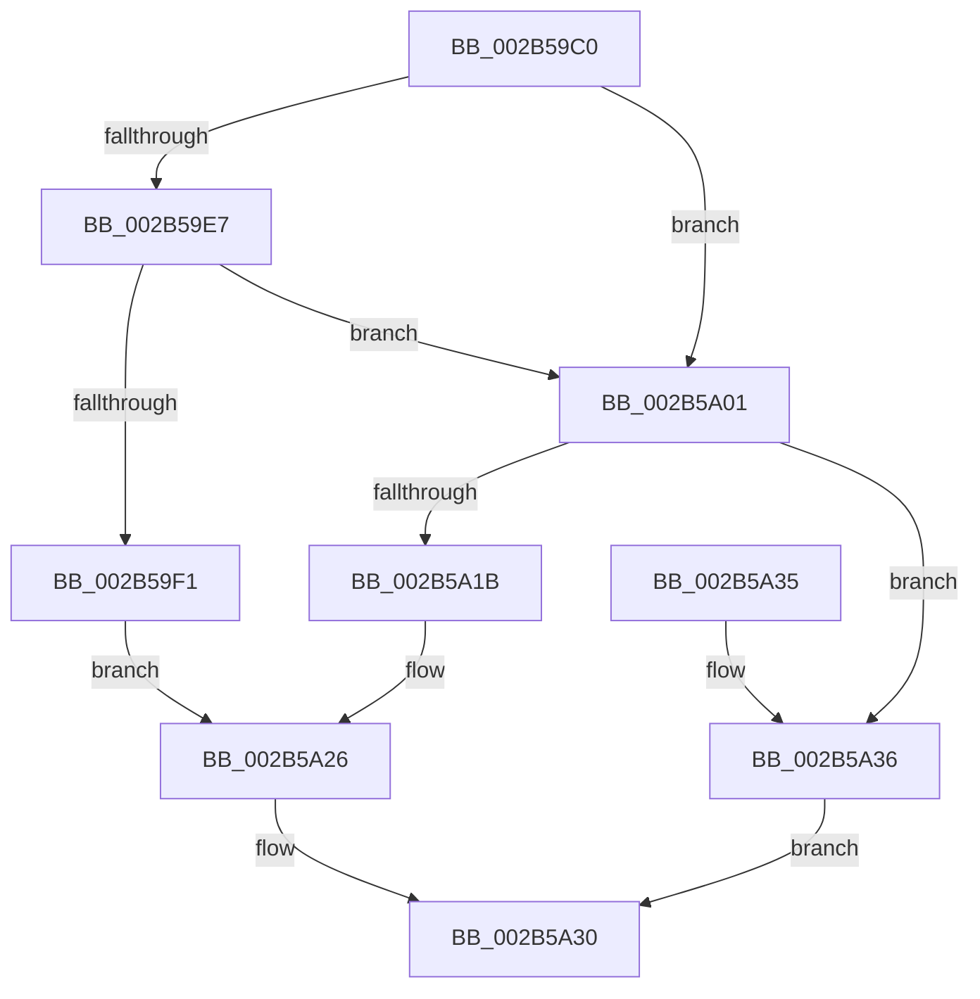

# MiInsertInPageBlock

- RVA: `0x002B59C0`–`0x002B5A3A` (길이 `122` bytes)
- VA: `0x00000001402B59C0`
- 실행 섹션: `.text`
- PDB 이름 있음: `예`; PDB Function 태그: `아니요`
- unwind 정보 RVA: `0x00069B1C`
- 디코드: `29`개 명령, `122/122` bytes 표시
- 미해석 바이트: `0` (있으면 어셈블리에 `.byte`로 보존)

> 이 문서는 커널 이미지의 기계어와 PDB 기호를 분석해 생성했습니다. 4번과 5번은 함수 원형과 자료형을 바이너리 사용 방식에서 추정한 C 해석이며 원본 소스 복구 결과는 아닙니다.

## 1. Dependencies

- 직접 호출 지점: **1**; 고유 호출 대상: **1**
- 직접 호출자로 확인된 함수: **2**
- RIP 상대 이미지 참조: **2**

### Outgoing calls
- `0x002B5A26` → [ExpInterlockedPushEntrySList](../6B/ExpInterlockedPushEntrySList_function_006BA5B0.md) (function, `0x006BA5B0`)

### Direct callers
- [MiFreeInPageSupportBlock](MiFreeInPageSupportBlock_function_002B5900.md) at `0x002B597D`
- [MiInitializePageFaultResources](../67/MiInitializePageFaultResources_function_0067E490.md) at `0x0067E556`

### Static image references
- `0x002B59C7` → RVA `0x00E2CB40` (`.data`; read)
- `0x002B59F5` → RVA `0x00E373C0` (`.data`; read)

## 2. Other-region calls and transfers

- 다른 실행 섹션으로 향하는 call: **0**
- 별도 외부 분기/꼬리 이동을 확인하지 못했습니다.

## 3. Assembly (complete function range)

```asm
002B59C0  48 83 EC 28                     sub rsp, 0x28
002B59C4  48 8B D1                        mov rdx, rcx
002B59C7  4C 8D 0D 72 71 B7 00            lea r9, [rip + 0xb77172]
002B59CE  8B 89 C0 00 00 00               mov ecx, dword ptr [rcx + 0xc0]
002B59D4  F7 D1                           not ecx
002B59D6  48 C1 E9 08                     shr rcx, 8
002B59DA  83 E1 01                        and ecx, 1
002B59DD  49 3B 94 C9 A8 A8 00 00         cmp rdx, qword ptr [r9 + rcx*8 + 0xa8a8]
002B59E5  72 1A                           jb 0x1402b5a01
002B59E7  49 3B 94 C9 B8 A8 00 00         cmp rdx, qword ptr [r9 + rcx*8 + 0xa8b8]
002B59EF  73 10                           jae 0x1402b5a01
002B59F1  48 C1 E1 04                     shl rcx, 4
002B59F5  4C 8D 05 C4 19 B8 00            lea r8, [rip + 0xb819c4]
002B59FC  49 03 C8                        add rcx, r8
002B59FF  EB 25                           jmp 0x1402b5a26
002B5A01  42 0F B6 84 09 A0 A8 00 00      movzx eax, byte ptr [rcx + r9 + 0xa8a0]
002B5A0A  4C 8B C1                        mov r8, rcx
002B5A0D  4D 03 C0                        add r8, r8
002B5A10  66 43 39 84 C1 60 A8 00 00      cmp word ptr [r9 + r8*8 + 0xa860], ax
002B5A19  73 1B                           jae 0x1402b5a36
002B5A1B  49 81 C1 60 A8 00 00            add r9, 0xa860
002B5A22  4B 8D 0C C1                     lea rcx, [r9 + r8*8]
002B5A26  E8 85 4B 40 00                  call 0x1406ba5b0
002B5A2B  B8 01 00 00 00                  mov eax, 1
002B5A30  48 83 C4 28                     add rsp, 0x28
002B5A34  C3                              ret
002B5A35  CC                              int3
002B5A36  33 C0                           xor eax, eax
002B5A38  EB F6                           jmp 0x1402b5a30
```

## 4. C-style interpretation (structured pseudocode)

```c
__int64 __fastcall MiInsertInPageBlock(__int64 a1)
{
    __int64 result;
    __int64 v_rsp;

    v_rsp = (v_rsp) - (40);
    a1 = (unsigned int)(~((unsigned int)(*(unsigned int *)(a1 + 192))));
    a1 = (a1) >> (8);
    a1 = (unsigned int)((a1) & (1));
    if (a1 < (*(unsigned __int64 *)(v_rip + 12022130 + a1 * 8 + 43176))) goto loc_002B5A01;
    if (a1 >= (*(unsigned __int64 *)(v_rip + 12022130 + a1 * 8 + 43192))) goto loc_002B5A01;
    a1 = (a1) << (4);
    a1 = (a1) + (v_rip + 12065220);
    goto loc_002B5A26;
loc_002B5A01:
    a3 = (a1) + (a1);
    if ((*(unsigned __int16 *)(v_rip + 12022130 + a3 * 8 + 43104)) >= ((unsigned __int16)(*(unsigned __int8 *)(a1 + v_rip + 12022130 * 1 + 43168)))) goto loc_002B5A36;
    a4 = (v_rip + 12022130) + (0xA860ULL);
loc_002B5A26:
    result = ExpInterlockedPushEntrySList(a4 + a3 * 8, a1, a3, a4);
loc_002B5A30:
    v_rsp = (v_rsp) + (40);
    return 1;
loc_002B5A36:
    result = 0;
    goto loc_002B5A30;
}
```

## 5. (Beta) C Style

```c
int64_t MiInsertInPageBlock(void *Arg1)
{
    uint8_t *arg1 = (uint8_t *)Arg1;

    int64_t result;
    int64_t local_rsp;

    local_rsp = (local_rsp) - (40);
    Arg1 = (uint32_t)(~((uint32_t)(*(uint32_t *)(arg1 + 0xC0))));
    Arg1 = (Arg1) >> (8);
    Arg1 = (uint32_t)((Arg1) & (1));
    if (Arg1 < (*(uint64_t *)(v_rip + 0xB77172 + arg1 * 8 + 0xA8A8))) goto loc_002B5A01;
    if (Arg1 >= (*(uint64_t *)(v_rip + 0xB77172 + arg1 * 8 + 0xA8B8))) goto loc_002B5A01;
    Arg1 = (Arg1) << (4);
    Arg1 = (Arg1) + (v_rip + 12065220);
    goto loc_002B5A26;
loc_002B5A01:
    a3 = (Arg1) + (Arg1);
    if ((*(uint16_t *)(v_rip + 0xB77172 + a3 * 8 + 0xA860)) >= ((uint16_t)(*(uint8_t *)(arg1 + v_rip + 0xB77172 * 1 + 0xA8A0)))) goto loc_002B5A36;
    a4 = (v_rip + 12022130) + (0xA860ULL);
loc_002B5A26:
    result = ExpInterlockedPushEntrySList(a4 + a3 * 8, Arg1, a3, a4);
loc_002B5A30:
    local_rsp = (local_rsp) + (40);
    return 1;
loc_002B5A36:
    result = 0;
    goto loc_002B5A30;
}
```

### 관측된 메모리 오프셋

구조체 형식이 확인되지 않은 접근은 인자 기준의 오프셋으로만 기록했습니다.

| 기준 인자 | 오프셋 표현 | 폭 (bit) | 접근 |
|---|---:|---:|---|
| `Arg1` | `+ 0xC0` | `32` | `R` |

## 6. Execution-region graph

[열기: 2D/3D 그래프와 함수 탐색 컨트롤 패널](../../../control-panel.html?section=text&rva=0x002B59C0&view=graph)

- 2D 그래프는 위에서 아래로 흐르고, 3D 그래프는 빈 공간을 드래그해 회전합니다. Shift+드래그는 이동, 휠은 확대·축소, 함수 노드 선택은 대상 보고서 이동입니다.

### Static fallback


