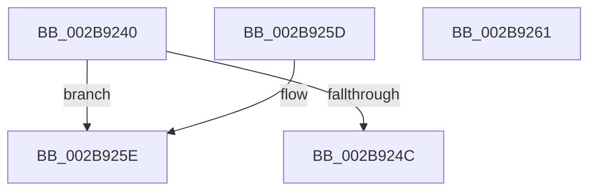

# MiIsDecayPfn

- RVA: `0x002B9240`–`0x002B9262` (길이 `34` bytes)
- VA: `0x00000001402B9240`
- 실행 섹션: `.text`
- PDB 이름 있음: `예`; PDB Function 태그: `아니요`
- unwind 정보 RVA: `0x000DB714`
- 디코드: `13`개 명령, `34/34` bytes 표시
- 미해석 바이트: `0` (있으면 어셈블리에 `.byte`로 보존)

> 이 문서는 커널 이미지의 기계어와 PDB 기호를 분석해 생성했습니다. 4번과 5번은 함수 원형과 자료형을 바이너리 사용 방식에서 추정한 C 해석이며 원본 소스 복구 결과는 아닙니다.

## 1. Dependencies

- 직접 호출 지점: **0**; 고유 호출 대상: **0**
- 직접 호출자로 확인된 함수: **21**
- RIP 상대 이미지 참조: **1**

### Outgoing calls
- 직접 디코드된 call 명령이 없습니다.

### Direct callers
- [MiResolveTransitionFault](../28/MiResolveTransitionFault_function_00282940.md) at `0x002833BF`
- [MiReplaceTransitionPage](MiReplaceTransitionPage_function_002B1120.md) at `0x002B17C9`
- [MiReplaceTransitionPage](MiReplaceTransitionPage_function_002B1120.md) at `0x002B1825`
- [MiMirrorReduceBlackWrites](MiMirrorReduceBlackWrites_function_002B7C50.md) at `0x002B7D00`
- [MiUpdatePfnPriority](MiUpdatePfnPriority_function_002B8570.md) at `0x002B867E`
- [MiLockProtoPoolPage](MiLockProtoPoolPage_function_002B8B80.md) at `0x002B9046`
- [sub_002B98DD](Unknown_function_002B98DD.md) at `0x002B999F`
- [MiSynchronizeFastPageInsert](MiSynchronizeFastPageInsert_function_002BAE80.md) at `0x002BB485`
- [MiSafeLockPageAtDpc](../31/MiSafeLockPageAtDpc_function_0031C67C.md) at `0x0031C6DF`
- [sub_0031CA0D](../31/Unknown_function_0031CA0D.md) at `0x0031CA58`
- [sub_003216DF](../32/Unknown_function_003216DF.md) at `0x003216E2`
- [MiAddKernelStackToPrcbCache](../33/MiAddKernelStackToPrcbCache_function_00338710.md) at `0x00338BBF`
- [sub_00338E63](../33/Unknown_function_00338E63.md) at `0x0033950F`
- [sub_00338E63](../33/Unknown_function_00338E63.md) at `0x00339577`
- [MiSharedInsertPfnChainInList](../33/MiSharedInsertPfnChainInList_function_0033CA70.md) at `0x0033D215`
- [sub_0033EA66](../33/Unknown_function_0033EA66.md) at `0x0033EA8F`
- [MiSwapNumaStandbyPage](../38/MiSwapNumaStandbyPage_function_00385144.md) at `0x003856CE`
- [MiWalkPagesOnLists](../3B/MiWalkPagesOnLists_function_003B6AA4.md) at `0x003B6E90`
- [MiLockStandbyOldestPage](../3D/MiLockStandbyOldestPage_function_003D4EA4.md) at `0x003D4F8F`
- [MiLockStandbyOldestPage](../3D/MiLockStandbyOldestPage_function_003D4EA4.md) at `0x003D4FB9`
- [MiSetPageZeroInProgress](../43/MiSetPageZeroInProgress_function_0043B980.md) at `0x0043BB6B`
- [MiSetPageZeroInProgress](../43/MiSetPageZeroInProgress_function_0043B980.md) at `0x0043BB85`
- [MiSafeTryLockNestedPageAtDpc](../49/MiSafeTryLockNestedPageAtDpc_function_00495E88.md) at `0x00495ECC`
- [sub_006DBD20](../6D/Unknown_function_006DBD20.md) at `0x006DBE34`
- [sub_006DBD20](../6D/Unknown_function_006DBD20.md) at `0x006DBED7`
- [sub_006E4A1A](../6E/Unknown_function_006E4A1A.md) at `0x006E4B10`

### Static image references
- `0x002B9240` → RVA `0x00E35C00` (`.data`; read)

## 2. Other-region calls and transfers

- 다른 실행 섹션으로 향하는 call: **0**
- 별도 외부 분기/꼬리 이동을 확인하지 못했습니다.

## 3. Assembly (complete function range)

```asm
002B9240  48 8B 05 B9 C9 B7 00            mov rax, qword ptr [rip + 0xb7c9b9]
002B9247  48 3B C8                        cmp rcx, rax
002B924A  72 12                           jb 0x1402b925e
002B924C  33 D2                           xor edx, edx
002B924E  48 05 00 08 00 00               add rax, 0x800
002B9254  48 3B C8                        cmp rcx, rax
002B9257  0F 92 C2                        setb dl
002B925A  8B C2                           mov eax, edx
002B925C  C3                              ret
002B925D  CC                              int3
002B925E  33 C0                           xor eax, eax
002B9260  C3                              ret
002B9261  CC                              int3
```

## 4. C-style interpretation (structured pseudocode)

```c
__int64 __fastcall MiIsDecayPfn(__int64 a1, int a2)
{
    __int64 result;

    if (a1 < (*(unsigned __int64 *)(v_rip + 12044729))) goto loc_002B925E;
    a2 = 0;
    result = (*(unsigned __int64 *)(v_rip + 12044729)) + (0x800ULL);
    a2 = (a1 < result) ? 1 : 0;
    return (unsigned int)(a2);
loc_002B925E:
    result = 0;
    return result;
}
```

## 5. (Beta) C Style

```c
int64_t MiIsDecayPfn(int64_t Arg1, int32_t Arg2)
{
    int64_t result;

    if (Arg1 < (*(uint64_t *)(v_rip + 0xB7C9B9))) goto loc_002B925E;
    Arg2 = 0;
    result = (*(uint64_t *)(v_rip + 0xB7C9B9)) + (0x800ULL);
    Arg2 = (Arg1 < result) ? 1 : 0;
    return (uint32_t)(Arg2);
loc_002B925E:
    result = 0;
    return result;
}
```

## 6. Execution-region graph

[열기: 2D/3D 그래프와 함수 탐색 컨트롤 패널](../../../control-panel.html?section=text&rva=0x002B9240&view=graph)

- 2D 그래프는 위에서 아래로 흐르고, 3D 그래프는 빈 공간을 드래그해 회전합니다. Shift+드래그는 이동, 휠은 확대·축소, 함수 노드 선택은 대상 보고서 이동입니다.

### Static fallback


