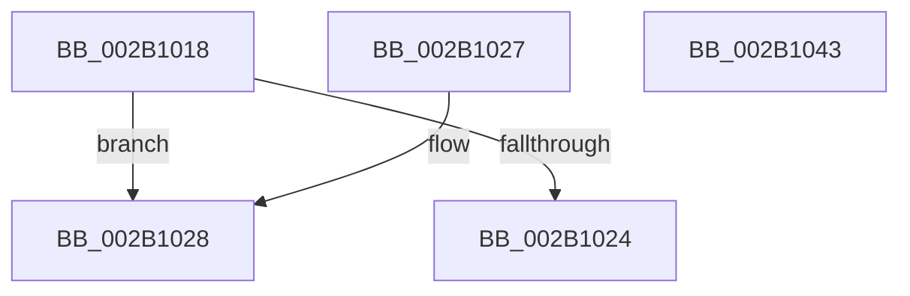

# MiIsPageOnBadList

- RVA: `0x002B1018`–`0x002B1044` (길이 `44` bytes)
- VA: `0x00000001402B1018`
- 실행 섹션: `.text`
- PDB 이름 있음: `예`; PDB Function 태그: `아니요`
- unwind 정보 RVA: `0x000DB714`
- 디코드: `16`개 명령, `44/44` bytes 표시
- 미해석 바이트: `0` (있으면 어셈블리에 `.byte`로 보존)

> 이 문서는 커널 이미지의 기계어와 PDB 기호를 분석해 생성했습니다. 4번과 5번은 함수 원형과 자료형을 바이너리 사용 방식에서 추정한 C 해석이며 원본 소스 복구 결과는 아닙니다.

## 1. Dependencies

- 직접 호출 지점: **0**; 고유 호출 대상: **0**
- 직접 호출자로 확인된 함수: **17**
- RIP 상대 이미지 참조: **0**

### Outgoing calls
- 직접 디코드된 call 명령이 없습니다.

### Direct callers
- [MiFindContiguousPagesEx](../28/MiFindContiguousPagesEx_function_0028BDE0.md) at `0x0028C362`
- [MiFindContiguousPagesEx](../28/MiFindContiguousPagesEx_function_0028BDE0.md) at `0x0028C7C6`
- [MiTradePage](../28/MiTradePage_function_0028D160.md) at `0x0028D574`
- [MiTradePage](../28/MiTradePage_function_0028D160.md) at `0x0028DAB5`
- [MiTradePage](../28/MiTradePage_function_0028D160.md) at `0x0028DAD0`
- [MiConfirmCombinePageContents](../2A/MiConfirmCombinePageContents_function_002AF394.md) at `0x002AF3C0`
- [MiGetWorkingSetInfoList](../2A/MiGetWorkingSetInfoList_function_002AF770.md) at `0x002AFD25`
- [MiGetWorkingSetInfoList](../2A/MiGetWorkingSetInfoList_function_002AF770.md) at `0x002B04D2`
- [MiPfnsWorthTrying](../31/MiPfnsWorthTrying_function_0031B0C0.md) at `0x0031B5BE`
- [MiDeleteSectionCluster](../37/MiDeleteSectionCluster_function_00373DF0.md) at `0x00373F22`
- [MiCopyHeaderIfResident](../48/MiCopyHeaderIfResident_function_00482184.md) at `0x00482239`
- [MiMakePageBad](../48/MiMakePageBad_function_00486F04.md) at `0x00486F5F`
- [MiArePageContentsZero](../4D/MiArePageContentsZero_function_004D4278.md) at `0x004D4321`
- [MmTryIdentifyPage](../67/MmTryIdentifyPage_function_00678738.md) at `0x006787CD`
- [MiGetListOfPendingBadPages](../67/MiGetListOfPendingBadPages_function_006799D0.md) at `0x00679B9B`
- [MiRemoveBadPages](../67/MiRemoveBadPages_function_00679F6C.md) at `0x0067A016`
- [MiUnlinkBadPages](../67/MiUnlinkBadPages_function_0067A6FC.md) at `0x0067A7F8`
- [MmGetPageBadStatus](../67/MmGetPageBadStatus_function_0067A9B0.md) at `0x0067AA04`
- [MmMarkPhysicalMemoryAsBad](../67/MmMarkPhysicalMemoryAsBad_function_0067AA50.md) at `0x0067AD21`
- [MmMarkPhysicalMemoryAsBad](../67/MmMarkPhysicalMemoryAsBad_function_0067AA50.md) at `0x0067AECF`
- [MiLocateSharedPageViews](../67/MiLocateSharedPageViews_function_0067F1E4.md) at `0x0067F234`
- [MiTransferPartitionPageRun](../69/MiTransferPartitionPageRun_function_00691DCC.md) at `0x00691F09`

### Static image references
- 디코드된 RIP-relative 메모리 참조가 없습니다.

## 2. Other-region calls and transfers

- 다른 실행 섹션으로 향하는 call: **0**
- 별도 외부 분기/꼬리 이동을 확인하지 못했습니다.

## 3. Assembly (complete function range)

```asm
002B1018  8B 41 20                        mov eax, dword ptr [rcx + 0x20]
002B101B  C1 E8 10                        shr eax, 0x10
002B101E  24 07                           and al, 7
002B1020  3C 05                           cmp al, 5
002B1022  74 04                           je 0x1402b1028
002B1024  33 C0                           xor eax, eax
002B1026  C3                              ret
002B1027  CC                              int3
002B1028  48 8B 49 08                     mov rcx, qword ptr [rcx + 8]
002B102C  48 B8 00 00 00 00 00 00 00 80   movabs rax, 0x8000000000000000
002B1036  48 0B C8                        or rcx, rax
002B1039  33 C0                           xor eax, eax
002B103B  48 83 F9 FC                     cmp rcx, -4
002B103F  0F 94 C0                        sete al
002B1042  C3                              ret
002B1043  CC                              int3
```

## 4. C-style interpretation (structured pseudocode)

```c
__int64 __fastcall MiIsPageOnBadList(__int64 a1)
{
    __int64 result;

    result = (unsigned int)(((unsigned int)(*(unsigned int *)(a1 + 32))) >> (16));
    result = (unsigned __int8)((result) & (7));
    if (((unsigned __int8)(result)) == 5) goto loc_002B1028;
    result = 0;
    return result;
loc_002B1028:
    a1 = (*(unsigned __int64 *)(a1 + 8)) | (0);
    result = 0;
    result = (a1 == -4) ? 1 : 0;
    return result;
}
```

## 5. (Beta) C Style

```c
int64_t MiIsPageOnBadList(void *Arg1)
{
    uint8_t *arg1 = (uint8_t *)Arg1;

    int64_t result;

    result = (uint32_t)(((uint32_t)(*(uint32_t *)(arg1 + 0x20))) >> (16));
    result = (uint8_t)((result) & (7));
    if (((uint8_t)(result)) == 5) goto loc_002B1028;
    result = 0;
    return result;
loc_002B1028:
    Arg1 = (*(uint64_t *)(arg1 + 0x8)) | (0);
    result = 0;
    result = (Arg1 == -4) ? 1 : 0;
    return result;
}
```

### 관측된 메모리 오프셋

구조체 형식이 확인되지 않은 접근은 인자 기준의 오프셋으로만 기록했습니다.

| 기준 인자 | 오프셋 표현 | 폭 (bit) | 접근 |
|---|---:|---:|---|
| `Arg1` | `+ 0x8` | `64` | `R` |
| `Arg1` | `+ 0x20` | `32` | `R` |

## 6. Execution-region graph

[열기: 2D/3D 그래프와 함수 탐색 컨트롤 패널](../../../control-panel.html?section=text&rva=0x002B1018&view=graph)

- 2D 그래프는 위에서 아래로 흐르고, 3D 그래프는 빈 공간을 드래그해 회전합니다. Shift+드래그는 이동, 휠은 확대·축소, 함수 노드 선택은 대상 보고서 이동입니다.

### Static fallback


