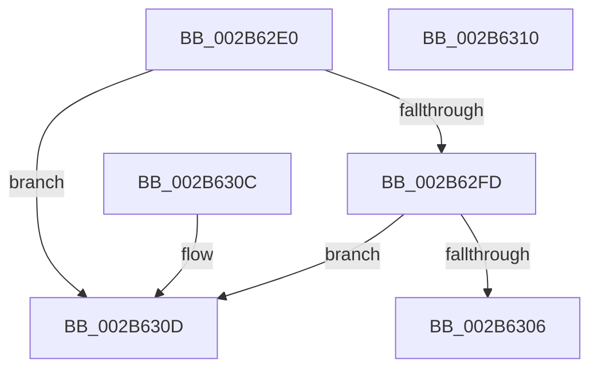

# MiIsStoreProcess

- RVA: `0x002B62E0`–`0x002B6311` (길이 `49` bytes)
- VA: `0x00000001402B62E0`
- 실행 섹션: `.text`
- PDB 이름 있음: `예`; PDB Function 태그: `아니요`
- unwind 정보 RVA: `0x000DB714`
- 디코드: `14`개 명령, `49/49` bytes 표시
- 미해석 바이트: `0` (있으면 어셈블리에 `.byte`로 보존)

> 이 문서는 커널 이미지의 기계어와 PDB 기호를 분석해 생성했습니다. 4번과 5번은 함수 원형과 자료형을 바이너리 사용 방식에서 추정한 C 해석이며 원본 소스 복구 결과는 아닙니다.

## 1. Dependencies

- 직접 호출 지점: **0**; 고유 호출 대상: **0**
- 직접 호출자로 확인된 함수: **11**
- RIP 상대 이미지 참조: **1**

### Outgoing calls
- 직접 디코드된 call 명령이 없습니다.

### Direct callers
- [MiDecommitInitializePacket](../24/MiDecommitInitializePacket_function_00242F30.md) at `0x00243129`
- [MiStoreCheckCandidatePage](MiStoreCheckCandidatePage_function_002B54E8.md) at `0x002B55CB`
- [sub_002B5C0F](Unknown_function_002B5C0F.md) at `0x002B5C12`
- [MiProcessSuitableForCombining](MiProcessSuitableForCombining_function_002B6294.md) at `0x002B62B3`
- [MiAgeWorkingSet](../2C/MiAgeWorkingSet_function_002C21E0.md) at `0x002C23EE`
- [sub_0032D782](../32/Unknown_function_0032D782.md) at `0x0032DBAD`
- [MiResolvePageFileFault](../36/MiResolvePageFileFault_function_0036D968.md) at `0x0036EAE0`
- [MiOrderTrimList](../40/MiOrderTrimList_function_00409F24.md) at `0x00409FF2`
- [MiComputeTrimAmount](../4E/MiComputeTrimAmount_function_004EDAE4.md) at `0x004EDBAE`
- [MiStoreDiscardPoisonedPage](../69/MiStoreDiscardPoisonedPage_function_00692858.md) at `0x0069296E`
- [MiCloneProcessAddressSpace](../../page/AD/MiCloneProcessAddressSpace_function_00AD6F7C.md) at `0x00AD6FEF`

### Static image references
- `0x002B62E7` → RVA `0x00E30088` (`.data`; read)

## 2. Other-region calls and transfers

- 다른 실행 섹션으로 향하는 call: **0**
- 별도 외부 분기/꼬리 이동을 확인하지 못했습니다.

## 3. Assembly (complete function range)

```asm
002B62E0  0F B7 91 AE 04 00 00            movzx edx, word ptr [rcx + 0x4ae]
002B62E7  48 8B 05 9A 9D B7 00            mov rax, qword ptr [rip + 0xb79d9a]
002B62EE  48 8B 04 D0                     mov rax, qword ptr [rax + rdx*8]
002B62F2  8B 90 B4 04 00 00               mov edx, dword ptr [rax + 0x4b4]
002B62F8  83 FA FF                        cmp edx, -1
002B62FB  74 10                           je 0x1402b630d
002B62FD  48 39 88 A0 06 00 00            cmp qword ptr [rax + 0x6a0], rcx
002B6304  75 07                           jne 0x1402b630d
002B6306  B8 01 00 00 00                  mov eax, 1
002B630B  C3                              ret
002B630C  CC                              int3
002B630D  33 C0                           xor eax, eax
002B630F  C3                              ret
002B6310  CC                              int3
```

## 4. C-style interpretation (structured pseudocode)

```c
__int64 __fastcall MiIsStoreProcess(__int64 a1)
{
    __int64 result;

    if (((unsigned int)((unsigned int)(*(unsigned int *)(*(unsigned __int64 *)(*(unsigned __int64 *)(v_rip + 12033434) + *(unsigned __int16 *)(a1 + 1198) * 8) + 1204)))) == -1) goto loc_002B630D;
    if ((*(unsigned __int64 *)(*(unsigned __int64 *)(*(unsigned __int64 *)(v_rip + 12033434) + *(unsigned __int16 *)(a1 + 1198) * 8) + 1696)) != a1) goto loc_002B630D;
    return 1;
loc_002B630D:
    result = 0;
    return result;
}
```

## 5. (Beta) C Style

```c
int64_t MiIsStoreProcess(void *Arg1)
{
    uint8_t *arg1 = (uint8_t *)Arg1;

    int64_t result;

    if (((uint32_t)((uint32_t)(*(uint32_t *)(*(uint64_t *)(*(uint64_t *)(v_rip + 0xB79D9A) + *(uint16_t *)(arg1 + 0x4AE) * 8) + 0x4B4)))) == -1) goto loc_002B630D;
    if ((*(uint64_t *)(*(uint64_t *)(*(uint64_t *)(v_rip + 0xB79D9A) + *(uint16_t *)(arg1 + 0x4AE) * 8) + 0x6A0)) != Arg1) goto loc_002B630D;
    return 1;
loc_002B630D:
    result = 0;
    return result;
}
```

### 관측된 메모리 오프셋

구조체 형식이 확인되지 않은 접근은 인자 기준의 오프셋으로만 기록했습니다.

| 기준 인자 | 오프셋 표현 | 폭 (bit) | 접근 |
|---|---:|---:|---|
| `Arg1` | `+ 0x4AE` | `16` | `R` |

## 6. Execution-region graph

[열기: 2D/3D 그래프와 함수 탐색 컨트롤 패널](../../../control-panel.html?section=text&rva=0x002B62E0&view=graph)

- 2D 그래프는 위에서 아래로 흐르고, 3D 그래프는 빈 공간을 드래그해 회전합니다. Shift+드래그는 이동, 휠은 확대·축소, 함수 노드 선택은 대상 보고서 이동입니다.

### Static fallback


