# MiLockSectionControlArea

- RVA: `0x002BC930`–`0x002BCBB1` (길이 `641` bytes)
- VA: `0x00000001402BC930`
- 실행 섹션: `.text`
- PDB 이름 있음: `예`; PDB Function 태그: `아니요`
- unwind 정보 RVA: `0x0006E190`
- 디코드: `148`개 명령, `641/641` bytes 표시
- 미해석 바이트: `0` (있으면 어셈블리에 `.byte`로 보존)

> 이 문서는 커널 이미지의 기계어와 PDB 기호를 분석해 생성했습니다. 4번과 5번은 함수 원형과 자료형을 바이너리 사용 방식에서 추정한 C 해석이며 원본 소스 복구 결과는 아닙니다.

## 1. Dependencies

- 직접 호출 지점: **13**; 고유 호출 대상: **11**
- 직접 호출자로 확인된 함수: **11**
- RIP 상대 이미지 참조: **8**

### Outgoing calls
- `0x002BC99C` → [ExpWaitForSpinLockExclusiveAndAcquire](../32/ExpWaitForSpinLockExclusiveAndAcquire_function_003239A0.md) (function, `0x003239A0`)
- `0x002BCA32` → [KiLowerIrqlProcessIrqlFlags](../4F/KiLowerIrqlProcessIrqlFlags_function_004F5698.md) (function, `0x004F5698`)
- `0x002BCA62` → [TRY_ACQUIRE_EXLOCK_EXCLUSIVE](TRY_ACQUIRE_EXLOCK_EXCLUSIVE_function_002BD130.md) (function, `0x002BD130`)
- `0x002BCABC` → [ExpAcquireSpinLockExclusiveAtDpcLevelInstrumented](../32/ExpAcquireSpinLockExclusiveAtDpcLevelInstrumented_function_00323A70.md) (function, `0x00323A70`)
- `0x002BCAD0` → [ExpTryAcquireSpinLockExclusiveAtDpcLevelInstrumented](ExpTryAcquireSpinLockExclusiveAtDpcLevelInstrumented_function_002BE6A0.md) (function, `0x002BE6A0`)
- `0x002BCADE` → [KiRaiseIrqlProcessIrqlFlags](../4F/KiRaiseIrqlProcessIrqlFlags_function_004F56FC.md) (function, `0x004F56FC`)
- `0x002BCAF3` → [ExAcquireSpinLockExclusiveAtDpcLevel](../24/ExAcquireSpinLockExclusiveAtDpcLevel_function_00248E80.md) (function, `0x00248E80`)
- `0x002BCB11` → [MiReleaseSpinLockExclusive](../24/MiReleaseSpinLockExclusive_function_002482C0.md) (function, `0x002482C0`)
- `0x002BCB29` → [KiCheckVpBackingLongSpinWaitHypercall](../30/KiCheckVpBackingLongSpinWaitHypercall_function_0030F490.md) (function, `0x0030F490`)
- `0x002BCB38` → [HvlNotifyLongSpinWait](../30/HvlNotifyLongSpinWait_function_0030F460.md) (function, `0x0030F460`)
- `0x002BCB5C` → [ExpReleaseSpinLockExclusiveFromDpcLevelInstrumented](../2C/ExpReleaseSpinLockExclusiveFromDpcLevelInstrumented_function_002C0F44.md) (function, `0x002C0F44`)
- `0x002BCB83` → [ExpReleaseSpinLockExclusiveFromDpcLevelInstrumented](../2C/ExpReleaseSpinLockExclusiveFromDpcLevelInstrumented_function_002C0F44.md) (function, `0x002C0F44`)
- `0x002BCBA7` → [ExpReleaseSpinLockExclusiveFromDpcLevelInstrumented](../2C/ExpReleaseSpinLockExclusiveFromDpcLevelInstrumented_function_002C0F44.md) (function, `0x002C0F44`)

### Direct callers
- [MiForceSectionClosed](../2A/MiForceSectionClosed_function_002ACFD4.md) at `0x002ACFF0`
- [MiReferenceExistingControlArea](MiReferenceExistingControlArea_function_002BDE64.md) at `0x002BDE8C`
- [MmDisableModifiedWriteOfSection](MmDisableModifiedWriteOfSection_function_002BE290.md) at `0x002BE2A7`
- [sub_002BE5B1](Unknown_function_002BE5B1.md) at `0x002BE5C4`
- [MmUpdateSectionIoAttribution](../3C/MmUpdateSectionIoAttribution_function_003C9FA4.md) at `0x003C9FC0`
- [MmChangeSectionBackingFile](../45/MmChangeSectionBackingFile_function_0045808C.md) at `0x004580D9`
- [MmGetImageFileSignatureInformation](../45/MmGetImageFileSignatureInformation_function_004582B0.md) at `0x004582D4`
- [MiCopyHeaderIfResident](../48/MiCopyHeaderIfResident_function_00482184.md) at `0x004821AB`
- [MmOnlySystemCacheViewsPresent](../48/MmOnlySystemCacheViewsPresent_function_0048E4DC.md) at `0x0048E4F1`
- [MiFlushDataSection](../48/MiFlushDataSection_function_0048ED88.md) at `0x0048EDB5`
- [MmIsFileSectionActive](../49/MmIsFileSectionActive_function_004958C0.md) at `0x004958FF`
- [MmIsFileSectionActive](../49/MmIsFileSectionActive_function_004958C0.md) at `0x0049591E`

### Static image references
- `0x002BC96C` → RVA `0x00FC6D20` (`ALMOSTRO`; read)
- `0x002BC978` → RVA `0x00FC6B06` (`ALMOSTRO`; read)
- `0x002BC987` → RVA `0x00E2CD00` (`.data`; read/write)
- `0x002BC995` → RVA `0x00E2CD00` (`.data`; read)
- `0x002BC9CA` → RVA `0x00FC52AC` (`ALMOSTRO`; reference)
- `0x002BCA18` → RVA `0x00E2CD00` (`.data`; write)
- `0x002BCAA4` → RVA `0x00F0DE58` (`.data`; read)
- `0x002BCB1B` → RVA `0x00FC6AB8` (`ALMOSTRO`; read)

## 2. Other-region calls and transfers

- 다른 실행 섹션으로 향하는 call: **0**
- 별도 외부 분기/꼬리 이동을 확인하지 못했습니다.

## 3. Assembly (complete function range)

```asm
002BC930  48 89 5C 24 08                  mov qword ptr [rsp + 8], rbx
002BC935  48 89 6C 24 18                  mov qword ptr [rsp + 0x18], rbp
002BC93A  56                              push rsi
002BC93B  57                              push rdi
002BC93C  41 54                           push r12
002BC93E  41 56                           push r14
002BC940  41 57                           push r15
002BC942  48 83 EC 20                     sub rsp, 0x20
002BC946  8B EA                           mov ebp, edx
002BC948  8B FA                           mov edi, edx
002BC94A  83 E5 02                        and ebp, 2
002BC94D  4D 8B F0                        mov r14, r8
002BC950  83 E7 01                        and edi, 1
002BC953  4C 8B F9                        mov r15, rcx
002BC956  41 BC 02 00 00 00               mov r12d, 2
002BC95C  85 ED                           test ebp, ebp
002BC95E  0F 85 84 01 00 00               jne 0x1402bcae8
002BC964  44 0F 20 C3                     mov rbx, cr8
002BC968  45 0F 22 C4                     mov cr8, r12
002BC96C  39 2D AE A3 D0 00               cmp dword ptr [rip + 0xd0a3ae], ebp
002BC972  0F 85 5F 01 00 00               jne 0x1402bcad7
002BC978  F6 05 87 A1 D0 00 21            test byte ptr [rip + 0xd0a187], 0x21
002BC97F  0F 85 1F 01 00 00               jne 0x1402bcaa4
002BC985  33 F6                           xor esi, esi
002BC987  F0 0F BA 2D 70 03 B7 00 1F      lock bts dword ptr [rip + 0xb70370], 0x1f
002BC990  73 11                           jae 0x1402bc9a3
002BC992  0F B6 D3                        movzx edx, bl
002BC995  48 8D 0D 64 03 B7 00            lea rcx, [rip + 0xb70364]
002BC99C  E8 FF 6F 06 00                  call 0x1403239a0
002BC9A1  8B F0                           mov esi, eax
002BC9A3  8B 15 57 03 B7 00               mov edx, dword ptr [rip + 0xb70357]
002BC9A9  8B CA                           mov ecx, edx
002BC9AB  0F BA F1 1E                     btr ecx, 0x1e
002BC9AF  81 F9 00 00 00 80               cmp ecx, 0x80000000
002BC9B5  74 34                           je 0x1402bc9eb
002BC9B7  0F BA E2 1E                     bt edx, 0x1e
002BC9BB  72 0B                           jb 0x1402bc9c8
002BC9BD  F0 81 0D 38 03 B7 00 00 00 00 40  lock or dword ptr [rip + 0xb70338], 0x40000000
002BC9C8  FF C6                           inc esi
002BC9CA  85 35 DC 88 D0 00               test dword ptr [rip + 0xd088dc], esi
002BC9D0  0F 84 45 01 00 00               je 0x1402bcb1b
002BC9D6  F3 90                           pause
002BC9D8  8B 15 22 03 B7 00               mov edx, dword ptr [rip + 0xb70322]
002BC9DE  8B C2                           mov eax, edx
002BC9E0  0F BA F0 1E                     btr eax, 0x1e
002BC9E4  3D 00 00 00 80                  cmp eax, 0x80000000
002BC9E9  75 CC                           jne 0x1402bc9b7
002BC9EB  41 88 1E                        mov byte ptr [r14], bl
002BC9EE  85 FF                           test edi, edi
002BC9F0  0F 84 07 01 00 00               je 0x1402bcafd
002BC9F6  49 8B 1F                        mov rbx, qword ptr [r15]
002BC9F9  48 85 DB                        test rbx, rbx
002BC9FC  75 57                           jne 0x1402bca55
002BC9FE  41 0F B6 1E                     movzx ebx, byte ptr [r14]
002BCA02  80 FB 11                        cmp bl, 0x11
002BCA05  0F 84 80 00 00 00               je 0x1402bca8b
002BCA0B  F6 05 F4 A0 D0 00 01            test byte ptr [rip + 0xd0a0f4], 1
002BCA12  0F 85 51 01 00 00               jne 0x1402bcb69
002BCA18  C7 05 DE 02 B7 00 00 00 00 00   mov dword ptr [rip + 0xb702de], 0
002BCA22  83 3D F7 A2 D0 00 00            cmp dword ptr [rip + 0xd0a2f7], 0
002BCA29  74 0C                           je 0x1402bca37
002BCA2B  44 0F 20 C1                     mov rcx, cr8
002BCA2F  0F B6 D3                        movzx edx, bl
002BCA32  E8 61 8C 23 00                  call 0x1404f5698
002BCA37  44 0F 22 C3                     mov cr8, rbx
002BCA3B  33 C0                           xor eax, eax
002BCA3D  48 8B 5C 24 50                  mov rbx, qword ptr [rsp + 0x50]
002BCA42  48 8B 6C 24 60                  mov rbp, qword ptr [rsp + 0x60]
002BCA47  48 83 C4 20                     add rsp, 0x20
002BCA4B  41 5F                           pop r15
002BCA4D  41 5E                           pop r14
002BCA4F  41 5C                           pop r12
002BCA51  5F                              pop rdi
002BCA52  5E                              pop rsi
002BCA53  C3                              ret
002BCA54  CC                              int3
002BCA55  F6 05 AA A0 D0 00 21            test byte ptr [rip + 0xd0a0aa], 0x21
002BCA5C  48 8D 4B 48                     lea rcx, [rbx + 0x48]
002BCA60  75 64                           jne 0x1402bcac6
002BCA62  E8 C9 06 00 00                  call 0x1402bd130
002BCA67  85 C0                           test eax, eax
002BCA69  0F 84 97 00 00 00               je 0x1402bcb06
002BCA6F  F6 05 90 A0 D0 00 01            test byte ptr [rip + 0xd0a090], 1
002BCA76  0F 85 C6 00 00 00               jne 0x1402bcb42
002BCA7C  C7 05 7A 02 B7 00 00 00 00 00   mov dword ptr [rip + 0xb7027a], 0
002BCA86  48 8B C3                        mov rax, rbx
002BCA89  EB B2                           jmp 0x1402bca3d
002BCA8B  F6 05 74 A0 D0 00 01            test byte ptr [rip + 0xd0a074], 1
002BCA92  0F 85 F5 00 00 00               jne 0x1402bcb8d
002BCA98  C7 05 5E 02 B7 00 00 00 00 00   mov dword ptr [rip + 0xb7025e], 0
002BCAA2  EB 97                           jmp 0x1402bca3b
002BCAA4  8B 05 AE 13 C5 00               mov eax, dword ptr [rip + 0xc513ae]
002BCAAA  85 C0                           test eax, eax
002BCAAC  0F 85 D3 FE FF FF               jne 0x1402bc985
002BCAB2  0F B6 D3                        movzx edx, bl
002BCAB5  48 8D 0D 44 02 B7 00            lea rcx, [rip + 0xb70244]
002BCABC  E8 AF 6F 06 00                  call 0x140323a70
002BCAC1  E9 25 FF FF FF                  jmp 0x1402bc9eb
002BCAC6  8B 05 8C 13 C5 00               mov eax, dword ptr [rip + 0xc5138c]
002BCACC  85 C0                           test eax, eax
002BCACE  75 92                           jne 0x1402bca62
002BCAD0  E8 CB 1B 00 00                  call 0x1402be6a0
002BCAD5  EB 90                           jmp 0x1402bca67
002BCAD7  41 0F B6 D4                     movzx edx, r12b
002BCADB  0F B6 CB                        movzx ecx, bl
002BCADE  E8 19 8C 23 00                  call 0x1404f56fc
002BCAE3  E9 90 FE FF FF                  jmp 0x1402bc978
002BCAE8  48 8D 0D 11 02 B7 00            lea rcx, [rip + 0xb70211]
002BCAEF  41 C6 06 11                     mov byte ptr [r14], 0x11
002BCAF3  E8 88 C3 F8 FF                  call 0x140248e80
002BCAF8  E9 F1 FE FF FF                  jmp 0x1402bc9ee
002BCAFD  49 8B 5F 10                     mov rbx, qword ptr [r15 + 0x10]
002BCB01  E9 F3 FE FF FF                  jmp 0x1402bc9f9
002BCB06  41 0F B6 16                     movzx edx, byte ptr [r14]
002BCB0A  48 8D 0D EF 01 B7 00            lea rcx, [rip + 0xb701ef]
002BCB11  E8 AA B7 F8 FF                  call 0x1402482c0
002BCB16  E9 41 FE FF FF                  jmp 0x1402bc95c
002BCB1B  8B 05 97 9F D0 00               mov eax, dword ptr [rip + 0xd09f97]
002BCB21  A8 40                           test al, 0x40
002BCB23  0F 84 AD FE FF FF               je 0x1402bc9d6
002BCB29  E8 62 29 05 00                  call 0x14030f490
002BCB2E  84 C0                           test al, al
002BCB30  0F 84 A0 FE FF FF               je 0x1402bc9d6
002BCB36  8B CE                           mov ecx, esi
002BCB38  E8 23 29 05 00                  call 0x14030f460
002BCB3D  E9 96 FE FF FF                  jmp 0x1402bc9d8
002BCB42  8B 05 10 13 C5 00               mov eax, dword ptr [rip + 0xc51310]
002BCB48  85 C0                           test eax, eax
002BCB4A  0F 85 2C FF FF FF               jne 0x1402bca7c
002BCB50  48 8B 54 24 48                  mov rdx, qword ptr [rsp + 0x48]
002BCB55  48 8D 0D A4 01 B7 00            lea rcx, [rip + 0xb701a4]
002BCB5C  E8 E3 43 00 00                  call 0x1402c0f44
002BCB61  48 8B C3                        mov rax, rbx
002BCB64  E9 D4 FE FF FF                  jmp 0x1402bca3d
002BCB69  8B 05 E9 12 C5 00               mov eax, dword ptr [rip + 0xc512e9]
002BCB6F  85 C0                           test eax, eax
002BCB71  0F 85 A1 FE FF FF               jne 0x1402bca18
002BCB77  48 8B 54 24 48                  mov rdx, qword ptr [rsp + 0x48]
002BCB7C  48 8D 0D 7D 01 B7 00            lea rcx, [rip + 0xb7017d]
002BCB83  E8 BC 43 00 00                  call 0x1402c0f44
002BCB88  E9 95 FE FF FF                  jmp 0x1402bca22
002BCB8D  8B 05 C5 12 C5 00               mov eax, dword ptr [rip + 0xc512c5]
002BCB93  85 C0                           test eax, eax
002BCB95  0F 85 FD FE FF FF               jne 0x1402bca98
002BCB9B  48 8B 54 24 48                  mov rdx, qword ptr [rsp + 0x48]
002BCBA0  48 8D 0D 59 01 B7 00            lea rcx, [rip + 0xb70159]
002BCBA7  E8 98 43 00 00                  call 0x1402c0f44
002BCBAC  E9 8A FE FF FF                  jmp 0x1402bca3b
```

## 4. C-style interpretation (structured pseudocode)

```c
__int64 __fastcall MiLockSectionControlArea(__int64 a1, int a2, __int64 a3)
{
    __int64 result;
    __int64 v_rbp;
    __int64 v_rdi;
    __int64 v_rsi;
    __int64 v_rsp;
    unsigned __int64 v_stack_p18;
    unsigned __int64 v_stack_p48;
    unsigned __int64 v_stack_p8;

    v_stack_p8 = v_rbx;
    v_stack_p18 = v_rbp;
    v_rsp = (v_rsp) - (32);
    v_rbp = (unsigned int)(((unsigned int)(a2)) & (2));
    v_rdi = (unsigned int)(((unsigned int)(a2)) & (1));
loc_002BC95C:
    if ((unsigned int)(v_rbp) != 0) goto loc_002BCAE8;
    if ((*(unsigned int *)(v_rip + 13673390)) != ((unsigned int)(v_rbp))) goto loc_002BCAD7;
loc_002BC978:
    if (((*(unsigned __int8 *)(v_rip + 13672839)) & (33)) != 0) goto loc_002BCAA4;
loc_002BC985:
    v_rsi = 0;
    if (!(condition_is_above_or_equal)) {
        a2 = (unsigned __int8)(v_cr8);
        a1 = v_rip + 11993956;
        result = ExpWaitForSpinLockExclusiveAndAcquire(a1, a2, a3, a4);
        v_rsi = (unsigned int)(result);
    }
    if (((unsigned int)((unsigned int)((unsigned int)((unsigned int)(*(unsigned int *)(v_rip + 11993943)))))) == 0x80000000ULL) goto loc_002BC9EB;
loc_002BC9B7:
    if (((unsigned int)((unsigned int)((unsigned int)((unsigned int)(*(unsigned int *)(v_rip + 11993943)))))) >= 0x80000000ULL) {
    }
    v_rsi = (unsigned int)((v_rsi) + 1);
    if (((*(unsigned int *)(v_rip + 13666524)) & ((unsigned int)(v_rsi))) == 0) goto loc_002BCB1B;
loc_002BC9D6:
loc_002BC9D8:
    if (((unsigned int)((unsigned int)((unsigned int)((unsigned int)(*(unsigned int *)(v_rip + 11993890)))))) != 0x80000000ULL) goto loc_002BC9B7;
loc_002BC9EB:
    *(unsigned __int8 *)(a3) = (unsigned __int8)(v_cr8);
loc_002BC9EE:
    if ((unsigned int)(v_rdi) == 0) goto loc_002BCAFD;
loc_002BC9F9:
    if (*(unsigned __int64 *)(a1) != 0) goto loc_002BCA55;
    if (((unsigned __int8)(*(unsigned __int8 *)(a3))) == 17) goto loc_002BCA8B;
    if (((*(unsigned __int8 *)(v_rip + 13672692)) & (1)) != 0) goto loc_002BCB69;
loc_002BCA18:
    *(unsigned int *)(v_rip + 11993822) = 0;
loc_002BCA22:
    result = (unsigned int)((unsigned int)((unsigned int)(*(unsigned int *)(v_rip + 11993890))));
    if ((*(unsigned int *)(v_rip + 13673207)) != 0) {
        a1 = 2;
        a2 = (unsigned __int8)(*(unsigned __int8 *)(a3));
        result = KiLowerIrqlProcessIrqlFlags(a1, a2, a3, a4);
    }
loc_002BCA3B:
    result = 0;
loc_002BCA3D:
    v_rsp = (v_rsp) + (32);
    return result;
loc_002BCA55:
    if (((*(unsigned __int8 *)(v_rip + 13672618)) & (33)) != 0) goto loc_002BCAC6;
loc_002BCA62:
    result = TRY_ACQUIRE_EXLOCK_EXCLUSIVE(v_stack_p8 + 72, a2, a3, a4);
loc_002BCA67:
    if ((unsigned int)(result) == 0) goto loc_002BCB06;
    if (((*(unsigned __int8 *)(v_rip + 13672592)) & (1)) != 0) goto loc_002BCB42;
loc_002BCA7C:
    *(unsigned int *)(v_rip + 11993722) = 0;
    goto loc_002BCA3D;
loc_002BCA8B:
    if (((*(unsigned __int8 *)(v_rip + 13672564)) & (1)) != 0) goto loc_002BCB8D;
loc_002BCA98:
    *(unsigned int *)(v_rip + 11993694) = 0;
    goto loc_002BCA3B;
loc_002BCAA4:
    if ((unsigned int)((unsigned int)(*(unsigned int *)(v_rip + 12915630))) != 0) goto loc_002BC985;
    result = ExpAcquireSpinLockExclusiveAtDpcLevelInstrumented(v_rip + 11993668, (unsigned __int8)(v_stack_p8), a3, a4);
    goto loc_002BC9EB;
loc_002BCAC6:
    if ((unsigned int)((unsigned int)(*(unsigned int *)(v_rip + 12915596))) != 0) goto loc_002BCA62;
    result = ExpTryAcquireSpinLockExclusiveAtDpcLevelInstrumented(v_rip + 11993668, (unsigned __int8)(v_stack_p8), a3, a4);
    goto loc_002BCA67;
loc_002BCAD7:
    result = KiRaiseIrqlProcessIrqlFlags((unsigned __int8)(v_stack_p8), 2, a3, a4);
    goto loc_002BC978;
loc_002BCAE8:
    *(unsigned __int8 *)(a3) = 17;
    result = ExAcquireSpinLockExclusiveAtDpcLevel(v_rip + 11993617, 2, a3, a4);
    goto loc_002BC9EE;
loc_002BCAFD:
    goto loc_002BC9F9;
loc_002BCB06:
    result = MiReleaseSpinLockExclusive(v_rip + 11993583, *(unsigned __int8 *)(a3), a3, a4);
    goto loc_002BC95C;
loc_002BCB1B:
    if ((((unsigned __int8)((unsigned int)(*(unsigned int *)(v_rip + 13672343)))) & (64)) == 0) goto loc_002BC9D6;
    result = KiCheckVpBackingLongSpinWaitHypercall(v_rip + 11993583, *(unsigned __int8 *)(a3), a3, a4);
    if ((unsigned __int8)(result) == 0) goto loc_002BC9D6;
    result = HvlNotifyLongSpinWait((unsigned int)((unsigned int)(v_rsi)), *(unsigned __int8 *)(a3), a3, a4);
    goto loc_002BC9D8;
loc_002BCB42:
    if ((unsigned int)((unsigned int)(*(unsigned int *)(v_rip + 12915472))) != 0) goto loc_002BCA7C;
    result = ExpReleaseSpinLockExclusiveFromDpcLevelInstrumented(v_rip + 11993508, v_stack_p48, a3, a4);
    goto loc_002BCA3D;
loc_002BCB69:
    if ((unsigned int)((unsigned int)(*(unsigned int *)(v_rip + 12915433))) != 0) goto loc_002BCA18;
    result = ExpReleaseSpinLockExclusiveFromDpcLevelInstrumented(v_rip + 11993469, v_stack_p48, a3, a4);
    goto loc_002BCA22;
loc_002BCB8D:
    if ((unsigned int)((unsigned int)(*(unsigned int *)(v_rip + 12915397))) != 0) goto loc_002BCA98;
    result = ExpReleaseSpinLockExclusiveFromDpcLevelInstrumented(v_rip + 11993433, v_stack_p48, a3, a4);
    goto loc_002BCA3B;
}
```

## 5. (Beta) C Style

```c
int64_t MiLockSectionControlArea(void *Arg1, int32_t Arg2, void *Arg3)
{
    uint8_t *arg1 = (uint8_t *)Arg1;
    uint8_t *arg3 = (uint8_t *)Arg3;

    int64_t result;
    int64_t local_rbp;
    int64_t local_rdi;
    int64_t local_rsi;
    int64_t local_rsp;
    uint64_t v_stack_p18;
    uint64_t v_stack_p48;
    uint64_t v_stack_p8;

    v_stack_p8 = local_rbx;
    v_stack_p18 = local_rbp;
    local_rsp = (local_rsp) - (32);
    local_rbp = (uint32_t)(((uint32_t)(Arg2)) & (2));
    local_rdi = (uint32_t)(((uint32_t)(Arg2)) & (1));
loc_002BC95C:
    if ((uint32_t)(local_rbp) != 0) goto loc_002BCAE8;
    if ((*(uint32_t *)(v_rip + 0xD0A3AE)) != ((uint32_t)(local_rbp))) goto loc_002BCAD7;
loc_002BC978:
    if (((*(uint8_t *)(v_rip + 0xD0A187)) & (33)) != 0) goto loc_002BCAA4;
loc_002BC985:
    local_rsi = 0;
    if (!(condition_is_above_or_equal)) {
        Arg2 = (uint8_t)(v_cr8);
        Arg1 = v_rip + 11993956;
        result = ExpWaitForSpinLockExclusiveAndAcquire(Arg1, Arg2, Arg3, a4);
        local_rsi = (uint32_t)(result);
    }
    if (((uint32_t)((uint32_t)((uint32_t)((uint32_t)(*(uint32_t *)(v_rip + 0xB70357)))))) == 0x80000000ULL) goto loc_002BC9EB;
loc_002BC9B7:
    if (((uint32_t)((uint32_t)((uint32_t)((uint32_t)(*(uint32_t *)(v_rip + 0xB70357)))))) >= 0x80000000ULL) {
    }
    local_rsi = (uint32_t)((local_rsi) + 1);
    if (((*(uint32_t *)(v_rip + 0xD088DC)) & ((uint32_t)(local_rsi))) == 0) goto loc_002BCB1B;
loc_002BC9D6:
loc_002BC9D8:
    if (((uint32_t)((uint32_t)((uint32_t)((uint32_t)(*(uint32_t *)(v_rip + 0xB70322)))))) != 0x80000000ULL) goto loc_002BC9B7;
loc_002BC9EB:
    *(uint8_t *)(arg3) = (uint8_t)(v_cr8);
loc_002BC9EE:
    if ((uint32_t)(local_rdi) == 0) goto loc_002BCAFD;
loc_002BC9F9:
    if (*(uint64_t *)(arg1) != 0) goto loc_002BCA55;
    if (((uint8_t)(*(uint8_t *)(arg3))) == 17) goto loc_002BCA8B;
    if (((*(uint8_t *)(v_rip + 0xD0A0F4)) & (1)) != 0) goto loc_002BCB69;
loc_002BCA18:
    *(uint32_t *)(v_rip + 0xB702DE) = 0;
loc_002BCA22:
    result = (uint32_t)((uint32_t)((uint32_t)(*(uint32_t *)(v_rip + 0xB70322))));
    if ((*(uint32_t *)(v_rip + 0xD0A2F7)) != 0) {
        Arg1 = 2;
        Arg2 = (uint8_t)(*(uint8_t *)(arg3));
        result = KiLowerIrqlProcessIrqlFlags(Arg1, Arg2, Arg3, a4);
    }
loc_002BCA3B:
    result = 0;
loc_002BCA3D:
    local_rsp = (local_rsp) + (32);
    return result;
loc_002BCA55:
    if (((*(uint8_t *)(v_rip + 0xD0A0AA)) & (33)) != 0) goto loc_002BCAC6;
loc_002BCA62:
    result = TRY_ACQUIRE_EXLOCK_EXCLUSIVE(v_stack_p8 + 72, Arg2, Arg3, a4);
loc_002BCA67:
    if ((uint32_t)(result) == 0) goto loc_002BCB06;
    if (((*(uint8_t *)(v_rip + 0xD0A090)) & (1)) != 0) goto loc_002BCB42;
loc_002BCA7C:
    *(uint32_t *)(v_rip + 0xB7027A) = 0;
    goto loc_002BCA3D;
loc_002BCA8B:
    if (((*(uint8_t *)(v_rip + 0xD0A074)) & (1)) != 0) goto loc_002BCB8D;
loc_002BCA98:
    *(uint32_t *)(v_rip + 0xB7025E) = 0;
    goto loc_002BCA3B;
loc_002BCAA4:
    if ((uint32_t)((uint32_t)(*(uint32_t *)(v_rip + 0xC513AE))) != 0) goto loc_002BC985;
    result = ExpAcquireSpinLockExclusiveAtDpcLevelInstrumented(v_rip + 11993668, (uint8_t)(v_stack_p8), Arg3, a4);
    goto loc_002BC9EB;
loc_002BCAC6:
    if ((uint32_t)((uint32_t)(*(uint32_t *)(v_rip + 0xC5138C))) != 0) goto loc_002BCA62;
    result = ExpTryAcquireSpinLockExclusiveAtDpcLevelInstrumented(v_rip + 11993668, (uint8_t)(v_stack_p8), Arg3, a4);
    goto loc_002BCA67;
loc_002BCAD7:
    result = KiRaiseIrqlProcessIrqlFlags((uint8_t)(v_stack_p8), 2, Arg3, a4);
    goto loc_002BC978;
loc_002BCAE8:
    *(uint8_t *)(arg3) = 17;
    result = ExAcquireSpinLockExclusiveAtDpcLevel(v_rip + 11993617, 2, Arg3, a4);
    goto loc_002BC9EE;
loc_002BCAFD:
    goto loc_002BC9F9;
loc_002BCB06:
    result = MiReleaseSpinLockExclusive(v_rip + 11993583, *(uint8_t *)(arg3), Arg3, a4);
    goto loc_002BC95C;
loc_002BCB1B:
    if ((((uint8_t)((uint32_t)(*(uint32_t *)(v_rip + 0xD09F97)))) & (64)) == 0) goto loc_002BC9D6;
    result = KiCheckVpBackingLongSpinWaitHypercall(v_rip + 11993583, *(uint8_t *)(arg3), Arg3, a4);
    if ((uint8_t)(result) == 0) goto loc_002BC9D6;
    result = HvlNotifyLongSpinWait((uint32_t)((uint32_t)(local_rsi)), *(uint8_t *)(arg3), Arg3, a4);
    goto loc_002BC9D8;
loc_002BCB42:
    if ((uint32_t)((uint32_t)(*(uint32_t *)(v_rip + 0xC51310))) != 0) goto loc_002BCA7C;
    result = ExpReleaseSpinLockExclusiveFromDpcLevelInstrumented(v_rip + 11993508, v_stack_p48, Arg3, a4);
    goto loc_002BCA3D;
loc_002BCB69:
    if ((uint32_t)((uint32_t)(*(uint32_t *)(v_rip + 0xC512E9))) != 0) goto loc_002BCA18;
    result = ExpReleaseSpinLockExclusiveFromDpcLevelInstrumented(v_rip + 11993469, v_stack_p48, Arg3, a4);
    goto loc_002BCA22;
loc_002BCB8D:
    if ((uint32_t)((uint32_t)(*(uint32_t *)(v_rip + 0xC512C5))) != 0) goto loc_002BCA98;
    result = ExpReleaseSpinLockExclusiveFromDpcLevelInstrumented(v_rip + 11993433, v_stack_p48, Arg3, a4);
    goto loc_002BCA3B;
}
```

### 관측된 메모리 오프셋

구조체 형식이 확인되지 않은 접근은 인자 기준의 오프셋으로만 기록했습니다.

| 기준 인자 | 오프셋 표현 | 폭 (bit) | 접근 |
|---|---:|---:|---|
| `Arg1` | `+ 0x0` | `64` | `R` |
| `Arg1` | `+ 0x10` | `64` | `R` |
| `Arg3` | `+ 0x0` | `8` | `R` |
| `Arg3` | `+ 0x0` | `8` | `W` |

## 6. Execution-region graph

[열기: 2D/3D 그래프와 함수 탐색 컨트롤 패널](../../../control-panel.html?section=text&rva=0x002BC930&view=graph)

- 2D 그래프는 위에서 아래로 흐르고, 3D 그래프는 빈 공간을 드래그해 회전합니다. Shift+드래그는 이동, 휠은 확대·축소, 함수 노드 선택은 대상 보고서 이동입니다.

### Static fallback

```mermaid
flowchart TD
  bb_002BC930[BB_002BC930]
  bb_002BC95C[BB_002BC95C]
  bb_002BC964[BB_002BC964]
  bb_002BC978[BB_002BC978]
  bb_002BC985[BB_002BC985]
  bb_002BC992[BB_002BC992]
  bb_002BC9A3[BB_002BC9A3]
  bb_002BC9B7[BB_002BC9B7]
  bb_002BC9BD[BB_002BC9BD]
  bb_002BC9C8[BB_002BC9C8]
  bb_002BC9D6[BB_002BC9D6]
  bb_002BC9D8[BB_002BC9D8]
  bb_002BC9EB[BB_002BC9EB]
  bb_002BC9EE[BB_002BC9EE]
  bb_002BC9F6[BB_002BC9F6]
  bb_002BC9F9[BB_002BC9F9]
  bb_002BC9FE[BB_002BC9FE]
  bb_002BCA0B[BB_002BCA0B]
  bb_002BCA18[BB_002BCA18]
  bb_002BCA22[BB_002BCA22]
  bb_002BCA2B[BB_002BCA2B]
  bb_002BCA37[BB_002BCA37]
  bb_002BCA3B[BB_002BCA3B]
  bb_002BCA3D[BB_002BCA3D]
  bb_002BCA54[BB_002BCA54]
  bb_002BCA55[BB_002BCA55]
  bb_002BCA62[BB_002BCA62]
  bb_002BCA67[BB_002BCA67]
  bb_002BCA6F[BB_002BCA6F]
  bb_002BCA7C[BB_002BCA7C]
  bb_002BCA8B[BB_002BCA8B]
  bb_002BCA98[BB_002BCA98]
  bb_002BCAA4[BB_002BCAA4]
  bb_002BCAB2[BB_002BCAB2]
  bb_002BCAC6[BB_002BCAC6]
  bb_002BCAD0[BB_002BCAD0]
  bb_002BCAD7[BB_002BCAD7]
  bb_002BCAE8[BB_002BCAE8]
  bb_002BCAFD[BB_002BCAFD]
  bb_002BCB06[BB_002BCB06]
  bb_002BCB1B[BB_002BCB1B]
  bb_002BCB29[BB_002BCB29]
  bb_002BCB36[BB_002BCB36]
  bb_002BCB42[BB_002BCB42]
  bb_002BCB50[BB_002BCB50]
  bb_002BCB69[BB_002BCB69]
  bb_002BCB77[BB_002BCB77]
  bb_002BCB8D[BB_002BCB8D]
  bb_002BCB9B[BB_002BCB9B]
  bb_002BC930 -->|flow| bb_002BC95C
  bb_002BC95C -->|branch| bb_002BCAE8
  bb_002BC95C -->|fallthrough| bb_002BC964
  bb_002BC964 -->|branch| bb_002BCAD7
  bb_002BC964 -->|fallthrough| bb_002BC978
  bb_002BC978 -->|branch| bb_002BCAA4
  bb_002BC978 -->|fallthrough| bb_002BC985
  bb_002BC985 -->|branch| bb_002BC9A3
  bb_002BC985 -->|fallthrough| bb_002BC992
  bb_002BC992 -->|flow| bb_002BC9A3
  bb_002BC9A3 -->|branch| bb_002BC9EB
  bb_002BC9A3 -->|fallthrough| bb_002BC9B7
  bb_002BC9B7 -->|branch| bb_002BC9C8
  bb_002BC9B7 -->|fallthrough| bb_002BC9BD
  bb_002BC9BD -->|flow| bb_002BC9C8
  bb_002BC9C8 -->|branch| bb_002BCB1B
  bb_002BC9C8 -->|fallthrough| bb_002BC9D6
  bb_002BC9D6 -->|flow| bb_002BC9D8
  bb_002BC9D8 -->|branch| bb_002BC9B7
  bb_002BC9D8 -->|fallthrough| bb_002BC9EB
  bb_002BC9EB -->|flow| bb_002BC9EE
  bb_002BC9EE -->|branch| bb_002BCAFD
  bb_002BC9EE -->|fallthrough| bb_002BC9F6
  bb_002BC9F6 -->|flow| bb_002BC9F9
  bb_002BC9F9 -->|branch| bb_002BCA55
  bb_002BC9F9 -->|fallthrough| bb_002BC9FE
  bb_002BC9FE -->|branch| bb_002BCA8B
  bb_002BC9FE -->|fallthrough| bb_002BCA0B
  bb_002BCA0B -->|branch| bb_002BCB69
  bb_002BCA0B -->|fallthrough| bb_002BCA18
  bb_002BCA18 -->|flow| bb_002BCA22
  bb_002BCA22 -->|branch| bb_002BCA37
  bb_002BCA22 -->|fallthrough| bb_002BCA2B
  bb_002BCA2B -->|flow| bb_002BCA37
  bb_002BCA37 -->|flow| bb_002BCA3B
  bb_002BCA3B -->|flow| bb_002BCA3D
  bb_002BCA54 -->|flow| bb_002BCA55
  bb_002BCA55 -->|branch| bb_002BCAC6
  bb_002BCA55 -->|fallthrough| bb_002BCA62
  bb_002BCA62 -->|flow| bb_002BCA67
  bb_002BCA67 -->|branch| bb_002BCB06
  bb_002BCA67 -->|fallthrough| bb_002BCA6F
  bb_002BCA6F -->|branch| bb_002BCB42
  bb_002BCA6F -->|fallthrough| bb_002BCA7C
  bb_002BCA7C -->|branch| bb_002BCA3D
  bb_002BCA8B -->|branch| bb_002BCB8D
  bb_002BCA8B -->|fallthrough| bb_002BCA98
  bb_002BCA98 -->|branch| bb_002BCA3B
  bb_002BCAA4 -->|branch| bb_002BC985
  bb_002BCAA4 -->|fallthrough| bb_002BCAB2
  bb_002BCAB2 -->|branch| bb_002BC9EB
  bb_002BCAC6 -->|branch| bb_002BCA62
  bb_002BCAC6 -->|fallthrough| bb_002BCAD0
  bb_002BCAD0 -->|branch| bb_002BCA67
  bb_002BCAD7 -->|branch| bb_002BC978
  bb_002BCAE8 -->|branch| bb_002BC9EE
  bb_002BCAFD -->|branch| bb_002BC9F9
  bb_002BCB06 -->|branch| bb_002BC95C
  bb_002BCB1B -->|branch| bb_002BC9D6
  bb_002BCB1B -->|fallthrough| bb_002BCB29
  bb_002BCB29 -->|branch| bb_002BC9D6
  bb_002BCB29 -->|fallthrough| bb_002BCB36
  bb_002BCB36 -->|branch| bb_002BC9D8
  bb_002BCB42 -->|branch| bb_002BCA7C
  bb_002BCB42 -->|fallthrough| bb_002BCB50
  bb_002BCB50 -->|branch| bb_002BCA3D
  bb_002BCB69 -->|branch| bb_002BCA18
  bb_002BCB69 -->|fallthrough| bb_002BCB77
  bb_002BCB77 -->|branch| bb_002BCA22
  bb_002BCB8D -->|branch| bb_002BCA98
  bb_002BCB8D -->|fallthrough| bb_002BCB9B
  bb_002BCB9B -->|branch| bb_002BCA3B
```


