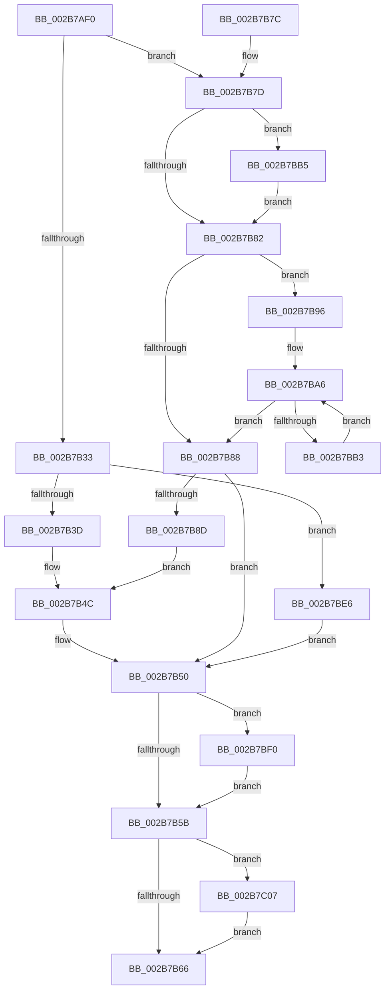

# MiMirrorOmitPagesFromCopy

- RVA: `0x002B7AF0`–`0x002B7C26` (길이 `310` bytes)
- VA: `0x00000001402B7AF0`
- 실행 섹션: `.text`
- PDB 이름 있음: `예`; PDB Function 태그: `예`
- unwind 정보 RVA: `0x0006DB10`
- 디코드: `89`개 명령, `310/310` bytes 표시
- 미해석 바이트: `0` (있으면 어셈블리에 `.byte`로 보존)

> 이 문서는 커널 이미지의 기계어와 PDB 기호를 분석해 생성했습니다. 4번과 5번은 함수 원형과 자료형을 바이너리 사용 방식에서 추정한 C 해석이며 원본 소스 복구 결과는 아닙니다.

## 1. Dependencies

- 직접 호출 지점: **1**; 고유 호출 대상: **1**
- 직접 호출자로 확인된 함수: **5**
- RIP 상대 이미지 참조: **2**

### Outgoing calls
- `0x002B7BFD` → [RtlClearBitsEx](../29/RtlClearBitsEx_function_00297740.md) (function, `0x00297740`)

### Direct callers
- [MiMirrorReduceBlackWrites](MiMirrorReduceBlackWrites_function_002B7C50.md) at `0x002B7D13`
- [MiMirrorReduceBlackWrites](MiMirrorReduceBlackWrites_function_002B7C50.md) at `0x002B7D99`
- [MiMirrorZeroFreeListsCallback](../47/MiMirrorZeroFreeListsCallback_function_00471DF0.md) at `0x00471EC1`
- [MiMirrorRemoveInactivePages](../4A/MiMirrorRemoveInactivePages_function_004AC24C.md) at `0x004AC519`
- [MiMirrorRemoveInactivePages](../4A/MiMirrorRemoveInactivePages_function_004AC24C.md) at `0x004AC55F`
- [MiMirrorRemoveBlackChildPartitionPages](../67/MiMirrorRemoveBlackChildPartitionPages_function_00678C20.md) at `0x00678C5F`
- [MiRemoveEnclavePagesFromMirror](../../pagelk/B7/MiRemoveEnclavePagesFromMirror_function_00B74F48.md) at `0x00B74F78`

### Static image references
- `0x002B7B05` → RVA `0x00E301A8` (`.data`; read)
- `0x002B7BF3` → RVA `0x00E30190` (`.data`; read)

## 2. Other-region calls and transfers

- 다른 실행 섹션으로 향하는 call: **0**
- 별도 외부 분기/꼬리 이동을 확인하지 못했습니다.

## 3. Assembly (complete function range)

```asm
002B7AF0  48 89 5C 24 10                  mov qword ptr [rsp + 0x10], rbx
002B7AF5  48 89 74 24 18                  mov qword ptr [rsp + 0x18], rsi
002B7AFA  48 89 7C 24 20                  mov qword ptr [rsp + 0x20], rdi
002B7AFF  41 56                           push r14
002B7B01  48 83 EC 20                     sub rsp, 0x20
002B7B05  48 8B 05 9C 86 B7 00            mov rax, qword ptr [rip + 0xb7869c]
002B7B0C  48 8B FA                        mov rdi, rdx
002B7B0F  48 C1 EF 05                     shr rdi, 5
002B7B13  48 8B F1                        mov rsi, rcx
002B7B16  49 8B C8                        mov rcx, r8
002B7B19  49 8B D8                        mov rbx, r8
002B7B1C  4C 8B F2                        mov r14, rdx
002B7B1F  4C 8D 04 B8                     lea r8, [rax + rdi*4]
002B7B23  48 8B FA                        mov rdi, rdx
002B7B26  83 E7 1F                        and edi, 0x1f
002B7B29  48 8D 04 0F                     lea rax, [rdi + rcx]
002B7B2D  48 83 F8 20                     cmp rax, 0x20
002B7B31  77 4A                           ja 0x1402b7b7d
002B7B33  48 83 F9 20                     cmp rcx, 0x20
002B7B37  0F 84 A9 00 00 00               je 0x1402b7be6
002B7B3D  B8 01 00 00 00                  mov eax, 1
002B7B42  D3 E0                           shl eax, cl
002B7B44  8B CF                           mov ecx, edi
002B7B46  FF C8                           dec eax
002B7B48  D3 E0                           shl eax, cl
002B7B4A  F7 D0                           not eax
002B7B4C  F0 41 21 00                     lock and dword ptr [r8], eax
002B7B50  48 83 7E 18 00                  cmp qword ptr [rsi + 0x18], 0
002B7B55  0F 85 95 00 00 00               jne 0x1402b7bf0
002B7B5B  8B 46 20                        mov eax, dword ptr [rsi + 0x20]
002B7B5E  A8 20                           test al, 0x20
002B7B60  0F 85 A1 00 00 00               jne 0x1402b7c07
002B7B66  48 8B 5C 24 38                  mov rbx, qword ptr [rsp + 0x38]
002B7B6B  48 8B 74 24 40                  mov rsi, qword ptr [rsp + 0x40]
002B7B70  48 8B 7C 24 48                  mov rdi, qword ptr [rsp + 0x48]
002B7B75  48 83 C4 20                     add rsp, 0x20
002B7B79  41 5E                           pop r14
002B7B7B  C3                              ret
002B7B7C  CC                              int3
002B7B7D  48 85 FF                        test rdi, rdi
002B7B80  75 33                           jne 0x1402b7bb5
002B7B82  48 83 F9 20                     cmp rcx, 0x20
002B7B86  73 0E                           jae 0x1402b7b96
002B7B88  48 85 C9                        test rcx, rcx
002B7B8B  74 C3                           je 0x1402b7b50
002B7B8D  B8 FF FF FF FF                  mov eax, 0xffffffff
002B7B92  D3 E0                           shl eax, cl
002B7B94  EB B6                           jmp 0x1402b7b4c
002B7B96  48 8B D1                        mov rdx, rcx
002B7B99  48 C1 EA 05                     shr rdx, 5
002B7B9D  48 6B C2 E0                     imul rax, rdx, -0x20
002B7BA1  48 03 C8                        add rcx, rax
002B7BA4  33 C0                           xor eax, eax
002B7BA6  41 89 00                        mov dword ptr [r8], eax
002B7BA9  49 83 C0 04                     add r8, 4
002B7BAD  48 83 EA 01                     sub rdx, 1
002B7BB1  74 D5                           je 0x1402b7b88
002B7BB3  EB F1                           jmp 0x1402b7ba6
002B7BB5  41 8B C6                        mov eax, r14d
002B7BB8  BA 20 00 00 00                  mov edx, 0x20
002B7BBD  83 E0 1F                        and eax, 0x1f
002B7BC0  2B D0                           sub edx, eax
002B7BC2  B8 01 00 00 00                  mov eax, 1
002B7BC7  8B CA                           mov ecx, edx
002B7BC9  D3 E0                           shl eax, cl
002B7BCB  48 8B CF                        mov rcx, rdi
002B7BCE  FF C8                           dec eax
002B7BD0  D3 E0                           shl eax, cl
002B7BD2  F7 D0                           not eax
002B7BD4  F0 41 21 00                     lock and dword ptr [r8], eax
002B7BD8  8B C2                           mov eax, edx
002B7BDA  48 8B CB                        mov rcx, rbx
002B7BDD  48 2B C8                        sub rcx, rax
002B7BE0  49 83 C0 04                     add r8, 4
002B7BE4  EB 9C                           jmp 0x1402b7b82
002B7BE6  33 C0                           xor eax, eax
002B7BE8  41 89 00                        mov dword ptr [r8], eax
002B7BEB  E9 60 FF FF FF                  jmp 0x1402b7b50
002B7BF0  4C 8B C3                        mov r8, rbx
002B7BF3  48 8D 0D 96 85 B7 00            lea rcx, [rip + 0xb78596]
002B7BFA  49 8B D6                        mov rdx, r14
002B7BFD  E8 3E FB FD FF                  call 0x140297740
002B7C02  E9 54 FF FF FF                  jmp 0x1402b7b5b
002B7C07  4B 8D 04 76                     lea rax, [r14 + r14*2]
002B7C0B  48 C1 E0 04                     shl rax, 4
002B7C0F  48 B9 00 00 00 00 00 DE FF FF   movabs rcx, 0xffffde0000000000
002B7C19  48 83 C0 28                     add rax, 0x28
002B7C1D  48 85 DB                        test rbx, rbx
002B7C20  0F 84 40 FF FF FF               je 0x1402b7b66
```

## 4. C-style interpretation (structured pseudocode)

```c
__int64 __fastcall MiMirrorOmitPagesFromCopy(__int64 a1, __int64 a2, __int64 a3)
{
    __int64 result;
    __int64 v_rdi;
    __int64 v_rsp;
    unsigned __int64 v_stack_p10;
    unsigned __int64 v_stack_p18;
    unsigned __int64 v_stack_p20;

    v_stack_p10 = v_rbx;
    v_stack_p18 = v_rsi;
    v_stack_p20 = v_rdi;
    v_rsp = (v_rsp) - (32);
    v_rdi = (a2) >> (5);
    v_rdi = (unsigned int)((a2) & (31));
    if ((v_rdi + a3 * 1) > 32) goto loc_002B7B7D;
    if (a3 == 32) goto loc_002B7BE6;
    result = (unsigned int)((1) << ((unsigned __int8)(a3)));
    result = (unsigned int)((result) - 1);
    result = (unsigned int)((result) << ((unsigned __int8)((unsigned int)((unsigned int)(v_rdi)))));
    result = (unsigned int)(~(result));
loc_002B7B4C:
loc_002B7B50:
    if ((*(unsigned __int64 *)(a1 + 24)) != 0) goto loc_002B7BF0;
loc_002B7B5B:
    if ((((unsigned __int8)((unsigned int)(*(unsigned int *)(a1 + 32)))) & (32)) != 0) goto loc_002B7C07;
loc_002B7B66:
    v_rsp = (v_rsp) + (32);
    return (unsigned int)(*(unsigned int *)(a1 + 32));
loc_002B7B7D:
    if (v_stack_p20 != 0) goto loc_002B7BB5;
loc_002B7B82:
    if (((unsigned int)((unsigned int)(v_rdi))) >= 32) goto loc_002B7B96;
loc_002B7B88:
    if ((unsigned int)((unsigned int)(v_rdi)) == 0) goto loc_002B7B50;
    result = (unsigned int)(((unsigned int)(0xFFFFFFFFULL)) << ((unsigned __int8)((unsigned int)((unsigned int)(v_rdi)))));
    goto loc_002B7B4C;
loc_002B7B96:
    a2 = ((unsigned int)((unsigned int)(v_rdi))) >> (5);
    result = (result) * (a2);
    a1 = ((unsigned int)((unsigned int)(v_rdi))) + (result);
    result = 0;
loc_002B7BA6:
    *(unsigned int *)(*(unsigned __int64 *)(v_rip + 12027548) + v_rdi * 4) = 0;
    a3 = (*(unsigned __int64 *)(v_rip + 12027548) + v_rdi * 4) + (4);
    a2 = (a2) - (1);
    if (condition_is_equal) goto loc_002B7B88;
    goto loc_002B7BA6;
loc_002B7BB5:
    result = (unsigned int)(((unsigned int)((unsigned int)(a2))) & (31));
    a2 = (unsigned int)((32) - ((unsigned int)(result)));
    result = (unsigned int)((1) << ((unsigned __int8)((unsigned int)((unsigned int)(a2)))));
    result = (unsigned int)((result) - 1);
    result = (unsigned int)((result) << ((unsigned __int8)(v_stack_p20)));
    result = (unsigned int)(~(result));
    a1 = (v_stack_p10) - ((unsigned int)((unsigned int)(a2)));
    a3 = (a3) + (4);
    goto loc_002B7B82;
loc_002B7BE6:
    result = 0;
    *(unsigned int *)(a3) = 0;
    goto loc_002B7B50;
loc_002B7BF0:
    result = RtlClearBitsEx(v_rip + 12027286, a2, v_stack_p10, a4);
    goto loc_002B7B5B;
loc_002B7C07:
    result = (a2 + a2 * 2) << (4);
    result = (result) + (40);
    if (v_stack_p10 == 0) goto loc_002B7B66;
}
```

## 5. (Beta) C Style

```c
int64_t MiMirrorOmitPagesFromCopy(void *Arg1, void *Arg2, int64_t Arg3)
{
    uint8_t *arg1 = (uint8_t *)Arg1;
    uint8_t *arg2 = (uint8_t *)Arg2;

    int64_t result;
    int64_t local_rdi;
    int64_t local_rsp;
    uint64_t v_stack_p10;
    uint64_t v_stack_p18;
    uint64_t v_stack_p20;

    v_stack_p10 = local_rbx;
    v_stack_p18 = local_rsi;
    v_stack_p20 = local_rdi;
    local_rsp = (local_rsp) - (32);
    local_rdi = (Arg2) >> (5);
    local_rdi = (uint32_t)((Arg2) & (31));
    if ((local_rdi + Arg3 * 1) > 32) goto loc_002B7B7D;
    if (Arg3 == 32) goto loc_002B7BE6;
    result = (uint32_t)((1) << ((uint8_t)(Arg3)));
    result = (uint32_t)((result) - 1);
    result = (uint32_t)((result) << ((uint8_t)((uint32_t)((uint32_t)(local_rdi)))));
    result = (uint32_t)(~(result));
loc_002B7B4C:
loc_002B7B50:
    if ((*(uint64_t *)(arg1 + 0x18)) != 0) goto loc_002B7BF0;
loc_002B7B5B:
    if ((((uint8_t)((uint32_t)(*(uint32_t *)(arg1 + 0x20)))) & (32)) != 0) goto loc_002B7C07;
loc_002B7B66:
    local_rsp = (local_rsp) + (32);
    return (uint32_t)(*(uint32_t *)(arg1 + 0x20));
loc_002B7B7D:
    if (v_stack_p20 != 0) goto loc_002B7BB5;
loc_002B7B82:
    if (((uint32_t)((uint32_t)(local_rdi))) >= 32) goto loc_002B7B96;
loc_002B7B88:
    if ((uint32_t)((uint32_t)(local_rdi)) == 0) goto loc_002B7B50;
    result = (uint32_t)(((uint32_t)(0xFFFFFFFFULL)) << ((uint8_t)((uint32_t)((uint32_t)(local_rdi)))));
    goto loc_002B7B4C;
loc_002B7B96:
    Arg2 = ((uint32_t)((uint32_t)(local_rdi))) >> (5);
    result = (result) * (Arg2);
    Arg1 = ((uint32_t)((uint32_t)(local_rdi))) + (result);
    result = 0;
loc_002B7BA6:
    *(uint32_t *)(*(uint64_t *)(v_rip + 0xB7869C) + local_rdi * 4) = 0;
    Arg3 = (*(uint64_t *)(v_rip + 0xB7869C) + local_rdi * 4) + (4);
    Arg2 = (Arg2) - (1);
    if (condition_is_equal) goto loc_002B7B88;
    goto loc_002B7BA6;
loc_002B7BB5:
    result = (uint32_t)(((uint32_t)((uint32_t)(Arg2))) & (31));
    Arg2 = (uint32_t)((32) - ((uint32_t)(result)));
    result = (uint32_t)((1) << ((uint8_t)((uint32_t)((uint32_t)(Arg2)))));
    result = (uint32_t)((result) - 1);
    result = (uint32_t)((result) << ((uint8_t)(v_stack_p20)));
    result = (uint32_t)(~(result));
    Arg1 = (v_stack_p10) - ((uint32_t)((uint32_t)(Arg2)));
    Arg3 = (Arg3) + (4);
    goto loc_002B7B82;
loc_002B7BE6:
    result = 0;
    *(uint32_t *)(Arg3) = 0;
    goto loc_002B7B50;
loc_002B7BF0:
    result = RtlClearBitsEx(v_rip + 12027286, Arg2, v_stack_p10, a4);
    goto loc_002B7B5B;
loc_002B7C07:
    result = (Arg2 + Arg2 * 2) << (4);
    result = (result) + (40);
    if (v_stack_p10 == 0) goto loc_002B7B66;
}
```

### 관측된 메모리 오프셋

구조체 형식이 확인되지 않은 접근은 인자 기준의 오프셋으로만 기록했습니다.

| 기준 인자 | 오프셋 표현 | 폭 (bit) | 접근 |
|---|---:|---:|---|
| `Arg1` | `+ 0x18` | `64` | `R` |
| `Arg1` | `+ 0x20` | `32` | `R` |
| `Arg2` | `+ 0x0 + r14*2` | `64` | `R` |
| `Arg2` | `+ 0x0 + rcx*1` | `64` | `R` |

## 6. Execution-region graph

[열기: 2D/3D 그래프와 함수 탐색 컨트롤 패널](../../../control-panel.html?section=text&rva=0x002B7AF0&view=graph)

- 2D 그래프는 위에서 아래로 흐르고, 3D 그래프는 빈 공간을 드래그해 회전합니다. Shift+드래그는 이동, 휠은 확대·축소, 함수 노드 선택은 대상 보고서 이동입니다.

### Static fallback


