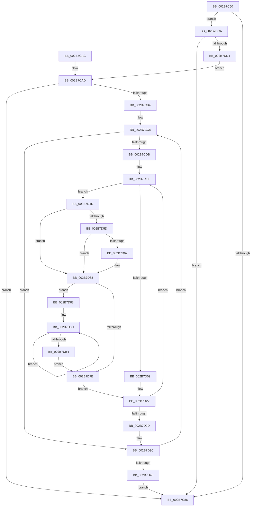

# MiMirrorReduceBlackWrites

- RVA: `0x002B7C50`–`0x002B7DD9` (길이 `393` bytes)
- VA: `0x00000001402B7C50`
- 실행 섹션: `.text`
- PDB 이름 있음: `예`; PDB Function 태그: `아니요`
- unwind 정보 RVA: `0x0006DB50`
- 디코드: `102`개 명령, `393/393` bytes 표시
- 미해석 바이트: `0` (있으면 어셈블리에 `.byte`로 보존)

> 이 문서는 커널 이미지의 기계어와 PDB 기호를 분석해 생성했습니다. 4번과 5번은 함수 원형과 자료형을 바이너리 사용 방식에서 추정한 C 해석이며 원본 소스 복구 결과는 아닙니다.

## 1. Dependencies

- 직접 호출 지점: **4**; 고유 호출 대상: **3**
- 직접 호출자로 확인된 함수: **1**
- RIP 상대 이미지 참조: **1**

### Outgoing calls
- `0x002B7C92` → [MiMirrorNodeFreeZeroPages](../4F/MiMirrorNodeFreeZeroPages_function_004FC8CC.md) (function, `0x004FC8CC`)
- `0x002B7D00` → [MiIsDecayPfn](MiIsDecayPfn_function_002B9240.md) (function, `0x002B9240`)
- `0x002B7D13` → [MiMirrorOmitPagesFromCopy](MiMirrorOmitPagesFromCopy_function_002B7AF0.md) (function, `0x002B7AF0`)
- `0x002B7D99` → [MiMirrorOmitPagesFromCopy](MiMirrorOmitPagesFromCopy_function_002B7AF0.md) (function, `0x002B7AF0`)

### Direct callers
- [MiMirrorBlackPhase](../67/MiMirrorBlackPhase_function_00678B4C.md) at `0x00678BBE`

### Static image references
- `0x002B7D4D` → RVA `0x00E2DC80` (`.data`; read)

## 2. Other-region calls and transfers

- 다른 실행 섹션으로 향하는 call: **0**
- 별도 외부 분기/꼬리 이동을 확인하지 못했습니다.

## 3. Assembly (complete function range)

```asm
002B7C50  48 89 5C 24 08                  mov qword ptr [rsp + 8], rbx
002B7C55  48 89 54 24 10                  mov qword ptr [rsp + 0x10], rdx
002B7C5A  55                              push rbp
002B7C5B  56                              push rsi
002B7C5C  57                              push rdi
002B7C5D  41 54                           push r12
002B7C5F  41 55                           push r13
002B7C61  41 56                           push r14
002B7C63  41 57                           push r15
002B7C65  48 83 EC 20                     sub rsp, 0x20
002B7C69  8B 42 08                        mov eax, dword ptr [rdx + 8]
002B7C6C  48 8B F2                        mov rsi, rdx
002B7C6F  44 8B 7A 0C                     mov r15d, dword ptr [rdx + 0xc]
002B7C73  4C 8B E1                        mov r12, rcx
002B7C76  4C 8B 2A                        mov r13, qword ptr [rdx]
002B7C79  44 89 7C 24 70                  mov dword ptr [rsp + 0x70], r15d
002B7C7E  A8 08                           test al, 8
002B7C80  0F 84 44 01 00 00               je 0x1402b7dca
002B7C86  41 B8 01 00 00 00               mov r8d, 1
002B7C8C  49 8B D4                        mov rdx, r12
002B7C8F  48 8B CE                        mov rcx, rsi
002B7C92  E8 35 4C 24 00                  call 0x1404fc8cc
002B7C97  48 8B 5C 24 60                  mov rbx, qword ptr [rsp + 0x60]
002B7C9C  48 83 C4 20                     add rsp, 0x20
002B7CA0  41 5F                           pop r15
002B7CA2  41 5E                           pop r14
002B7CA4  41 5D                           pop r13
002B7CA6  41 5C                           pop r12
002B7CA8  5F                              pop rdi
002B7CA9  5E                              pop rsi
002B7CAA  5D                              pop rbp
002B7CAB  C3                              ret
002B7CAC  CC                              int3
002B7CAD  33 ED                           xor ebp, ebp
002B7CAF  45 85 FF                        test r15d, r15d
002B7CB2  74 D2                           je 0x1402b7c86
002B7CB4  48 BA FF FF FF FF 3F 00 00 00   movabs rdx, 0x3fffffffff
002B7CBE  49 B8 00 00 00 00 00 DE FF FF   movabs r8, 0xffffde0000000000
002B7CC8  8B C5                           mov eax, ebp
002B7CCA  48 6B C8 58                     imul rcx, rax, 0x58
002B7CCE  4A 8B BC 21 D0 0C 00 00         mov rdi, qword ptr [rcx + r12 + 0xcd0]
002B7CD6  48 3B FA                        cmp rdi, rdx
002B7CD9  74 61                           je 0x1402b7d3c
002B7CDB  48 BB FF FF FF FF FF 00 00 00   movabs rbx, 0xffffffffff
002B7CE5  49 BF FF FF FF FF 3F 00 00 00   movabs r15, 0x3fffffffff
002B7CEF  4C 8D 34 7F                     lea r14, [rdi + rdi*2]
002B7CF3  49 C1 E6 04                     shl r14, 4
002B7CF7  49 8B C0                        mov rax, r8
002B7CFA  48 8B CF                        mov rcx, rdi
002B7CFD  4C 03 F0                        add r14, rax
002B7D00  E8 3B 15 00 00                  call 0x1402b9240
002B7D05  85 C0                           test eax, eax
002B7D07  75 44                           jne 0x1402b7d4d
002B7D09  44 8D 40 01                     lea r8d, [rax + 1]
002B7D0D  48 8B D7                        mov rdx, rdi
002B7D10  49 8B CD                        mov rcx, r13
002B7D13  E8 D8 FD FF FF                  call 0x1402b7af0
002B7D18  49 B8 00 00 00 00 00 DE FF FF   movabs r8, 0xffffde0000000000
002B7D22  49 8B 3E                        mov rdi, qword ptr [r14]
002B7D25  48 23 FB                        and rdi, rbx
002B7D28  49 3B FF                        cmp rdi, r15
002B7D2B  75 C2                           jne 0x1402b7cef
002B7D2D  44 8B 7C 24 70                  mov r15d, dword ptr [rsp + 0x70]
002B7D32  48 BA FF FF FF FF 3F 00 00 00   movabs rdx, 0x3fffffffff
002B7D3C  FF C5                           inc ebp
002B7D3E  41 3B EF                        cmp ebp, r15d
002B7D41  75 85                           jne 0x1402b7cc8
002B7D43  48 8B 74 24 68                  mov rsi, qword ptr [rsp + 0x68]
002B7D48  E9 39 FF FF FF                  jmp 0x1402b7c86
002B7D4D  48 8B 05 2C 5F B7 00            mov rax, qword ptr [rip + 0xb75f2c]
002B7D54  49 8B 5E 10                     mov rbx, qword ptr [r14 + 0x10]
002B7D58  48 85 C0                        test rax, rax
002B7D5B  74 0B                           je 0x1402b7d68
002B7D5D  F6 C3 10                        test bl, 0x10
002B7D60  75 06                           jne 0x1402b7d68
002B7D62  48 F7 D0                        not rax
002B7D65  48 23 D8                        and rbx, rax
002B7D68  48 C1 EB 0C                     shr rbx, 0xc
002B7D6C  48 BE FF FF FF FF FF 00 00 00   movabs rsi, 0xffffffffff
002B7D76  48 23 DE                        and rbx, rsi
002B7D79  48 3B DF                        cmp rbx, rdi
002B7D7C  75 05                           jne 0x1402b7d83
002B7D7E  48 8B DE                        mov rbx, rsi
002B7D81  EB 9F                           jmp 0x1402b7d22
002B7D83  49 BF 00 00 00 00 00 DE FF FF   movabs r15, 0xffffde0000000000
002B7D8D  41 B8 01 00 00 00               mov r8d, 1
002B7D93  48 8B D3                        mov rdx, rbx
002B7D96  49 8B CD                        mov rcx, r13
002B7D99  E8 52 FD FF FF                  call 0x1402b7af0
002B7D9E  48 8D 0C 5B                     lea rcx, [rbx + rbx*2]
002B7DA2  48 03 C9                        add rcx, rcx
002B7DA5  49 8B C7                        mov rax, r15
002B7DA8  48 8B 1C C8                     mov rbx, qword ptr [rax + rcx*8]
002B7DAC  48 23 DE                        and rbx, rsi
002B7DAF  48 3B DF                        cmp rbx, rdi
002B7DB2  75 D9                           jne 0x1402b7d8d
002B7DB4  49 BF FF FF FF FF 3F 00 00 00   movabs r15, 0x3fffffffff
002B7DBE  49 B8 00 00 00 00 00 DE FF FF   movabs r8, 0xffffde0000000000
002B7DC8  EB B4                           jmp 0x1402b7d7e
002B7DCA  0F BA E0 0A                     bt eax, 0xa
002B7DCE  0F 82 B2 FE FF FF               jb 0x1402b7c86
002B7DD4  E9 D4 FE FF FF                  jmp 0x1402b7cad
```

## 4. C-style interpretation (structured pseudocode)

```c
__int64 __fastcall MiMirrorReduceBlackWrites(__int64 a1, __int64 a2)
{
    __int64 result;
    __int64 v_r14;
    __int64 v_rbp;
    __int64 v_rbx;
    __int64 v_rdi;
    __int64 v_rsp;
    unsigned __int64 v_stack_p10;
    unsigned int v_stack_p18;
    unsigned __int64 v_stack_p68;
    unsigned int v_stack_p70;
    unsigned __int64 v_stack_p8;

    v_stack_p8 = v_rbx;
    v_stack_p10 = a2;
    v_rsp = (v_rsp) - (32);
    v_stack_p18 = (unsigned int)((unsigned int)(*(unsigned int *)(a2 + 12)));
    if ((((unsigned __int8)((unsigned int)(*(unsigned int *)(a2 + 8)))) & (8)) == 0) goto loc_002B7DCA;
loc_002B7C86:
    result = MiMirrorNodeFreeZeroPages(a2, a1, 1, a4);
    v_rsp = (v_rsp) + (32);
    return result;
loc_002B7CAD:
    v_rbp = 0;
    if ((unsigned int)((unsigned int)(*(unsigned int *)(a2 + 12))) == 0) goto loc_002B7C86;
loc_002B7CC8:
    a1 = (a2) * (0);
    if ((*(unsigned __int64 *)(a1 + a1 * 1 + 3280)) == a1) goto loc_002B7D3C;
loc_002B7CEF:
    v_r14 = (*(unsigned __int64 *)(a1 + a1 * 1 + 3280) + *(unsigned __int64 *)(a1 + a1 * 1 + 3280) * 2) << (4);
    v_r14 = (v_r14) + (1);
    result = MiIsDecayPfn(*(unsigned __int64 *)(a1 + a1 * 1 + 3280), a1, 1, a4);
    if ((unsigned int)(result) != 0) goto loc_002B7D4D;
    result = MiMirrorOmitPagesFromCopy(*(unsigned __int64 *)(a2), *(unsigned __int64 *)(a1 + a1 * 1 + 3280), result + 1, a4);
loc_002B7D22:
    v_rdi = (*(unsigned __int64 *)(v_r14)) & (v_stack_p8);
    if (v_rdi != ((unsigned int)(*(unsigned int *)(a2 + 12)))) goto loc_002B7CEF;
loc_002B7D3C:
    v_rbp = (unsigned int)((v_rbp) + 1);
    if (((unsigned int)(v_rbp)) != ((unsigned int)((unsigned int)(v_stack_p70)))) goto loc_002B7CC8;
    goto loc_002B7C86;
loc_002B7D4D:
    if (*(unsigned __int64 *)(v_rip + 12017452) == 0) goto loc_002B7D68;
    result = *(unsigned __int64 *)(v_rip + 12017452);
    v_rbx = *(unsigned __int64 *)(v_r14 + 16);
    if ((((unsigned __int8)(*(unsigned __int64 *)(v_r14 + 16))) & (16)) == 0) {
        result = ~(*(unsigned __int64 *)(v_rip + 12017452));
        v_rbx = (*(unsigned __int64 *)(v_r14 + 16)) & (result);
    }
    v_rbx = (v_rbx) >> (12);
    v_rbx = (v_rbx) & (v_stack_p68);
    if (v_rbx != v_rdi) goto loc_002B7D83;
loc_002B7D7E:
    goto loc_002B7D22;
loc_002B7D83:
loc_002B7D8D:
    result = MiMirrorOmitPagesFromCopy(*(unsigned __int64 *)(a2), v_stack_p68, 1, a4);
    a1 = (v_stack_p68 + v_stack_p68 * 2) + (v_stack_p68 + v_stack_p68 * 2);
    v_rbx = (*(unsigned __int64 *)((unsigned int)(v_stack_p70) + a1 * 8)) & (v_stack_p68);
    if (v_rbx != v_rdi) goto loc_002B7D8D;
    goto loc_002B7D7E;
loc_002B7DCA:
    if (v_rbx < v_rdi) goto loc_002B7C86;
    goto loc_002B7CAD;
}
```

## 5. (Beta) C Style

```c
int64_t MiMirrorReduceBlackWrites(int64_t Arg1, void *Arg2)
{
    uint8_t *arg2 = (uint8_t *)Arg2;

    int64_t result;
    int64_t local_r14;
    int64_t local_rbp;
    int64_t local_rbx;
    int64_t local_rdi;
    int64_t local_rsp;
    uint64_t v_stack_p10;
    uint32_t v_stack_p18;
    uint64_t v_stack_p68;
    uint32_t v_stack_p70;
    uint64_t v_stack_p8;

    v_stack_p8 = local_rbx;
    v_stack_p10 = Arg2;
    local_rsp = (local_rsp) - (32);
    v_stack_p18 = (uint32_t)((uint32_t)(*(uint32_t *)(arg2 + 0xC)));
    if ((((uint8_t)((uint32_t)(*(uint32_t *)(arg2 + 0x8)))) & (8)) == 0) goto loc_002B7DCA;
loc_002B7C86:
    result = MiMirrorNodeFreeZeroPages(Arg2, Arg1, 1, a4);
    local_rsp = (local_rsp) + (32);
    return result;
loc_002B7CAD:
    local_rbp = 0;
    if ((uint32_t)((uint32_t)(*(uint32_t *)(arg2 + 0xC))) == 0) goto loc_002B7C86;
loc_002B7CC8:
    Arg1 = (Arg2) * (0);
    if ((*(uint64_t *)(Arg1 + Arg1 * 1 + 0xCD0)) == Arg1) goto loc_002B7D3C;
loc_002B7CEF:
    local_r14 = (*(uint64_t *)(Arg1 + Arg1 * 1 + 0xCD0) + *(uint64_t *)(Arg1 + Arg1 * 1 + 0xCD0) * 2) << (4);
    local_r14 = (local_r14) + (1);
    result = MiIsDecayPfn(*(uint64_t *)(Arg1 + Arg1 * 1 + 0xCD0), Arg1, 1, a4);
    if ((uint32_t)(result) != 0) goto loc_002B7D4D;
    result = MiMirrorOmitPagesFromCopy(*(uint64_t *)(arg2), *(uint64_t *)(Arg1 + Arg1 * 1 + 0xCD0), result + 1, a4);
loc_002B7D22:
    local_rdi = (*(uint64_t *)(local_r14)) & (v_stack_p8);
    if (local_rdi != ((uint32_t)(*(uint32_t *)(arg2 + 0xC)))) goto loc_002B7CEF;
loc_002B7D3C:
    local_rbp = (uint32_t)((local_rbp) + 1);
    if (((uint32_t)(local_rbp)) != ((uint32_t)((uint32_t)(v_stack_p70)))) goto loc_002B7CC8;
    goto loc_002B7C86;
loc_002B7D4D:
    if (*(uint64_t *)(v_rip + 0xB75F2C) == 0) goto loc_002B7D68;
    result = *(uint64_t *)(v_rip + 0xB75F2C);
    local_rbx = *(uint64_t *)(local_r14 + 0x10);
    if ((((uint8_t)(*(uint64_t *)(local_r14 + 0x10))) & (16)) == 0) {
        result = ~(*(uint64_t *)(v_rip + 0xB75F2C));
        local_rbx = (*(uint64_t *)(local_r14 + 0x10)) & (result);
    }
    local_rbx = (local_rbx) >> (12);
    local_rbx = (local_rbx) & (v_stack_p68);
    if (local_rbx != local_rdi) goto loc_002B7D83;
loc_002B7D7E:
    goto loc_002B7D22;
loc_002B7D83:
loc_002B7D8D:
    result = MiMirrorOmitPagesFromCopy(*(uint64_t *)(arg2), v_stack_p68, 1, a4);
    Arg1 = (v_stack_p68 + v_stack_p68 * 2) + (v_stack_p68 + v_stack_p68 * 2);
    local_rbx = (*(uint64_t *)((uint32_t)(v_stack_p70) + Arg1 * 8)) & (v_stack_p68);
    if (local_rbx != local_rdi) goto loc_002B7D8D;
    goto loc_002B7D7E;
loc_002B7DCA:
    if (local_rbx < local_rdi) goto loc_002B7C86;
    goto loc_002B7CAD;
}
```

### 관측된 메모리 오프셋

구조체 형식이 확인되지 않은 접근은 인자 기준의 오프셋으로만 기록했습니다.

| 기준 인자 | 오프셋 표현 | 폭 (bit) | 접근 |
|---|---:|---:|---|
| `Arg2` | `+ 0x0` | `64` | `R` |
| `Arg2` | `+ 0x8` | `32` | `R` |
| `Arg2` | `+ 0xC` | `32` | `R` |

## 6. Execution-region graph

[열기: 2D/3D 그래프와 함수 탐색 컨트롤 패널](../../../control-panel.html?section=text&rva=0x002B7C50&view=graph)

- 2D 그래프는 위에서 아래로 흐르고, 3D 그래프는 빈 공간을 드래그해 회전합니다. Shift+드래그는 이동, 휠은 확대·축소, 함수 노드 선택은 대상 보고서 이동입니다.

### Static fallback


