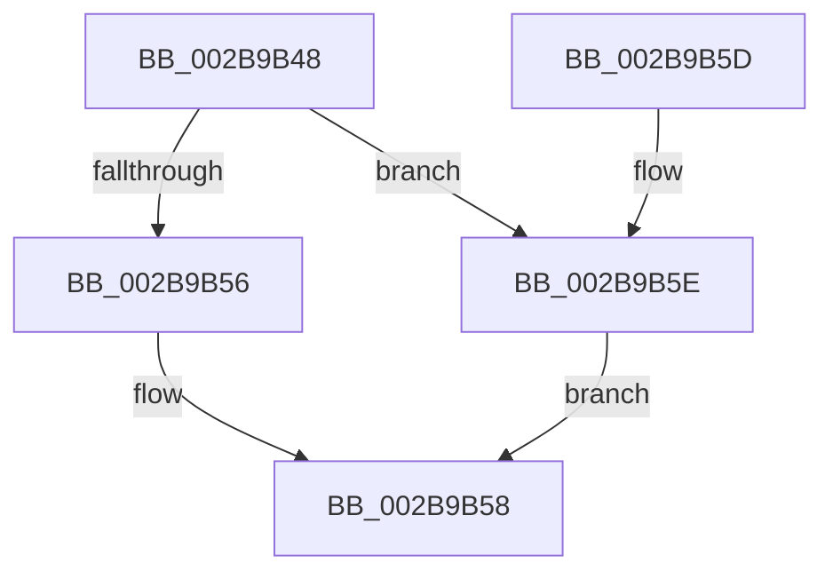

# MiPageToChannel

- RVA: `0x002B9B48`–`0x002B9B68` (길이 `32` bytes)
- VA: `0x00000001402B9B48`
- 실행 섹션: `.text`
- PDB 이름 있음: `예`; PDB Function 태그: `아니요`
- unwind 정보 RVA: `0x0005F758`
- 디코드: `10`개 명령, `32/32` bytes 표시
- 미해석 바이트: `0` (있으면 어셈블리에 `.byte`로 보존)

> 이 문서는 커널 이미지의 기계어와 PDB 기호를 분석해 생성했습니다. 4번과 5번은 함수 원형과 자료형을 바이너리 사용 방식에서 추정한 C 해석이며 원본 소스 복구 결과는 아닙니다.

## 1. Dependencies

- 직접 호출 지점: **1**; 고유 호출 대상: **1**
- 직접 호출자로 확인된 함수: **12**
- RIP 상대 이미지 참조: **1**

### Outgoing calls
- `0x002B9B5E` → [MiSearchChannelTable](../33/MiSearchChannelTable_function_0033BE24.md) (function, `0x0033BE24`)

### Direct callers
- [sub_0024B727](../24/Unknown_function_0024B727.md) at `0x0024B777`
- [sub_0024B727](../24/Unknown_function_0024B727.md) at `0x0024B791`
- [MiGetPage](../28/MiGetPage_function_002884C0.md) at `0x0028919D`
- [sub_002B98DD](Unknown_function_002B98DD.md) at `0x002B9906`
- [sub_002B98DD](Unknown_function_002B98DD.md) at `0x002B9923`
- [sub_002B98DD](Unknown_function_002B98DD.md) at `0x002B994D`
- [MiSynchronizeFastPageInsert](MiSynchronizeFastPageInsert_function_002BAE80.md) at `0x002BB442`
- [sub_003354FB](../33/Unknown_function_003354FB.md) at `0x00335CE9`
- [sub_00338E63](../33/Unknown_function_00338E63.md) at `0x003394A5`
- [sub_00338E63](../33/Unknown_function_00338E63.md) at `0x003394BE`
- [MiSharedInsertPfnChainInList](../33/MiSharedInsertPfnChainInList_function_0033CA70.md) at `0x0033D1D5`
- [MiComputeHugeRangeColorHeadAtDpc](../43/MiComputeHugeRangeColorHeadAtDpc_function_00436968.md) at `0x004369BA`
- [MiUnlinkHugeRange](../43/MiUnlinkHugeRange_function_00436EF0.md) at `0x00436F24`
- [MiInsertHugeRangeInList](../43/MiInsertHugeRangeInList_function_004371E8.md) at `0x0043724D`
- [MiDescribePageRun](../../page/7F/MiDescribePageRun_function_007FA38C.md) at `0x007FA3E8`
- [MiInitializeSystemChannelOrdering](../../init/C6/MiInitializeSystemChannelOrdering_function_00C687E4.md) at `0x00C68812`

### Static image references
- `0x002B9B4C` → RVA `0x00E2DC28` (`.data`; read)

## 2. Other-region calls and transfers

- 다른 실행 섹션으로 향하는 call: **0**
- 별도 외부 분기/꼬리 이동을 확인하지 못했습니다.

## 3. Assembly (complete function range)

```asm
002B9B48  48 83 EC 28                     sub rsp, 0x28
002B9B4C  48 83 3D D4 40 B7 00 00         cmp qword ptr [rip + 0xb740d4], 0
002B9B54  75 08                           jne 0x1402b9b5e
002B9B56  32 C0                           xor al, al
002B9B58  48 83 C4 28                     add rsp, 0x28
002B9B5C  C3                              ret
002B9B5D  CC                              int3
002B9B5E  E8 C1 22 08 00                  call 0x14033be24
002B9B63  8A 40 0C                        mov al, byte ptr [rax + 0xc]
002B9B66  EB F0                           jmp 0x1402b9b58
```

## 4. C-style interpretation (structured pseudocode)

```c
__int64 __fastcall MiPageToChannel(void)
{
    __int64 result;
    __int64 v_rsp;

    v_rsp = (v_rsp) - (40);
    if ((*(unsigned __int64 *)(v_rip + 12009684)) != 0) goto loc_002B9B5E;
    result = 0;
loc_002B9B58:
    v_rsp = (v_rsp) + (40);
    return result;
loc_002B9B5E:
    result = MiSearchChannelTable(a1, a2, a3, a4);
    goto loc_002B9B58;
}
```

## 5. (Beta) C Style

```c
void MiPageToChannel(void)
{
    int64_t result;
    int64_t local_rsp;

    local_rsp = (local_rsp) - (40);
    if ((*(uint64_t *)(v_rip + 0xB740D4)) != 0) goto loc_002B9B5E;
    result = 0;
loc_002B9B58:
    local_rsp = (local_rsp) + (40);
    return result;
loc_002B9B5E:
    result = MiSearchChannelTable(a1, a2, a3, a4);
    goto loc_002B9B58;
}
```

## 6. Execution-region graph

[열기: 2D/3D 그래프와 함수 탐색 컨트롤 패널](../../../control-panel.html?section=text&rva=0x002B9B48&view=graph)

- 2D 그래프는 위에서 아래로 흐르고, 3D 그래프는 빈 공간을 드래그해 회전합니다. Shift+드래그는 이동, 휠은 확대·축소, 함수 노드 선택은 대상 보고서 이동입니다.

### Static fallback


