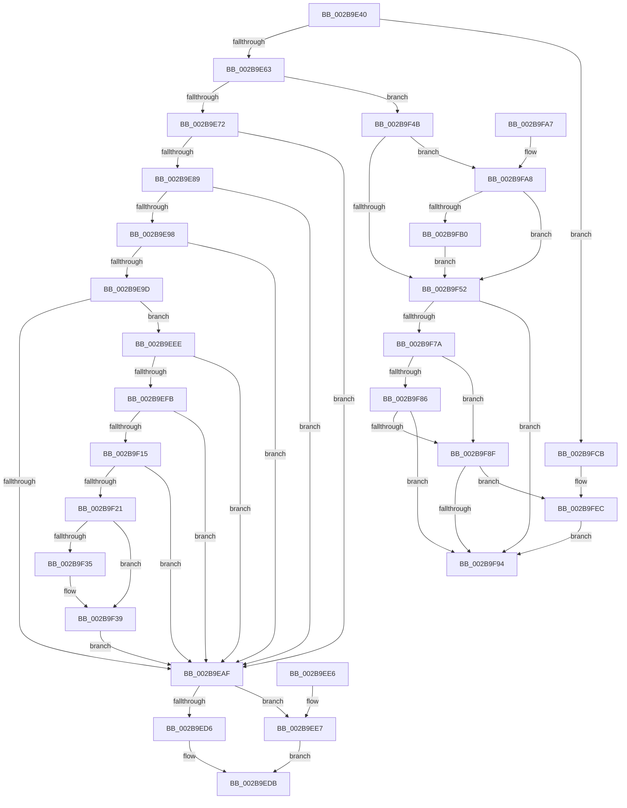

# MiPfnReferenceCountIsZero

- RVA: `0x002B9E40`–`0x002B9FF9` (길이 `441` bytes)
- VA: `0x00000001402B9E40`
- 실행 섹션: `.text`
- PDB 이름 있음: `예`; PDB Function 태그: `아니요`
- unwind 정보 RVA: `0x0006DD24`
- 디코드: `114`개 명령, `441/441` bytes 표시
- 미해석 바이트: `0` (있으면 어셈블리에 `.byte`로 보존)

> 이 문서는 커널 이미지의 기계어와 PDB 기호를 분석해 생성했습니다. 4번과 5번은 함수 원형과 자료형을 바이너리 사용 방식에서 추정한 C 해석이며 원본 소스 복구 결과는 아닙니다.

## 1. Dependencies

- 직접 호출 지점: **4**; 고유 호출 대상: **4**
- 직접 호출자로 확인된 함수: **12**
- RIP 상대 이미지 참조: **2**

### Outgoing calls
- `0x002B9EDB` → [MiInsertPageInList](MiInsertPageInList_function_002BA000.md) (function, `0x002BA000`)
- `0x002B9F9C` → [MiInsertPageInFreeOrZeroedList](../33/MiInsertPageInFreeOrZeroedList_function_00334D20.md) (function, `0x00334D20`)
- `0x002B9FE6` → [KeBugCheckEx](../4F/KeBugCheckEx_function_004FD660.md) (function, `0x004FD660`)
- `0x002B9FF2` → [MiReleasePageFileInfo](../28/MiReleasePageFileInfo_function_00283FD0.md) (function, `0x00283FD0`)

### Direct callers
- [MiCombineInitialInstance](../22/MiCombineInitialInstance_function_0022BC0C.md) at `0x0022C4DD`
- [MiCombineInitialInstance](../22/MiCombineInitialInstance_function_0022BC0C.md) at `0x0022C689`
- [MiAddPageToInsertList](../24/MiAddPageToInsertList_function_0024A950.md) at `0x0024ADDF`
- [MiHardFaultPageRelease](MiHardFaultPageRelease_function_002B5728.md) at `0x002B57C1`
- [MiWalkEntireImage](../36/MiWalkEntireImage_function_00365D70.md) at `0x003662F3`
- [MiWalkEntireImage](../36/MiWalkEntireImage_function_00365D70.md) at `0x003667DD`
- [MiWalkEntireImage](../36/MiWalkEntireImage_function_00365D70.md) at `0x00366D02`
- [MiWriteCompletePfn](../37/MiWriteCompletePfn_function_003737C4.md) at `0x0037392A`
- [MiSwapHardFaultPage](../38/MiSwapHardFaultPage_function_00385F34.md) at `0x00386052`
- [MiInsertProtectedStandbyPage](../45/MiInsertProtectedStandbyPage_function_004527D8.md) at `0x004528F7`
- [MiMirrorPerformBrownWrites](../45/MiMirrorPerformBrownWrites_function_0045C560.md) at `0x0045CDB8`
- [MiMarkFileOnlyPfnGood](../68/MiMarkFileOnlyPfnGood_function_0068178C.md) at `0x0068182F`
- [MiPurgeBadFileOnlyPages](../68/MiPurgeBadFileOnlyPages_function_00681ADC.md) at `0x00681C61`
- [MiNoPagesLastChance](../68/MiNoPagesLastChance_function_0068B22C.md) at `0x0068B665`
- [sub_006D7070](../6D/Unknown_function_006D7070.md) at `0x006D70EA`

### Static image references
- `0x002B9EEE` → RVA `0x00FC6A88` (`ALMOSTRO`; read)
- `0x002B9F56` → RVA `0x00E30088` (`.data`; read)

## 2. Other-region calls and transfers

- 다른 실행 섹션으로 향하는 call: **0**
- 별도 외부 분기/꼬리 이동을 확인하지 못했습니다.

## 3. Assembly (complete function range)

```asm
002B9E40  40 53                           push rbx
002B9E42  48 83 EC 30                     sub rsp, 0x30
002B9E46  48 8B 41 18                     mov rax, qword ptr [rcx + 0x18]
002B9E4A  4C 8B C9                        mov r9, rcx
002B9E4D  48 B9 FF FF FF FF FF FF FF 3F   movabs rcx, 0x3fffffffffffffff
002B9E57  48 8B DA                        mov rbx, rdx
002B9E5A  48 85 C1                        test rcx, rax
002B9E5D  0F 85 68 01 00 00               jne 0x1402b9fcb
002B9E63  49 8B 41 18                     mov rax, qword ptr [r9 + 0x18]
002B9E67  48 0F BA E0 3E                  bt rax, 0x3e
002B9E6C  0F 82 D9 00 00 00               jb 0x1402b9f4b
002B9E72  49 8B 49 10                     mov rcx, qword ptr [r9 + 0x10]
002B9E76  49 8D 51 10                     lea rdx, [r9 + 0x10]
002B9E7A  48 B8 00 D0 BE 7D FB F6 FF FF   movabs rax, 0xfffff6fb7dbed000
002B9E84  48 3B D0                        cmp rdx, rax
002B9E87  72 26                           jb 0x1402b9eaf
002B9E89  48 B8 F8 D7 BE 7D FB F6 FF FF   movabs rax, 0xfffff6fb7dbed7f8
002B9E93  48 3B D0                        cmp rdx, rax
002B9E96  77 17                           ja 0x1402b9eaf
002B9E98  F6 C1 01                        test cl, 1
002B9E9B  74 12                           je 0x1402b9eaf
002B9E9D  F6 C1 42                        test cl, 0x42
002B9EA0  41 0F 95 C0                     setne r8b
002B9EA4  F6 C1 20                        test cl, 0x20
002B9EA7  0F 95 C0                        setne al
002B9EAA  44 84 C0                        test al, r8b
002B9EAD  74 3F                           je 0x1402b9eee
002B9EAF  48 0F BA E1 0A                  bt rcx, 0xa
002B9EB4  48 C7 C0 F7 FF FF FF            mov rax, 0xfffffffffffffff7
002B9EBB  49 C7 C0 FF F7 FF FF            mov r8, 0xfffffffffffff7ff
002B9EC2  49 0F 42 C0                     cmovb rax, r8
002B9EC6  48 23 C1                        and rax, rcx
002B9EC9  49 8B C9                        mov rcx, r9
002B9ECC  48 89 02                        mov qword ptr [rdx], rax
002B9ECF  41 F6 41 22 10                  test byte ptr [r9 + 0x22], 0x10
002B9ED4  74 11                           je 0x1402b9ee7
002B9ED6  BA 08 00 00 00                  mov edx, 8
002B9EDB  E8 20 01 00 00                  call 0x1402ba000
002B9EE0  48 83 C4 30                     add rsp, 0x30
002B9EE4  5B                              pop rbx
002B9EE5  C3                              ret
002B9EE6  CC                              int3
002B9EE7  BA 04 00 00 00                  mov edx, 4
002B9EEC  EB ED                           jmp 0x1402b9edb
002B9EEE  48 F7 05 8F CB D0 00 00 00 60 00  test qword ptr [rip + 0xd0cb8f], 0x600000
002B9EF9  74 B4                           je 0x1402b9eaf
002B9EFB  65 48 8B 04 25 88 01 00 00      mov rax, qword ptr gs:[0x188]
002B9F04  4C 8B 80 B8 00 00 00            mov r8, qword ptr [rax + 0xb8]
002B9F0B  41 80 B8 60 01 00 00 01         cmp byte ptr [r8 + 0x160], 1
002B9F13  74 9A                           je 0x1402b9eaf
002B9F15  4D 8B 90 08 05 00 00            mov r10, qword ptr [r8 + 0x508]
002B9F1C  4D 85 D2                        test r10, r10
002B9F1F  74 8E                           je 0x1402b9eaf
002B9F21  48 8B C2                        mov rax, rdx
002B9F24  48 C1 E8 03                     shr rax, 3
002B9F28  25 FF 01 00 00                  and eax, 0x1ff
002B9F2D  49 8B 04 C2                     mov rax, qword ptr [r10 + rax*8]
002B9F31  A8 20                           test al, 0x20
002B9F33  74 04                           je 0x1402b9f39
002B9F35  48 83 C9 20                     or rcx, 0x20
002B9F39  4C 8B C1                        mov r8, rcx
002B9F3C  48 83 C9 42                     or rcx, 0x42
002B9F40  A8 42                           test al, 0x42
002B9F42  49 0F 44 C8                     cmove rcx, r8
002B9F46  E9 64 FF FF FF                  jmp 0x1402b9eaf
002B9F4B  41 F6 41 23 10                  test byte ptr [r9 + 0x23], 0x10
002B9F50  75 56                           jne 0x1402b9fa8
002B9F52  49 8B 41 28                     mov rax, qword ptr [r9 + 0x28]
002B9F56  48 8B 0D 2B 61 B7 00            mov rcx, qword ptr [rip + 0xb7612b]
002B9F5D  48 C1 E8 2B                     shr rax, 0x2b
002B9F61  25 FF 03 00 00                  and eax, 0x3ff
002B9F66  48 8B 0C C1                     mov rcx, qword ptr [rcx + rax*8]
002B9F6A  49 8B 41 10                     mov rax, qword ptr [r9 + 0x10]
002B9F6E  48 89 44 24 40                  mov qword ptr [rsp + 0x40], rax
002B9F73  48 0F BA E0 0A                  bt rax, 0xa
002B9F78  72 1A                           jb 0x1402b9f94
002B9F7A  48 8B 54 24 40                  mov rdx, qword ptr [rsp + 0x40]
002B9F7F  C0 E8 02                        shr al, 2
002B9F82  A8 01                           test al, 1
002B9F84  75 09                           jne 0x1402b9f8f
002B9F86  0F B6 C2                        movzx eax, dl
002B9F89  D0 E8                           shr al, 1
002B9F8B  A8 01                           test al, 1
002B9F8D  74 05                           je 0x1402b9f94
002B9F8F  48 85 D2                        test rdx, rdx
002B9F92  75 58                           jne 0x1402b9fec
002B9F94  BA 02 00 00 00                  mov edx, 2
002B9F99  48 8B CB                        mov rcx, rbx
002B9F9C  E8 7F AD 07 00                  call 0x140334d20
002B9FA1  48 83 C4 30                     add rsp, 0x30
002B9FA5  5B                              pop rbx
002B9FA6  C3                              ret
002B9FA7  CC                              int3
002B9FA8  49 0F BA 61 28 35               bt qword ptr [r9 + 0x28], 0x35
002B9FAE  72 A2                           jb 0x1402b9f52
002B9FB0  41 8B 41 20                     mov eax, dword ptr [r9 + 0x20]
002B9FB4  89 44 24 40                     mov dword ptr [rsp + 0x40], eax
002B9FB8  C1 E8 18                        shr eax, 0x18
002B9FBB  24 EF                           and al, 0xef
002B9FBD  88 44 24 43                     mov byte ptr [rsp + 0x43], al
002B9FC1  8B 44 24 40                     mov eax, dword ptr [rsp + 0x40]
002B9FC5  41 89 41 20                     mov dword ptr [r9 + 0x20], eax
002B9FC9  EB 87                           jmp 0x1402b9f52
002B9FCB  4D 8B 49 18                     mov r9, qword ptr [r9 + 0x18]
002B9FCF  BA 07 00 00 00                  mov edx, 7
002B9FD4  4C 23 C9                        and r9, rcx
002B9FD7  48 C7 44 24 20 00 00 00 00      mov qword ptr [rsp + 0x20], 0
002B9FE0  4C 8B C3                        mov r8, rbx
002B9FE3  8D 4A 47                        lea ecx, [rdx + 0x47]
002B9FE6  E8 75 36 24 00                  call 0x1404fd660
002B9FEB  CC                              int3
002B9FEC  41 B8 01 00 00 00               mov r8d, 1
002B9FF2  E8 D9 9F FC FF                  call 0x140283fd0
002B9FF7  EB 9B                           jmp 0x1402b9f94
```

## 4. C-style interpretation (structured pseudocode)

```c
__int64 __fastcall MiPfnReferenceCountIsZero(__int64 a1, __int64 a2)
{
    __int64 result;
    __int64 v_rsp;
    unsigned __int64 v_stack_p40;
    unsigned __int64 v_stack_p58;
    unsigned int v_stack_p78;
    unsigned __int8 v_stack_p7B;

    v_rsp = (v_rsp) - (48);
    if (((a1) & (*(unsigned __int64 *)(a1 + 24))) != 0) goto loc_002B9FCB;
    if (condition_is_below) goto loc_002B9F4B;
    if ((a1 + 16) < (*(unsigned __int64 *)(a1 + 24))) goto loc_002B9EAF;
    if ((a1 + 16) > (*(unsigned __int64 *)(a1 + 24))) goto loc_002B9EAF;
    if ((((unsigned __int8)(*(unsigned __int64 *)(a1 + 16))) & (1)) == 0) goto loc_002B9EAF;
    a3 = ((((unsigned __int8)(*(unsigned __int64 *)(a1 + 16))) & (66)) != 0) ? 1 : 0;
    result = ((((unsigned __int8)(*(unsigned __int64 *)(a1 + 16))) & (32)) != 0) ? 1 : 0;
    if ((((unsigned __int8)(result)) & ((unsigned __int8)(a3))) == 0) goto loc_002B9EEE;
loc_002B9EAF:
    result = -9;
    if (condition_is_below) { result = 0xFFFFFFFFFFFFF7FFULL; }
    result = (result) & (*(unsigned __int64 *)(a1 + 16));
    *(unsigned __int64 *)(a1 + 16) = result;
    if (((*(unsigned __int8 *)(a1 + 34)) & (16)) == 0) goto loc_002B9EE7;
loc_002B9EDB:
    result = MiInsertPageInList(a1, 8, 0xFFFFFFFFFFFFF7FFULL, a1);
    v_rsp = (v_rsp) + (48);
    return result;
loc_002B9EE7:
    goto loc_002B9EDB;
loc_002B9EEE:
    if (((*(unsigned __int64 *)(v_rip + 13683599)) & (0x600000ULL)) == 0) goto loc_002B9EAF;
    if ((*(unsigned __int8 *)(*(unsigned __int64 *)(*(unsigned __int64 *)(gs_base + (0 + 392)) + 184) + 352)) == 1) goto loc_002B9EAF;
    if (*(unsigned __int64 *)(*(unsigned __int64 *)(*(unsigned __int64 *)(gs_base + (0 + 392)) + 184) + 1288) == 0) goto loc_002B9EAF;
    result = (4) >> (3);
    result = (unsigned int)((result) & (511));
    if ((((unsigned __int8)(*(unsigned __int64 *)(*(unsigned __int64 *)(*(unsigned __int64 *)(*(unsigned __int64 *)(gs_base + (0 + 392)) + 184) + 1288) + result * 8))) & (32)) != 0) {
        a1 = (a1) | (32);
    }
    a1 = (a1) | (66);
    if ((((unsigned __int8)(*(unsigned __int64 *)(*(unsigned __int64 *)(*(unsigned __int64 *)(*(unsigned __int64 *)(gs_base + (0 + 392)) + 184) + 1288) + result * 8))) & (66)) == 0) { a1 = a1; }
    goto loc_002B9EAF;
loc_002B9F4B:
    if (((*(unsigned __int8 *)(a1 + 35)) & (16)) != 0) goto loc_002B9FA8;
loc_002B9F52:
    result = (*(unsigned __int64 *)(a1 + 40)) >> (43);
    result = (unsigned int)((result) & (0x3FFULL));
    v_stack_p40 = *(unsigned __int64 *)(a1 + 16);
    if (condition_is_below) goto loc_002B9F94;
    result = (unsigned __int8)((*(unsigned __int64 *)(a1 + 16)) >> (2));
    if ((((unsigned __int8)(result)) & (1)) != 0) goto loc_002B9F8F;
    result = (unsigned __int8)(((unsigned __int8)(v_stack_p40)) >> (1));
    if ((((unsigned __int8)(result)) & (1)) == 0) goto loc_002B9F94;
loc_002B9F8F:
    if (v_stack_p40 != 0) goto loc_002B9FEC;
loc_002B9F94:
    result = MiInsertPageInFreeOrZeroedList(a2, 2, a1, a1);
    v_rsp = (v_rsp) + (48);
    return result;
loc_002B9FA8:
    if (condition_is_below) goto loc_002B9F52;
    v_stack_p78 = (unsigned int)((unsigned int)(*(unsigned int *)(a1 + 32)));
    result = (unsigned int)(((unsigned int)(*(unsigned int *)(a1 + 32))) >> (24));
    result = (unsigned __int8)((result) & (239));
    v_stack_p7B = (unsigned __int8)(result);
    *(unsigned int *)(a1 + 32) = (unsigned int)((unsigned int)(v_stack_p78));
    goto loc_002B9F52;
loc_002B9FCB:
    a4 = (*(unsigned __int64 *)(a1 + 24)) & (a2);
    v_stack_p58 = 0;
    result = KeBugCheckEx(7 + 71, 7, a2, a4);
loc_002B9FEC:
    result = MiReleasePageFileInfo(7 + 71, 7, 1, a4);
    goto loc_002B9F94;
}
```

## 5. (Beta) C Style

```c
int64_t MiPfnReferenceCountIsZero(void *Arg1, int64_t Arg2)
{
    uint8_t *arg1 = (uint8_t *)Arg1;

    int64_t result;
    int64_t local_rsp;
    uint64_t v_stack_p40;
    uint64_t v_stack_p58;
    uint32_t v_stack_p78;
    uint8_t v_stack_p7B;

    local_rsp = (local_rsp) - (48);
    if (((Arg1) & (*(uint64_t *)(arg1 + 0x18))) != 0) goto loc_002B9FCB;
    if (condition_is_below) goto loc_002B9F4B;
    if ((Arg1 + 16) < (*(uint64_t *)(arg1 + 0x18))) goto loc_002B9EAF;
    if ((Arg1 + 16) > (*(uint64_t *)(arg1 + 0x18))) goto loc_002B9EAF;
    if ((((uint8_t)(*(uint64_t *)(arg1 + 0x10))) & (1)) == 0) goto loc_002B9EAF;
    a3 = ((((uint8_t)(*(uint64_t *)(arg1 + 0x10))) & (66)) != 0) ? 1 : 0;
    result = ((((uint8_t)(*(uint64_t *)(arg1 + 0x10))) & (32)) != 0) ? 1 : 0;
    if ((((uint8_t)(result)) & ((uint8_t)(a3))) == 0) goto loc_002B9EEE;
loc_002B9EAF:
    result = -9;
    if (condition_is_below) { result = 0xFFFFFFFFFFFFF7FFULL; }
    result = (result) & (*(uint64_t *)(arg1 + 0x10));
    *(uint64_t *)(arg1 + 0x10) = result;
    if (((*(uint8_t *)(arg1 + 0x22)) & (16)) == 0) goto loc_002B9EE7;
loc_002B9EDB:
    result = MiInsertPageInList(Arg1, 8, 0xFFFFFFFFFFFFF7FFULL, Arg1);
    local_rsp = (local_rsp) + (48);
    return result;
loc_002B9EE7:
    goto loc_002B9EDB;
loc_002B9EEE:
    if (((*(uint64_t *)(v_rip + 0xD0CB8F)) & (0x600000ULL)) == 0) goto loc_002B9EAF;
    if ((*(uint8_t *)(*(uint64_t *)(*(uint64_t *)(gs_base + (0 + 0x188)) + 0xB8) + 0x160)) == 1) goto loc_002B9EAF;
    if (*(uint64_t *)(*(uint64_t *)(*(uint64_t *)(gs_base + (0 + 0x188)) + 0xB8) + 0x508) == 0) goto loc_002B9EAF;
    result = (4) >> (3);
    result = (uint32_t)((result) & (511));
    if ((((uint8_t)(*(uint64_t *)(*(uint64_t *)(*(uint64_t *)(*(uint64_t *)(gs_base + (0 + 0x188)) + 0xB8) + 0x508) + result * 8))) & (32)) != 0) {
        Arg1 = (Arg1) | (32);
    }
    Arg1 = (Arg1) | (66);
    if ((((uint8_t)(*(uint64_t *)(*(uint64_t *)(*(uint64_t *)(*(uint64_t *)(gs_base + (0 + 0x188)) + 0xB8) + 0x508) + result * 8))) & (66)) == 0) { Arg1 = Arg1; }
    goto loc_002B9EAF;
loc_002B9F4B:
    if (((*(uint8_t *)(arg1 + 0x23)) & (16)) != 0) goto loc_002B9FA8;
loc_002B9F52:
    result = (*(uint64_t *)(arg1 + 0x28)) >> (43);
    result = (uint32_t)((result) & (0x3FFULL));
    v_stack_p40 = *(uint64_t *)(arg1 + 0x10);
    if (condition_is_below) goto loc_002B9F94;
    result = (uint8_t)((*(uint64_t *)(arg1 + 0x10)) >> (2));
    if ((((uint8_t)(result)) & (1)) != 0) goto loc_002B9F8F;
    result = (uint8_t)(((uint8_t)(v_stack_p40)) >> (1));
    if ((((uint8_t)(result)) & (1)) == 0) goto loc_002B9F94;
loc_002B9F8F:
    if (v_stack_p40 != 0) goto loc_002B9FEC;
loc_002B9F94:
    result = MiInsertPageInFreeOrZeroedList(Arg2, 2, Arg1, Arg1);
    local_rsp = (local_rsp) + (48);
    return result;
loc_002B9FA8:
    if (condition_is_below) goto loc_002B9F52;
    v_stack_p78 = (uint32_t)((uint32_t)(*(uint32_t *)(arg1 + 0x20)));
    result = (uint32_t)(((uint32_t)(*(uint32_t *)(arg1 + 0x20))) >> (24));
    result = (uint8_t)((result) & (239));
    v_stack_p7B = (uint8_t)(result);
    *(uint32_t *)(arg1 + 0x20) = (uint32_t)((uint32_t)(v_stack_p78));
    goto loc_002B9F52;
loc_002B9FCB:
    a4 = (*(uint64_t *)(arg1 + 0x18)) & (Arg2);
    v_stack_p58 = 0;
    result = KeBugCheckEx(7 + 71, 7, Arg2, a4);
loc_002B9FEC:
    result = MiReleasePageFileInfo(7 + 71, 7, 1, a4);
    goto loc_002B9F94;
}
```

### 관측된 메모리 오프셋

구조체 형식이 확인되지 않은 접근은 인자 기준의 오프셋으로만 기록했습니다.

| 기준 인자 | 오프셋 표현 | 폭 (bit) | 접근 |
|---|---:|---:|---|
| `Arg1` | `+ 0x10` | `64` | `R` |
| `Arg1` | `+ 0x18` | `64` | `R` |
| `Arg1` | `+ 0x20` | `32` | `R` |
| `Arg1` | `+ 0x20` | `32` | `W` |
| `Arg1` | `+ 0x22` | `8` | `R` |
| `Arg1` | `+ 0x23` | `8` | `R` |
| `Arg1` | `+ 0x28` | `64` | `R` |

## 6. Execution-region graph

[열기: 2D/3D 그래프와 함수 탐색 컨트롤 패널](../../../control-panel.html?section=text&rva=0x002B9E40&view=graph)

- 2D 그래프는 위에서 아래로 흐르고, 3D 그래프는 빈 공간을 드래그해 회전합니다. Shift+드래그는 이동, 휠은 확대·축소, 함수 노드 선택은 대상 보고서 이동입니다.

### Static fallback


