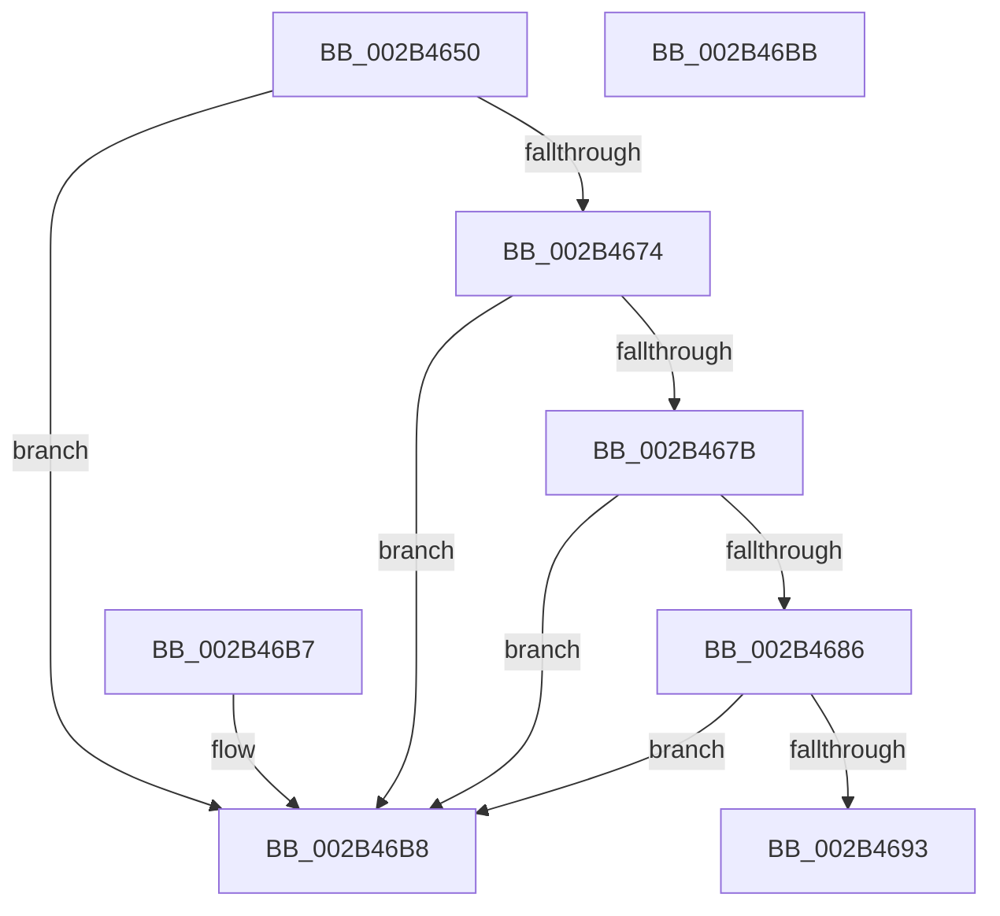

# MiPrepareAttachThread

- RVA: `0x002B4650`–`0x002B46BC` (길이 `108` bytes)
- VA: `0x00000001402B4650`
- 실행 섹션: `.text`
- PDB 이름 있음: `예`; PDB Function 태그: `아니요`
- unwind 정보 RVA: `0x000DB714`
- 디코드: `31`개 명령, `108/108` bytes 표시
- 미해석 바이트: `0` (있으면 어셈블리에 `.byte`로 보존)

> 이 문서는 커널 이미지의 기계어와 PDB 기호를 분석해 생성했습니다. 4번과 5번은 함수 원형과 자료형을 바이너리 사용 방식에서 추정한 C 해석이며 원본 소스 복구 결과는 아닙니다.

## 1. Dependencies

- 직접 호출 지점: **0**; 고유 호출 대상: **0**
- 직접 호출자로 확인된 함수: **5**
- RIP 상대 이미지 참조: **0**

### Outgoing calls
- 직접 디코드된 call 명령이 없습니다.

### Direct callers
- [MiLockStealUserVm](MiLockStealUserVm_function_002B3EDC.md) at `0x002B4015`
- [MiTrimSharedPageFromViews](../2E/MiTrimSharedPageFromViews_function_002E16F8.md) at `0x002E1825`
- [MiSharePages](../31/MiSharePages_function_00315110.md) at `0x0031520D`
- [MmReleaseCommitForMemResetPages](../66/MmReleaseCommitForMemResetPages_function_0066FDCC.md) at `0x0066FE74`
- [sub_006F5914](../6F/Unknown_function_006F5914.md) at `0x006F5929`

### Static image references
- 디코드된 RIP-relative 메모리 참조가 없습니다.

## 2. Other-region calls and transfers

- 다른 실행 섹션으로 향하는 call: **0**
- 별도 외부 분기/꼬리 이동을 확인하지 못했습니다.

## 3. Assembly (complete function range)

```asm
002B4650  8B 82 B8 00 00 00               mov eax, dword ptr [rdx + 0xb8]
002B4656  4C 8B C2                        mov r8, rdx
002B4659  8B 89 F4 01 00 00               mov ecx, dword ptr [rcx + 0x1f4]
002B465F  89 44 24 08                     mov dword ptr [rsp + 8], eax
002B4663  81 E1 00 0C 00 00               and ecx, 0xc00
002B4669  C1 E8 08                        shr eax, 8
002B466C  81 F9 00 0C 00 00               cmp ecx, 0xc00
002B4672  72 44                           jb 0x1402b46b8
002B4674  48 83 7A 68 00                  cmp qword ptr [rdx + 0x68], 0
002B4679  75 3D                           jne 0x1402b46b8
002B467B  0F B6 C8                        movzx ecx, al
002B467E  80 E1 F0                        and cl, 0xf0
002B4681  80 F9 F0                        cmp cl, 0xf0
002B4684  74 32                           je 0x1402b46b8
002B4686  48 8B 8A 90 00 00 00            mov rcx, qword ptr [rdx + 0x90]
002B468D  48 83 F9 01                     cmp rcx, 1
002B4691  76 25                           jbe 0x1402b46b8
002B4693  8D 50 10                        lea edx, [rax + 0x10]
002B4696  0F B6 CA                        movzx ecx, dl
002B4699  32 C8                           xor cl, al
002B469B  80 E1 0F                        and cl, 0xf
002B469E  32 CA                           xor cl, dl
002B46A0  88 4C 24 09                     mov byte ptr [rsp + 9], cl
002B46A4  0F B7 44 24 08                  movzx eax, word ptr [rsp + 8]
002B46A9  66 41 89 80 B8 00 00 00         mov word ptr [r8 + 0xb8], ax
002B46B1  B8 01 00 00 00                  mov eax, 1
002B46B6  C3                              ret
002B46B7  CC                              int3
002B46B8  33 C0                           xor eax, eax
002B46BA  C3                              ret
002B46BB  CC                              int3
```

## 4. C-style interpretation (structured pseudocode)

```c
__int64 __fastcall MiPrepareAttachThread(__int64 a1, __int64 a2)
{
    __int64 result;
    unsigned int v_stack_p8;
    unsigned __int8 v_stack_p9;

    v_stack_p8 = (unsigned int)((unsigned int)(*(unsigned int *)(a2 + 184)));
    a1 = (unsigned int)(((unsigned int)(*(unsigned int *)(a1 + 500))) & (0xC00ULL));
    result = (unsigned int)(((unsigned int)(*(unsigned int *)(a2 + 184))) >> (8));
    if (((unsigned int)(a1)) < 0xC00ULL) goto loc_002B46B8;
    if ((*(unsigned __int64 *)(a2 + 104)) != 0) goto loc_002B46B8;
    a1 = (unsigned __int8)(((unsigned __int8)(result)) & (240));
    if (((unsigned __int8)(a1)) == 240) goto loc_002B46B8;
    if ((*(unsigned __int64 *)(a2 + 144)) <= 1) goto loc_002B46B8;
    a1 = (unsigned __int8)(((unsigned __int8)(result + 16)) ^ ((unsigned __int8)(result)));
    a1 = (unsigned __int8)((a1) & (15));
    a1 = (unsigned __int8)((a1) ^ ((unsigned __int8)(result + 16)));
    v_stack_p9 = (unsigned __int8)(a1);
    *(unsigned __int16 *)(a2 + 184) = (unsigned __int16)(v_stack_p8);
    return 1;
loc_002B46B8:
    result = 0;
    return result;
}
```

## 5. (Beta) C Style

```c
int64_t MiPrepareAttachThread(void *Arg1, void *Arg2)
{
    uint8_t *arg1 = (uint8_t *)Arg1;
    uint8_t *arg2 = (uint8_t *)Arg2;

    int64_t result;
    uint32_t v_stack_p8;
    uint8_t v_stack_p9;

    v_stack_p8 = (uint32_t)((uint32_t)(*(uint32_t *)(arg2 + 0xB8)));
    Arg1 = (uint32_t)(((uint32_t)(*(uint32_t *)(arg1 + 0x1F4))) & (0xC00ULL));
    result = (uint32_t)(((uint32_t)(*(uint32_t *)(arg2 + 0xB8))) >> (8));
    if (((uint32_t)(Arg1)) < 0xC00ULL) goto loc_002B46B8;
    if ((*(uint64_t *)(arg2 + 0x68)) != 0) goto loc_002B46B8;
    Arg1 = (uint8_t)(((uint8_t)(result)) & (240));
    if (((uint8_t)(Arg1)) == 240) goto loc_002B46B8;
    if ((*(uint64_t *)(arg2 + 0x90)) <= 1) goto loc_002B46B8;
    Arg1 = (uint8_t)(((uint8_t)(result + 16)) ^ ((uint8_t)(result)));
    Arg1 = (uint8_t)((Arg1) & (15));
    Arg1 = (uint8_t)((Arg1) ^ ((uint8_t)(result + 16)));
    v_stack_p9 = (uint8_t)(Arg1);
    *(uint16_t *)(arg2 + 0xB8) = (uint16_t)(v_stack_p8);
    return 1;
loc_002B46B8:
    result = 0;
    return result;
}
```

### 관측된 메모리 오프셋

구조체 형식이 확인되지 않은 접근은 인자 기준의 오프셋으로만 기록했습니다.

| 기준 인자 | 오프셋 표현 | 폭 (bit) | 접근 |
|---|---:|---:|---|
| `Arg1` | `+ 0x1F4` | `32` | `R` |
| `Arg2` | `+ 0x68` | `64` | `R` |
| `Arg2` | `+ 0x90` | `64` | `R` |
| `Arg2` | `+ 0xB8` | `16` | `W` |
| `Arg2` | `+ 0xB8` | `32` | `R` |

## 6. Execution-region graph

[열기: 2D/3D 그래프와 함수 탐색 컨트롤 패널](../../../control-panel.html?section=text&rva=0x002B4650&view=graph)

- 2D 그래프는 위에서 아래로 흐르고, 3D 그래프는 빈 공간을 드래그해 회전합니다. Shift+드래그는 이동, 휠은 확대·축소, 함수 노드 선택은 대상 보고서 이동입니다.

### Static fallback


