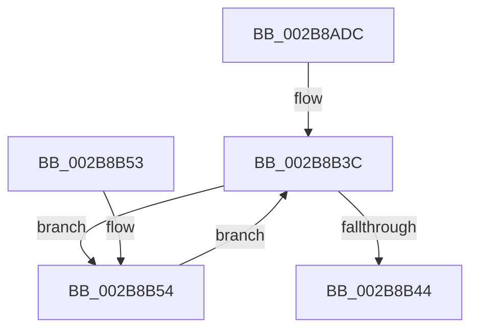

# MiPrepareDecayNodeForReuse

- RVA: `0x002B8ADC`–`0x002B8B6B` (길이 `143` bytes)
- VA: `0x00000001402B8ADC`
- 실행 섹션: `.text`
- PDB 이름 있음: `예`; PDB Function 태그: `아니요`
- unwind 정보 RVA: `0x0006DBD4`
- 디코드: `36`개 명령, `143/143` bytes 표시
- 미해석 바이트: `0` (있으면 어셈블리에 `.byte`로 보존)

> 이 문서는 커널 이미지의 기계어와 PDB 기호를 분석해 생성했습니다. 4번과 5번은 함수 원형과 자료형을 바이너리 사용 방식에서 추정한 C 해석이며 원본 소스 복구 결과는 아닙니다.

## 1. Dependencies

- 직접 호출 지점: **2**; 고유 호출 대상: **2**
- 직접 호출자로 확인된 함수: **1**
- RIP 상대 이미지 참조: **0**

### Outgoing calls
- `0x002B8B10` → [MiSwizzleInvalidPte](../28/MiSwizzleInvalidPte_function_0028F5E0.md) (function, `0x0028F5E0`)
- `0x002B8B49` → [MiUnlinkPageFromListEx](../28/MiUnlinkPageFromListEx_function_00287590.md) (function, `0x00287590`)

### Direct callers
- [MiCreateDecayPfn](MiCreateDecayPfn_function_002B8764.md) at `0x002B88D4`

### Static image references
- 디코드된 RIP-relative 메모리 참조가 없습니다.

## 2. Other-region calls and transfers

- 다른 실행 섹션으로 향하는 call: **0**
- 별도 외부 분기/꼬리 이동을 확인하지 못했습니다.

## 3. Assembly (complete function range)

```asm
002B8ADC  48 83 EC 28                     sub rsp, 0x28
002B8AE0  4C 8D 0C 49                     lea r9, [rcx + rcx*2]
002B8AE4  4C 8B D1                        mov r10, rcx
002B8AE7  49 C1 E1 04                     shl r9, 4
002B8AEB  48 B8 00 00 00 00 00 DE FF FF   movabs rax, 0xffffde0000000000
002B8AF5  4C 03 C8                        add r9, rax
002B8AF8  48 B8 FF FF FF FF FF 00 00 00   movabs rax, 0xffffffffff
002B8B02  48 23 C8                        and rcx, rax
002B8B05  48 C1 E1 0C                     shl rcx, 0xc
002B8B09  48 81 C9 80 08 00 00            or rcx, 0x880
002B8B10  E8 CB 6A FD FF                  call 0x14028f5e0
002B8B15  49 89 41 10                     mov qword ptr [r9 + 0x10], rax
002B8B19  49 BB 00 00 00 00 00 FF FF FF   movabs r11, 0xffffff0000000000
002B8B23  49 8B 51 28                     mov rdx, qword ptr [r9 + 0x28]
002B8B27  48 8B CA                        mov rcx, rdx
002B8B2A  48 8B C2                        mov rax, rdx
002B8B2D  49 33 CA                        xor rcx, r10
002B8B30  49 23 CB                        and rcx, r11
002B8B33  49 33 CA                        xor rcx, r10
002B8B36  F0 49 0F B1 49 28               lock cmpxchg qword ptr [r9 + 0x28], rcx
002B8B3C  4C 8B C0                        mov r8, rax
002B8B3F  48 3B D0                        cmp rdx, rax
002B8B42  75 10                           jne 0x1402b8b54
002B8B44  33 D2                           xor edx, edx
002B8B46  49 8B C9                        mov rcx, r9
002B8B49  E8 42 EA FC FF                  call 0x140287590
002B8B4E  48 83 C4 28                     add rsp, 0x28
002B8B52  C3                              ret
002B8B53  CC                              int3
002B8B54  49 8B D0                        mov rdx, r8
002B8B57  4D 33 C2                        xor r8, r10
002B8B5A  4D 23 C3                        and r8, r11
002B8B5D  48 8B C2                        mov rax, rdx
002B8B60  4D 33 C2                        xor r8, r10
002B8B63  F0 4D 0F B1 41 28               lock cmpxchg qword ptr [r9 + 0x28], r8
002B8B69  EB D1                           jmp 0x1402b8b3c
```

## 4. C-style interpretation (structured pseudocode)

```c
__int64 __fastcall MiPrepareDecayNodeForReuse(__int64 a1)
{
    __int64 result;
    __int64 v_rsp;

    v_rsp = (v_rsp) - (40);
    a4 = (a1 + a1 * 2) << (4);
    a4 = (a4) + (result);
    a1 = (a1) & (result);
    a1 = (a1) << (12);
    a1 = (a1) | (0x880ULL);
    result = MiSwizzleInvalidPte(a1, a2, a3, a4);
    *(unsigned __int64 *)(a4 + 16) = result;
    a1 = (*(unsigned __int64 *)(a4 + 40)) ^ (a1);
    a1 = (a1) & (v_r11);
    a1 = (a1) ^ (a1);
loc_002B8B3C:
    if ((*(unsigned __int64 *)(a4 + 40)) != (*(unsigned __int64 *)(a4 + 40))) goto loc_002B8B54;
    a2 = 0;
    result = MiUnlinkPageFromListEx(a4, a2, *(unsigned __int64 *)(a4 + 40), a4);
    v_rsp = (v_rsp) + (40);
    return result;
loc_002B8B54:
    a3 = (*(unsigned __int64 *)(a4 + 40)) ^ (a1);
    a3 = (a3) & (v_r11);
    a3 = (a3) ^ (a1);
    goto loc_002B8B3C;
}
```

## 5. (Beta) C Style

```c
int64_t MiPrepareDecayNodeForReuse(void *Arg1)
{
    uint8_t *arg1 = (uint8_t *)Arg1;

    int64_t result;
    int64_t local_rsp;

    local_rsp = (local_rsp) - (40);
    a4 = (Arg1 + Arg1 * 2) << (4);
    a4 = (a4) + (result);
    Arg1 = (Arg1) & (result);
    Arg1 = (Arg1) << (12);
    Arg1 = (Arg1) | (0x880ULL);
    result = MiSwizzleInvalidPte(Arg1, a2, a3, a4);
    *(uint64_t *)(a4 + 0x10) = result;
    Arg1 = (*(uint64_t *)(a4 + 0x28)) ^ (Arg1);
    Arg1 = (Arg1) & (local_r11);
    Arg1 = (Arg1) ^ (Arg1);
loc_002B8B3C:
    if ((*(uint64_t *)(a4 + 0x28)) != (*(uint64_t *)(a4 + 0x28))) goto loc_002B8B54;
    a2 = 0;
    result = MiUnlinkPageFromListEx(a4, a2, *(uint64_t *)(a4 + 0x28), a4);
    local_rsp = (local_rsp) + (40);
    return result;
loc_002B8B54:
    a3 = (*(uint64_t *)(a4 + 0x28)) ^ (Arg1);
    a3 = (a3) & (local_r11);
    a3 = (a3) ^ (Arg1);
    goto loc_002B8B3C;
}
```

### 관측된 메모리 오프셋

구조체 형식이 확인되지 않은 접근은 인자 기준의 오프셋으로만 기록했습니다.

| 기준 인자 | 오프셋 표현 | 폭 (bit) | 접근 |
|---|---:|---:|---|
| `Arg1` | `+ 0x0 + rcx*2` | `64` | `R` |

## 6. Execution-region graph

[열기: 2D/3D 그래프와 함수 탐색 컨트롤 패널](../../../control-panel.html?section=text&rva=0x002B8ADC&view=graph)

- 2D 그래프는 위에서 아래로 흐르고, 3D 그래프는 빈 공간을 드래그해 회전합니다. Shift+드래그는 이동, 휠은 확대·축소, 함수 노드 선택은 대상 보고서 이동입니다.

### Static fallback


