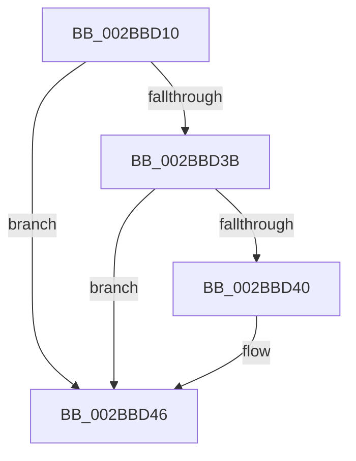

# MiPreventControlAreaDeletion

- RVA: `0x002BBD10`–`0x002BBD57` (길이 `71` bytes)
- VA: `0x00000001402BBD10`
- 실행 섹션: `.text`
- PDB 이름 있음: `예`; PDB Function 태그: `아니요`
- unwind 정보 RVA: `0x0006DF08`
- 디코드: `22`개 명령, `71/71` bytes 표시
- 미해석 바이트: `0` (있으면 어셈블리에 `.byte`로 보존)

> 이 문서는 커널 이미지의 기계어와 PDB 기호를 분석해 생성했습니다. 4번과 5번은 함수 원형과 자료형을 바이너리 사용 방식에서 추정한 C 해석이며 원본 소스 복구 결과는 아닙니다.

## 1. Dependencies

- 직접 호출 지점: **0**; 고유 호출 대상: **0**
- 직접 호출자로 확인된 함수: **3**
- RIP 상대 이미지 참조: **1**

### Outgoing calls
- 직접 디코드된 call 명령이 없습니다.

### Direct callers
- [MiTrimSharedPage](../29/MiTrimSharedPage_function_00297D14.md) at `0x00297DD8`
- [MiLocateSharedPageViews](../67/MiLocateSharedPageViews_function_0067F1E4.md) at `0x0067F36F`
- [MiPurgeBadFileOnlyPages](../68/MiPurgeBadFileOnlyPages_function_00681ADC.md) at `0x00681BAF`

### Static image references
- `0x002BBD1C` → RVA `0x00E2DC80` (`.data`; read)

## 2. Other-region calls and transfers

- 다른 실행 섹션으로 향하는 call: **0**
- call이 아닌 외부 분기/꼬리 이동: **1**
  - `0x002BBD51` → [sub_002BBE27](Unknown_function_002BBE27.md) (`tail-transfer`)

## 3. Assembly (complete function range)

```asm
002BBD10  40 53                           push rbx
002BBD12  41 55                           push r13
002BBD14  41 56                           push r14
002BBD16  41 57                           push r15
002BBD18  48 83 EC 28                     sub rsp, 0x28
002BBD1C  48 8B 05 5D 1F B7 00            mov rax, qword ptr [rip + 0xb71f5d]
002BBD23  45 33 ED                        xor r13d, r13d
002BBD26  48 8B 59 10                     mov rbx, qword ptr [rcx + 0x10]
002BBD2A  4D 8B F8                        mov r15, r8
002BBD2D  4D 89 28                        mov qword ptr [r8], r13
002BBD30  4C 8B F2                        mov r14, rdx
002BBD33  4C 89 2A                        mov qword ptr [rdx], r13
002BBD36  48 85 C0                        test rax, rax
002BBD39  74 0B                           je 0x1402bbd46
002BBD3B  F6 C3 10                        test bl, 0x10
002BBD3E  75 06                           jne 0x1402bbd46
002BBD40  48 F7 D0                        not rax
002BBD43  48 23 D8                        and rbx, rax
002BBD46  48 C1 FB 10                     sar rbx, 0x10
002BBD4A  8B 43 20                        mov eax, dword ptr [rbx + 0x20]
002BBD4D  0F BA E0 11                     bt eax, 0x11
002BBD51  0F 82 D0 00 00 00               jb 0x1402bbe27
```

## 4. C-style interpretation (structured pseudocode)

```c
__int64 __fastcall MiPreventControlAreaDeletion(__int64 a1, __int64 a2, __int64 a3)
{
    __int64 result;
    __int64 v_r13;
    __int64 v_rbx;
    __int64 v_rsp;

    v_rsp = (v_rsp) - (40);
    v_r13 = 0;
    *(unsigned __int64 *)(a3) = 0;
    *(unsigned __int64 *)(a2) = 0;
    if (*(unsigned __int64 *)(v_rip + 12001117) == 0) goto loc_002BBD46;
    result = *(unsigned __int64 *)(v_rip + 12001117);
    v_rbx = *(unsigned __int64 *)(a1 + 16);
    if ((((unsigned __int8)(*(unsigned __int64 *)(a1 + 16))) & (16)) == 0) {
        result = ~(*(unsigned __int64 *)(v_rip + 12001117));
        v_rbx = (*(unsigned __int64 *)(a1 + 16)) & (result);
    }
    v_rbx = (v_rbx) >> (16);
}
```

## 5. (Beta) C Style

```c
int64_t MiPreventControlAreaDeletion(void *Arg1, void *Arg2, void *Arg3)
{
    uint8_t *arg1 = (uint8_t *)Arg1;
    uint8_t *arg2 = (uint8_t *)Arg2;
    uint8_t *arg3 = (uint8_t *)Arg3;

    int64_t result;
    int64_t local_r13;
    int64_t local_rbx;
    int64_t local_rsp;

    local_rsp = (local_rsp) - (40);
    local_r13 = 0;
    *(uint64_t *)(arg3) = 0;
    *(uint64_t *)(arg2) = 0;
    if (*(uint64_t *)(v_rip + 0xB71F5D) == 0) goto loc_002BBD46;
    result = *(uint64_t *)(v_rip + 0xB71F5D);
    local_rbx = *(uint64_t *)(arg1 + 0x10);
    if ((((uint8_t)(*(uint64_t *)(arg1 + 0x10))) & (16)) == 0) {
        result = ~(*(uint64_t *)(v_rip + 0xB71F5D));
        local_rbx = (*(uint64_t *)(arg1 + 0x10)) & (result);
    }
    local_rbx = (local_rbx) >> (16);
}
```

### 관측된 메모리 오프셋

구조체 형식이 확인되지 않은 접근은 인자 기준의 오프셋으로만 기록했습니다.

| 기준 인자 | 오프셋 표현 | 폭 (bit) | 접근 |
|---|---:|---:|---|
| `Arg1` | `+ 0x10` | `64` | `R` |
| `Arg2` | `+ 0x0` | `64` | `W` |
| `Arg3` | `+ 0x0` | `64` | `W` |

## 6. Execution-region graph

[열기: 2D/3D 그래프와 함수 탐색 컨트롤 패널](../../../control-panel.html?section=text&rva=0x002BBD10&view=graph)

- 2D 그래프는 위에서 아래로 흐르고, 3D 그래프는 빈 공간을 드래그해 회전합니다. Shift+드래그는 이동, 휠은 확대·축소, 함수 노드 선택은 대상 보고서 이동입니다.

### Static fallback


