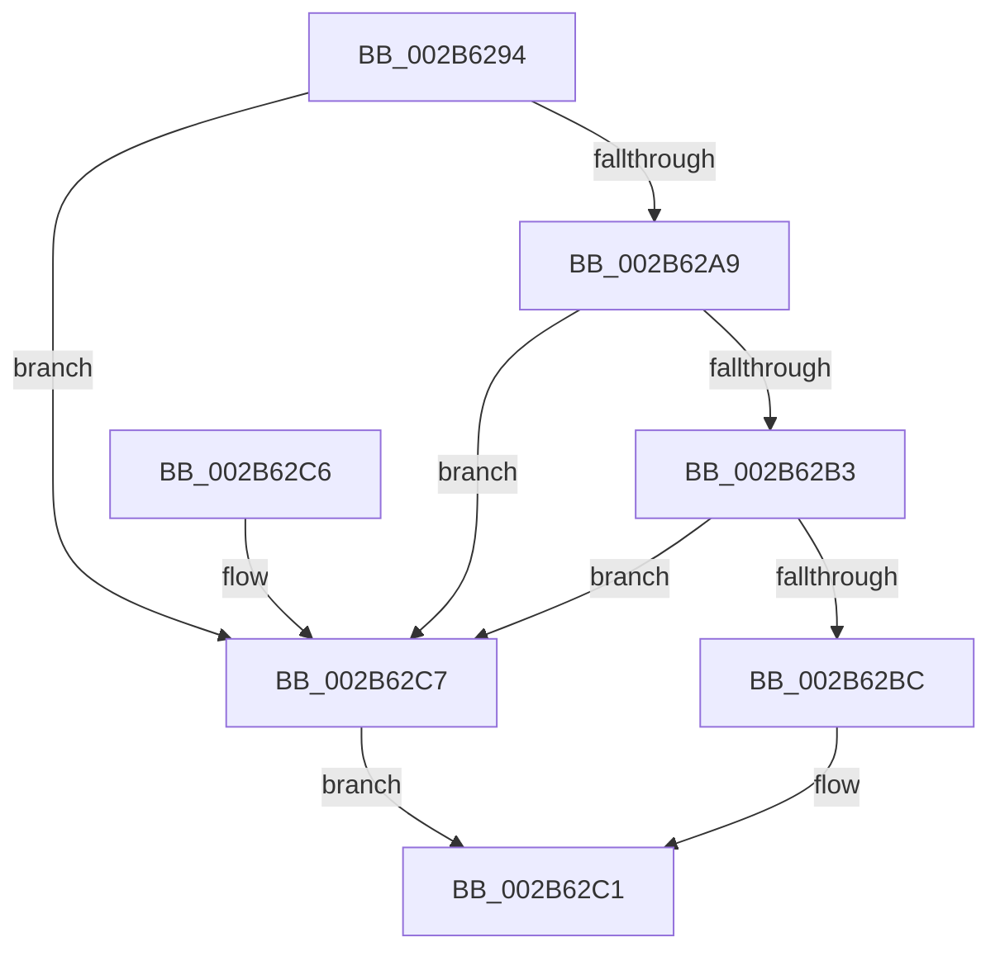

# MiProcessSuitableForCombining

- RVA: `0x002B6294`–`0x002B62CB` (길이 `55` bytes)
- VA: `0x00000001402B6294`
- 실행 섹션: `.text`
- PDB 이름 있음: `예`; PDB Function 태그: `아니요`
- unwind 정보 RVA: `0x00069B1C`
- 디코드: `17`개 명령, `55/55` bytes 표시
- 미해석 바이트: `0` (있으면 어셈블리에 `.byte`로 보존)

> 이 문서는 커널 이미지의 기계어와 PDB 기호를 분석해 생성했습니다. 4번과 5번은 함수 원형과 자료형을 바이너리 사용 방식에서 추정한 C 해석이며 원본 소스 복구 결과는 아닙니다.

## 1. Dependencies

- 직접 호출 지점: **1**; 고유 호출 대상: **1**
- 직접 호출자로 확인된 함수: **4**
- RIP 상대 이미지 참조: **0**

### Outgoing calls
- `0x002B62B3` → [MiIsStoreProcess](MiIsStoreProcess_function_002B62E0.md) (function, `0x002B62E0`)

### Direct callers
- [MiSharePages](../31/MiSharePages_function_00315110.md) at `0x00315308`
- [MiCapturePfnVm](../46/MiCapturePfnVm_function_00465570.md) at `0x00465660`
- [MiCombinePte](../68/MiCombinePte_function_0068B9A0.md) at `0x0068B9EC`
- [MiCombineWorkingSet](../68/MiCombineWorkingSet_function_0068BB18.md) at `0x0068BBAF`

### Static image references
- 디코드된 RIP-relative 메모리 참조가 없습니다.

## 2. Other-region calls and transfers

- 다른 실행 섹션으로 향하는 call: **0**
- 별도 외부 분기/꼬리 이동을 확인하지 못했습니다.

## 3. Assembly (complete function range)

```asm
002B6294  48 83 EC 28                     sub rsp, 0x28
002B6298  8B 81 F4 01 00 00               mov eax, dword ptr [rcx + 0x1f4]
002B629E  BA 00 0C 00 00                  mov edx, 0xc00
002B62A3  23 C2                           and eax, edx
002B62A5  3B C2                           cmp eax, edx
002B62A7  72 1E                           jb 0x1402b62c7
002B62A9  48 83 B9 68 04 00 00 00         cmp qword ptr [rcx + 0x468], 0
002B62B1  75 14                           jne 0x1402b62c7
002B62B3  E8 28 00 00 00                  call 0x1402b62e0
002B62B8  85 C0                           test eax, eax
002B62BA  75 0B                           jne 0x1402b62c7
002B62BC  B8 01 00 00 00                  mov eax, 1
002B62C1  48 83 C4 28                     add rsp, 0x28
002B62C5  C3                              ret
002B62C6  CC                              int3
002B62C7  33 C0                           xor eax, eax
002B62C9  EB F6                           jmp 0x1402b62c1
```

## 4. C-style interpretation (structured pseudocode)

```c
__int64 __fastcall MiProcessSuitableForCombining(__int64 a1)
{
    __int64 result;
    __int64 v_rsp;

    v_rsp = (v_rsp) - (40);
    result = (unsigned int)(((unsigned int)(*(unsigned int *)(a1 + 500))) & ((unsigned int)((unsigned int)(0xC00ULL))));
    if (((unsigned int)(result)) < ((unsigned int)((unsigned int)(0xC00ULL)))) goto loc_002B62C7;
    if ((*(unsigned __int64 *)(a1 + 1128)) != 0) goto loc_002B62C7;
    result = MiIsStoreProcess(a1, (unsigned int)(0xC00ULL), a3, a4);
    if ((unsigned int)(result) != 0) goto loc_002B62C7;
loc_002B62C1:
    v_rsp = (v_rsp) + (40);
    return 1;
loc_002B62C7:
    result = 0;
    goto loc_002B62C1;
}
```

## 5. (Beta) C Style

```c
int64_t MiProcessSuitableForCombining(void *Arg1)
{
    uint8_t *arg1 = (uint8_t *)Arg1;

    int64_t result;
    int64_t local_rsp;

    local_rsp = (local_rsp) - (40);
    result = (uint32_t)(((uint32_t)(*(uint32_t *)(arg1 + 0x1F4))) & ((uint32_t)((uint32_t)(0xC00ULL))));
    if (((uint32_t)(result)) < ((uint32_t)((uint32_t)(0xC00ULL)))) goto loc_002B62C7;
    if ((*(uint64_t *)(arg1 + 0x468)) != 0) goto loc_002B62C7;
    result = MiIsStoreProcess(Arg1, (uint32_t)(0xC00ULL), a3, a4);
    if ((uint32_t)(result) != 0) goto loc_002B62C7;
loc_002B62C1:
    local_rsp = (local_rsp) + (40);
    return 1;
loc_002B62C7:
    result = 0;
    goto loc_002B62C1;
}
```

### 관측된 메모리 오프셋

구조체 형식이 확인되지 않은 접근은 인자 기준의 오프셋으로만 기록했습니다.

| 기준 인자 | 오프셋 표현 | 폭 (bit) | 접근 |
|---|---:|---:|---|
| `Arg1` | `+ 0x1F4` | `32` | `R` |
| `Arg1` | `+ 0x468` | `64` | `R` |

## 6. Execution-region graph

[열기: 2D/3D 그래프와 함수 탐색 컨트롤 패널](../../../control-panel.html?section=text&rva=0x002B6294&view=graph)

- 2D 그래프는 위에서 아래로 흐르고, 3D 그래프는 빈 공간을 드래그해 회전합니다. Shift+드래그는 이동, 휠은 확대·축소, 함수 노드 선택은 대상 보고서 이동입니다.

### Static fallback


