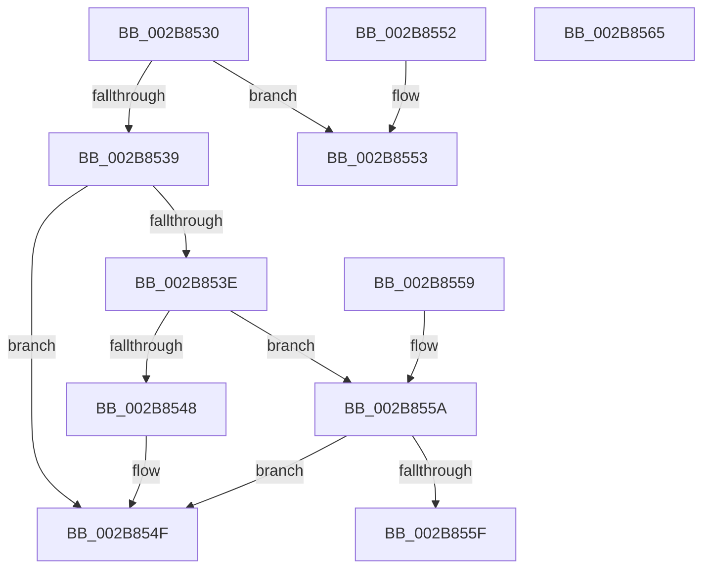

# MiProtectionToCacheAttribute

- RVA: `0x002B8530`–`0x002B8566` (길이 `54` bytes)
- VA: `0x00000001402B8530`
- 실행 섹션: `.text`
- PDB 이름 있음: `예`; PDB Function 태그: `아니요`
- unwind 정보 RVA: `0x000DB714`
- 디코드: `23`개 명령, `54/54` bytes 표시
- 미해석 바이트: `0` (있으면 어셈블리에 `.byte`로 보존)

> 이 문서는 커널 이미지의 기계어와 PDB 기호를 분석해 생성했습니다. 4번과 5번은 함수 원형과 자료형을 바이너리 사용 방식에서 추정한 C 해석이며 원본 소스 복구 결과는 아닙니다.

## 1. Dependencies

- 직접 호출 지점: **0**; 고유 호출 대상: **0**
- 직접 호출자로 확인된 함수: **21**
- RIP 상대 이미지 참조: **0**

### Outgoing calls
- 직접 디코드된 call 명령이 없습니다.

### Direct callers
- [MiInitializeTransitionPfn](../2A/MiInitializeTransitionPfn_function_002AC2E8.md) at `0x002AC3B6`
- [MiInsertPhysicalPteMapping](../2A/MiInsertPhysicalPteMapping_function_002AE26C.md) at `0x002AE292`
- [MiCreateSharedZeroPages](MiCreateSharedZeroPages_function_002B6318.md) at `0x002B63F1`
- [MiInitializeReadInProgressPfn](MiInitializeReadInProgressPfn_function_002B6990.md) at `0x002B6A8B`
- [MiMakePageAvoidRead](MiMakePageAvoidRead_function_002B7DE0.md) at `0x002B7F47`
- [sub_002F6E32](../2F/Unknown_function_002F6E32.md) at `0x002F724D`
- [MiGetHardFaultPages](../36/MiGetHardFaultPages_function_0036200C.md) at `0x003620D3`
- [MiBuildMdlForMappedFileFault](../36/MiBuildMdlForMappedFileFault_function_0036380C.md) at `0x003639C4`
- [MiPrefetchPreallocatePages](../36/MiPrefetchPreallocatePages_function_0036B1F0.md) at `0x0036B32E`
- [MiResolvePageFileFault](../36/MiResolvePageFileFault_function_0036D968.md) at `0x0036E505`
- [MiMapContiguousMemoryLarge](../3B/MiMapContiguousMemoryLarge_function_003B44CC.md) at `0x003B4503`
- [MiAllocateLargeZeroPages](../3B/MiAllocateLargeZeroPages_function_003B743C.md) at `0x003B74B8`
- [MiGetFastLargePages](../3B/MiGetFastLargePages_function_003B7EE0.md) at `0x003B7F55`
- [MiAllocateContiguousMemory](../3E/MiAllocateContiguousMemory_function_003E9FDC.md) at `0x003EA0D4`
- [MiIdealClusterPage](../4D/MiIdealClusterPage_function_004DB964.md) at `0x004DBDB7`
- [MiGetClusterPage](../4D/MiGetClusterPage_function_004DC57C.md) at `0x004DC89C`
- [MiGetClusterPage](../4D/MiGetClusterPage_function_004DC57C.md) at `0x004DC995`
- [sub_006E141E](../6E/Unknown_function_006E141E.md) at `0x006E1420`
- [sub_006E1C04](../6E/Unknown_function_006E1C04.md) at `0x006E1C6E`
- [MiPfPrepareSequentialReadList](../../page/93/MiPfPrepareSequentialReadList_function_0093D8E8.md) at `0x0093DA12`
- [MiMapViewOfPhysicalSection](../../page/97/MiMapViewOfPhysicalSection_function_0097F984.md) at `0x0097FB60`
- [MiFindLargePageMemory](../../page/AA/MiFindLargePageMemory_function_00AA8334.md) at `0x00AA83C7`

### Static image references
- 디코드된 RIP-relative 메모리 참조가 없습니다.

## 2. Other-region calls and transfers

- 다른 실행 섹션으로 향하는 call: **0**
- 별도 외부 분기/꼬리 이동을 확인하지 못했습니다.

## 3. Assembly (complete function range)

```asm
002B8530  BA 01 00 00 00                  mov edx, 1
002B8535  85 C9                           test ecx, ecx
002B8537  74 1A                           je 0x1402b8553
002B8539  83 F9 1F                        cmp ecx, 0x1f
002B853C  74 11                           je 0x1402b854f
002B853E  8B C1                           mov eax, ecx
002B8540  C1 E8 03                        shr eax, 3
002B8543  83 F8 03                        cmp eax, 3
002B8546  74 12                           je 0x1402b855a
002B8548  33 C9                           xor ecx, ecx
002B854A  3B C2                           cmp eax, edx
002B854C  0F 44 D1                        cmove edx, ecx
002B854F  8B C2                           mov eax, edx
002B8551  C3                              ret
002B8552  CC                              int3
002B8553  B8 03 00 00 00                  mov eax, 3
002B8558  C3                              ret
002B8559  CC                              int3
002B855A  F6 C1 07                        test cl, 7
002B855D  74 F0                           je 0x1402b854f
002B855F  B8 02 00 00 00                  mov eax, 2
002B8564  C3                              ret
002B8565  CC                              int3
```

## 4. C-style interpretation (structured pseudocode)

```c
__int64 __fastcall MiProtectionToCacheAttribute(int a1)
{
    __int64 result;

    if (a1 == 0) goto loc_002B8553;
    if (a1 == 31) goto loc_002B854F;
    result = (unsigned int)(((unsigned int)(a1)) >> (3));
    if (((unsigned int)(result)) == 3) goto loc_002B855A;
    a1 = 0;
    a2 = 1;
    if (((unsigned int)(result)) == 1) { a2 = 0; }
loc_002B854F:
    return (unsigned int)((unsigned int)(a2));
loc_002B8553:
    return 3;
loc_002B855A:
    if (((0) & (7)) == 0) goto loc_002B854F;
    return 2;
}
```

## 5. (Beta) C Style

```c
int64_t MiProtectionToCacheAttribute(int32_t Arg1)
{
    int64_t result;

    if (Arg1 == 0) goto loc_002B8553;
    if (Arg1 == 31) goto loc_002B854F;
    result = (uint32_t)(((uint32_t)(Arg1)) >> (3));
    if (((uint32_t)(result)) == 3) goto loc_002B855A;
    Arg1 = 0;
    a2 = 1;
    if (((uint32_t)(result)) == 1) { a2 = 0; }
loc_002B854F:
    return (uint32_t)((uint32_t)(a2));
loc_002B8553:
    return 3;
loc_002B855A:
    if (((0) & (7)) == 0) goto loc_002B854F;
    return 2;
}
```

## 6. Execution-region graph

[열기: 2D/3D 그래프와 함수 탐색 컨트롤 패널](../../../control-panel.html?section=text&rva=0x002B8530&view=graph)

- 2D 그래프는 위에서 아래로 흐르고, 3D 그래프는 빈 공간을 드래그해 회전합니다. Shift+드래그는 이동, 휠은 확대·축소, 함수 노드 선택은 대상 보고서 이동입니다.

### Static fallback


