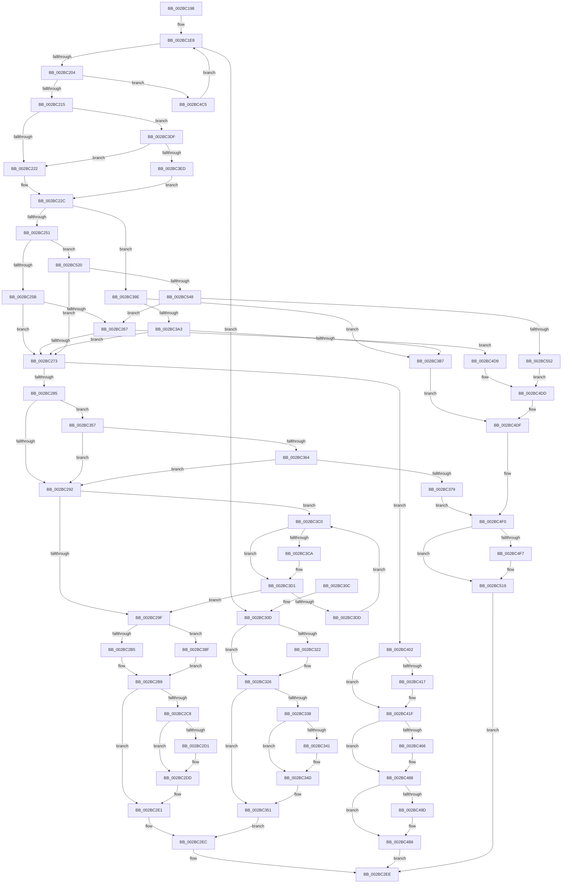

# MiReferenceControlArea

- RVA: `0x002BC198`–`0x002BC558` (길이 `960` bytes)
- VA: `0x00000001402BC198`
- 실행 섹션: `.text`
- PDB 이름 있음: `예`; PDB Function 태그: `아니요`
- unwind 정보 RVA: `0x0006E11C`
- 디코드: `238`개 명령, `960/960` bytes 표시
- 미해석 바이트: `0` (있으면 어셈블리에 `.byte`로 보존)

> 이 문서는 커널 이미지의 기계어와 PDB 기호를 분석해 생성했습니다. 4번과 5번은 함수 원형과 자료형을 바이너리 사용 방식에서 추정한 C 해석이며 원본 소스 복구 결과는 아닙니다.

## 1. Dependencies

- 직접 호출 지점: **22**; 고유 호출 대상: **14**
- 직접 호출자로 확인된 함수: **1**
- RIP 상대 이미지 참조: **7**

### Outgoing calls
- `0x002BC1EF` → [ExAcquireSpinLockExclusive](../24/ExAcquireSpinLockExclusive_function_00248690.md) (function, `0x00248690`)
- `0x002BC208` → [ExTryAcquireSpinLockExclusiveAtDpcLevel](ExTryAcquireSpinLockExclusiveAtDpcLevel_function_002BB800.md) (function, `0x002BB800`)
- `0x002BC2A6` → [MiRemoveUnusedSegment](MiRemoveUnusedSegment_function_002BBE74.md) (function, `0x002BBE74`)
- `0x002BC2BD` → [ExReleaseSpinLockExclusiveFromDpcLevel](../24/ExReleaseSpinLockExclusiveFromDpcLevel_function_002497E0.md) (function, `0x002497E0`)
- `0x002BC2D8` → [KiLowerIrqlProcessIrqlFlags](../4F/KiLowerIrqlProcessIrqlFlags_function_004F5698.md) (function, `0x004F5698`)
- `0x002BC2E3` → [MiReleaseControlAreaWaiters](../28/MiReleaseControlAreaWaiters_function_002865F0.md) (function, `0x002865F0`)
- `0x002BC318` → [KeAbPreAcquire](../21/KeAbPreAcquire_function_00210230.md) (function, `0x00210230`)
- `0x002BC32D` → [ExReleaseSpinLockExclusiveFromDpcLevel](../24/ExReleaseSpinLockExclusiveFromDpcLevel_function_002497E0.md) (function, `0x002497E0`)
- `0x002BC348` → [KiLowerIrqlProcessIrqlFlags](../4F/KiLowerIrqlProcessIrqlFlags_function_004F5698.md) (function, `0x004F5698`)
- `0x002BC36C` → [MiControlAreaRequiresCharge](../3B/MiControlAreaRequiresCharge_function_003B36CC.md) (function, `0x003B36CC`)
- `0x002BC380` → [MiReleaseSpinLockExclusive](../24/MiReleaseSpinLockExclusive_function_002482C0.md) (function, `0x002482C0`)
- `0x002BC3F8` → [ExpReleaseSpinLockExclusiveFromDpcLevelInstrumented](../2C/ExpReleaseSpinLockExclusiveFromDpcLevelInstrumented_function_002C0F44.md) (function, `0x002C0F44`)
- `0x002BC40A` → [KeAbPreAcquire](../21/KeAbPreAcquire_function_00210230.md) (function, `0x00210230`)
- `0x002BC41A` → [KeAbPreWait](../20/KeAbPreWait_function_0020E560.md) (function, `0x0020E560`)
- `0x002BC45B` → [MiReleaseSpinLockExclusive](../24/MiReleaseSpinLockExclusive_function_002482C0.md) (function, `0x002482C0`)
- `0x002BC480` → [FsRtlReleaseFile](../../page/98/FsRtlReleaseFile_function_00985B70.md) (function, `0x00985B70`)
- `0x002BC493` → [KeWaitForGate](../2C/KeWaitForGate_function_002CA794.md) (function, `0x002CA794`)
- `0x002BC4A6` → [KeAbPreAcquire](../21/KeAbPreAcquire_function_00210230.md) (function, `0x00210230`)
- `0x002BC4B1` → [KeAbPostReleaseEx](../26/KeAbPostReleaseEx_function_00262210.md) (function, `0x00262210`)
- `0x002BC4CF` → [MiReleaseSpinLockExclusive](../24/MiReleaseSpinLockExclusive_function_002482C0.md) (function, `0x002482C0`)
- `0x002BC4EB` → [MiReleaseSpinLockExclusive](../24/MiReleaseSpinLockExclusive_function_002482C0.md) (function, `0x002482C0`)
- `0x002BC511` → [FsRtlReleaseFile](../../page/98/FsRtlReleaseFile_function_00985B70.md) (function, `0x00985B70`)

### Direct callers
- [sub_009848DC](../../page/98/Unknown_function_009848DC.md) at `0x00984A1E`

### Static image references
- `0x002BC1E8` → RVA `0x00E2CD00` (`.data`; read)
- `0x002BC215` → RVA `0x00FC6B06` (`ALMOSTRO`; read)
- `0x002BC222` → RVA `0x00E2CD00` (`.data`; write)
- `0x002BC230` → RVA `0x00E30088` (`.data`; read)
- `0x002BC25B` → RVA `0x00E38D00` (`.data`; read)
- `0x002BC2C8` → RVA `0x00FC6D20` (`ALMOSTRO`; read)
- `0x002BC3DF` → RVA `0x00F0DE58` (`.data`; read)

## 2. Other-region calls and transfers

- 다른 실행 섹션으로 향하는 call: **2**
  - `0x002BC480` → [FsRtlReleaseFile](../../page/98/FsRtlReleaseFile_function_00985B70.md) (`.text` → `PAGE`)
  - `0x002BC511` → [FsRtlReleaseFile](../../page/98/FsRtlReleaseFile_function_00985B70.md) (`.text` → `PAGE`)
- 별도 외부 분기/꼬리 이동을 확인하지 못했습니다.

## 3. Assembly (complete function range)

```asm
002BC198  48 89 5C 24 08                  mov qword ptr [rsp + 8], rbx
002BC19D  48 89 74 24 10                  mov qword ptr [rsp + 0x10], rsi
002BC1A2  48 89 7C 24 18                  mov qword ptr [rsp + 0x18], rdi
002BC1A7  55                              push rbp
002BC1A8  41 54                           push r12
002BC1AA  41 55                           push r13
002BC1AC  41 56                           push r14
002BC1AE  41 57                           push r15
002BC1B0  48 8B EC                        mov rbp, rsp
002BC1B3  48 83 EC 50                     sub rsp, 0x50
002BC1B7  4C 8B 69 38                     mov r13, qword ptr [rcx + 0x38]
002BC1BB  0F 57 C0                        xorps xmm0, xmm0
002BC1BE  33 C0                           xor eax, eax
002BC1C0  4D 8B E0                        mov r12, r8
002BC1C3  F7 41 10 00 00 00 01            test dword ptr [rcx + 0x10], 0x1000000
002BC1CA  48 8B F2                        mov rsi, rdx
002BC1CD  0F 11 45 D0                     movups xmmword ptr [rbp - 0x30], xmm0
002BC1D1  48 89 45 F0                     mov qword ptr [rbp - 0x10], rax
002BC1D5  48 8B F9                        mov rdi, rcx
002BC1D8  0F 11 45 E0                     movups xmmword ptr [rbp - 0x20], xmm0
002BC1DC  4D 8B 4D 28                     mov r9, qword ptr [r13 + 0x28]
002BC1E0  4D 8D 79 10                     lea r15, [r9 + 0x10]
002BC1E4  4D 0F 44 F9                     cmove r15, r9
002BC1E8  48 8D 0D 11 0B B7 00            lea rcx, [rip + 0xb70b11]
002BC1EF  E8 9C C4 F8 FF                  call 0x140248690
002BC1F4  49 8B 1F                        mov rbx, qword ptr [r15]
002BC1F7  44 0F B6 F0                     movzx r14d, al
002BC1FB  48 85 DB                        test rbx, rbx
002BC1FE  0F 84 09 01 00 00               je 0x1402bc30d
002BC204  48 8D 4B 48                     lea rcx, [rbx + 0x48]
002BC208  E8 F3 F5 FF FF                  call 0x1402bb800
002BC20D  85 C0                           test eax, eax
002BC20F  0F 84 B0 02 00 00               je 0x1402bc4c5
002BC215  F6 05 EA A8 D0 00 01            test byte ptr [rip + 0xd0a8ea], 1
002BC21C  0F 85 BD 01 00 00               jne 0x1402bc3df
002BC222  C7 05 D4 0A B7 00 00 00 00 00   mov dword ptr [rip + 0xb70ad4], 0
002BC22C  0F B7 4B 3C                     movzx ecx, word ptr [rbx + 0x3c]
002BC230  48 8B 05 51 3E B7 00            mov rax, qword ptr [rip + 0xb73e51]
002BC237  81 E1 FF 03 00 00               and ecx, 0x3ff
002BC23D  4C 8B 04 C8                     mov r8, qword ptr [rax + rcx*8]
002BC241  48 8B 87 B0 00 00 00            mov rax, qword ptr [rdi + 0xb0]
002BC248  48 85 C0                        test rax, rax
002BC24B  0F 85 4D 01 00 00               jne 0x1402bc39e
002BC251  F6 43 3E 01                     test byte ptr [rbx + 0x3e], 1
002BC255  0F 85 C5 02 00 00               jne 0x1402bc520
002BC25B  48 8D 05 9E CA B7 00            lea rax, [rip + 0xb7ca9e]
002BC262  4C 3B C0                        cmp r8, rax
002BC265  74 0C                           je 0x1402bc273
002BC267  8B 07                           mov eax, dword ptr [rdi]
002BC269  0F BA E0 18                     bt eax, 0x18
002BC26D  0F 83 66 02 00 00               jae 0x1402bc4d9
002BC273  8B 43 38                        mov eax, dword ptr [rbx + 0x38]
002BC276  8B C8                           mov ecx, eax
002BC278  D1 E9                           shr ecx, 1
002BC27A  0B C8                           or ecx, eax
002BC27C  F6 C1 01                        test cl, 1
002BC27F  0F 85 7D 01 00 00               jne 0x1402bc402
002BC285  F7 47 10 00 00 00 01            test dword ptr [rdi + 0x10], 0x1000000
002BC28C  0F 85 C5 00 00 00               jne 0x1402bc357
002BC292  48 8B 4B 50                     mov rcx, qword ptr [rbx + 0x50]
002BC296  48 85 C9                        test rcx, rcx
002BC299  0F 85 21 01 00 00               jne 0x1402bc3c0
002BC29F  48 FF 43 18                     inc qword ptr [rbx + 0x18]
002BC2A3  48 8B CB                        mov rcx, rbx
002BC2A6  E8 C9 FB FF FF                  call 0x1402bbe74
002BC2AB  8B 07                           mov eax, dword ptr [rdi]
002BC2AD  A8 01                           test al, 1
002BC2AF  0F 85 DA 00 00 00               jne 0x1402bc38f
002BC2B5  48 FF 43 30                     inc qword ptr [rbx + 0x30]
002BC2B9  48 8D 4B 48                     lea rcx, [rbx + 0x48]
002BC2BD  E8 1E D5 F8 FF                  call 0x1402497e0
002BC2C2  41 80 FE 11                     cmp r14b, 0x11
002BC2C6  74 19                           je 0x1402bc2e1
002BC2C8  83 3D 51 AA D0 00 00            cmp dword ptr [rip + 0xd0aa51], 0
002BC2CF  74 0C                           je 0x1402bc2dd
002BC2D1  44 0F 20 C1                     mov rcx, cr8
002BC2D5  41 8A D6                        mov dl, r14b
002BC2D8  E8 BB 93 23 00                  call 0x1404f5698
002BC2DD  45 0F 22 C6                     mov cr8, r14
002BC2E1  33 C9                           xor ecx, ecx
002BC2E3  E8 08 A3 FC FF                  call 0x1402865f0
002BC2E8  49 89 1C 24                     mov qword ptr [r12], rbx
002BC2EC  33 C0                           xor eax, eax
002BC2EE  4C 8D 5C 24 50                  lea r11, [rsp + 0x50]
002BC2F3  49 8B 5B 30                     mov rbx, qword ptr [r11 + 0x30]
002BC2F7  49 8B 73 38                     mov rsi, qword ptr [r11 + 0x38]
002BC2FB  49 8B 7B 40                     mov rdi, qword ptr [r11 + 0x40]
002BC2FF  49 8B E3                        mov rsp, r11
002BC302  41 5F                           pop r15
002BC304  41 5E                           pop r14
002BC306  41 5D                           pop r13
002BC308  41 5C                           pop r12
002BC30A  5D                              pop rbp
002BC30B  C3                              ret
002BC30C  CC                              int3
002BC30D  45 33 C0                        xor r8d, r8d
002BC310  49 89 37                        mov qword ptr [r15], rsi
002BC313  33 D2                           xor edx, edx
002BC315  49 8B CF                        mov rcx, r15
002BC318  E8 13 3F F5 FF                  call 0x140210230
002BC31D  48 85 C0                        test rax, rax
002BC320  74 04                           je 0x1402bc326
002BC322  C6 40 0A 01                     mov byte ptr [rax + 0xa], 1
002BC326  48 8D 0D D3 09 B7 00            lea rcx, [rip + 0xb709d3]
002BC32D  E8 AE D4 F8 FF                  call 0x1402497e0
002BC332  41 80 FE 11                     cmp r14b, 0x11
002BC336  74 19                           je 0x1402bc351
002BC338  83 3D E1 A9 D0 00 00            cmp dword ptr [rip + 0xd0a9e1], 0
002BC33F  74 0C                           je 0x1402bc34d
002BC341  44 0F 20 C1                     mov rcx, cr8
002BC345  41 8A D6                        mov dl, r14b
002BC348  E8 4B 93 23 00                  call 0x1404f5698
002BC34D  45 0F 22 C6                     mov cr8, r14
002BC351  49 89 34 24                     mov qword ptr [r12], rsi
002BC355  EB 95                           jmp 0x1402bc2ec
002BC357  F7 47 14 00 00 10 00            test dword ptr [rdi + 0x14], 0x100000
002BC35E  0F 84 2E FF FF FF               je 0x1402bc292
002BC364  BA 02 00 00 00                  mov edx, 2
002BC369  48 8B CB                        mov rcx, rbx
002BC36C  E8 5B 73 0F 00                  call 0x1403b36cc
002BC371  85 C0                           test eax, eax
002BC373  0F 85 19 FF FF FF               jne 0x1402bc292
002BC379  48 8D 4B 48                     lea rcx, [rbx + 0x48]
002BC37D  41 8A D6                        mov dl, r14b
002BC380  E8 3B BF F8 FF                  call 0x1402482c0
002BC385  BE 0B 06 00 C0                  mov esi, 0xc000060b
002BC38A  E9 61 01 00 00                  jmp 0x1402bc4f0
002BC38F  8B 43 38                        mov eax, dword ptr [rbx + 0x38]
002BC392  0F BA E8 0F                     bts eax, 0xf
002BC396  89 43 38                        mov dword ptr [rbx + 0x38], eax
002BC399  E9 1B FF FF FF                  jmp 0x1402bc2b9
002BC39E  4C 39 00                        cmp qword ptr [rax], r8
002BC3A1  75 14                           jne 0x1402bc3b7
002BC3A3  8B 07                           mov eax, dword ptr [rdi]
002BC3A5  0F B6 4B 3E                     movzx ecx, byte ptr [rbx + 0x3e]
002BC3A9  C1 E8 16                        shr eax, 0x16
002BC3AC  33 C8                           xor ecx, eax
002BC3AE  F6 C1 01                        test cl, 1
002BC3B1  0F 84 BC FE FF FF               je 0x1402bc273
002BC3B7  0F BA 2F 17                     bts dword ptr [rdi], 0x17
002BC3BB  E9 1F 01 00 00                  jmp 0x1402bc4df
002BC3C0  8B 41 08                        mov eax, dword ptr [rcx + 8]
002BC3C3  48 8B 11                        mov rdx, qword ptr [rcx]
002BC3C6  A8 04                           test al, 4
002BC3C8  74 07                           je 0x1402bc3d1
002BC3CA  C7 41 0C 01 00 00 00            mov dword ptr [rcx + 0xc], 1
002BC3D1  48 8B CA                        mov rcx, rdx
002BC3D4  48 85 D2                        test rdx, rdx
002BC3D7  0F 84 C2 FE FF FF               je 0x1402bc29f
002BC3DD  EB E1                           jmp 0x1402bc3c0
002BC3DF  8B 05 73 1A C5 00               mov eax, dword ptr [rip + 0xc51a73]
002BC3E5  85 C0                           test eax, eax
002BC3E7  0F 85 35 FE FF FF               jne 0x1402bc222
002BC3ED  48 8B 55 28                     mov rdx, qword ptr [rbp + 0x28]
002BC3F1  48 8D 0D 08 09 B7 00            lea rcx, [rip + 0xb70908]
002BC3F8  E8 47 4B 00 00                  call 0x1402c0f44
002BC3FD  E9 2A FE FF FF                  jmp 0x1402bc22c
002BC402  45 33 C0                        xor r8d, r8d
002BC405  33 D2                           xor edx, edx
002BC407  49 8B CF                        mov rcx, r15
002BC40A  E8 21 3E F5 FF                  call 0x140210230
002BC40F  48 8B F0                        mov rsi, rax
002BC412  48 85 C0                        test rax, rax
002BC415  74 08                           je 0x1402bc41f
002BC417  48 8B C8                        mov rcx, rax
002BC41A  E8 41 21 F5 FF                  call 0x14020e560
002BC41F  83 65 E4 00                     and dword ptr [rbp - 0x1c], 0
002BC423  48 8D 45 E8                     lea rax, [rbp - 0x18]
002BC427  48 89 45 F0                     mov qword ptr [rbp - 0x10], rax
002BC42B  48 8D 4B 48                     lea rcx, [rbx + 0x48]
002BC42F  66 C7 45 E0 07 01               mov word ptr [rbp - 0x20], 0x107
002BC435  48 8D 45 E8                     lea rax, [rbp - 0x18]
002BC439  48 89 45 E8                     mov qword ptr [rbp - 0x18], rax
002BC43D  41 8A D6                        mov dl, r14b
002BC440  C6 45 E2 06                     mov byte ptr [rbp - 0x1e], 6
002BC444  C7 45 D8 01 00 00 00            mov dword ptr [rbp - 0x28], 1
002BC44B  48 8B 43 50                     mov rax, qword ptr [rbx + 0x50]
002BC44F  48 89 45 D0                     mov qword ptr [rbp - 0x30], rax
002BC453  48 8D 45 D0                     lea rax, [rbp - 0x30]
002BC457  48 89 43 50                     mov qword ptr [rbx + 0x50], rax
002BC45B  E8 60 BE F8 FF                  call 0x1402482c0
002BC460  8B 07                           mov eax, dword ptr [rdi]
002BC462  A8 01                           test al, 1
002BC464  75 22                           jne 0x1402bc488
002BC466  65 48 8B 14 25 88 01 00 00      mov rdx, qword ptr gs:[0x188]
002BC46F  49 8B CD                        mov rcx, r13
002BC472  48 8B 87 B8 00 00 00            mov rax, qword ptr [rdi + 0xb8]
002BC479  48 89 82 50 05 00 00            mov qword ptr [rdx + 0x550], rax
002BC480  E8 EB 96 6C 00                  call 0x140985b70
002BC485  83 27 FD                        and dword ptr [rdi], 0xfffffffd
002BC488  45 33 C0                        xor r8d, r8d
002BC48B  48 8D 4D E0                     lea rcx, [rbp - 0x20]
002BC48F  41 8D 50 12                     lea edx, [r8 + 0x12]
002BC493  E8 FC E2 00 00                  call 0x1402ca794
002BC498  48 85 F6                        test rsi, rsi
002BC49B  74 19                           je 0x1402bc4b6
002BC49D  45 33 C0                        xor r8d, r8d
002BC4A0  48 8B D6                        mov rdx, rsi
002BC4A3  49 8B CF                        mov rcx, r15
002BC4A6  E8 85 3D F5 FF                  call 0x140210230
002BC4AB  48 8B D6                        mov rdx, rsi
002BC4AE  49 8B CF                        mov rcx, r15
002BC4B1  E8 5A 5D FA FF                  call 0x140262210
002BC4B6  49 83 24 24 00                  and qword ptr [r12], 0
002BC4BB  B8 2D 02 00 C0                  mov eax, 0xc000022d
002BC4C0  E9 29 FE FF FF                  jmp 0x1402bc2ee
002BC4C5  41 8A D6                        mov dl, r14b
002BC4C8  48 8D 0D 31 08 B7 00            lea rcx, [rip + 0xb70831]
002BC4CF  E8 EC BD F8 FF                  call 0x1402482c0
002BC4D4  E9 0F FD FF FF                  jmp 0x1402bc1e8
002BC4D9  0F BA E8 18                     bts eax, 0x18
002BC4DD  89 07                           mov dword ptr [rdi], eax
002BC4DF  48 8D 4B 48                     lea rcx, [rbx + 0x48]
002BC4E3  41 8A D6                        mov dl, r14b
002BC4E6  BE 76 04 00 C0                  mov esi, 0xc0000476
002BC4EB  E8 D0 BD F8 FF                  call 0x1402482c0
002BC4F0  8B 0F                           mov ecx, dword ptr [rdi]
002BC4F2  F6 C1 01                        test cl, 1
002BC4F5  75 22                           jne 0x1402bc519
002BC4F7  65 48 8B 14 25 88 01 00 00      mov rdx, qword ptr gs:[0x188]
002BC500  48 8B 8F B8 00 00 00            mov rcx, qword ptr [rdi + 0xb8]
002BC507  48 89 8A 50 05 00 00            mov qword ptr [rdx + 0x550], rcx
002BC50E  49 8B CD                        mov rcx, r13
002BC511  E8 5A 96 6C 00                  call 0x140985b70
002BC516  83 27 FD                        and dword ptr [rdi], 0xfffffffd
002BC519  8B C6                           mov eax, esi
002BC51B  E9 CE FD FF FF                  jmp 0x1402bc2ee
002BC520  65 48 8B 04 25 88 01 00 00      mov rax, qword ptr gs:[0x188]
002BC529  48 8B 88 B8 00 00 00            mov rcx, qword ptr [rax + 0xb8]
002BC530  48 8B 05 51 3B B7 00            mov rax, qword ptr [rip + 0xb73b51]
002BC537  0F B7 91 AE 04 00 00            movzx edx, word ptr [rcx + 0x4ae]
002BC53E  4C 3B 04 D0                     cmp r8, qword ptr [rax + rdx*8]
002BC542  0F 84 2B FD FF FF               je 0x1402bc273
002BC548  8B 07                           mov eax, dword ptr [rdi]
002BC54A  A8 01                           test al, 1
002BC54C  0F 85 15 FD FF FF               jne 0x1402bc267
002BC552  0F BA E8 17                     bts eax, 0x17
002BC556  EB 85                           jmp 0x1402bc4dd
```

## 4. C-style interpretation (structured pseudocode)

```c
__int64 __fastcall MiReferenceControlArea(__int64 a1, __int64 a2, __int64 a3)
{
    __int64 result;
    __int64 v_r15;
    __int64 v_rsp;
    unsigned __int64 v_stack_m28;
    unsigned __int64 v_stack_m38;
    unsigned __int64 v_stack_m40;
    unsigned int v_stack_m44;
    unsigned __int8 v_stack_m46;
    unsigned __int64 v_stack_m48;
    unsigned int v_stack_m50;
    unsigned __int64 v_stack_m58;
    unsigned __int64 v_stack_p0;
    unsigned __int64 v_stack_p10;
    unsigned __int64 v_stack_p18;
    unsigned __int64 v_stack_p8;

    v_stack_p8 = v_rbx;
    v_stack_p10 = v_rsi;
    v_stack_p18 = v_rdi;
    v_rsp = (v_rsp) - (80);
    result = 0;
    v_stack_m58 = v_xmm0;
    v_stack_m38 = 0;
    v_stack_m48 = v_xmm0;
    v_r15 = *(unsigned __int64 *)(*(unsigned __int64 *)(a1 + 56) + 40) + 16;
    if (((*(unsigned int *)(a1 + 16)) & (0x1000000ULL)) == 0) { v_r15 = *(unsigned __int64 *)(*(unsigned __int64 *)(a1 + 56) + 40); }
loc_002BC1E8:
    result = ExAcquireSpinLockExclusive(v_rip + 11995921, a2, a3, *(unsigned __int64 *)(*(unsigned __int64 *)(a1 + 56) + 40));
    if (*(unsigned __int64 *)(v_r15) == 0) goto loc_002BC30D;
    result = ExTryAcquireSpinLockExclusiveAtDpcLevel(*(unsigned __int64 *)(v_r15) + 72, a2, a3, *(unsigned __int64 *)(*(unsigned __int64 *)(a1 + 56) + 40));
    if ((unsigned int)(result) == 0) goto loc_002BC4C5;
    if (((*(unsigned __int8 *)(v_rip + 13674730)) & (1)) != 0) goto loc_002BC3DF;
loc_002BC222:
    *(unsigned int *)(v_rip + 11995860) = 0;
loc_002BC22C:
    a1 = (unsigned int)((*(unsigned __int16 *)(*(unsigned __int64 *)(v_r15) + 60)) & (0x3FFULL));
    if (*(unsigned __int64 *)(a1 + 176) != 0) goto loc_002BC39E;
    if (((*(unsigned __int8 *)(*(unsigned __int64 *)(v_r15) + 62)) & (1)) != 0) goto loc_002BC520;
    if ((*(unsigned __int64 *)(*(unsigned __int64 *)(v_rip + 12009041) + a1 * 8)) == (v_rip + 12044958)) goto loc_002BC273;
loc_002BC267:
    if ((*(unsigned __int64 *)(*(unsigned __int64 *)(v_rip + 12009041) + a1 * 8)) >= (v_rip + 12044958)) goto loc_002BC4D9;
loc_002BC273:
    a1 = (unsigned int)(((unsigned int)((unsigned int)((unsigned int)(*(unsigned int *)(*(unsigned __int64 *)(v_r15) + 56))))) >> (1));
    a1 = (unsigned int)((a1) | ((unsigned int)((unsigned int)(*(unsigned int *)(*(unsigned __int64 *)(v_r15) + 56)))));
    if ((((unsigned __int8)(a1)) & (1)) != 0) goto loc_002BC402;
    if (((*(unsigned int *)(a1 + 16)) & (0x1000000ULL)) != 0) goto loc_002BC357;
loc_002BC292:
    if (*(unsigned __int64 *)(*(unsigned __int64 *)(v_r15) + 80) != 0) goto loc_002BC3C0;
loc_002BC29F:
    result = MiRemoveUnusedSegment(*(unsigned __int64 *)(v_r15), a2, *(unsigned __int64 *)(*(unsigned __int64 *)(v_rip + 12009041) + a1 * 8), *(unsigned __int64 *)(*(unsigned __int64 *)(a1 + 56) + 40));
    if ((((unsigned __int8)((unsigned int)(*(unsigned int *)(a1)))) & (1)) != 0) goto loc_002BC38F;
loc_002BC2B9:
    result = ExReleaseSpinLockExclusiveFromDpcLevel(*(unsigned __int64 *)(v_r15) + 72, a2, *(unsigned __int64 *)(*(unsigned __int64 *)(v_rip + 12009041) + a1 * 8), *(unsigned __int64 *)(*(unsigned __int64 *)(a1 + 56) + 40));
    if (((unsigned __int8)((unsigned __int8)(result))) == 17) goto loc_002BC2E1;
    if ((*(unsigned int *)(v_rip + 13675089)) != 0) {
        a1 = v_cr8;
        a2 = (unsigned __int8)((unsigned __int8)(result));
        result = KiLowerIrqlProcessIrqlFlags(a1, a2, *(unsigned __int64 *)(*(unsigned __int64 *)(v_rip + 12009041) + a1 * 8), *(unsigned __int64 *)(*(unsigned __int64 *)(a1 + 56) + 40));
    }
loc_002BC2E1:
    a1 = 0;
    result = MiReleaseControlAreaWaiters(a1, a2, *(unsigned __int64 *)(*(unsigned __int64 *)(v_rip + 12009041) + a1 * 8), *(unsigned __int64 *)(*(unsigned __int64 *)(a1 + 56) + 40));
    *(unsigned __int64 *)(a3) = *(unsigned __int64 *)(v_r15);
loc_002BC2EC:
    result = 0;
loc_002BC2EE:
    return result;
loc_002BC30D:
    a3 = 0;
    *(unsigned __int64 *)(v_r15) = *(unsigned __int64 *)(v_stack_m28 + 56);
    a2 = 0;
    result = KeAbPreAcquire(v_r15, a2, a3, *(unsigned __int64 *)(*(unsigned __int64 *)(a1 + 56) + 40));
    if (result != 0) {
        *(unsigned __int8 *)(result + 10) = 1;
    }
    result = ExReleaseSpinLockExclusiveFromDpcLevel(v_rip + 11995603, a2, a3, *(unsigned __int64 *)(*(unsigned __int64 *)(a1 + 56) + 40));
    if (((unsigned __int8)((unsigned __int8)(result))) == 17) goto loc_002BC351;
    if ((*(unsigned int *)(v_rip + 13674977)) != 0) {
        a1 = (unsigned __int8)(result);
        a2 = (unsigned __int8)((unsigned __int8)(result));
        result = KiLowerIrqlProcessIrqlFlags(a1, a2, a3, *(unsigned __int64 *)(*(unsigned __int64 *)(a1 + 56) + 40));
    }
loc_002BC351:
    *(unsigned __int64 *)(a3) = *(unsigned __int64 *)(v_stack_m28 + 56);
    goto loc_002BC2EC;
loc_002BC357:
    if (((*(unsigned int *)(*(unsigned __int64 *)(v_stack_m28 + 64) + 20)) & (0x100000ULL)) == 0) goto loc_002BC292;
    result = MiControlAreaRequiresCharge(*(unsigned __int64 *)(v_stack_m28 + 48), 2, a3, *(unsigned __int64 *)(*(unsigned __int64 *)(a1 + 56) + 40));
    if ((unsigned int)(result) != 0) goto loc_002BC292;
    result = MiReleaseSpinLockExclusive(*(unsigned __int64 *)(v_stack_m28 + 48) + 72, (unsigned __int8)((unsigned __int8)(result)), a3, *(unsigned __int64 *)(*(unsigned __int64 *)(a1 + 56) + 40));
    goto loc_002BC4F0;
loc_002BC38F:
    *(unsigned int *)(*(unsigned __int64 *)(v_stack_m28 + 48) + 56) = (unsigned int)((unsigned int)(*(unsigned int *)(*(unsigned __int64 *)(v_stack_m28 + 48) + 56)));
    goto loc_002BC2B9;
loc_002BC39E:
    if ((*(unsigned __int64 *)((unsigned int)(*(unsigned int *)(*(unsigned __int64 *)(v_stack_m28 + 48) + 56)))) != 0) goto loc_002BC3B7;
    result = (unsigned int)(((unsigned int)(*(unsigned int *)(*(unsigned __int64 *)(v_stack_m28 + 64)))) >> (22));
    a1 = (unsigned int)((*(unsigned __int8 *)(*(unsigned __int64 *)(v_stack_m28 + 48) + 62)) ^ ((unsigned int)(result)));
    if ((((unsigned __int8)(a1)) & (1)) == 0) goto loc_002BC273;
loc_002BC3B7:
    goto loc_002BC4DF;
loc_002BC3C0:
    if ((((unsigned __int8)((unsigned int)(*(unsigned int *)(a1 + 8)))) & (4)) != 0) {
        *(unsigned int *)(a1 + 12) = 1;
    }
    if (*(unsigned __int64 *)(a1) == 0) goto loc_002BC29F;
    goto loc_002BC3C0;
loc_002BC3DF:
    if ((unsigned int)((unsigned int)(*(unsigned int *)(v_rip + 12917363))) != 0) goto loc_002BC222;
    result = ExpReleaseSpinLockExclusiveFromDpcLevelInstrumented(v_rip + 11995400, v_stack_p0, a3, *(unsigned __int64 *)(*(unsigned __int64 *)(a1 + 56) + 40));
    goto loc_002BC22C;
loc_002BC402:
    a3 = 0;
    a2 = 0;
    result = KeAbPreAcquire(v_r15, a2, a3, *(unsigned __int64 *)(*(unsigned __int64 *)(a1 + 56) + 40));
    if (result != 0) {
        a1 = result;
        result = KeAbPreWait(a1, a2, a3, *(unsigned __int64 *)(*(unsigned __int64 *)(a1 + 56) + 40));
    }
    v_stack_m38 = v_stack_m40;
    v_stack_m48 = 263;
    v_stack_m40 = v_stack_m40;
    v_stack_m46 = 6;
    v_stack_m50 = 1;
    v_stack_m58 = *(unsigned __int64 *)(*(unsigned __int64 *)(v_stack_m28 + 48) + 80);
    *(unsigned __int64 *)(*(unsigned __int64 *)(v_stack_m28 + 48) + 80) = v_stack_m58;
    result = MiReleaseSpinLockExclusive(*(unsigned __int64 *)(v_stack_m28 + 48) + 72, (unsigned __int8)((unsigned __int8)(result)), a3, *(unsigned __int64 *)(*(unsigned __int64 *)(a1 + 56) + 40));
    result = (unsigned int)(*(unsigned int *)(*(unsigned __int64 *)(v_stack_m28 + 64)));
    if ((((unsigned __int8)((unsigned int)(*(unsigned int *)(*(unsigned __int64 *)(v_stack_m28 + 64))))) & (1)) == 0) {
        a2 = *(unsigned __int64 *)(gs_base + (0 + 392));
        a1 = *(unsigned __int64 *)(a1 + 56);
        result = *(unsigned __int64 *)(*(unsigned __int64 *)(v_stack_m28 + 64) + 184);
        *(unsigned __int64 *)(a2 + 1360) = result;
        result = FsRtlReleaseFile(a1, a2, a3, *(unsigned __int64 *)(*(unsigned __int64 *)(a1 + 56) + 40));
    }
    a3 = 0;
    result = KeWaitForGate(v_stack_m48, a3 + 18, a3, *(unsigned __int64 *)(*(unsigned __int64 *)(a1 + 56) + 40));
    if (result != 0) {
        a3 = 0;
        a2 = result;
        a1 = v_r15;
        result = KeAbPreAcquire(a1, a2, a3, *(unsigned __int64 *)(*(unsigned __int64 *)(a1 + 56) + 40));
        a2 = result;
        a1 = v_r15;
        result = KeAbPostReleaseEx(a1, a2, a3, *(unsigned __int64 *)(*(unsigned __int64 *)(a1 + 56) + 40));
    }
    goto loc_002BC2EE;
loc_002BC4C5:
    result = MiReleaseSpinLockExclusive(v_rip + 11995185, (unsigned __int8)((unsigned __int8)(result)), a3, *(unsigned __int64 *)(*(unsigned __int64 *)(a1 + 56) + 40));
    goto loc_002BC1E8;
loc_002BC4D9:
loc_002BC4DD:
    *(unsigned int *)(*(unsigned __int64 *)(v_stack_m28 + 64)) = (unsigned int)(result);
loc_002BC4DF:
    result = MiReleaseSpinLockExclusive(*(unsigned __int64 *)(v_stack_m28 + 48) + 72, (unsigned __int8)((unsigned __int8)(result)), a3, *(unsigned __int64 *)(*(unsigned __int64 *)(a1 + 56) + 40));
loc_002BC4F0:
    if ((((unsigned __int8)((unsigned int)(*(unsigned int *)(*(unsigned __int64 *)(v_stack_m28 + 64))))) & (1)) == 0) {
        a2 = *(unsigned __int64 *)(gs_base + (0 + 392));
        a1 = *(unsigned __int64 *)(*(unsigned __int64 *)(v_stack_m28 + 64) + 184);
        *(unsigned __int64 *)(a2 + 1360) = a1;
        a1 = *(unsigned __int64 *)(a1 + 56);
        result = FsRtlReleaseFile(a1, a2, a3, *(unsigned __int64 *)(*(unsigned __int64 *)(a1 + 56) + 40));
    }
    goto loc_002BC2EE;
loc_002BC520:
    if (0 == (*(unsigned __int64 *)(*(unsigned __int64 *)(v_rip + 12008273) + *(unsigned __int16 *)(*(unsigned __int64 *)(*(unsigned __int64 *)(gs_base + (0 + 392)) + 184) + 1198) * 8))) goto loc_002BC273;
    if ((((unsigned __int8)((unsigned int)(*(unsigned int *)(*(unsigned __int64 *)(v_stack_m28 + 64))))) & (1)) != 0) goto loc_002BC267;
    goto loc_002BC4DD;
}
```

## 5. (Beta) C Style

```c
int64_t MiReferenceControlArea(void *Arg1, int64_t Arg2, void *Arg3)
{
    uint8_t *arg1 = (uint8_t *)Arg1;
    uint8_t *arg3 = (uint8_t *)Arg3;

    int64_t result;
    int64_t local_r15;
    int64_t local_rsp;
    uint64_t v_stack_m28;
    uint64_t v_stack_m38;
    uint64_t v_stack_m40;
    uint32_t v_stack_m44;
    uint8_t v_stack_m46;
    uint64_t v_stack_m48;
    uint32_t v_stack_m50;
    uint64_t v_stack_m58;
    uint64_t v_stack_p0;
    uint64_t v_stack_p10;
    uint64_t v_stack_p18;
    uint64_t v_stack_p8;

    v_stack_p8 = local_rbx;
    v_stack_p10 = local_rsi;
    v_stack_p18 = local_rdi;
    local_rsp = (local_rsp) - (80);
    result = 0;
    v_stack_m58 = v_xmm0;
    v_stack_m38 = 0;
    v_stack_m48 = v_xmm0;
    local_r15 = *(uint64_t *)(*(uint64_t *)(arg1 + 0x38) + 0x28) + 16;
    if (((*(uint32_t *)(arg1 + 0x10)) & (0x1000000ULL)) == 0) { local_r15 = *(uint64_t *)(*(uint64_t *)(arg1 + 0x38) + 0x28); }
loc_002BC1E8:
    result = ExAcquireSpinLockExclusive(v_rip + 11995921, Arg2, Arg3, *(uint64_t *)(*(uint64_t *)(arg1 + 0x38) + 0x28));
    if (*(uint64_t *)(local_r15) == 0) goto loc_002BC30D;
    result = ExTryAcquireSpinLockExclusiveAtDpcLevel(*(uint64_t *)(local_r15) + 72, Arg2, Arg3, *(uint64_t *)(*(uint64_t *)(arg1 + 0x38) + 0x28));
    if ((uint32_t)(result) == 0) goto loc_002BC4C5;
    if (((*(uint8_t *)(v_rip + 0xD0A8EA)) & (1)) != 0) goto loc_002BC3DF;
loc_002BC222:
    *(uint32_t *)(v_rip + 0xB70AD4) = 0;
loc_002BC22C:
    Arg1 = (uint32_t)((*(uint16_t *)(*(uint64_t *)(local_r15) + 0x3C)) & (0x3FFULL));
    if (*(uint64_t *)(arg1 + 0xB0) != 0) goto loc_002BC39E;
    if (((*(uint8_t *)(*(uint64_t *)(local_r15) + 0x3E)) & (1)) != 0) goto loc_002BC520;
    if ((*(uint64_t *)(*(uint64_t *)(v_rip + 0xB73E51) + arg1 * 8)) == (v_rip + 12044958)) goto loc_002BC273;
loc_002BC267:
    if ((*(uint64_t *)(*(uint64_t *)(v_rip + 0xB73E51) + arg1 * 8)) >= (v_rip + 12044958)) goto loc_002BC4D9;
loc_002BC273:
    Arg1 = (uint32_t)(((uint32_t)((uint32_t)((uint32_t)(*(uint32_t *)(*(uint64_t *)(local_r15) + 0x38))))) >> (1));
    Arg1 = (uint32_t)((Arg1) | ((uint32_t)((uint32_t)(*(uint32_t *)(*(uint64_t *)(local_r15) + 0x38)))));
    if ((((uint8_t)(Arg1)) & (1)) != 0) goto loc_002BC402;
    if (((*(uint32_t *)(arg1 + 0x10)) & (0x1000000ULL)) != 0) goto loc_002BC357;
loc_002BC292:
    if (*(uint64_t *)(*(uint64_t *)(local_r15) + 0x50) != 0) goto loc_002BC3C0;
loc_002BC29F:
    result = MiRemoveUnusedSegment(*(uint64_t *)(local_r15), Arg2, *(uint64_t *)(*(uint64_t *)(v_rip + 0xB73E51) + arg1 * 8), *(uint64_t *)(*(uint64_t *)(arg1 + 0x38) + 0x28));
    if ((((uint8_t)((uint32_t)(*(uint32_t *)(arg1)))) & (1)) != 0) goto loc_002BC38F;
loc_002BC2B9:
    result = ExReleaseSpinLockExclusiveFromDpcLevel(*(uint64_t *)(local_r15) + 72, Arg2, *(uint64_t *)(*(uint64_t *)(v_rip + 0xB73E51) + arg1 * 8), *(uint64_t *)(*(uint64_t *)(arg1 + 0x38) + 0x28));
    if (((uint8_t)((uint8_t)(result))) == 17) goto loc_002BC2E1;
    if ((*(uint32_t *)(v_rip + 0xD0AA51)) != 0) {
        Arg1 = v_cr8;
        Arg2 = (uint8_t)((uint8_t)(result));
        result = KiLowerIrqlProcessIrqlFlags(Arg1, Arg2, *(uint64_t *)(*(uint64_t *)(v_rip + 0xB73E51) + arg1 * 8), *(uint64_t *)(*(uint64_t *)(arg1 + 0x38) + 0x28));
    }
loc_002BC2E1:
    Arg1 = 0;
    result = MiReleaseControlAreaWaiters(Arg1, Arg2, *(uint64_t *)(*(uint64_t *)(v_rip + 0xB73E51) + arg1 * 8), *(uint64_t *)(*(uint64_t *)(arg1 + 0x38) + 0x28));
    *(uint64_t *)(arg3) = *(uint64_t *)(local_r15);
loc_002BC2EC:
    result = 0;
loc_002BC2EE:
    return result;
loc_002BC30D:
    Arg3 = 0;
    *(uint64_t *)(local_r15) = *(uint64_t *)(v_stack_m28 + 0x38);
    Arg2 = 0;
    result = KeAbPreAcquire(local_r15, Arg2, Arg3, *(uint64_t *)(*(uint64_t *)(arg1 + 0x38) + 0x28));
    if (result != 0) {
        *(uint8_t *)(result + 0xA) = 1;
    }
    result = ExReleaseSpinLockExclusiveFromDpcLevel(v_rip + 11995603, Arg2, Arg3, *(uint64_t *)(*(uint64_t *)(arg1 + 0x38) + 0x28));
    if (((uint8_t)((uint8_t)(result))) == 17) goto loc_002BC351;
    if ((*(uint32_t *)(v_rip + 0xD0A9E1)) != 0) {
        Arg1 = (uint8_t)(result);
        Arg2 = (uint8_t)((uint8_t)(result));
        result = KiLowerIrqlProcessIrqlFlags(Arg1, Arg2, Arg3, *(uint64_t *)(*(uint64_t *)(arg1 + 0x38) + 0x28));
    }
loc_002BC351:
    *(uint64_t *)(arg3) = *(uint64_t *)(v_stack_m28 + 0x38);
    goto loc_002BC2EC;
loc_002BC357:
    if (((*(uint32_t *)(*(uint64_t *)(v_stack_m28 + 0x40) + 0x14)) & (0x100000ULL)) == 0) goto loc_002BC292;
    result = MiControlAreaRequiresCharge(*(uint64_t *)(v_stack_m28 + 0x30), 2, Arg3, *(uint64_t *)(*(uint64_t *)(arg1 + 0x38) + 0x28));
    if ((uint32_t)(result) != 0) goto loc_002BC292;
    result = MiReleaseSpinLockExclusive(*(uint64_t *)(v_stack_m28 + 0x30) + 72, (uint8_t)((uint8_t)(result)), Arg3, *(uint64_t *)(*(uint64_t *)(arg1 + 0x38) + 0x28));
    goto loc_002BC4F0;
loc_002BC38F:
    *(uint32_t *)(*(uint64_t *)(v_stack_m28 + 0x30) + 0x38) = (uint32_t)((uint32_t)(*(uint32_t *)(*(uint64_t *)(v_stack_m28 + 0x30) + 0x38)));
    goto loc_002BC2B9;
loc_002BC39E:
    if ((*(uint64_t *)((uint32_t)(*(uint32_t *)(*(uint64_t *)(v_stack_m28 + 0x30) + 0x38)))) != 0) goto loc_002BC3B7;
    result = (uint32_t)(((uint32_t)(*(uint32_t *)(*(uint64_t *)(v_stack_m28 + 0x40)))) >> (22));
    Arg1 = (uint32_t)((*(uint8_t *)(*(uint64_t *)(v_stack_m28 + 0x30) + 0x3E)) ^ ((uint32_t)(result)));
    if ((((uint8_t)(Arg1)) & (1)) == 0) goto loc_002BC273;
loc_002BC3B7:
    goto loc_002BC4DF;
loc_002BC3C0:
    if ((((uint8_t)((uint32_t)(*(uint32_t *)(arg1 + 0x8)))) & (4)) != 0) {
        *(uint32_t *)(arg1 + 0xC) = 1;
    }
    if (*(uint64_t *)(arg1) == 0) goto loc_002BC29F;
    goto loc_002BC3C0;
loc_002BC3DF:
    if ((uint32_t)((uint32_t)(*(uint32_t *)(v_rip + 0xC51A73))) != 0) goto loc_002BC222;
    result = ExpReleaseSpinLockExclusiveFromDpcLevelInstrumented(v_rip + 11995400, v_stack_p0, Arg3, *(uint64_t *)(*(uint64_t *)(arg1 + 0x38) + 0x28));
    goto loc_002BC22C;
loc_002BC402:
    Arg3 = 0;
    Arg2 = 0;
    result = KeAbPreAcquire(local_r15, Arg2, Arg3, *(uint64_t *)(*(uint64_t *)(arg1 + 0x38) + 0x28));
    if (result != 0) {
        Arg1 = result;
        result = KeAbPreWait(Arg1, Arg2, Arg3, *(uint64_t *)(*(uint64_t *)(arg1 + 0x38) + 0x28));
    }
    v_stack_m38 = v_stack_m40;
    v_stack_m48 = 263;
    v_stack_m40 = v_stack_m40;
    v_stack_m46 = 6;
    v_stack_m50 = 1;
    v_stack_m58 = *(uint64_t *)(*(uint64_t *)(v_stack_m28 + 0x30) + 0x50);
    *(uint64_t *)(*(uint64_t *)(v_stack_m28 + 0x30) + 0x50) = v_stack_m58;
    result = MiReleaseSpinLockExclusive(*(uint64_t *)(v_stack_m28 + 0x30) + 72, (uint8_t)((uint8_t)(result)), Arg3, *(uint64_t *)(*(uint64_t *)(arg1 + 0x38) + 0x28));
    result = (uint32_t)(*(uint32_t *)(*(uint64_t *)(v_stack_m28 + 0x40)));
    if ((((uint8_t)((uint32_t)(*(uint32_t *)(*(uint64_t *)(v_stack_m28 + 0x40))))) & (1)) == 0) {
        Arg2 = *(uint64_t *)(gs_base + (0 + 0x188));
        Arg1 = *(uint64_t *)(arg1 + 0x38);
        result = *(uint64_t *)(*(uint64_t *)(v_stack_m28 + 0x40) + 0xB8);
        *(uint64_t *)(Arg2 + 0x550) = result;
        result = FsRtlReleaseFile(Arg1, Arg2, Arg3, *(uint64_t *)(*(uint64_t *)(arg1 + 0x38) + 0x28));
    }
    Arg3 = 0;
    result = KeWaitForGate(v_stack_m48, Arg3 + 18, Arg3, *(uint64_t *)(*(uint64_t *)(arg1 + 0x38) + 0x28));
    if (result != 0) {
        Arg3 = 0;
        Arg2 = result;
        Arg1 = local_r15;
        result = KeAbPreAcquire(Arg1, Arg2, Arg3, *(uint64_t *)(*(uint64_t *)(arg1 + 0x38) + 0x28));
        Arg2 = result;
        Arg1 = local_r15;
        result = KeAbPostReleaseEx(Arg1, Arg2, Arg3, *(uint64_t *)(*(uint64_t *)(arg1 + 0x38) + 0x28));
    }
    goto loc_002BC2EE;
loc_002BC4C5:
    result = MiReleaseSpinLockExclusive(v_rip + 11995185, (uint8_t)((uint8_t)(result)), Arg3, *(uint64_t *)(*(uint64_t *)(arg1 + 0x38) + 0x28));
    goto loc_002BC1E8;
loc_002BC4D9:
loc_002BC4DD:
    *(uint32_t *)(*(uint64_t *)(v_stack_m28 + 0x40)) = (uint32_t)(result);
loc_002BC4DF:
    result = MiReleaseSpinLockExclusive(*(uint64_t *)(v_stack_m28 + 0x30) + 72, (uint8_t)((uint8_t)(result)), Arg3, *(uint64_t *)(*(uint64_t *)(arg1 + 0x38) + 0x28));
loc_002BC4F0:
    if ((((uint8_t)((uint32_t)(*(uint32_t *)(*(uint64_t *)(v_stack_m28 + 0x40))))) & (1)) == 0) {
        Arg2 = *(uint64_t *)(gs_base + (0 + 0x188));
        Arg1 = *(uint64_t *)(*(uint64_t *)(v_stack_m28 + 0x40) + 0xB8);
        *(void **)(Arg2 + 0x550) = Arg1;
        Arg1 = *(uint64_t *)(arg1 + 0x38);
        result = FsRtlReleaseFile(Arg1, Arg2, Arg3, *(uint64_t *)(*(uint64_t *)(arg1 + 0x38) + 0x28));
    }
    goto loc_002BC2EE;
loc_002BC520:
    if (0 == (*(uint64_t *)(*(uint64_t *)(v_rip + 0xB73B51) + *(uint16_t *)(*(uint64_t *)(*(uint64_t *)(gs_base + (0 + 0x188)) + 0xB8) + 0x4AE) * 8))) goto loc_002BC273;
    if ((((uint8_t)((uint32_t)(*(uint32_t *)(*(uint64_t *)(v_stack_m28 + 0x40))))) & (1)) != 0) goto loc_002BC267;
    goto loc_002BC4DD;
}
```

### 관측된 메모리 오프셋

구조체 형식이 확인되지 않은 접근은 인자 기준의 오프셋으로만 기록했습니다.

| 기준 인자 | 오프셋 표현 | 폭 (bit) | 접근 |
|---|---:|---:|---|
| `Arg1` | `+ 0x0` | `32` | `R` |
| `Arg1` | `+ 0x0` | `32` | `R/W` |
| `Arg1` | `+ 0x0` | `32` | `W` |
| `Arg1` | `+ 0x10` | `32` | `R` |
| `Arg1` | `+ 0x14` | `32` | `R` |
| `Arg1` | `+ 0x38` | `64` | `R` |
| `Arg1` | `+ 0xB0` | `64` | `R` |
| `Arg1` | `+ 0xB8` | `64` | `R` |
| `Arg3` | `+ 0x0` | `64` | `R/W` |
| `Arg3` | `+ 0x0` | `64` | `W` |

## 6. Execution-region graph

[열기: 2D/3D 그래프와 함수 탐색 컨트롤 패널](../../../control-panel.html?section=text&rva=0x002BC198&view=graph)

- 2D 그래프는 위에서 아래로 흐르고, 3D 그래프는 빈 공간을 드래그해 회전합니다. Shift+드래그는 이동, 휠은 확대·축소, 함수 노드 선택은 대상 보고서 이동입니다.

### Static fallback


