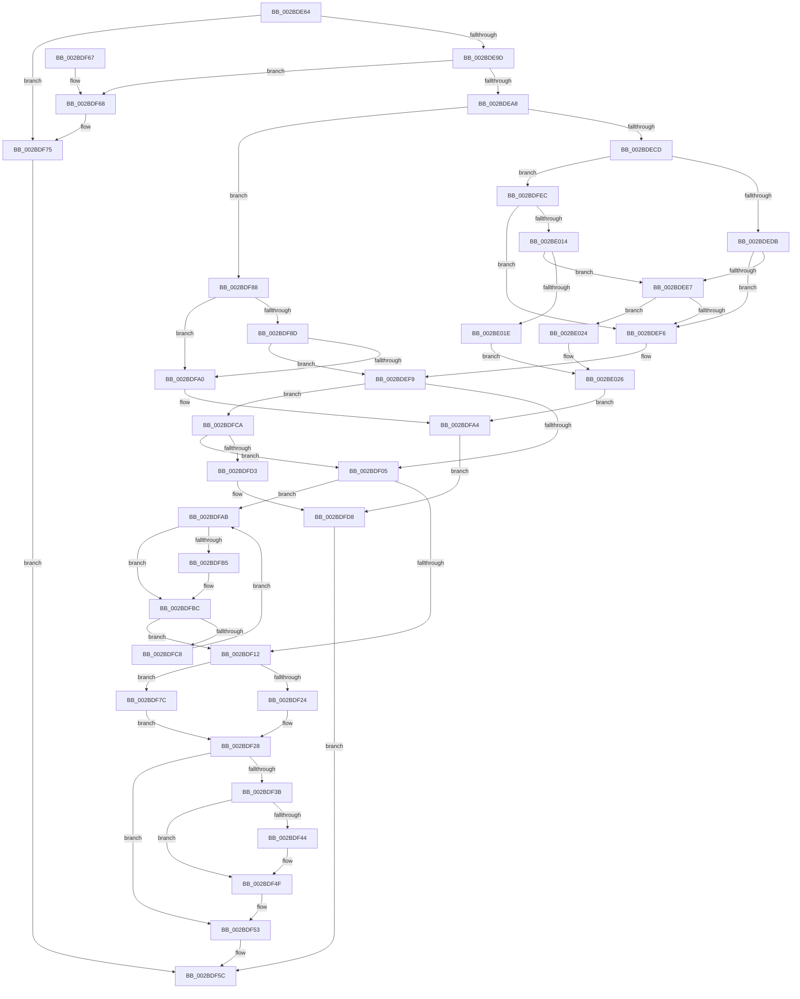

# MiReferenceExistingControlArea

- RVA: `0x002BDE64`–`0x002BE02D` (길이 `457` bytes)
- VA: `0x00000001402BDE64`
- 실행 섹션: `.text`
- PDB 이름 있음: `예`; PDB Function 태그: `아니요`
- unwind 정보 RVA: `0x0006E288`
- 디코드: `118`개 명령, `457/457` bytes 표시
- 미해석 바이트: `0` (있으면 어셈블리에 `.byte`로 보존)

> 이 문서는 커널 이미지의 기계어와 PDB 기호를 분석해 생성했습니다. 4번과 5번은 함수 원형과 자료형을 바이너리 사용 방식에서 추정한 C 해석이며 원본 소스 복구 결과는 아닙니다.

## 1. Dependencies

- 직접 호출 지점: **7**; 고유 호출 대상: **6**
- 직접 호출자로 확인된 함수: **1**
- RIP 상대 이미지 참조: **3**

### Outgoing calls
- `0x002BDE8C` → [MiLockSectionControlArea](MiLockSectionControlArea_function_002BC930.md) (function, `0x002BC930`)
- `0x002BDF19` → [MiRemoveUnusedSegment](MiRemoveUnusedSegment_function_002BBE74.md) (function, `0x002BBE74`)
- `0x002BDF31` → [ExReleaseSpinLockExclusiveFromDpcLevel](../24/ExReleaseSpinLockExclusiveFromDpcLevel_function_002497E0.md) (function, `0x002497E0`)
- `0x002BDF4A` → [KiLowerIrqlProcessIrqlFlags](../4F/KiLowerIrqlProcessIrqlFlags_function_004F5698.md) (function, `0x004F5698`)
- `0x002BDF55` → [MiReleaseControlAreaWaiters](../28/MiReleaseControlAreaWaiters_function_002865F0.md) (function, `0x002865F0`)
- `0x002BDF70` → [MiReleaseSpinLockExclusive](../24/MiReleaseSpinLockExclusive_function_002482C0.md) (function, `0x002482C0`)
- `0x002BDFE0` → [MiReleaseSpinLockExclusive](../24/MiReleaseSpinLockExclusive_function_002482C0.md) (function, `0x002482C0`)

### Direct callers
- [sub_00984B34](../../page/98/Unknown_function_00984B34.md) at `0x00984B81`

### Static image references
- `0x002BDEAC` → RVA `0x00E30088` (`.data`; read)
- `0x002BDEDB` → RVA `0x00E38D00` (`.data`; read)
- `0x002BDF3B` → RVA `0x00FC6D20` (`ALMOSTRO`; read)

## 2. Other-region calls and transfers

- 다른 실행 섹션으로 향하는 call: **0**
- 별도 외부 분기/꼬리 이동을 확인하지 못했습니다.

## 3. Assembly (complete function range)

```asm
002BDE64  48 89 5C 24 10                  mov qword ptr [rsp + 0x10], rbx
002BDE69  57                              push rdi
002BDE6A  48 83 EC 20                     sub rsp, 0x20
002BDE6E  48 8B 41 30                     mov rax, qword ptr [rcx + 0x30]
002BDE72  4C 8D 44 24 30                  lea r8, [rsp + 0x30]
002BDE77  48 8B F9                        mov rdi, rcx
002BDE7A  C6 44 24 30 00                  mov byte ptr [rsp + 0x30], 0
002BDE7F  48 8B 48 28                     mov rcx, qword ptr [rax + 0x28]
002BDE83  0F B6 57 13                     movzx edx, byte ptr [rdi + 0x13]
002BDE87  F7 D2                           not edx
002BDE89  83 E2 01                        and edx, 1
002BDE8C  E8 9F EA FF FF                  call 0x1402bc930
002BDE91  48 8B D8                        mov rbx, rax
002BDE94  48 85 C0                        test rax, rax
002BDE97  0F 84 D8 00 00 00               je 0x1402bdf75
002BDE9D  8B 40 38                        mov eax, dword ptr [rax + 0x38]
002BDEA0  A8 03                           test al, 3
002BDEA2  0F 85 C0 00 00 00               jne 0x1402bdf68
002BDEA8  0F B7 4B 3C                     movzx ecx, word ptr [rbx + 0x3c]
002BDEAC  48 8B 05 D5 21 B7 00            mov rax, qword ptr [rip + 0xb721d5]
002BDEB3  81 E1 FF 03 00 00               and ecx, 0x3ff
002BDEB9  4C 8B 0C C8                     mov r9, qword ptr [rax + rcx*8]
002BDEBD  48 8B 87 B0 00 00 00            mov rax, qword ptr [rdi + 0xb0]
002BDEC4  48 85 C0                        test rax, rax
002BDEC7  0F 85 BB 00 00 00               jne 0x1402bdf88
002BDECD  44 8A 43 3E                     mov r8b, byte ptr [rbx + 0x3e]
002BDED1  41 F6 C0 01                     test r8b, 1
002BDED5  0F 85 11 01 00 00               jne 0x1402bdfec
002BDEDB  48 8D 05 1E AE B7 00            lea rax, [rip + 0xb7ae1e]
002BDEE2  4C 3B C8                        cmp r9, rax
002BDEE5  74 0F                           je 0x1402bdef6
002BDEE7  8B 07                           mov eax, dword ptr [rdi]
002BDEE9  B9 00 00 00 01                  mov ecx, 0x1000000
002BDEEE  85 C1                           test ecx, eax
002BDEF0  0F 84 2E 01 00 00               je 0x1402be024
002BDEF6  41 8A C8                        mov cl, r8b
002BDEF9  F7 07 00 00 00 02               test dword ptr [rdi], 0x2000000
002BDEFF  0F 85 C5 00 00 00               jne 0x1402bdfca
002BDF05  48 8B 4B 50                     mov rcx, qword ptr [rbx + 0x50]
002BDF09  48 85 C9                        test rcx, rcx
002BDF0C  0F 85 99 00 00 00               jne 0x1402bdfab
002BDF12  48 FF 43 18                     inc qword ptr [rbx + 0x18]
002BDF16  48 8B CB                        mov rcx, rbx
002BDF19  E8 56 DF FF FF                  call 0x1402bbe74
002BDF1E  8B 07                           mov eax, dword ptr [rdi]
002BDF20  A8 01                           test al, 1
002BDF22  75 58                           jne 0x1402bdf7c
002BDF24  48 FF 43 30                     inc qword ptr [rbx + 0x30]
002BDF28  48 8D 4B 48                     lea rcx, [rbx + 0x48]
002BDF2C  0F B6 5C 24 30                  movzx ebx, byte ptr [rsp + 0x30]
002BDF31  E8 AA B8 F8 FF                  call 0x1402497e0
002BDF36  80 FB 11                        cmp bl, 0x11
002BDF39  74 18                           je 0x1402bdf53
002BDF3B  83 3D DE 8D D0 00 00            cmp dword ptr [rip + 0xd08dde], 0
002BDF42  74 0B                           je 0x1402bdf4f
002BDF44  44 0F 20 C1                     mov rcx, cr8
002BDF48  8A D3                           mov dl, bl
002BDF4A  E8 49 77 23 00                  call 0x1404f5698
002BDF4F  44 0F 22 C3                     mov cr8, rbx
002BDF53  33 C9                           xor ecx, ecx
002BDF55  E8 96 86 FC FF                  call 0x1402865f0
002BDF5A  33 C0                           xor eax, eax
002BDF5C  48 8B 5C 24 38                  mov rbx, qword ptr [rsp + 0x38]
002BDF61  48 83 C4 20                     add rsp, 0x20
002BDF65  5F                              pop rdi
002BDF66  C3                              ret
002BDF67  CC                              int3
002BDF68  8A 54 24 30                     mov dl, byte ptr [rsp + 0x30]
002BDF6C  48 8D 4B 48                     lea rcx, [rbx + 0x48]
002BDF70  E8 4B A3 F8 FF                  call 0x1402482c0
002BDF75  B8 01 00 00 C0                  mov eax, 0xc0000001
002BDF7A  EB E0                           jmp 0x1402bdf5c
002BDF7C  8B 43 38                        mov eax, dword ptr [rbx + 0x38]
002BDF7F  0F BA E8 0F                     bts eax, 0xf
002BDF83  89 43 38                        mov dword ptr [rbx + 0x38], eax
002BDF86  EB A0                           jmp 0x1402bdf28
002BDF88  4C 39 08                        cmp qword ptr [rax], r9
002BDF8B  75 13                           jne 0x1402bdfa0
002BDF8D  8B 07                           mov eax, dword ptr [rdi]
002BDF8F  0F B6 4B 3E                     movzx ecx, byte ptr [rbx + 0x3e]
002BDF93  C1 E8 16                        shr eax, 0x16
002BDF96  33 C1                           xor eax, ecx
002BDF98  A8 01                           test al, 1
002BDF9A  0F 84 59 FF FF FF               je 0x1402bdef9
002BDFA0  0F BA 2F 17                     bts dword ptr [rdi], 0x17
002BDFA4  BF 76 04 00 C0                  mov edi, 0xc0000476
002BDFA9  EB 2D                           jmp 0x1402bdfd8
002BDFAB  8B 41 08                        mov eax, dword ptr [rcx + 8]
002BDFAE  48 8B 11                        mov rdx, qword ptr [rcx]
002BDFB1  A8 04                           test al, 4
002BDFB3  74 07                           je 0x1402bdfbc
002BDFB5  C7 41 0C 01 00 00 00            mov dword ptr [rcx + 0xc], 1
002BDFBC  48 8B CA                        mov rcx, rdx
002BDFBF  48 85 D2                        test rdx, rdx
002BDFC2  0F 84 4A FF FF FF               je 0x1402bdf12
002BDFC8  EB E1                           jmp 0x1402bdfab
002BDFCA  F6 C1 0C                        test cl, 0xc
002BDFCD  0F 84 32 FF FF FF               je 0x1402bdf05
002BDFD3  BF 11 09 00 C0                  mov edi, 0xc0000911
002BDFD8  8A 54 24 30                     mov dl, byte ptr [rsp + 0x30]
002BDFDC  48 8D 4B 48                     lea rcx, [rbx + 0x48]
002BDFE0  E8 DB A2 F8 FF                  call 0x1402482c0
002BDFE5  8B C7                           mov eax, edi
002BDFE7  E9 70 FF FF FF                  jmp 0x1402bdf5c
002BDFEC  65 48 8B 04 25 88 01 00 00      mov rax, qword ptr gs:[0x188]
002BDFF5  48 8B 88 B8 00 00 00            mov rcx, qword ptr [rax + 0xb8]
002BDFFC  48 8B 05 85 20 B7 00            mov rax, qword ptr [rip + 0xb72085]
002BE003  0F B7 91 AE 04 00 00            movzx edx, word ptr [rcx + 0x4ae]
002BE00A  4C 3B 0C D0                     cmp r9, qword ptr [rax + rdx*8]
002BE00E  0F 84 E2 FE FF FF               je 0x1402bdef6
002BE014  8B 07                           mov eax, dword ptr [rdi]
002BE016  A8 01                           test al, 1
002BE018  0F 85 C9 FE FF FF               jne 0x1402bdee7
002BE01E  0F BA E8 17                     bts eax, 0x17
002BE022  EB 02                           jmp 0x1402be026
002BE024  0B C1                           or eax, ecx
002BE026  89 07                           mov dword ptr [rdi], eax
002BE028  E9 77 FF FF FF                  jmp 0x1402bdfa4
```

## 4. C-style interpretation (structured pseudocode)

```c
__int64 __fastcall MiReferenceExistingControlArea(__int64 a1)
{
    __int64 result;
    __int64 v_rsp;
    unsigned __int64 v_stack_p10;
    unsigned __int8 v_stack_p30;
    unsigned __int64 v_stack_p8;

    v_stack_p10 = v_rbx;
    v_rsp = (v_rsp) - (32);
    v_stack_p8 = 0;
    a2 = (unsigned int)(~(*(unsigned __int8 *)(a1 + 19)));
    a2 = (unsigned int)((a2) & (1));
    result = MiLockSectionControlArea(*(unsigned __int64 *)(*(unsigned __int64 *)(a1 + 48) + 40), a2, v_stack_p8, a4);
    if (result == 0) goto loc_002BDF75;
    if ((((unsigned __int8)((unsigned int)(*(unsigned int *)(result + 56)))) & (3)) != 0) goto loc_002BDF68;
    a1 = (unsigned int)((*(unsigned __int16 *)(result + 60)) & (0x3FFULL));
    if (*(unsigned __int64 *)(a1 + 176) != 0) goto loc_002BDF88;
    if ((((unsigned __int8)(*(unsigned __int8 *)(result + 62))) & (1)) != 0) goto loc_002BDFEC;
    if ((*(unsigned __int64 *)(*(unsigned __int64 *)(v_rip + 12001749) + a1 * 8)) == (v_rip + 12037662)) goto loc_002BDEF6;
loc_002BDEE7:
    if ((((unsigned int)((unsigned int)(0x1000000ULL))) & ((unsigned int)((unsigned int)(*(unsigned int *)(a1))))) == 0) goto loc_002BE024;
loc_002BDEF6:
loc_002BDEF9:
    if (((*(unsigned int *)(a1)) & (0x2000000ULL)) != 0) goto loc_002BDFCA;
loc_002BDF05:
    if (*(unsigned __int64 *)(result + 80) != 0) goto loc_002BDFAB;
loc_002BDF12:
    result = MiRemoveUnusedSegment(result, a2, *(unsigned __int8 *)(result + 62), *(unsigned __int64 *)(*(unsigned __int64 *)(v_rip + 12001749) + a1 * 8));
    if ((((unsigned __int8)((unsigned int)(*(unsigned int *)(a1)))) & (1)) != 0) goto loc_002BDF7C;
loc_002BDF28:
    result = ExReleaseSpinLockExclusiveFromDpcLevel(result + 72, a2, *(unsigned __int8 *)(result + 62), *(unsigned __int64 *)(*(unsigned __int64 *)(v_rip + 12001749) + a1 * 8));
    if (((unsigned __int8)(v_stack_p8)) == 17) goto loc_002BDF53;
    if ((*(unsigned int *)(v_rip + 13667806)) != 0) {
        a1 = v_cr8;
        a2 = (unsigned __int8)(v_stack_p8);
        result = KiLowerIrqlProcessIrqlFlags(a1, a2, *(unsigned __int8 *)(result + 62), *(unsigned __int64 *)(*(unsigned __int64 *)(v_rip + 12001749) + a1 * 8));
    }
loc_002BDF53:
    a1 = 0;
    result = MiReleaseControlAreaWaiters(a1, a2, *(unsigned __int8 *)(result + 62), *(unsigned __int64 *)(*(unsigned __int64 *)(v_rip + 12001749) + a1 * 8));
    result = 0;
loc_002BDF5C:
    v_rsp = (v_rsp) + (32);
    return result;
loc_002BDF68:
    result = MiReleaseSpinLockExclusive(v_stack_p10 + 72, v_stack_p30, *(unsigned __int8 *)(result + 62), *(unsigned __int64 *)(*(unsigned __int64 *)(v_rip + 12001749) + a1 * 8));
loc_002BDF75:
    goto loc_002BDF5C;
loc_002BDF7C:
    *(unsigned int *)(v_stack_p10 + 56) = (unsigned int)((unsigned int)(*(unsigned int *)(v_stack_p10 + 56)));
    goto loc_002BDF28;
loc_002BDF88:
    if ((*(unsigned __int64 *)((unsigned int)(*(unsigned int *)(v_stack_p10 + 56)))) != (*(unsigned __int64 *)(*(unsigned __int64 *)(v_rip + 12001749) + a1 * 8))) goto loc_002BDFA0;
    result = (unsigned int)(((unsigned int)(*(unsigned int *)(a1))) >> (22));
    result = (unsigned int)((result) ^ ((unsigned int)(*(unsigned __int8 *)(v_stack_p10 + 62))));
    if ((((unsigned __int8)(result)) & (1)) == 0) goto loc_002BDEF9;
loc_002BDFA0:
loc_002BDFA4:
    goto loc_002BDFD8;
loc_002BDFAB:
    if ((((unsigned __int8)((unsigned int)(*(unsigned int *)(*(unsigned __int8 *)(v_stack_p10 + 62) + 8)))) & (4)) != 0) {
        *(unsigned int *)(*(unsigned __int8 *)(v_stack_p10 + 62) + 12) = 1;
    }
    if (*(unsigned __int64 *)(*(unsigned __int8 *)(v_stack_p10 + 62)) == 0) goto loc_002BDF12;
    goto loc_002BDFAB;
loc_002BDFCA:
    if ((((unsigned __int8)(*(unsigned __int64 *)(*(unsigned __int8 *)(v_stack_p10 + 62)))) & (12)) == 0) goto loc_002BDF05;
loc_002BDFD8:
    result = MiReleaseSpinLockExclusive(v_stack_p10 + 72, v_stack_p30, *(unsigned __int8 *)(result + 62), *(unsigned __int64 *)(*(unsigned __int64 *)(v_rip + 12001749) + a1 * 8));
    goto loc_002BDF5C;
loc_002BDFEC:
    if ((*(unsigned __int64 *)(*(unsigned __int64 *)(v_rip + 12001749) + a1 * 8)) == (*(unsigned __int64 *)(*(unsigned __int64 *)(v_rip + 12001413) + *(unsigned __int16 *)(*(unsigned __int64 *)(*(unsigned __int64 *)(gs_base + (0 + 392)) + 184) + 1198) * 8))) goto loc_002BDEF6;
    if ((((unsigned __int8)((unsigned int)(*(unsigned int *)((unsigned int)(0xC0000911ULL))))) & (1)) != 0) goto loc_002BDEE7;
    goto loc_002BE026;
loc_002BE024:
    result = (unsigned int)(((unsigned int)(*(unsigned int *)((unsigned int)(0xC0000911ULL)))) | ((unsigned int)(*(unsigned __int64 *)(*(unsigned __int64 *)(gs_base + (0 + 392)) + 184))));
loc_002BE026:
    *(unsigned int *)((unsigned int)(0xC0000911ULL)) = (unsigned int)(result);
    goto loc_002BDFA4;
}
```

## 5. (Beta) C Style

```c
int64_t MiReferenceExistingControlArea(void *Arg1)
{
    uint8_t *arg1 = (uint8_t *)Arg1;

    int64_t result;
    int64_t local_rsp;
    uint64_t v_stack_p10;
    uint8_t v_stack_p30;
    uint64_t v_stack_p8;

    v_stack_p10 = local_rbx;
    local_rsp = (local_rsp) - (32);
    v_stack_p8 = 0;
    a2 = (uint32_t)(~(*(uint8_t *)(arg1 + 0x13)));
    a2 = (uint32_t)((a2) & (1));
    result = MiLockSectionControlArea(*(uint64_t *)(*(uint64_t *)(arg1 + 0x30) + 0x28), a2, v_stack_p8, a4);
    if (result == 0) goto loc_002BDF75;
    if ((((uint8_t)((uint32_t)(*(uint32_t *)(result + 0x38)))) & (3)) != 0) goto loc_002BDF68;
    Arg1 = (uint32_t)((*(uint16_t *)(result + 0x3C)) & (0x3FFULL));
    if (*(uint64_t *)(arg1 + 0xB0) != 0) goto loc_002BDF88;
    if ((((uint8_t)(*(uint8_t *)(result + 0x3E))) & (1)) != 0) goto loc_002BDFEC;
    if ((*(uint64_t *)(*(uint64_t *)(v_rip + 0xB721D5) + arg1 * 8)) == (v_rip + 12037662)) goto loc_002BDEF6;
loc_002BDEE7:
    if ((((uint32_t)((uint32_t)(0x1000000ULL))) & ((uint32_t)((uint32_t)(*(uint32_t *)(arg1))))) == 0) goto loc_002BE024;
loc_002BDEF6:
loc_002BDEF9:
    if (((*(uint32_t *)(arg1)) & (0x2000000ULL)) != 0) goto loc_002BDFCA;
loc_002BDF05:
    if (*(uint64_t *)(result + 0x50) != 0) goto loc_002BDFAB;
loc_002BDF12:
    result = MiRemoveUnusedSegment(result, a2, *(uint8_t *)(result + 0x3E), *(uint64_t *)(*(uint64_t *)(v_rip + 0xB721D5) + arg1 * 8));
    if ((((uint8_t)((uint32_t)(*(uint32_t *)(arg1)))) & (1)) != 0) goto loc_002BDF7C;
loc_002BDF28:
    result = ExReleaseSpinLockExclusiveFromDpcLevel(result + 72, a2, *(uint8_t *)(result + 0x3E), *(uint64_t *)(*(uint64_t *)(v_rip + 0xB721D5) + arg1 * 8));
    if (((uint8_t)(v_stack_p8)) == 17) goto loc_002BDF53;
    if ((*(uint32_t *)(v_rip + 0xD08DDE)) != 0) {
        Arg1 = v_cr8;
        a2 = (uint8_t)(v_stack_p8);
        result = KiLowerIrqlProcessIrqlFlags(Arg1, a2, *(uint8_t *)(result + 0x3E), *(uint64_t *)(*(uint64_t *)(v_rip + 0xB721D5) + arg1 * 8));
    }
loc_002BDF53:
    Arg1 = 0;
    result = MiReleaseControlAreaWaiters(Arg1, a2, *(uint8_t *)(result + 0x3E), *(uint64_t *)(*(uint64_t *)(v_rip + 0xB721D5) + arg1 * 8));
    result = 0;
loc_002BDF5C:
    local_rsp = (local_rsp) + (32);
    return result;
loc_002BDF68:
    result = MiReleaseSpinLockExclusive(v_stack_p10 + 72, v_stack_p30, *(uint8_t *)(result + 0x3E), *(uint64_t *)(*(uint64_t *)(v_rip + 0xB721D5) + arg1 * 8));
loc_002BDF75:
    goto loc_002BDF5C;
loc_002BDF7C:
    *(uint32_t *)(v_stack_p10 + 0x38) = (uint32_t)((uint32_t)(*(uint32_t *)(v_stack_p10 + 0x38)));
    goto loc_002BDF28;
loc_002BDF88:
    if ((*(uint64_t *)((uint32_t)(*(uint32_t *)(v_stack_p10 + 0x38)))) != (*(uint64_t *)(*(uint64_t *)(v_rip + 0xB721D5) + arg1 * 8))) goto loc_002BDFA0;
    result = (uint32_t)(((uint32_t)(*(uint32_t *)(arg1))) >> (22));
    result = (uint32_t)((result) ^ ((uint32_t)(*(uint8_t *)(v_stack_p10 + 0x3E))));
    if ((((uint8_t)(result)) & (1)) == 0) goto loc_002BDEF9;
loc_002BDFA0:
loc_002BDFA4:
    goto loc_002BDFD8;
loc_002BDFAB:
    if ((((uint8_t)((uint32_t)(*(uint32_t *)(*(uint8_t *)(v_stack_p10 + 0x3E) + 0x8)))) & (4)) != 0) {
        *(uint32_t *)(*(uint8_t *)(v_stack_p10 + 0x3E) + 0xC) = 1;
    }
    if (*(uint64_t *)(*(uint8_t *)(v_stack_p10 + 0x3E)) == 0) goto loc_002BDF12;
    goto loc_002BDFAB;
loc_002BDFCA:
    if ((((uint8_t)(*(uint64_t *)(*(uint8_t *)(v_stack_p10 + 0x3E)))) & (12)) == 0) goto loc_002BDF05;
loc_002BDFD8:
    result = MiReleaseSpinLockExclusive(v_stack_p10 + 72, v_stack_p30, *(uint8_t *)(result + 0x3E), *(uint64_t *)(*(uint64_t *)(v_rip + 0xB721D5) + arg1 * 8));
    goto loc_002BDF5C;
loc_002BDFEC:
    if ((*(uint64_t *)(*(uint64_t *)(v_rip + 0xB721D5) + arg1 * 8)) == (*(uint64_t *)(*(uint64_t *)(v_rip + 0xB72085) + *(uint16_t *)(*(uint64_t *)(*(uint64_t *)(gs_base + (0 + 0x188)) + 0xB8) + 0x4AE) * 8))) goto loc_002BDEF6;
    if ((((uint8_t)((uint32_t)(*(uint32_t *)((uint32_t)(0xC0000911ULL))))) & (1)) != 0) goto loc_002BDEE7;
    goto loc_002BE026;
loc_002BE024:
    result = (uint32_t)(((uint32_t)(*(uint32_t *)((uint32_t)(0xC0000911ULL)))) | ((uint32_t)(*(uint64_t *)(*(uint64_t *)(gs_base + (0 + 0x188)) + 0xB8))));
loc_002BE026:
    *(uint32_t *)((uint32_t)(0xC0000911ULL)) = (uint32_t)(result);
    goto loc_002BDFA4;
}
```

### 관측된 메모리 오프셋

구조체 형식이 확인되지 않은 접근은 인자 기준의 오프셋으로만 기록했습니다.

| 기준 인자 | 오프셋 표현 | 폭 (bit) | 접근 |
|---|---:|---:|---|
| `Arg1` | `+ 0x0` | `32` | `R` |
| `Arg1` | `+ 0x0` | `32` | `R/W` |
| `Arg1` | `+ 0x0` | `32` | `W` |
| `Arg1` | `+ 0x13` | `8` | `R` |
| `Arg1` | `+ 0x30` | `64` | `R` |
| `Arg1` | `+ 0xB0` | `64` | `R` |

## 6. Execution-region graph

[열기: 2D/3D 그래프와 함수 탐색 컨트롤 패널](../../../control-panel.html?section=text&rva=0x002BDE64&view=graph)

- 2D 그래프는 위에서 아래로 흐르고, 3D 그래프는 빈 공간을 드래그해 회전합니다. Shift+드래그는 이동, 휠은 확대·축소, 함수 노드 선택은 대상 보고서 이동입니다.

### Static fallback


