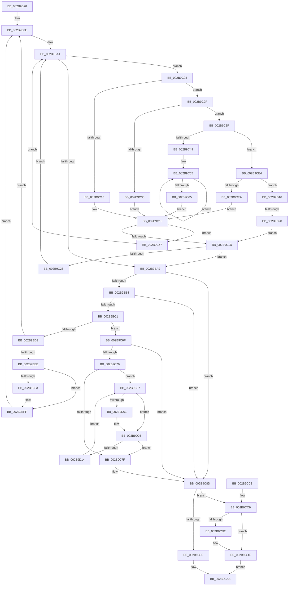

# MiReferencePfBackedSection

- RVA: `0x002B9B70`–`0x002B9D27` (길이 `439` bytes)
- VA: `0x00000001402B9B70`
- 실행 섹션: `.text`
- PDB 이름 있음: `예`; PDB Function 태그: `예`
- unwind 정보 RVA: `0x0006DCE8`
- 디코드: `121`개 명령, `439/439` bytes 표시
- 미해석 바이트: `0` (있으면 어셈블리에 `.byte`로 보존)

> 이 문서는 커널 이미지의 기계어와 PDB 기호를 분석해 생성했습니다. 4번과 5번은 함수 원형과 자료형을 바이너리 사용 방식에서 추정한 C 해석이며 원본 소스 복구 결과는 아닙니다.

## 1. Dependencies

- 직접 호출 지점: **8**; 고유 호출 대상: **6**
- 직접 호출자로 확인된 함수: **4**
- RIP 상대 이미지 참조: **3**

### Outgoing calls
- `0x002B9B95` → [ExAcquireSpinLockShared](../24/ExAcquireSpinLockShared_function_0024DCE0.md) (function, `0x0024DCE0`)
- `0x002B9BCC` → [ExTryAcquireSpinLockExclusiveAtDpcLevel](ExTryAcquireSpinLockExclusiveAtDpcLevel_function_002BB800.md) (function, `0x002BB800`)
- `0x002B9BE0` → [ExReleaseSpinLockSharedFromDpcLevel](../24/ExReleaseSpinLockSharedFromDpcLevel_function_0024A590.md) (function, `0x0024A590`)
- `0x002B9BFA` → [KiLowerIrqlProcessIrqlFlags](../4F/KiLowerIrqlProcessIrqlFlags_function_004F5698.md) (function, `0x004F5698`)
- `0x002B9C85` → [MiRemoveUnusedSegment](MiRemoveUnusedSegment_function_002BBE74.md) (function, `0x002BBE74`)
- `0x002B9C94` → [ExReleaseSpinLockSharedFromDpcLevel](../24/ExReleaseSpinLockSharedFromDpcLevel_function_0024A590.md) (function, `0x0024A590`)
- `0x002B9CA5` → [MiReleaseSpinLockExclusive](../24/MiReleaseSpinLockExclusive_function_002482C0.md) (function, `0x002482C0`)
- `0x002B9CD9` → [KiLowerIrqlProcessIrqlFlags](../4F/KiLowerIrqlProcessIrqlFlags_function_004F5698.md) (function, `0x004F5698`)

### Direct callers
- [MiTrimSharedPage](../29/MiTrimSharedPage_function_00297D14.md) at `0x00297F64`
- [MiGetPageFileSectionForReservation](../38/MiGetPageFileSectionForReservation_function_00385E2C.md) at `0x00385E44`
- [MiBuildReservationCluster](../40/MiBuildReservationCluster_function_004071A0.md) at `0x004077B5`
- [MiLocateSharedPageViews](../67/MiLocateSharedPageViews_function_0067F1E4.md) at `0x0067F3CD`

### Static image references
- `0x002B9B8E` → RVA `0x00E2D710` (`.data`; read)
- `0x002B9B9A` → RVA `0x00E2D708` (`.data`; read)
- `0x002B9BEB` → RVA `0x00FC6D20` (`ALMOSTRO`; read)

## 2. Other-region calls and transfers

- 다른 실행 섹션으로 향하는 call: **0**
- call이 아닌 외부 분기/꼬리 이동: **1**
  - `0x002B9D1A` → [sub_006DBBB2](../6D/Unknown_function_006DBBB2.md) (`tail-transfer`)

## 3. Assembly (complete function range)

```asm
002B9B70  48 8B C4                        mov rax, rsp
002B9B73  48 89 58 08                     mov qword ptr [rax + 8], rbx
002B9B77  48 89 68 10                     mov qword ptr [rax + 0x10], rbp
002B9B7B  48 89 70 18                     mov qword ptr [rax + 0x18], rsi
002B9B7F  48 89 78 20                     mov qword ptr [rax + 0x20], rdi
002B9B83  41 56                           push r14
002B9B85  48 83 EC 20                     sub rsp, 0x20
002B9B89  4C 8B F1                        mov r14, rcx
002B9B8C  33 ED                           xor ebp, ebp
002B9B8E  48 8D 0D 7B 3B B7 00            lea rcx, [rip + 0xb73b7b]
002B9B95  E8 46 41 F9 FF                  call 0x14024dce0
002B9B9A  48 8B 15 67 3B B7 00            mov rdx, qword ptr [rip + 0xb73b67]
002B9BA1  0F B6 F8                        movzx edi, al
002B9BA4  48 85 D2                        test rdx, rdx
002B9BA7  75 5C                           jne 0x1402b9c05
002B9BA9  33 DB                           xor ebx, ebx
002B9BAB  48 85 D2                        test rdx, rdx
002B9BAE  0F 84 D9 00 00 00               je 0x1402b9c8d
002B9BB4  8A 42 18                        mov al, byte ptr [rdx + 0x18]
002B9BB7  24 07                           and al, 7
002B9BB9  3C 01                           cmp al, 1
002B9BBB  0F 85 CC 00 00 00               jne 0x1402b9c8d
002B9BC1  48 8D 72 C8                     lea rsi, [rdx - 0x38]
002B9BC5  48 8B 1E                        mov rbx, qword ptr [rsi]
002B9BC8  48 8D 4B 48                     lea rcx, [rbx + 0x48]
002B9BCC  E8 2F 1C 00 00                  call 0x1402bb800
002B9BD1  85 C0                           test eax, eax
002B9BD3  0F 85 96 00 00 00               jne 0x1402b9c6f
002B9BD9  48 8D 0D 30 3B B7 00            lea rcx, [rip + 0xb73b30]
002B9BE0  E8 AB 09 F9 FF                  call 0x14024a590
002B9BE5  40 80 FF 11                     cmp dil, 0x11
002B9BE9  74 A3                           je 0x1402b9b8e
002B9BEB  39 2D 2F D1 D0 00               cmp dword ptr [rip + 0xd0d12f], ebp
002B9BF1  74 0C                           je 0x1402b9bff
002B9BF3  44 0F 20 C1                     mov rcx, cr8
002B9BF7  40 8A D7                        mov dl, dil
002B9BFA  E8 99 BA 23 00                  call 0x1404f5698
002B9BFF  44 0F 22 C7                     mov cr8, rdi
002B9C03  EB 89                           jmp 0x1402b9b8e
002B9C05  8B 42 18                        mov eax, dword ptr [rdx + 0x18]
002B9C08  45 33 C0                        xor r8d, r8d
002B9C0B  83 E0 07                        and eax, 7
002B9C0E  75 1F                           jne 0x1402b9c2f
002B9C10  48 8B 4A 90                     mov rcx, qword ptr [rdx - 0x70]
002B9C14  44 8B 42 B4                     mov r8d, dword ptr [rdx - 0x4c]
002B9C18  4C 3B F1                        cmp r14, rcx
002B9C1B  72 4A                           jb 0x1402b9c67
002B9C1D  4A 8D 04 C1                     lea rax, [rcx + r8*8]
002B9C21  4C 3B F0                        cmp r14, rax
002B9C24  72 83                           jb 0x1402b9ba9
002B9C26  48 8B 52 08                     mov rdx, qword ptr [rdx + 8]
002B9C2A  E9 75 FF FF FF                  jmp 0x1402b9ba4
002B9C2F  48 83 E8 01                     sub rax, 1
002B9C33  75 0A                           jne 0x1402b9c3f
002B9C35  48 8B 4A D0                     mov rcx, qword ptr [rdx - 0x30]
002B9C39  44 8B 42 F4                     mov r8d, dword ptr [rdx - 0xc]
002B9C3D  EB D9                           jmp 0x1402b9c18
002B9C3F  48 83 E8 01                     sub rax, 1
002B9C43  0F 85 9B 00 00 00               jne 0x1402b9ce4
002B9C49  4C 8B 4A C8                     mov r9, qword ptr [rdx - 0x38]
002B9C4D  49 83 E9 80                     sub r9, -0x80
002B9C51  49 8B 49 08                     mov rcx, qword ptr [r9 + 8]
002B9C55  41 8B 41 2C                     mov eax, dword ptr [r9 + 0x2c]
002B9C59  4D 8B 49 10                     mov r9, qword ptr [r9 + 0x10]
002B9C5D  4C 03 C0                        add r8, rax
002B9C60  4D 85 C9                        test r9, r9
002B9C63  75 F0                           jne 0x1402b9c55
002B9C65  EB B1                           jmp 0x1402b9c18
002B9C67  48 8B 12                        mov rdx, qword ptr [rdx]
002B9C6A  E9 35 FF FF FF                  jmp 0x1402b9ba4
002B9C6F  8B 43 38                        mov eax, dword ptr [rbx + 0x38]
002B9C72  A8 03                           test al, 3
002B9C74  75 17                           jne 0x1402b9c8d
002B9C76  48 8B 4B 50                     mov rcx, qword ptr [rbx + 0x50]
002B9C7A  48 85 C9                        test rcx, rcx
002B9C7D  75 78                           jne 0x1402b9cf7
002B9C7F  FF 43 4C                        inc dword ptr [rbx + 0x4c]
002B9C82  48 8B CB                        mov rcx, rbx
002B9C85  E8 EA 21 00 00                  call 0x1402bbe74
002B9C8A  48 8B EE                        mov rbp, rsi
002B9C8D  48 8D 0D 7C 3A B7 00            lea rcx, [rip + 0xb73a7c]
002B9C94  E8 F7 08 F9 FF                  call 0x14024a590
002B9C99  48 85 DB                        test rbx, rbx
002B9C9C  74 2B                           je 0x1402b9cc9
002B9C9E  48 8D 4B 48                     lea rcx, [rbx + 0x48]
002B9CA2  40 8A D7                        mov dl, dil
002B9CA5  E8 16 E6 F8 FF                  call 0x1402482c0
002B9CAA  48 8B 5C 24 30                  mov rbx, qword ptr [rsp + 0x30]
002B9CAF  48 8B C5                        mov rax, rbp
002B9CB2  48 8B 6C 24 38                  mov rbp, qword ptr [rsp + 0x38]
002B9CB7  48 8B 74 24 40                  mov rsi, qword ptr [rsp + 0x40]
002B9CBC  48 8B 7C 24 48                  mov rdi, qword ptr [rsp + 0x48]
002B9CC1  48 83 C4 20                     add rsp, 0x20
002B9CC5  41 5E                           pop r14
002B9CC7  C3                              ret
002B9CC8  CC                              int3
002B9CC9  83 3D 50 D0 D0 00 00            cmp dword ptr [rip + 0xd0d050], 0
002B9CD0  74 0C                           je 0x1402b9cde
002B9CD2  44 0F 20 C1                     mov rcx, cr8
002B9CD6  40 8A D7                        mov dl, dil
002B9CD9  E8 BA B9 23 00                  call 0x1404f5698
002B9CDE  44 0F 22 C7                     mov cr8, rdi
002B9CE2  EB C6                           jmp 0x1402b9caa
002B9CE4  48 83 E8 01                     sub rax, 1
002B9CE8  75 2C                           jne 0x1402b9d16
002B9CEA  48 8B 4A 30                     mov rcx, qword ptr [rdx + 0x30]
002B9CEE  4C 8B 42 20                     mov r8, qword ptr [rdx + 0x20]
002B9CF2  E9 21 FF FF FF                  jmp 0x1402b9c18
002B9CF7  8B 41 08                        mov eax, dword ptr [rcx + 8]
002B9CFA  48 8B 11                        mov rdx, qword ptr [rcx]
002B9CFD  A8 04                           test al, 4
002B9CFF  74 07                           je 0x1402b9d08
002B9D01  C7 41 0C 01 00 00 00            mov dword ptr [rcx + 0xc], 1
002B9D08  48 8B CA                        mov rcx, rdx
002B9D0B  48 85 D2                        test rdx, rdx
002B9D0E  0F 84 6B FF FF FF               je 0x1402b9c7f
002B9D14  EB E1                           jmp 0x1402b9cf7
002B9D16  48 83 F8 01                     cmp rax, 1
002B9D1A  0F 84 92 1E 42 00               je 0x1406dbbb2
002B9D20  33 C9                           xor ecx, ecx
002B9D22  E9 F6 FE FF FF                  jmp 0x1402b9c1d
```

## 4. C-style interpretation (structured pseudocode)

```c
__int64 __fastcall MiReferencePfBackedSection(__int64 a1, __int64 a2, int a3)
{
    __int64 result;
    __int64 v_rbp;
    __int64 v_rbx;
    __int64 v_rsp;
    unsigned __int64 v_stack_p10;
    unsigned __int64 v_stack_p18;
    unsigned __int64 v_stack_p20;
    unsigned __int64 v_stack_p8;

    *(unsigned __int64 *)(v_rsp + 8) = v_rbx;
    *(unsigned __int64 *)(v_rsp + 16) = v_rbp;
    *(unsigned __int64 *)(v_rsp + 24) = v_rsi;
    *(unsigned __int64 *)(v_rsp + 32) = v_rdi;
    v_rsp = (v_rsp) - (32);
    v_rbp = 0;
loc_002B9B8E:
    result = ExAcquireSpinLockShared(v_rip + 12008315, a2, a3, a4);
loc_002B9BA4:
    if (*(unsigned __int64 *)(v_rip + 12008295) != 0) goto loc_002B9C05;
loc_002B9BA9:
    v_rbx = 0;
    if (*(unsigned __int64 *)(v_rip + 12008295) == 0) goto loc_002B9C8D;
    result = (unsigned __int8)((*(unsigned __int8 *)(*(unsigned __int64 *)(v_rip + 12008295) + 24)) & (7));
    if (((unsigned __int8)(result)) != 1) goto loc_002B9C8D;
    result = ExTryAcquireSpinLockExclusiveAtDpcLevel(*(unsigned __int64 *)(*(unsigned __int64 *)(v_rip + 12008295) - 56) + 72, *(unsigned __int64 *)(v_rip + 12008295), a3, a4);
    if ((unsigned int)(result) != 0) goto loc_002B9C6F;
    result = ExReleaseSpinLockSharedFromDpcLevel(v_rip + 12008240, *(unsigned __int64 *)(v_rip + 12008295), a3, a4);
    if (((unsigned __int8)((unsigned __int8)(result))) == 17) goto loc_002B9B8E;
    if ((*(unsigned int *)(v_rip + 13685039)) != 0) {
        a1 = v_cr8;
        a2 = (unsigned __int8)((unsigned __int8)(result));
        result = KiLowerIrqlProcessIrqlFlags(a1, a2, a3, a4);
    }
    goto loc_002B9B8E;
loc_002B9C05:
    a3 = 0;
    result = (unsigned int)(((unsigned int)(*(unsigned int *)(a2 + 24))) & (7));
    if (condition_is_not_equal) goto loc_002B9C2F;
loc_002B9C18:
    if (a1 < (*(unsigned __int64 *)(a2 - 112))) goto loc_002B9C67;
loc_002B9C1D:
    if (a1 < (*(unsigned __int64 *)(a2 - 112) + (unsigned int)(*(unsigned int *)(a2 - 76)) * 8)) goto loc_002B9BA9;
    goto loc_002B9BA4;
loc_002B9C2F:
    result = (*(unsigned __int64 *)(a2 - 112) + (unsigned int)(*(unsigned int *)(a2 - 76)) * 8) - (1);
    if (condition_is_not_equal) goto loc_002B9C3F;
    goto loc_002B9C18;
loc_002B9C3F:
    result = (result) - (1);
    if (condition_is_not_equal) goto loc_002B9CE4;
    a4 = (*(unsigned __int64 *)(*(unsigned __int64 *)(a2 + 8) - 56)) - (-128);
loc_002B9C55:
    a3 = ((unsigned int)(*(unsigned int *)(*(unsigned __int64 *)(a2 + 8) - 12))) + ((unsigned int)(*(unsigned int *)(a4 + 44)));
    if (*(unsigned __int64 *)(a4 + 16) != 0) goto loc_002B9C55;
    goto loc_002B9C18;
loc_002B9C67:
    goto loc_002B9BA4;
loc_002B9C6F:
    if ((((unsigned __int8)((unsigned int)(*(unsigned int *)(*(unsigned __int64 *)(*(unsigned __int64 *)(v_rip + 12008295) - 56) + 56)))) & (3)) != 0) goto loc_002B9C8D;
    if (*(unsigned __int64 *)(*(unsigned __int64 *)(*(unsigned __int64 *)(v_rip + 12008295) - 56) + 80) != 0) goto loc_002B9CF7;
loc_002B9C7F:
    result = MiRemoveUnusedSegment(*(unsigned __int64 *)(*(unsigned __int64 *)(v_rip + 12008295) - 56), *(unsigned __int64 *)(*(unsigned __int64 *)(a2 + 8)), a3, *(unsigned __int64 *)(a4 + 16));
loc_002B9C8D:
    result = ExReleaseSpinLockSharedFromDpcLevel(v_rip + 12008060, *(unsigned __int64 *)(*(unsigned __int64 *)(a2 + 8)), a3, *(unsigned __int64 *)(a4 + 16));
    if (*(unsigned __int64 *)(*(unsigned __int64 *)(v_rip + 12008295) - 56) == 0) goto loc_002B9CC9;
    result = MiReleaseSpinLockExclusive(*(unsigned __int64 *)(*(unsigned __int64 *)(v_rip + 12008295) - 56) + 72, (unsigned __int8)((unsigned __int8)(result)), a3, *(unsigned __int64 *)(a4 + 16));
loc_002B9CAA:
    v_rsp = (v_rsp) + (32);
    return *(unsigned __int64 *)(v_rip + 12008295) - 56;
loc_002B9CC9:
    result = *(unsigned __int64 *)(v_rip + 12008295) - 56;
    if ((*(unsigned int *)(v_rip + 13684816)) != 0) {
        a1 = (unsigned __int8)(result);
        a2 = (unsigned __int8)(v_stack_p20);
        result = KiLowerIrqlProcessIrqlFlags(a1, a2, a3, *(unsigned __int64 *)(a4 + 16));
    }
    goto loc_002B9CAA;
loc_002B9CE4:
    result = (result) - (1);
    if (condition_is_not_equal) goto loc_002B9D16;
    goto loc_002B9C18;
loc_002B9CF7:
    if ((((unsigned __int8)((unsigned int)(*(unsigned int *)(*(unsigned __int64 *)(a2 + 48) + 8)))) & (4)) != 0) {
        *(unsigned int *)(*(unsigned __int64 *)(a2 + 48) + 12) = 1;
    }
    if (*(unsigned __int64 *)(*(unsigned __int64 *)(a2 + 48)) == 0) goto loc_002B9C7F;
    goto loc_002B9CF7;
loc_002B9D16:
    a1 = 0;
    goto loc_002B9C1D;
}
```

## 5. (Beta) C Style

```c
int64_t MiReferencePfBackedSection(int64_t Arg1, int64_t Arg2, int32_t Arg3)
{
    int64_t result;
    int64_t local_rbp;
    int64_t local_rbx;
    int64_t local_rsp;
    uint64_t v_stack_p10;
    uint64_t v_stack_p18;
    uint64_t v_stack_p20;
    uint64_t v_stack_p8;

    *(uint64_t *)(local_rsp + 0x8) = local_rbx;
    *(uint64_t *)(local_rsp + 0x10) = local_rbp;
    *(uint64_t *)(local_rsp + 0x18) = local_rsi;
    *(uint64_t *)(local_rsp + 0x20) = local_rdi;
    local_rsp = (local_rsp) - (32);
    local_rbp = 0;
loc_002B9B8E:
    result = ExAcquireSpinLockShared(v_rip + 12008315, Arg2, Arg3, a4);
loc_002B9BA4:
    if (*(uint64_t *)(v_rip + 0xB73B67) != 0) goto loc_002B9C05;
loc_002B9BA9:
    local_rbx = 0;
    if (*(uint64_t *)(v_rip + 0xB73B67) == 0) goto loc_002B9C8D;
    result = (uint8_t)((*(uint8_t *)(*(uint64_t *)(v_rip + 0xB73B67) + 0x18)) & (7));
    if (((uint8_t)(result)) != 1) goto loc_002B9C8D;
    result = ExTryAcquireSpinLockExclusiveAtDpcLevel(*(uint64_t *)(*(uint64_t *)(v_rip + 0xB73B67) - 0x38) + 72, *(uint64_t *)(v_rip + 0xB73B67), Arg3, a4);
    if ((uint32_t)(result) != 0) goto loc_002B9C6F;
    result = ExReleaseSpinLockSharedFromDpcLevel(v_rip + 12008240, *(uint64_t *)(v_rip + 0xB73B67), Arg3, a4);
    if (((uint8_t)((uint8_t)(result))) == 17) goto loc_002B9B8E;
    if ((*(uint32_t *)(v_rip + 0xD0D12F)) != 0) {
        Arg1 = v_cr8;
        Arg2 = (uint8_t)((uint8_t)(result));
        result = KiLowerIrqlProcessIrqlFlags(Arg1, Arg2, Arg3, a4);
    }
    goto loc_002B9B8E;
loc_002B9C05:
    Arg3 = 0;
    result = (uint32_t)(((uint32_t)(*(uint32_t *)(Arg2 + 0x18))) & (7));
    if (condition_is_not_equal) goto loc_002B9C2F;
loc_002B9C18:
    if (Arg1 < (*(uint64_t *)(Arg2 - 0x70))) goto loc_002B9C67;
loc_002B9C1D:
    if (Arg1 < (*(uint64_t *)(Arg2 - 0x70) + (uint32_t)(*(uint32_t *)(Arg2 - 0x4C)) * 8)) goto loc_002B9BA9;
    goto loc_002B9BA4;
loc_002B9C2F:
    result = (*(uint64_t *)(Arg2 - 0x70) + (uint32_t)(*(uint32_t *)(Arg2 - 0x4C)) * 8) - (1);
    if (condition_is_not_equal) goto loc_002B9C3F;
    goto loc_002B9C18;
loc_002B9C3F:
    result = (result) - (1);
    if (condition_is_not_equal) goto loc_002B9CE4;
    a4 = (*(uint64_t *)(*(uint64_t *)(Arg2 + 0x8) - 0x38)) - (-128);
loc_002B9C55:
    Arg3 = ((uint32_t)(*(uint32_t *)(*(uint64_t *)(Arg2 + 0x8) - 0xC))) + ((uint32_t)(*(uint32_t *)(a4 + 0x2C)));
    if (*(uint64_t *)(a4 + 0x10) != 0) goto loc_002B9C55;
    goto loc_002B9C18;
loc_002B9C67:
    goto loc_002B9BA4;
loc_002B9C6F:
    if ((((uint8_t)((uint32_t)(*(uint32_t *)(*(uint64_t *)(*(uint64_t *)(v_rip + 0xB73B67) - 0x38) + 0x38)))) & (3)) != 0) goto loc_002B9C8D;
    if (*(uint64_t *)(*(uint64_t *)(*(uint64_t *)(v_rip + 0xB73B67) - 0x38) + 0x50) != 0) goto loc_002B9CF7;
loc_002B9C7F:
    result = MiRemoveUnusedSegment(*(uint64_t *)(*(uint64_t *)(v_rip + 0xB73B67) - 0x38), *(uint64_t *)(*(uint64_t *)(Arg2 + 0x8)), Arg3, *(uint64_t *)(a4 + 0x10));
loc_002B9C8D:
    result = ExReleaseSpinLockSharedFromDpcLevel(v_rip + 12008060, *(uint64_t *)(*(uint64_t *)(Arg2 + 0x8)), Arg3, *(uint64_t *)(a4 + 0x10));
    if (*(uint64_t *)(*(uint64_t *)(v_rip + 0xB73B67) - 0x38) == 0) goto loc_002B9CC9;
    result = MiReleaseSpinLockExclusive(*(uint64_t *)(*(uint64_t *)(v_rip + 0xB73B67) - 0x38) + 72, (uint8_t)((uint8_t)(result)), Arg3, *(uint64_t *)(a4 + 0x10));
loc_002B9CAA:
    local_rsp = (local_rsp) + (32);
    return *(uint64_t *)(v_rip + 0xB73B67) - 56;
loc_002B9CC9:
    result = *(uint64_t *)(v_rip + 0xB73B67) - 56;
    if ((*(uint32_t *)(v_rip + 0xD0D050)) != 0) {
        Arg1 = (uint8_t)(result);
        Arg2 = (uint8_t)(v_stack_p20);
        result = KiLowerIrqlProcessIrqlFlags(Arg1, Arg2, Arg3, *(uint64_t *)(a4 + 0x10));
    }
    goto loc_002B9CAA;
loc_002B9CE4:
    result = (result) - (1);
    if (condition_is_not_equal) goto loc_002B9D16;
    goto loc_002B9C18;
loc_002B9CF7:
    if ((((uint8_t)((uint32_t)(*(uint32_t *)(*(uint64_t *)(Arg2 + 0x30) + 0x8)))) & (4)) != 0) {
        *(uint32_t *)(*(uint64_t *)(Arg2 + 0x30) + 0xC) = 1;
    }
    if (*(uint64_t *)(*(uint64_t *)(Arg2 + 0x30)) == 0) goto loc_002B9C7F;
    goto loc_002B9CF7;
loc_002B9D16:
    Arg1 = 0;
    goto loc_002B9C1D;
}
```

## 6. Execution-region graph

[열기: 2D/3D 그래프와 함수 탐색 컨트롤 패널](../../../control-panel.html?section=text&rva=0x002B9B70&view=graph)

- 2D 그래프는 위에서 아래로 흐르고, 3D 그래프는 빈 공간을 드래그해 회전합니다. Shift+드래그는 이동, 휠은 확대·축소, 함수 노드 선택은 대상 보고서 이동입니다.

### Static fallback


