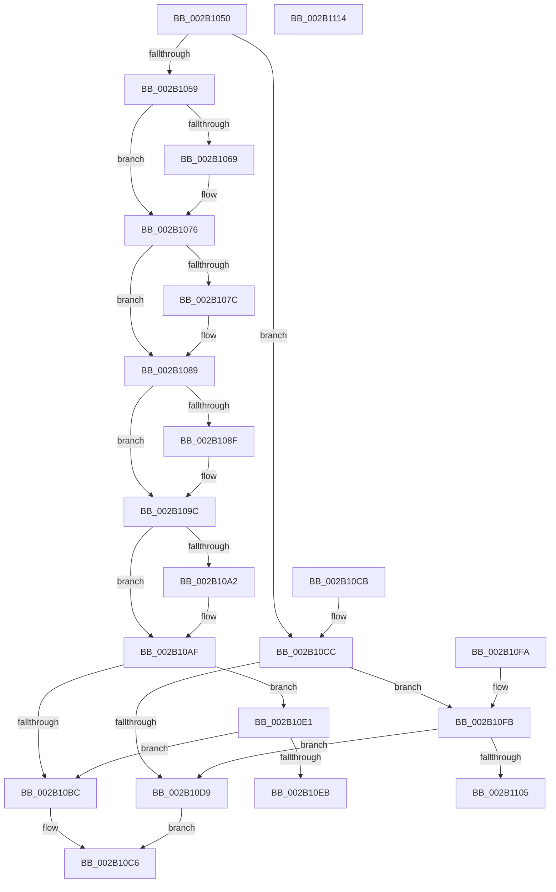

# MiReleasePageListLock

- RVA: `0x002B1050`–`0x002B1115` (길이 `197` bytes)
- VA: `0x00000001402B1050`
- 실행 섹션: `.text`
- PDB 이름 있음: `예`; PDB Function 태그: `아니요`
- unwind 정보 RVA: `0x0006D628`
- 디코드: `53`개 명령, `197/197` bytes 표시
- 미해석 바이트: `0` (있으면 어셈블리에 `.byte`로 보존)

> 이 문서는 커널 이미지의 기계어와 PDB 기호를 분석해 생성했습니다. 4번과 5번은 함수 원형과 자료형을 바이너리 사용 방식에서 추정한 C 해석이며 원본 소스 복구 결과는 아닙니다.

## 1. Dependencies

- 직접 호출 지점: **2**; 고유 호출 대상: **2**
- 직접 호출자로 확인된 함수: **7**
- RIP 상대 이미지 참조: **2**

### Outgoing calls
- `0x002B10F0` → [ExpReleaseSpinLockSharedFromDpcLevelInstrumented](../2F/ExpReleaseSpinLockSharedFromDpcLevelInstrumented_function_002F0F48.md) (function, `0x002F0F48`)
- `0x002B110A` → [ExpReleaseSpinLockExclusiveFromDpcLevelInstrumented](../2C/ExpReleaseSpinLockExclusiveFromDpcLevelInstrumented_function_002C0F44.md) (function, `0x002C0F44`)

### Direct callers
- [MiReplaceTransitionPage](MiReplaceTransitionPage_function_002B1120.md) at `0x002B158F`
- [MiSynchronizeFastPageInsert](MiSynchronizeFastPageInsert_function_002BAE80.md) at `0x002BB535`
- [MiRemoveLowestPriorityStandbyPage](../33/MiRemoveLowestPriorityStandbyPage_function_00334600.md) at `0x003349CA`
- [MiGetRepurposedSlabStandbyPage](../37/MiGetRepurposedSlabStandbyPage_function_003755A8.md) at `0x00375669`
- [MiUnlinkPageFromBadList](../3B/MiUnlinkPageFromBadList_function_003BD620.md) at `0x003BD841`
- [MiUpdatePageAttributeStamp](../48/MiUpdatePageAttributeStamp_function_00482364.md) at `0x00482471`
- [MiRepointPteAtExtendedStandby](../68/MiRepointPteAtExtendedStandby_function_0068B6F4.md) at `0x0068B735`

### Static image references
- `0x002B10B3` → RVA `0x00FC6B06` (`ALMOSTRO`; read)
- `0x002B10E1` → RVA `0x00F0DE58` (`.data`; read)

## 2. Other-region calls and transfers

- 다른 실행 섹션으로 향하는 call: **0**
- 별도 외부 분기/꼬리 이동을 확인하지 못했습니다.

## 3. Assembly (complete function range)

```asm
002B1050  48 83 EC 28                     sub rsp, 0x28
002B1054  80 3A 00                        cmp byte ptr [rdx], 0
002B1057  74 73                           je 0x1402b10cc
002B1059  80 7A 18 00                     cmp byte ptr [rdx + 0x18], 0
002B105D  49 B8 FF FF FF FF FF FF FF 7F   movabs r8, 0x7fffffffffffffff
002B1067  74 0D                           je 0x1402b1076
002B1069  48 8B 42 10                     mov rax, qword ptr [rdx + 0x10]
002B106D  F0 4C 21 40 18                  lock and qword ptr [rax + 0x18], r8
002B1072  C6 42 18 00                     mov byte ptr [rdx + 0x18], 0
002B1076  80 7A 30 00                     cmp byte ptr [rdx + 0x30], 0
002B107A  74 0D                           je 0x1402b1089
002B107C  48 8B 42 28                     mov rax, qword ptr [rdx + 0x28]
002B1080  F0 4C 21 40 18                  lock and qword ptr [rax + 0x18], r8
002B1085  C6 42 30 00                     mov byte ptr [rdx + 0x30], 0
002B1089  80 7A 48 00                     cmp byte ptr [rdx + 0x48], 0
002B108D  74 0D                           je 0x1402b109c
002B108F  48 8B 42 40                     mov rax, qword ptr [rdx + 0x40]
002B1093  F0 4C 21 40 18                  lock and qword ptr [rax + 0x18], r8
002B1098  C6 42 48 00                     mov byte ptr [rdx + 0x48], 0
002B109C  80 7A 60 00                     cmp byte ptr [rdx + 0x60], 0
002B10A0  74 0D                           je 0x1402b10af
002B10A2  48 8B 42 58                     mov rax, qword ptr [rdx + 0x58]
002B10A6  F0 4C 21 40 18                  lock and qword ptr [rax + 0x18], r8
002B10AB  C6 42 60 00                     mov byte ptr [rdx + 0x60], 0
002B10AF  48 83 C1 20                     add rcx, 0x20
002B10B3  F6 05 4C 5A D1 00 01            test byte ptr [rip + 0xd15a4c], 1
002B10BA  75 25                           jne 0x1402b10e1
002B10BC  F0 81 21 FF FF FF BF            lock and dword ptr [rcx], 0xbfffffff
002B10C3  F0 FF 09                        lock dec dword ptr [rcx]
002B10C6  48 83 C4 28                     add rsp, 0x28
002B10CA  C3                              ret
002B10CB  CC                              int3
002B10CC  48 83 C1 20                     add rcx, 0x20
002B10D0  F6 05 2F 5A D1 00 01            test byte ptr [rip + 0xd15a2f], 1
002B10D7  75 22                           jne 0x1402b10fb
002B10D9  C7 01 00 00 00 00               mov dword ptr [rcx], 0
002B10DF  EB E5                           jmp 0x1402b10c6
002B10E1  8B 05 71 CD C5 00               mov eax, dword ptr [rip + 0xc5cd71]
002B10E7  85 C0                           test eax, eax
002B10E9  75 D1                           jne 0x1402b10bc
002B10EB  48 8B 54 24 28                  mov rdx, qword ptr [rsp + 0x28]
002B10F0  E8 53 FE 03 00                  call 0x1402f0f48
002B10F5  48 83 C4 28                     add rsp, 0x28
002B10F9  C3                              ret
002B10FA  CC                              int3
002B10FB  8B 05 57 CD C5 00               mov eax, dword ptr [rip + 0xc5cd57]
002B1101  85 C0                           test eax, eax
002B1103  75 D4                           jne 0x1402b10d9
002B1105  48 8B 54 24 28                  mov rdx, qword ptr [rsp + 0x28]
002B110A  E8 35 FE 00 00                  call 0x1402c0f44
002B110F  48 83 C4 28                     add rsp, 0x28
002B1113  C3                              ret
002B1114  CC                              int3
```

## 4. C-style interpretation (structured pseudocode)

```c
__int64 __fastcall MiReleasePageListLock(__int64 a1, __int64 a2)
{
    __int64 result;
    __int64 v_rsp;
    unsigned __int64 v_stack_p28;
    unsigned __int64 v_stack_p50;

    v_rsp = (v_rsp) - (40);
    if ((*(unsigned __int8 *)(a2)) == 0) goto loc_002B10CC;
    if ((*(unsigned __int8 *)(a2 + 24)) != 0) {
        result = *(unsigned __int64 *)(a2 + 16);
        *(unsigned __int8 *)(a2 + 24) = 0;
    }
    if ((*(unsigned __int8 *)(a2 + 48)) != 0) {
        result = *(unsigned __int64 *)(a2 + 40);
        *(unsigned __int8 *)(a2 + 48) = 0;
    }
    if ((*(unsigned __int8 *)(a2 + 72)) != 0) {
        result = *(unsigned __int64 *)(a2 + 64);
        *(unsigned __int8 *)(a2 + 72) = 0;
    }
    if ((*(unsigned __int8 *)(a2 + 96)) != 0) {
        result = *(unsigned __int64 *)(a2 + 88);
        *(unsigned __int8 *)(a2 + 96) = 0;
    }
    a1 = (a1) + (32);
    if (((*(unsigned __int8 *)(v_rip + 13720140)) & (1)) != 0) goto loc_002B10E1;
loc_002B10BC:
loc_002B10C6:
    v_rsp = (v_rsp) + (40);
    return result;
loc_002B10CC:
    a1 = (a1) + (32);
    if (((*(unsigned __int8 *)(v_rip + 13720111)) & (1)) != 0) goto loc_002B10FB;
loc_002B10D9:
    *(unsigned int *)(a1) = 0;
    goto loc_002B10C6;
loc_002B10E1:
    if ((unsigned int)((unsigned int)(*(unsigned int *)(v_rip + 12963185))) != 0) goto loc_002B10BC;
    result = ExpReleaseSpinLockSharedFromDpcLevelInstrumented(a1, v_stack_p28, a3, a4);
    v_rsp = (v_rsp) + (40);
    return result;
loc_002B10FB:
    if ((unsigned int)((unsigned int)(*(unsigned int *)(v_rip + 12963159))) != 0) goto loc_002B10D9;
    result = ExpReleaseSpinLockExclusiveFromDpcLevelInstrumented(a1, v_stack_p50, a3, a4);
    v_rsp = (v_rsp) + (40);
    return result;
}
```

## 5. (Beta) C Style

```c
int64_t MiReleasePageListLock(void *Arg1, void *Arg2)
{
    uint8_t *arg1 = (uint8_t *)Arg1;
    uint8_t *arg2 = (uint8_t *)Arg2;

    int64_t result;
    int64_t local_rsp;
    uint64_t v_stack_p28;
    uint64_t v_stack_p50;

    local_rsp = (local_rsp) - (40);
    if ((*(uint8_t *)(arg2)) == 0) goto loc_002B10CC;
    if ((*(uint8_t *)(arg2 + 0x18)) != 0) {
        result = *(uint64_t *)(arg2 + 0x10);
        *(uint8_t *)(arg2 + 0x18) = 0;
    }
    if ((*(uint8_t *)(arg2 + 0x30)) != 0) {
        result = *(uint64_t *)(arg2 + 0x28);
        *(uint8_t *)(arg2 + 0x30) = 0;
    }
    if ((*(uint8_t *)(arg2 + 0x48)) != 0) {
        result = *(uint64_t *)(arg2 + 0x40);
        *(uint8_t *)(arg2 + 0x48) = 0;
    }
    if ((*(uint8_t *)(arg2 + 0x60)) != 0) {
        result = *(uint64_t *)(arg2 + 0x58);
        *(uint8_t *)(arg2 + 0x60) = 0;
    }
    Arg1 = (Arg1) + (32);
    if (((*(uint8_t *)(v_rip + 0xD15A4C)) & (1)) != 0) goto loc_002B10E1;
loc_002B10BC:
loc_002B10C6:
    local_rsp = (local_rsp) + (40);
    return result;
loc_002B10CC:
    Arg1 = (Arg1) + (32);
    if (((*(uint8_t *)(v_rip + 0xD15A2F)) & (1)) != 0) goto loc_002B10FB;
loc_002B10D9:
    *(uint32_t *)(arg1) = 0;
    goto loc_002B10C6;
loc_002B10E1:
    if ((uint32_t)((uint32_t)(*(uint32_t *)(v_rip + 0xC5CD71))) != 0) goto loc_002B10BC;
    result = ExpReleaseSpinLockSharedFromDpcLevelInstrumented(Arg1, v_stack_p28, a3, a4);
    local_rsp = (local_rsp) + (40);
    return result;
loc_002B10FB:
    if ((uint32_t)((uint32_t)(*(uint32_t *)(v_rip + 0xC5CD57))) != 0) goto loc_002B10D9;
    result = ExpReleaseSpinLockExclusiveFromDpcLevelInstrumented(Arg1, v_stack_p50, a3, a4);
    local_rsp = (local_rsp) + (40);
    return result;
}
```

### 관측된 메모리 오프셋

구조체 형식이 확인되지 않은 접근은 인자 기준의 오프셋으로만 기록했습니다.

| 기준 인자 | 오프셋 표현 | 폭 (bit) | 접근 |
|---|---:|---:|---|
| `Arg1` | `+ 0x0` | `32` | `R/W` |
| `Arg1` | `+ 0x0` | `32` | `W` |
| `Arg2` | `+ 0x0` | `8` | `R` |
| `Arg2` | `+ 0x10` | `64` | `R` |
| `Arg2` | `+ 0x18` | `8` | `R` |
| `Arg2` | `+ 0x18` | `8` | `W` |
| `Arg2` | `+ 0x28` | `64` | `R` |
| `Arg2` | `+ 0x30` | `8` | `R` |
| `Arg2` | `+ 0x30` | `8` | `W` |
| `Arg2` | `+ 0x40` | `64` | `R` |
| `Arg2` | `+ 0x48` | `8` | `R` |
| `Arg2` | `+ 0x48` | `8` | `W` |
| `Arg2` | `+ 0x58` | `64` | `R` |
| `Arg2` | `+ 0x60` | `8` | `R` |
| `Arg2` | `+ 0x60` | `8` | `W` |

## 6. Execution-region graph

[열기: 2D/3D 그래프와 함수 탐색 컨트롤 패널](../../../control-panel.html?section=text&rva=0x002B1050&view=graph)

- 2D 그래프는 위에서 아래로 흐르고, 3D 그래프는 빈 공간을 드래그해 회전합니다. Shift+드래그는 이동, 휠은 확대·축소, 함수 노드 선택은 대상 보고서 이동입니다.

### Static fallback


