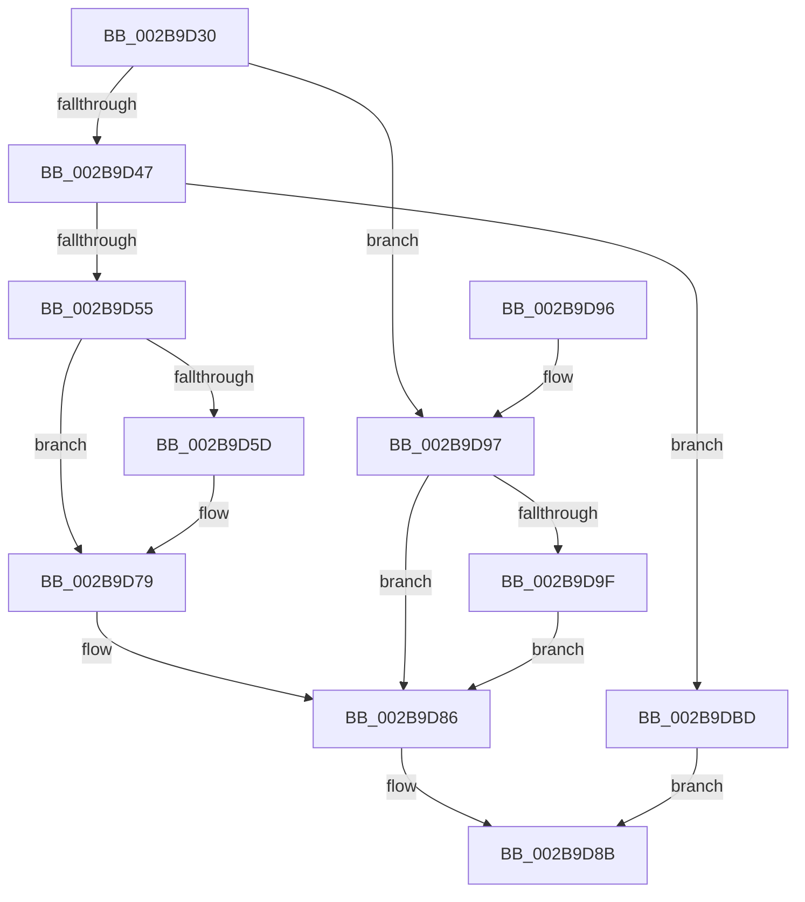

# MiRelinkStandbyPage

- RVA: `0x002B9D30`–`0x002B9E2D` (길이 `253` bytes)
- VA: `0x00000001402B9D30`
- 실행 섹션: `.text`
- PDB 이름 있음: `예`; PDB Function 태그: `아니요`
- unwind 정보 RVA: `0x0006DD14`
- 디코드: `70`개 명령, `253/253` bytes 표시
- 미해석 바이트: `0` (있으면 어셈블리에 `.byte`로 보존)

> 이 문서는 커널 이미지의 기계어와 PDB 기호를 분석해 생성했습니다. 4번과 5번은 함수 원형과 자료형을 바이너리 사용 방식에서 추정한 C 해석이며 원본 소스 복구 결과는 아닙니다.

## 1. Dependencies

- 직접 호출 지점: **5**; 고유 호출 대상: **5**
- 직접 호출자로 확인된 함수: **5**
- RIP 상대 이미지 참조: **0**

### Outgoing calls
- `0x002B9D4C` → [MiUnlinkPageFromListEx](../28/MiUnlinkPageFromListEx_function_00287590.md) (function, `0x00287590`)
- `0x002B9D81` → [MiInsertPageInList](MiInsertPageInList_function_002BA000.md) (function, `0x002BA000`)
- `0x002B9DC2` → [MiRestoreTransitionPte](../33/MiRestoreTransitionPte_function_0033DD90.md) (function, `0x0033DD90`)
- `0x002B9DCA` → [MiClearPfnReuseFields](../37/MiClearPfnReuseFields_function_003759F0.md) (function, `0x003759F0`)
- `0x002B9E21` → [MiInsertPageInFreeOrZeroedList](../33/MiInsertPageInFreeOrZeroedList_function_00334D20.md) (function, `0x00334D20`)

### Direct callers
- [MiResolveTransitionFault](../28/MiResolveTransitionFault_function_00282940.md) at `0x002834CE`
- [MiUpdatePfnPriority](MiUpdatePfnPriority_function_002B8570.md) at `0x002B871E`
- [MiEmptyDecayClusterTimers](../2D/MiEmptyDecayClusterTimers_function_002DAB50.md) at `0x002DADD0`
- [MmSetPfnListInfo](../31/MmSetPfnListInfo_function_0031D61C.md) at `0x0031D809`
- [MiUpdatePfnForPrefetchByPte](../32/MiUpdatePfnForPrefetchByPte_function_00321210.md) at `0x003214CA`

### Static image references
- 디코드된 RIP-relative 메모리 참조가 없습니다.

## 2. Other-region calls and transfers

- 다른 실행 섹션으로 향하는 call: **0**
- 별도 외부 분기/꼬리 이동을 확인하지 못했습니다.

## 3. Assembly (complete function range)

```asm
002B9D30  48 89 5C 24 10                  mov qword ptr [rsp + 0x10], rbx
002B9D35  57                              push rdi
002B9D36  48 83 EC 20                     sub rsp, 0x20
002B9D3A  8B 41 20                        mov eax, dword ptr [rcx + 0x20]
002B9D3D  8B DA                           mov ebx, edx
002B9D3F  48 8B F9                        mov rdi, rcx
002B9D42  66 85 C0                        test ax, ax
002B9D45  75 50                           jne 0x1402b9d97
002B9D47  BA 04 00 00 00                  mov edx, 4
002B9D4C  E8 3F D8 FC FF                  call 0x140287590
002B9D51  A8 03                           test al, 3
002B9D53  75 68                           jne 0x1402b9dbd
002B9D55  81 FB FF FF FF 00               cmp ebx, 0xffffff
002B9D5B  74 1C                           je 0x1402b9d79
002B9D5D  8B 47 20                        mov eax, dword ptr [rdi + 0x20]
002B9D60  89 44 24 30                     mov dword ptr [rsp + 0x30], eax
002B9D64  C1 E8 18                        shr eax, 0x18
002B9D67  32 D8                           xor bl, al
002B9D69  80 E3 07                        and bl, 7
002B9D6C  32 D8                           xor bl, al
002B9D6E  88 5C 24 33                     mov byte ptr [rsp + 0x33], bl
002B9D72  8B 44 24 30                     mov eax, dword ptr [rsp + 0x30]
002B9D76  89 47 20                        mov dword ptr [rdi + 0x20], eax
002B9D79  BA 04 00 00 00                  mov edx, 4
002B9D7E  48 8B CF                        mov rcx, rdi
002B9D81  E8 7A 02 00 00                  call 0x1402ba000
002B9D86  B8 01 00 00 00                  mov eax, 1
002B9D8B  48 8B 5C 24 38                  mov rbx, qword ptr [rsp + 0x38]
002B9D90  48 83 C4 20                     add rsp, 0x20
002B9D94  5F                              pop rdi
002B9D95  C3                              ret
002B9D96  CC                              int3
002B9D97  81 FB FF FF FF 00               cmp ebx, 0xffffff
002B9D9D  74 E7                           je 0x1402b9d86
002B9D9F  8B 41 20                        mov eax, dword ptr [rcx + 0x20]
002B9DA2  89 44 24 30                     mov dword ptr [rsp + 0x30], eax
002B9DA6  C1 E8 18                        shr eax, 0x18
002B9DA9  32 D8                           xor bl, al
002B9DAB  80 E3 07                        and bl, 7
002B9DAE  32 D8                           xor bl, al
002B9DB0  88 5C 24 33                     mov byte ptr [rsp + 0x33], bl
002B9DB4  8B 44 24 30                     mov eax, dword ptr [rsp + 0x30]
002B9DB8  89 41 20                        mov dword ptr [rcx + 0x20], eax
002B9DBB  EB C9                           jmp 0x1402b9d86
002B9DBD  33 D2                           xor edx, edx
002B9DBF  48 8B CF                        mov rcx, rdi
002B9DC2  E8 C9 3F 08 00                  call 0x14033dd90
002B9DC7  48 8B CF                        mov rcx, rdi
002B9DCA  E8 21 BC 0B 00                  call 0x1403759f0
002B9DCF  8B 47 20                        mov eax, dword ptr [rdi + 0x20]
002B9DD2  48 B9 00 00 00 00 00 00 00 40   movabs rcx, 0x4000000000000000
002B9DDC  89 44 24 30                     mov dword ptr [rsp + 0x30], eax
002B9DE0  C1 E8 10                        shr eax, 0x10
002B9DE3  24 FD                           and al, 0xfd
002B9DE5  0C 05                           or al, 5
002B9DE7  88 44 24 32                     mov byte ptr [rsp + 0x32], al
002B9DEB  8B 44 24 30                     mov eax, dword ptr [rsp + 0x30]
002B9DEF  89 47 20                        mov dword ptr [rdi + 0x20], eax
002B9DF2  48 8B 47 18                     mov rax, qword ptr [rdi + 0x18]
002B9DF6  48 0B C1                        or rax, rcx
002B9DF9  48 89 47 18                     mov qword ptr [rdi + 0x18], rax
002B9DFD  48 B8 00 00 00 00 00 DE FF FF   movabs rax, 0xffffde0000000000
002B9E07  48 2B F8                        sub rdi, rax
002B9E0A  48 B9 AB AA AA AA AA AA AA AA   movabs rcx, 0xaaaaaaaaaaaaaaab
002B9E14  48 C1 FF 04                     sar rdi, 4
002B9E18  BA 02 00 00 00                  mov edx, 2
002B9E1D  48 0F AF CF                     imul rcx, rdi
002B9E21  E8 FA AE 07 00                  call 0x140334d20
002B9E26  33 C0                           xor eax, eax
002B9E28  E9 5E FF FF FF                  jmp 0x1402b9d8b
```

## 4. C-style interpretation (structured pseudocode)

```c
__int64 __fastcall MiRelinkStandbyPage(__int64 a1, int a2)
{
    __int64 result;
    __int64 v_rbx;
    __int64 v_rdi;
    __int64 v_rsp;
    unsigned __int64 v_stack_p10;
    unsigned int v_stack_p30;
    unsigned __int8 v_stack_p32;
    unsigned __int8 v_stack_p33;
    unsigned int v_stack_p8;
    unsigned __int8 v_stack_pB;

    v_stack_p10 = v_rbx;
    v_rsp = (v_rsp) - (32);
    if ((unsigned __int16)((unsigned int)(*(unsigned int *)(a1 + 32))) != 0) goto loc_002B9D97;
    result = MiUnlinkPageFromListEx(a1, 4, a3, a4);
    if ((((unsigned __int8)(result)) & (3)) != 0) goto loc_002B9DBD;
    v_rbx = (unsigned int)(a2);
    if (((unsigned int)((unsigned int)(a2))) != 0xFFFFFFULL) {
        result = *(unsigned int *)(a1 + 32);
        v_stack_p8 = (unsigned int)(result);
        result = (unsigned int)((result) >> (24));
        v_rbx = (unsigned __int8)(((unsigned int)(a2)) ^ ((unsigned __int8)(result)));
        v_rbx = (unsigned __int8)((v_rbx) & (7));
        v_rbx = (unsigned __int8)((v_rbx) ^ ((unsigned __int8)(result)));
        v_stack_pB = (unsigned __int8)(v_rbx);
        result = v_stack_p8;
        *(unsigned int *)(a1 + 32) = (unsigned int)(result);
    }
    result = MiInsertPageInList(a1, 4, a3, a4);
loc_002B9D86:
loc_002B9D8B:
    v_rsp = (v_rsp) + (32);
    return 1;
loc_002B9D97:
    if (((unsigned int)(v_stack_p10)) == 0xFFFFFFULL) goto loc_002B9D86;
    v_stack_p30 = (unsigned int)((unsigned int)(*(unsigned int *)(a1 + 32)));
    result = (unsigned int)(((unsigned int)(*(unsigned int *)(a1 + 32))) >> (24));
    v_rbx = (unsigned __int8)((v_stack_p10) ^ ((unsigned __int8)(result)));
    v_rbx = (unsigned __int8)((v_rbx) & (7));
    v_rbx = (unsigned __int8)((v_rbx) ^ ((unsigned __int8)(result)));
    v_stack_p33 = (unsigned __int8)(v_rbx);
    *(unsigned int *)(a1 + 32) = (unsigned int)((unsigned int)(v_stack_p30));
    goto loc_002B9D86;
loc_002B9DBD:
    a2 = 0;
    result = MiRestoreTransitionPte(a1, a2, a3, a4);
    result = MiClearPfnReuseFields(a1, a2, a3, a4);
    v_stack_p30 = (unsigned int)((unsigned int)(*(unsigned int *)(a1 + 32)));
    result = (unsigned int)(((unsigned int)(*(unsigned int *)(a1 + 32))) >> (16));
    result = (unsigned __int8)((result) & (253));
    result = (unsigned __int8)((result) | (5));
    v_stack_p32 = (unsigned __int8)(result);
    *(unsigned int *)(a1 + 32) = (unsigned int)((unsigned int)(v_stack_p30));
    result = (*(unsigned __int64 *)(a1 + 24)) | (a1);
    *(unsigned __int64 *)(a1 + 24) = result;
    v_rdi = (a1) - (result);
    v_rdi = (v_rdi) >> (4);
    a1 = (a1) * (v_rdi);
    result = MiInsertPageInFreeOrZeroedList(a1, 2, a3, a4);
    result = 0;
    goto loc_002B9D8B;
}
```

## 5. (Beta) C Style

```c
int64_t MiRelinkStandbyPage(void *Arg1, int32_t Arg2)
{
    uint8_t *arg1 = (uint8_t *)Arg1;

    int64_t result;
    int64_t local_rbx;
    int64_t local_rdi;
    int64_t local_rsp;
    uint64_t v_stack_p10;
    uint32_t v_stack_p30;
    uint8_t v_stack_p32;
    uint8_t v_stack_p33;
    uint32_t v_stack_p8;
    uint8_t v_stack_pB;

    v_stack_p10 = local_rbx;
    local_rsp = (local_rsp) - (32);
    if ((uint16_t)((uint32_t)(*(uint32_t *)(arg1 + 0x20))) != 0) goto loc_002B9D97;
    result = MiUnlinkPageFromListEx(Arg1, 4, a3, a4);
    if ((((uint8_t)(result)) & (3)) != 0) goto loc_002B9DBD;
    local_rbx = (uint32_t)(Arg2);
    if (((uint32_t)((uint32_t)(Arg2))) != 0xFFFFFFULL) {
        result = *(uint32_t *)(arg1 + 0x20);
        v_stack_p8 = (uint32_t)(result);
        result = (uint32_t)((result) >> (24));
        local_rbx = (uint8_t)(((uint32_t)(Arg2)) ^ ((uint8_t)(result)));
        local_rbx = (uint8_t)((local_rbx) & (7));
        local_rbx = (uint8_t)((local_rbx) ^ ((uint8_t)(result)));
        v_stack_pB = (uint8_t)(local_rbx);
        result = v_stack_p8;
        *(uint32_t *)(arg1 + 0x20) = (uint32_t)(result);
    }
    result = MiInsertPageInList(Arg1, 4, a3, a4);
loc_002B9D86:
loc_002B9D8B:
    local_rsp = (local_rsp) + (32);
    return 1;
loc_002B9D97:
    if (((uint32_t)(v_stack_p10)) == 0xFFFFFFULL) goto loc_002B9D86;
    v_stack_p30 = (uint32_t)((uint32_t)(*(uint32_t *)(arg1 + 0x20)));
    result = (uint32_t)(((uint32_t)(*(uint32_t *)(arg1 + 0x20))) >> (24));
    local_rbx = (uint8_t)((v_stack_p10) ^ ((uint8_t)(result)));
    local_rbx = (uint8_t)((local_rbx) & (7));
    local_rbx = (uint8_t)((local_rbx) ^ ((uint8_t)(result)));
    v_stack_p33 = (uint8_t)(local_rbx);
    *(uint32_t *)(arg1 + 0x20) = (uint32_t)((uint32_t)(v_stack_p30));
    goto loc_002B9D86;
loc_002B9DBD:
    Arg2 = 0;
    result = MiRestoreTransitionPte(Arg1, Arg2, a3, a4);
    result = MiClearPfnReuseFields(Arg1, Arg2, a3, a4);
    v_stack_p30 = (uint32_t)((uint32_t)(*(uint32_t *)(arg1 + 0x20)));
    result = (uint32_t)(((uint32_t)(*(uint32_t *)(arg1 + 0x20))) >> (16));
    result = (uint8_t)((result) & (253));
    result = (uint8_t)((result) | (5));
    v_stack_p32 = (uint8_t)(result);
    *(uint32_t *)(arg1 + 0x20) = (uint32_t)((uint32_t)(v_stack_p30));
    result = (*(uint64_t *)(arg1 + 0x18)) | (Arg1);
    *(uint64_t *)(arg1 + 0x18) = result;
    local_rdi = (Arg1) - (result);
    local_rdi = (local_rdi) >> (4);
    Arg1 = (Arg1) * (local_rdi);
    result = MiInsertPageInFreeOrZeroedList(Arg1, 2, a3, a4);
    result = 0;
    goto loc_002B9D8B;
}
```

### 관측된 메모리 오프셋

구조체 형식이 확인되지 않은 접근은 인자 기준의 오프셋으로만 기록했습니다.

| 기준 인자 | 오프셋 표현 | 폭 (bit) | 접근 |
|---|---:|---:|---|
| `Arg1` | `+ 0x18` | `64` | `R` |
| `Arg1` | `+ 0x18` | `64` | `W` |
| `Arg1` | `+ 0x20` | `32` | `R` |
| `Arg1` | `+ 0x20` | `32` | `W` |

## 6. Execution-region graph

[열기: 2D/3D 그래프와 함수 탐색 컨트롤 패널](../../../control-panel.html?section=text&rva=0x002B9D30&view=graph)

- 2D 그래프는 위에서 아래로 흐르고, 3D 그래프는 빈 공간을 드래그해 회전합니다. Shift+드래그는 이동, 휠은 확대·축소, 함수 노드 선택은 대상 보고서 이동입니다.

### Static fallback


