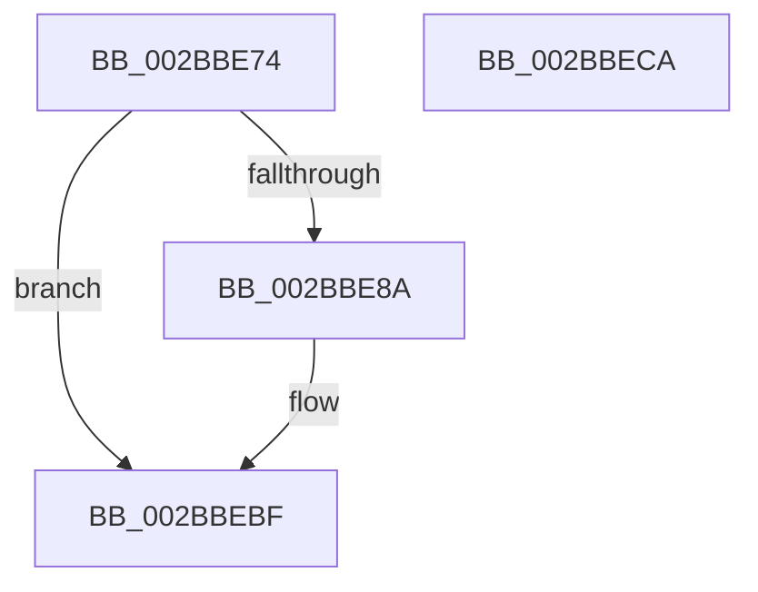

# MiRemoveUnusedSegment

- RVA: `0x002BBE74`–`0x002BBECB` (길이 `87` bytes)
- VA: `0x00000001402BBE74`
- 실행 섹션: `.text`
- PDB 이름 있음: `예`; PDB Function 태그: `아니요`
- unwind 정보 RVA: `0x0005CAAC`
- 디코드: `22`개 명령, `87/87` bytes 표시
- 미해석 바이트: `0` (있으면 어셈블리에 `.byte`로 보존)

> 이 문서는 커널 이미지의 기계어와 PDB 기호를 분석해 생성했습니다. 4번과 5번은 함수 원형과 자료형을 바이너리 사용 방식에서 추정한 C 해석이며 원본 소스 복구 결과는 아닙니다.

## 1. Dependencies

- 직접 호출 지점: **3**; 고유 호출 대상: **3**
- 직접 호출자로 확인된 함수: **10**
- RIP 상대 이미지 참조: **1**

### Outgoing calls
- `0x002BBEA6` → [ExAcquireSpinLockExclusiveAtDpcLevel](../24/ExAcquireSpinLockExclusiveAtDpcLevel_function_00248E80.md) (function, `0x00248E80`)
- `0x002BBEAE` → [MiUnlinkUnusedControlArea](../4E/MiUnlinkUnusedControlArea_function_004ED9F8.md) (function, `0x004ED9F8`)
- `0x002BBEBA` → [ExReleaseSpinLockExclusiveFromDpcLevel](../24/ExReleaseSpinLockExclusiveFromDpcLevel_function_002497E0.md) (function, `0x002497E0`)

### Direct callers
- [MiEntireSubsectionIsPurged](../29/MiEntireSubsectionIsPurged_function_00297C04.md) at `0x00297CB0`
- [MiAttemptSectionDelete](../2A/MiAttemptSectionDelete_function_002AD044.md) at `0x002AD0B4`
- [MiReferencePfBackedSection](MiReferencePfBackedSection_function_002B9B70.md) at `0x002B9C85`
- [sub_002BBACF](Unknown_function_002BBACF.md) at `0x002BBB2D`
- [sub_002BBDCA](Unknown_function_002BBDCA.md) at `0x002BBDDC`
- [MiReferenceControlArea](MiReferenceControlArea_function_002BC198.md) at `0x002BC2A6`
- [MiReferenceExistingControlArea](MiReferenceExistingControlArea_function_002BDE64.md) at `0x002BDF19`
- [MmGetImageFileSignatureInformation](../45/MmGetImageFileSignatureInformation_function_004582B0.md) at `0x004582EF`
- [MiPrepareSegmentForDeletion](../46/MiPrepareSegmentForDeletion_function_004630A8.md) at `0x004630ED`
- [MiSetDeleteOnClose](../4D/MiSetDeleteOnClose_function_004DD8E8.md) at `0x004DD926`

### Static image references
- `0x002BBE8E` → RVA `0x00E30088` (`.data`; read)

## 2. Other-region calls and transfers

- 다른 실행 섹션으로 향하는 call: **0**
- 별도 외부 분기/꼬리 이동을 확인하지 못했습니다.

## 3. Assembly (complete function range)

```asm
002BBE74  48 89 5C 24 08                  mov qword ptr [rsp + 8], rbx
002BBE79  57                              push rdi
002BBE7A  48 83 EC 20                     sub rsp, 0x20
002BBE7E  8B 41 38                        mov eax, dword ptr [rcx + 0x38]
002BBE81  48 8B F9                        mov rdi, rcx
002BBE84  0F BA E0 1C                     bt eax, 0x1c
002BBE88  73 35                           jae 0x1402bbebf
002BBE8A  0F B7 51 3C                     movzx edx, word ptr [rcx + 0x3c]
002BBE8E  48 8B 05 F3 41 B7 00            mov rax, qword ptr [rip + 0xb741f3]
002BBE95  81 E2 FF 03 00 00               and edx, 0x3ff
002BBE9B  48 8B 1C D0                     mov rbx, qword ptr [rax + rdx*8]
002BBE9F  48 8D 8B C0 06 00 00            lea rcx, [rbx + 0x6c0]
002BBEA6  E8 D5 CF F8 FF                  call 0x140248e80
002BBEAB  48 8B CF                        mov rcx, rdi
002BBEAE  E8 45 1B 23 00                  call 0x1404ed9f8
002BBEB3  48 8D 8B C0 06 00 00            lea rcx, [rbx + 0x6c0]
002BBEBA  E8 21 D9 F8 FF                  call 0x1402497e0
002BBEBF  48 8B 5C 24 30                  mov rbx, qword ptr [rsp + 0x30]
002BBEC4  48 83 C4 20                     add rsp, 0x20
002BBEC8  5F                              pop rdi
002BBEC9  C3                              ret
002BBECA  CC                              int3
```

## 4. C-style interpretation (structured pseudocode)

```c
__int64 __fastcall MiRemoveUnusedSegment(__int64 a1)
{
    __int64 result;
    __int64 v_rbx;
    __int64 v_rsp;
    unsigned __int64 v_stack_p8;

    v_stack_p8 = v_rbx;
    v_rsp = (v_rsp) - (32);
    result = (unsigned int)(*(unsigned int *)(a1 + 56));
    if (!(condition_is_above_or_equal)) {
        a2 = *(unsigned __int16 *)(a1 + 60);
        result = *(unsigned __int64 *)(v_rip + 12009971);
        a2 = (unsigned int)((a2) & (0x3FFULL));
        v_rbx = *(unsigned __int64 *)(result + a2 * 8);
        a1 = v_rbx + 1728;
        result = ExAcquireSpinLockExclusiveAtDpcLevel(a1, a2, a3, a4);
        a1 = a1;
        result = MiUnlinkUnusedControlArea(a1, a2, a3, a4);
        a1 = v_rbx + 1728;
        result = ExReleaseSpinLockExclusiveFromDpcLevel(a1, a2, a3, a4);
    }
    v_rsp = (v_rsp) + (32);
    return result;
}
```

## 5. (Beta) C Style

```c
int64_t MiRemoveUnusedSegment(void *Arg1)
{
    uint8_t *arg1 = (uint8_t *)Arg1;

    int64_t result;
    int64_t local_rbx;
    int64_t local_rsp;
    uint64_t v_stack_p8;

    v_stack_p8 = local_rbx;
    local_rsp = (local_rsp) - (32);
    result = (uint32_t)(*(uint32_t *)(arg1 + 0x38));
    if (!(condition_is_above_or_equal)) {
        a2 = *(uint16_t *)(arg1 + 0x3C);
        result = *(uint64_t *)(v_rip + 0xB741F3);
        a2 = (uint32_t)((a2) & (0x3FFULL));
        local_rbx = *(uint64_t *)(result + a2 * 8);
        Arg1 = local_rbx + 1728;
        result = ExAcquireSpinLockExclusiveAtDpcLevel(Arg1, a2, a3, a4);
        Arg1 = Arg1;
        result = MiUnlinkUnusedControlArea(Arg1, a2, a3, a4);
        Arg1 = local_rbx + 1728;
        result = ExReleaseSpinLockExclusiveFromDpcLevel(Arg1, a2, a3, a4);
    }
    local_rsp = (local_rsp) + (32);
    return result;
}
```

### 관측된 메모리 오프셋

구조체 형식이 확인되지 않은 접근은 인자 기준의 오프셋으로만 기록했습니다.

| 기준 인자 | 오프셋 표현 | 폭 (bit) | 접근 |
|---|---:|---:|---|
| `Arg1` | `+ 0x38` | `32` | `R` |
| `Arg1` | `+ 0x3C` | `16` | `R` |

## 6. Execution-region graph

[열기: 2D/3D 그래프와 함수 탐색 컨트롤 패널](../../../control-panel.html?section=text&rva=0x002BBE74&view=graph)

- 2D 그래프는 위에서 아래로 흐르고, 3D 그래프는 빈 공간을 드래그해 회전합니다. Shift+드래그는 이동, 휠은 확대·축소, 함수 노드 선택은 대상 보고서 이동입니다.

### Static fallback


