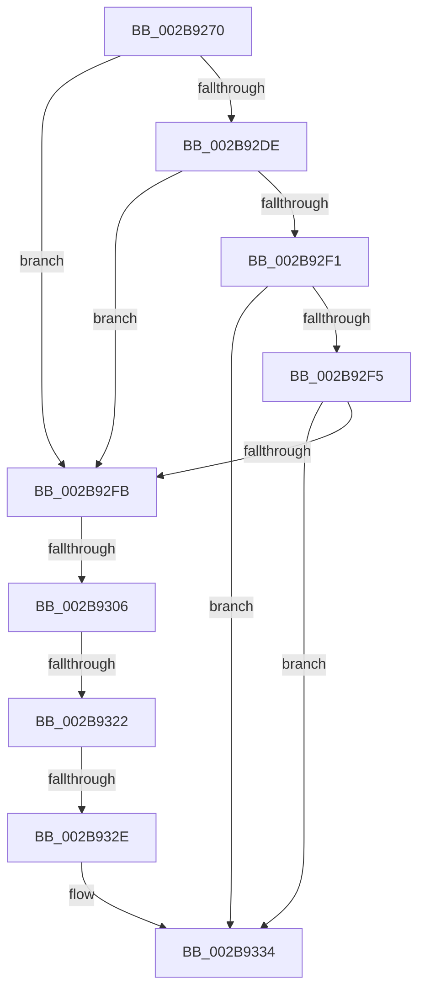

# MiReplaceSecondaryListStandbyPage

- RVA: `0x002B9270`–`0x002B933E` (길이 `206` bytes)
- VA: `0x00000001402B9270`
- 실행 섹션: `.text`
- PDB 이름 있음: `예`; PDB Function 태그: `아니요`
- unwind 정보 RVA: `0x0006DC04`
- 디코드: `51`개 명령, `206/206` bytes 표시
- 미해석 바이트: `0` (있으면 어셈블리에 `.byte`로 보존)

> 이 문서는 커널 이미지의 기계어와 PDB 기호를 분석해 생성했습니다. 4번과 5번은 함수 원형과 자료형을 바이너리 사용 방식에서 추정한 C 해석이며 원본 소스 복구 결과는 아닙니다.

## 1. Dependencies

- 직접 호출 지점: **0**; 고유 호출 대상: **0**
- 직접 호출자로 확인된 함수: **1**
- RIP 상대 이미지 참조: **5**

### Outgoing calls
- 직접 디코드된 call 명령이 없습니다.

### Direct callers
- [MiReplaceTransitionPage](MiReplaceTransitionPage_function_002B1120.md) at `0x002B1522`

### Static image references
- `0x002B92BF` → RVA `0x00E2DBC0` (`.data`; read)
- `0x002B92C9` → RVA `0x00E2DBC4` (`.data`; read)
- `0x002B92E5` → RVA `0x00E2DC20` (`.data`; read)
- `0x002B932E` → RVA `0x00E2DBC0` (`.data`; write)
- `0x002B9334` → RVA `0x00E2DC28` (`.data`; read)

## 2. Other-region calls and transfers

- 다른 실행 섹션으로 향하는 call: **0**
- call이 아닌 외부 분기/꼬리 이동: **3**
  - `0x002B9300` → [sub_002B9816](Unknown_function_002B9816.md) (`tail-transfer`)
  - `0x002B931C` → [sub_002B99D7](Unknown_function_002B99D7.md) (`tail-transfer`)
  - `0x002B9328` → [sub_002B98CB](Unknown_function_002B98CB.md) (`tail-transfer`)

## 3. Assembly (complete function range)

```asm
002B9270  48 89 5C 24 20                  mov qword ptr [rsp + 0x20], rbx
002B9275  44 89 44 24 18                  mov dword ptr [rsp + 0x18], r8d
002B927A  57                              push rdi
002B927B  41 54                           push r12
002B927D  41 55                           push r13
002B927F  41 56                           push r14
002B9281  41 57                           push r15
002B9283  48 81 EC C0 00 00 00            sub rsp, 0xc0
002B928A  0F 57 C0                        xorps xmm0, xmm0
002B928D  4D 63 E9                        movsxd r13, r9d
002B9290  0F 11 44 24 30                  movups xmmword ptr [rsp + 0x30], xmm0
002B9295  4C 8B FA                        mov r15, rdx
002B9298  4C 8B E1                        mov r12, rcx
002B929B  0F 11 44 24 40                  movups xmmword ptr [rsp + 0x40], xmm0
002B92A0  49 BA 00 00 00 00 00 DE FF FF   movabs r10, 0xffffde0000000000
002B92AA  0F 11 44 24 50                  movups xmmword ptr [rsp + 0x50], xmm0
002B92AF  49 8B C2                        mov rax, r10
002B92B2  4C 8B F1                        mov r14, rcx
002B92B5  48 BB AB AA AA AA AA AA AA AA   movabs rbx, 0xaaaaaaaaaaaaaaab
002B92BF  48 63 0D FA 48 B7 00            movsxd rcx, dword ptr [rip + 0xb748fa]
002B92C6  4C 2B F0                        sub r14, rax
002B92C9  8B 05 F5 48 B7 00               mov eax, dword ptr [rip + 0xb748f5]
002B92CF  45 33 C9                        xor r9d, r9d
002B92D2  49 C1 FE 04                     sar r14, 4
002B92D6  4C 0F AF F3                     imul r14, rbx
002B92DA  3B C8                           cmp ecx, eax
002B92DC  77 1D                           ja 0x1402b92fb
002B92DE  48 8B F9                        mov rdi, rcx
002B92E1  48 C1 E7 04                     shl rdi, 4
002B92E5  48 03 3D 34 49 B7 00            add rdi, qword ptr [rip + 0xb74934]
002B92EC  4C 3B 37                        cmp r14, qword ptr [rdi]
002B92EF  72 0A                           jb 0x1402b92fb
002B92F1  3B C8                           cmp ecx, eax
002B92F3  74 3F                           je 0x1402b9334
002B92F5  4C 3B 77 10                     cmp r14, qword ptr [rdi + 0x10]
002B92F9  72 39                           jb 0x1402b9334
002B92FB  41 8B C9                        mov ecx, r9d
002B92FE  3B C1                           cmp eax, ecx
002B9300  0F 8C 10 05 00 00               jl 0x1402b9816
002B9306  8D 14 01                        lea edx, [rcx + rax]
002B9309  D1 FA                           sar edx, 1
002B930B  48 63 FA                        movsxd rdi, edx
002B930E  48 C1 E7 04                     shl rdi, 4
002B9312  48 03 3D 07 49 B7 00            add rdi, qword ptr [rip + 0xb74907]
002B9319  4C 3B 37                        cmp r14, qword ptr [rdi]
002B931C  0F 82 B5 06 00 00               jb 0x1402b99d7
002B9322  3B 15 9C 48 B7 00               cmp edx, dword ptr [rip + 0xb7489c]
002B9328  0F 85 9D 05 00 00               jne 0x1402b98cb
002B932E  89 15 8C 48 B7 00               mov dword ptr [rip + 0xb7488c], edx
002B9334  4C 39 0D ED 48 B7 00            cmp qword ptr [rip + 0xb748ed], r9
002B933B  8B 7F 08                        mov edi, dword ptr [rdi + 8]
```

## 4. C-style interpretation (structured pseudocode)

```c
__int64 __fastcall MiReplaceSecondaryListStandbyPage(__int64 a1, __int64 a2, int a3, int a4)
{
    __int64 v_r14;
    __int64 v_rdi;
    __int64 v_rsp;
    unsigned __int64 v_stack_m98;
    unsigned __int64 v_stack_mA8;
    unsigned __int64 v_stack_mB8;
    unsigned int v_stack_p18;
    unsigned __int64 v_stack_p20;

    v_stack_p20 = v_rbx;
    v_stack_p18 = a3;
    v_rsp = (v_rsp) - (192);
    v_stack_mB8 = v_xmm0;
    v_stack_mA8 = v_xmm0;
    v_stack_m98 = v_xmm0;
    v_r14 = (a1) - (v_r10);
    a4 = 0;
    v_r14 = (v_r14) >> (4);
    v_r14 = (v_r14) * (v_rbx);
    if (((unsigned int)((int)(*(unsigned int *)(v_rip + 12011770)))) > ((unsigned int)((unsigned int)(*(unsigned int *)(v_rip + 12011765))))) goto loc_002B92FB;
    v_rdi = ((int)(*(unsigned int *)(v_rip + 12011770))) << (4);
    v_rdi = (v_rdi) + (*(unsigned __int64 *)(v_rip + 12011828));
    if (v_r14 < (*(unsigned __int64 *)(v_rdi))) goto loc_002B92FB;
    if (((unsigned int)((int)(*(unsigned int *)(v_rip + 12011770)))) == ((unsigned int)((unsigned int)(*(unsigned int *)(v_rip + 12011765))))) goto loc_002B9334;
    if (v_r14 < (*(unsigned __int64 *)(v_rdi + 16))) goto loc_002B9334;
loc_002B92FB:
    a2 = (unsigned int)((0 + (unsigned int)(*(unsigned int *)(v_rip + 12011765)) * 1) >> (1));
    v_rdi = ((int)((unsigned int)(a2))) << (4);
    v_rdi = (v_rdi) + (*(unsigned __int64 *)(v_rip + 12011783));
    *(unsigned int *)(v_rip + 12011660) = (unsigned int)(a2);
loc_002B9334:
    return (unsigned int)(*(unsigned int *)(v_rip + 12011765));
}
```

## 5. (Beta) C Style

```c
int64_t MiReplaceSecondaryListStandbyPage(int64_t Arg1, int64_t Arg2, int32_t Arg3, int32_t Arg4)
{
    int64_t local_r14;
    int64_t local_rdi;
    int64_t local_rsp;
    uint64_t v_stack_m98;
    uint64_t v_stack_mA8;
    uint64_t v_stack_mB8;
    uint32_t v_stack_p18;
    uint64_t v_stack_p20;

    v_stack_p20 = local_rbx;
    v_stack_p18 = Arg3;
    local_rsp = (local_rsp) - (192);
    v_stack_mB8 = v_xmm0;
    v_stack_mA8 = v_xmm0;
    v_stack_m98 = v_xmm0;
    local_r14 = (Arg1) - (local_r10);
    Arg4 = 0;
    local_r14 = (local_r14) >> (4);
    local_r14 = (local_r14) * (local_rbx);
    if (((uint32_t)((int32_t)(*(uint32_t *)(v_rip + 0xB748FA)))) > ((uint32_t)((uint32_t)(*(uint32_t *)(v_rip + 0xB748F5))))) goto loc_002B92FB;
    local_rdi = ((int32_t)(*(uint32_t *)(v_rip + 0xB748FA))) << (4);
    local_rdi = (local_rdi) + (*(uint64_t *)(v_rip + 0xB74934));
    if (local_r14 < (*(uint64_t *)(local_rdi))) goto loc_002B92FB;
    if (((uint32_t)((int32_t)(*(uint32_t *)(v_rip + 0xB748FA)))) == ((uint32_t)((uint32_t)(*(uint32_t *)(v_rip + 0xB748F5))))) goto loc_002B9334;
    if (local_r14 < (*(uint64_t *)(local_rdi + 0x10))) goto loc_002B9334;
loc_002B92FB:
    Arg2 = (uint32_t)((0 + (uint32_t)(*(uint32_t *)(v_rip + 0xB748F5)) * 1) >> (1));
    local_rdi = ((int32_t)((uint32_t)(Arg2))) << (4);
    local_rdi = (local_rdi) + (*(uint64_t *)(v_rip + 0xB74907));
    *(uint32_t *)(v_rip + 0xB7488C) = (uint32_t)(Arg2);
loc_002B9334:
    return (uint32_t)(*(uint32_t *)(v_rip + 0xB748F5));
}
```

## 6. Execution-region graph

[열기: 2D/3D 그래프와 함수 탐색 컨트롤 패널](../../../control-panel.html?section=text&rva=0x002B9270&view=graph)

- 2D 그래프는 위에서 아래로 흐르고, 3D 그래프는 빈 공간을 드래그해 회전합니다. Shift+드래그는 이동, 휠은 확대·축소, 함수 노드 선택은 대상 보고서 이동입니다.

### Static fallback


