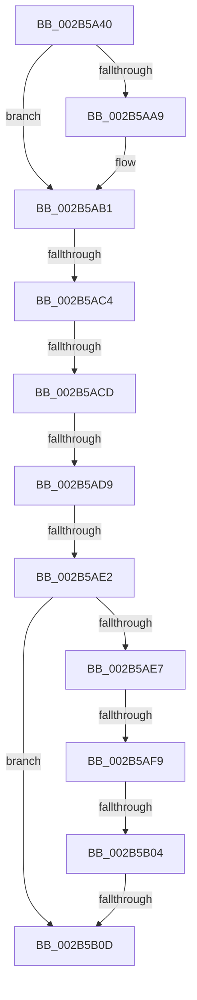

# MiResolveDemandZeroFault

- RVA: `0x002B5A40`–`0x002B5B1B` (길이 `219` bytes)
- VA: `0x00000001402B5A40`
- 실행 섹션: `.text`
- PDB 이름 있음: `예`; PDB Function 태그: `아니요`
- unwind 정보 RVA: `0x0006D888`
- 디코드: `56`개 명령, `219/219` bytes 표시
- 미해석 바이트: `0` (있으면 어셈블리에 `.byte`로 보존)

> 이 문서는 커널 이미지의 기계어와 PDB 기호를 분석해 생성했습니다. 4번과 5번은 함수 원형과 자료형을 바이너리 사용 방식에서 추정한 C 해석이며 원본 소스 복구 결과는 아닙니다.

## 1. Dependencies

- 직접 호출 지점: **1**; 고유 호출 대상: **1**
- 직접 호출자로 확인된 함수: **4**
- RIP 상대 이미지 참조: **1**

### Outgoing calls
- `0x002B5A7B` → [MI_READ_PTE_LOCK_FREE](../28/MI_READ_PTE_LOCK_FREE_function_002828A0.md) (function, `0x002828A0`)

### Direct callers
- [sub_00320866](../32/Unknown_function_00320866.md) at `0x00320AEA`
- [MiResolveProtoPteFault](../32/MiResolveProtoPteFault_function_00321750.md) at `0x00321F0C`
- [MiResolveProtoPteFault](../32/MiResolveProtoPteFault_function_00321750.md) at `0x00321FE6`
- [MiUserFault](../32/MiUserFault_function_00329840.md) at `0x00329FFD`
- [MiSystemFault](../34/MiSystemFault_function_0034AA64.md) at `0x0034AF6B`

### Static image references
- `0x002B5A53` → RVA `0x00E0A740` (`.data`; read)

## 2. Other-region calls and transfers

- 다른 실행 섹션으로 향하는 call: **0**
- call이 아닌 외부 분기/꼬리 이동: **7**
  - `0x002B5ABE` → [sub_002B5CFD](Unknown_function_002B5CFD.md) (`tail-transfer`)
  - `0x002B5AC7` → [sub_002B5F67 + 0x12](Unknown_function_002B5F67.md) (`tail-transfer`)
  - `0x002B5AD3` → [sub_002B5CFD + 0x37](Unknown_function_002B5CFD.md) (`tail-transfer`)
  - `0x002B5ADC` → [sub_002B5CFD + 0x1E](Unknown_function_002B5CFD.md) (`tail-transfer`)
  - `0x002B5AF3` → [sub_002B5F1B + 0x2B](Unknown_function_002B5F1B.md) (`tail-transfer`)
  - `0x002B5AFE` → [sub_002B5F1B](Unknown_function_002B5F1B.md) (`tail-transfer`)
  - `0x002B5B07` → [sub_002B5F1B + 0xD](Unknown_function_002B5F1B.md) (`tail-transfer`)

## 3. Assembly (complete function range)

```asm
002B5A40  40 55                           push rbp
002B5A42  53                              push rbx
002B5A43  56                              push rsi
002B5A44  57                              push rdi
002B5A45  41 54                           push r12
002B5A47  48 8D 6C 24 80                  lea rbp, [rsp - 0x80]
002B5A4C  48 81 EC 80 01 00 00            sub rsp, 0x180
002B5A53  48 8B 05 E6 4C B5 00            mov rax, qword ptr [rip + 0xb54ce6]
002B5A5A  48 33 C4                        xor rax, rsp
002B5A5D  48 89 45 50                     mov qword ptr [rbp + 0x50], rax
002B5A61  48 8B F9                        mov rdi, rcx
002B5A64  4C 89 4D B8                     mov qword ptr [rbp - 0x48], r9
002B5A68  33 C0                           xor eax, eax
002B5A6A  4C 89 45 C0                     mov qword ptr [rbp - 0x40], r8
002B5A6E  48 8B CA                        mov rcx, rdx
002B5A71  89 44 24 64                     mov dword ptr [rsp + 0x64], eax
002B5A75  4D 8B E0                        mov r12, r8
002B5A78  48 8B F2                        mov rsi, rdx
002B5A7B  E8 20 CE FC FF                  call 0x1402828a0
002B5A80  48 8B 47 38                     mov rax, qword ptr [rdi + 0x38]
002B5A84  33 DB                           xor ebx, ebx
002B5A86  48 89 5C 24 60                  mov qword ptr [rsp + 0x60], rbx
002B5A8B  48 89 5D 88                     mov qword ptr [rbp - 0x78], rbx
002B5A8F  48 89 5D 94                     mov qword ptr [rbp - 0x6c], rbx
002B5A93  89 5D 9C                        mov dword ptr [rbp - 0x64], ebx
002B5A96  48 89 5D A8                     mov qword ptr [rbp - 0x58], rbx
002B5A9A  8B 88 B8 00 00 00               mov ecx, dword ptr [rax + 0xb8]
002B5AA0  F6 C1 0F                        test cl, 0xf
002B5AA3  8B 4C 24 60                     mov ecx, dword ptr [rsp + 0x60]
002B5AA7  75 08                           jne 0x1402b5ab1
002B5AA9  0F BA E9 08                     bts ecx, 8
002B5AAD  89 4C 24 60                     mov dword ptr [rsp + 0x60], ecx
002B5AB1  48 8B 47 10                     mov rax, qword ptr [rdi + 0x10]
002B5AB5  48 8B D0                        mov rdx, rax
002B5AB8  48 83 E2 FE                     and rdx, 0xfffffffffffffffe
002B5ABC  A8 01                           test al, 1
002B5ABE  0F 85 39 02 00 00               jne 0x1402b5cfd
002B5AC4  F6 C1 23                        test cl, 0x23
002B5AC7  0F 84 AC 04 00 00               je 0x1402b5f79
002B5ACD  48 89 55 98                     mov qword ptr [rbp - 0x68], rdx
002B5AD1  A8 01                           test al, 1
002B5AD3  0F 85 5B 02 00 00               jne 0x1402b5d34
002B5AD9  F6 C1 02                        test cl, 2
002B5ADC  0F 85 39 02 00 00               jne 0x1402b5d1b
002B5AE2  F6 C1 20                        test cl, 0x20
002B5AE5  74 26                           je 0x1402b5b0d
002B5AE7  48 8B 42 08                     mov rax, qword ptr [rdx + 8]
002B5AEB  48 81 78 08 00 10 00 00         cmp qword ptr [rax + 8], 0x1000
002B5AF3  0F 87 4D 04 00 00               ja 0x1402b5f46
002B5AF9  8B 42 38                        mov eax, dword ptr [rdx + 0x38]
002B5AFC  A8 20                           test al, 0x20
002B5AFE  0F 85 17 04 00 00               jne 0x1402b5f1b
002B5B04  F6 C1 20                        test cl, 0x20
002B5B07  0F 85 1B 04 00 00               jne 0x1402b5f28
002B5B0D  65 48 8B 04 25 88 01 00 00      mov rax, qword ptr gs:[0x188]
002B5B16  4C 8D 44 24 48                  lea r8, [rsp + 0x48]
```

## 4. C-style interpretation (structured pseudocode)

```c
__int64 __fastcall MiResolveDemandZeroFault(__int64 a1, __int64 a2, __int64 a3, __int64 a4)
{
    __int64 result;
    __int64 v_rbx;
    __int64 v_rsp;
    unsigned __int64 v_stack_m100;
    unsigned int v_stack_m10C;
    unsigned __int64 v_stack_m110;
    unsigned __int64 v_stack_m114;
    unsigned __int64 v_stack_m120;
    unsigned int v_stack_m144;
    unsigned __int64 v_stack_m148;
    unsigned __int64 v_stack_m160;
    unsigned __int64 v_stack_m58;
    unsigned __int64 v_stack_mA8;
    unsigned __int64 v_stack_mE8;
    unsigned __int64 v_stack_mF0;

    v_rsp = (v_rsp) - (384);
    result = (*(unsigned __int64 *)(v_rip + 11881702)) ^ (v_rsp);
    v_stack_m58 = result;
    v_stack_mF0 = a4;
    result = 0;
    v_stack_mE8 = a3;
    v_stack_m144 = 0;
    result = MI_READ_PTE_LOCK_FREE(a2, a2, a3, a4);
    v_rbx = 0;
    v_stack_m148 = 0;
    v_stack_m120 = 0;
    v_stack_m114 = 0;
    v_stack_m10C = 0;
    v_stack_m100 = 0;
    if ((((unsigned __int8)((unsigned int)(*(unsigned int *)(*(unsigned __int64 *)(a1 + 56) + 184)))) & (15)) == 0) {
        v_stack_m148 = (unsigned int)((unsigned int)(v_stack_m148));
    }
    a2 = (*(unsigned __int64 *)(a1 + 16)) & (-2);
    v_stack_m110 = a2;
    if ((((unsigned __int8)((unsigned int)(v_stack_m148))) & (32)) == 0) goto loc_002B5B0D;
loc_002B5B0D:
    return *(unsigned __int64 *)(gs_base + (0 + 392));
}
```

## 5. (Beta) C Style

```c
int64_t MiResolveDemandZeroFault(void *Arg1, int64_t Arg2, int64_t Arg3, int64_t Arg4)
{
    uint8_t *arg1 = (uint8_t *)Arg1;

    int64_t result;
    int64_t local_rbx;
    int64_t local_rsp;
    uint64_t v_stack_m100;
    uint32_t v_stack_m10C;
    uint64_t v_stack_m110;
    uint64_t v_stack_m114;
    uint64_t v_stack_m120;
    uint32_t v_stack_m144;
    uint64_t v_stack_m148;
    uint64_t v_stack_m160;
    uint64_t v_stack_m58;
    uint64_t v_stack_mA8;
    uint64_t v_stack_mE8;
    uint64_t v_stack_mF0;

    local_rsp = (local_rsp) - (384);
    result = (*(uint64_t *)(v_rip + 0xB54CE6)) ^ (local_rsp);
    v_stack_m58 = result;
    v_stack_mF0 = Arg4;
    result = 0;
    v_stack_mE8 = Arg3;
    v_stack_m144 = 0;
    result = MI_READ_PTE_LOCK_FREE(Arg2, Arg2, Arg3, Arg4);
    local_rbx = 0;
    v_stack_m148 = 0;
    v_stack_m120 = 0;
    v_stack_m114 = 0;
    v_stack_m10C = 0;
    v_stack_m100 = 0;
    if ((((uint8_t)((uint32_t)(*(uint32_t *)(*(uint64_t *)(arg1 + 0x38) + 0xB8)))) & (15)) == 0) {
        v_stack_m148 = (uint32_t)((uint32_t)(v_stack_m148));
    }
    Arg2 = (*(uint64_t *)(arg1 + 0x10)) & (-2);
    v_stack_m110 = Arg2;
    if ((((uint8_t)((uint32_t)(v_stack_m148))) & (32)) == 0) goto loc_002B5B0D;
loc_002B5B0D:
    return *(uint64_t *)(gs_base + (0 + 0x188));
}
```

### 관측된 메모리 오프셋

구조체 형식이 확인되지 않은 접근은 인자 기준의 오프셋으로만 기록했습니다.

| 기준 인자 | 오프셋 표현 | 폭 (bit) | 접근 |
|---|---:|---:|---|
| `Arg1` | `+ 0x10` | `64` | `R` |
| `Arg1` | `+ 0x38` | `64` | `R` |

## 6. Execution-region graph

[열기: 2D/3D 그래프와 함수 탐색 컨트롤 패널](../../../control-panel.html?section=text&rva=0x002B5A40&view=graph)

- 2D 그래프는 위에서 아래로 흐르고, 3D 그래프는 빈 공간을 드래그해 회전합니다. Shift+드래그는 이동, 휠은 확대·축소, 함수 노드 선택은 대상 보고서 이동입니다.

### Static fallback


