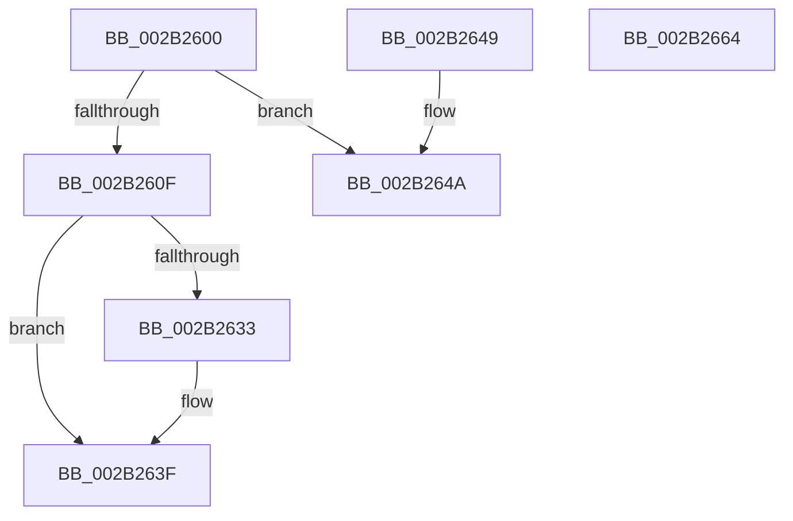

# MiReturnPteMappingSet

- RVA: `0x002B2600`–`0x002B2665` (길이 `101` bytes)
- VA: `0x00000001402B2600`
- 실행 섹션: `.text`
- PDB 이름 있음: `예`; PDB Function 태그: `아니요`
- unwind 정보 RVA: `0x0006D740`
- 디코드: `27`개 명령, `101/101` bytes 표시
- 미해석 바이트: `0` (있으면 어셈블리에 `.byte`로 보존)

> 이 문서는 커널 이미지의 기계어와 PDB 기호를 분석해 생성했습니다. 4번과 5번은 함수 원형과 자료형을 바이너리 사용 방식에서 추정한 C 해석이며 원본 소스 복구 결과는 아닙니다.

## 1. Dependencies

- 직접 호출 지점: **2**; 고유 호출 대상: **2**
- 직접 호출자로 확인된 함수: **5**
- RIP 상대 이미지 참조: **2**

### Outgoing calls
- `0x002B263A` → [KiLowerIrqlProcessIrqlFlags](../4F/KiLowerIrqlProcessIrqlFlags_function_004F5698.md) (function, `0x004F5698`)
- `0x002B2659` → [MiReleasePtes](../24/MiReleasePtes_function_00247240.md) (function, `0x00247240`)

### Direct callers
- [sub_002B1BCF](Unknown_function_002B1BCF.md) at `0x002B1D05`
- [MiSlowRotateCopy](../67/MiSlowRotateCopy_function_0067E2B0.md) at `0x0067E3B7`
- [MiCopyFilePage](../68/MiCopyFilePage_function_00680790.md) at `0x00680828`
- [MiFillPageWithImageExtentContents](../68/MiFillPageWithImageExtentContents_function_00680E44.md) at `0x00681164`
- [MiCopyMemoryPagefileData](../69/MiCopyMemoryPagefileData_function_00694C04.md) at `0x00694F2A`

### Static image references
- `0x002B2626` → RVA `0x00FC6D20` (`ALMOSTRO`; read)
- `0x002B2652` → RVA `0x00E37668` (`.data`; read)

## 2. Other-region calls and transfers

- 다른 실행 섹션으로 향하는 call: **0**
- 별도 외부 분기/꼬리 이동을 확인하지 못했습니다.

## 3. Assembly (complete function range)

```asm
002B2600  40 53                           push rbx
002B2602  48 83 EC 20                     sub rsp, 0x20
002B2606  80 79 08 11                     cmp byte ptr [rcx + 8], 0x11
002B260A  48 8B D9                        mov rbx, rcx
002B260D  74 3B                           je 0x1402b264a
002B260F  65 48 8B 04 25 20 00 00 00      mov rax, qword ptr gs:[0x20]
002B2618  48 8B 88 38 88 00 00            mov rcx, qword ptr [rax + 0x8838]
002B261F  48 C7 01 00 00 00 00            mov qword ptr [rcx], 0
002B2626  83 3D F3 46 D1 00 00            cmp dword ptr [rip + 0xd146f3], 0
002B262D  0F B6 5B 08                     movzx ebx, byte ptr [rbx + 8]
002B2631  74 0C                           je 0x1402b263f
002B2633  44 0F 20 C1                     mov rcx, cr8
002B2637  0F B6 D3                        movzx edx, bl
002B263A  E8 59 30 24 00                  call 0x1404f5698
002B263F  44 0F 22 C3                     mov cr8, rbx
002B2643  48 83 C4 20                     add rsp, 0x20
002B2647  5B                              pop rbx
002B2648  C3                              ret
002B2649  CC                              int3
002B264A  44 8B 41 04                     mov r8d, dword ptr [rcx + 4]
002B264E  48 8B 51 10                     mov rdx, qword ptr [rcx + 0x10]
002B2652  48 8D 0D 0F 50 B8 00            lea rcx, [rip + 0xb8500f]
002B2659  E8 E2 4B F9 FF                  call 0x140247240
002B265E  48 83 C4 20                     add rsp, 0x20
002B2662  5B                              pop rbx
002B2663  C3                              ret
002B2664  CC                              int3
```

## 4. C-style interpretation (structured pseudocode)

```c
__int64 __fastcall MiReturnPteMappingSet(__int64 a1)
{
    __int64 result;
    __int64 v_rsp;

    v_rsp = (v_rsp) - (32);
    if ((*(unsigned __int8 *)(a1 + 8)) == 17) goto loc_002B264A;
    *(unsigned __int64 *)(*(unsigned __int64 *)(*(unsigned __int64 *)(gs_base + (0 + 32)) + 34872)) = 0;
    result = *(unsigned __int64 *)(gs_base + (0 + 32));
    if ((*(unsigned int *)(v_rip + 13715187)) != 0) {
        a1 = v_cr8;
        a2 = (unsigned __int8)(*(unsigned __int8 *)(a1 + 8));
        result = KiLowerIrqlProcessIrqlFlags(a1, a2, a3, a4);
    }
    v_rsp = (v_rsp) + (32);
    return result;
loc_002B264A:
    result = MiReleasePtes(v_rip + 12079119, *(unsigned __int64 *)(a1 + 16), (unsigned int)(*(unsigned int *)(a1 + 4)), a4);
    v_rsp = (v_rsp) + (32);
    return result;
}
```

## 5. (Beta) C Style

```c
int64_t MiReturnPteMappingSet(void *Arg1)
{
    uint8_t *arg1 = (uint8_t *)Arg1;

    int64_t result;
    int64_t local_rsp;

    local_rsp = (local_rsp) - (32);
    if ((*(uint8_t *)(arg1 + 0x8)) == 17) goto loc_002B264A;
    *(uint64_t *)(*(uint64_t *)(*(uint64_t *)(gs_base + (0 + 0x20)) + 0x8838)) = 0;
    result = *(uint64_t *)(gs_base + (0 + 0x20));
    if ((*(uint32_t *)(v_rip + 0xD146F3)) != 0) {
        Arg1 = v_cr8;
        a2 = (uint8_t)(*(uint8_t *)(arg1 + 0x8));
        result = KiLowerIrqlProcessIrqlFlags(Arg1, a2, a3, a4);
    }
    local_rsp = (local_rsp) + (32);
    return result;
loc_002B264A:
    result = MiReleasePtes(v_rip + 12079119, *(uint64_t *)(arg1 + 0x10), (uint32_t)(*(uint32_t *)(arg1 + 0x4)), a4);
    local_rsp = (local_rsp) + (32);
    return result;
}
```

### 관측된 메모리 오프셋

구조체 형식이 확인되지 않은 접근은 인자 기준의 오프셋으로만 기록했습니다.

| 기준 인자 | 오프셋 표현 | 폭 (bit) | 접근 |
|---|---:|---:|---|
| `Arg1` | `+ 0x4` | `32` | `R` |
| `Arg1` | `+ 0x8` | `8` | `R` |
| `Arg1` | `+ 0x10` | `64` | `R` |

## 6. Execution-region graph

[열기: 2D/3D 그래프와 함수 탐색 컨트롤 패널](../../../control-panel.html?section=text&rva=0x002B2600&view=graph)

- 2D 그래프는 위에서 아래로 흐르고, 3D 그래프는 빈 공간을 드래그해 회전합니다. Shift+드래그는 이동, 휠은 확대·축소, 함수 노드 선택은 대상 보고서 이동입니다.

### Static fallback


