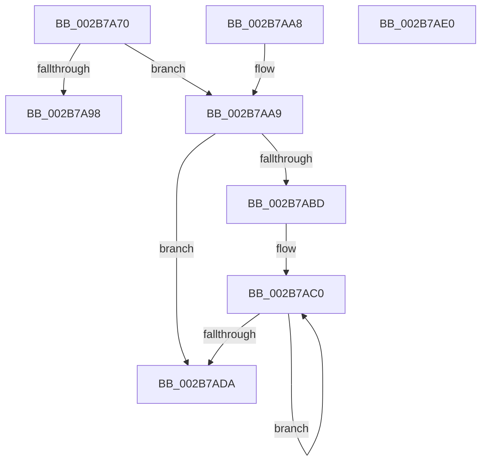

# MiSetPfnTbFlushStamp

- RVA: `0x002B7A70`–`0x002B7AE1` (길이 `113` bytes)
- VA: `0x00000001402B7A70`
- 실행 섹션: `.text`
- PDB 이름 있음: `예`; PDB Function 태그: `아니요`
- unwind 정보 RVA: `0x0006DB00`
- 디코드: `34`개 명령, `113/113` bytes 표시
- 미해석 바이트: `0` (있으면 어셈블리에 `.byte`로 보존)

> 이 문서는 커널 이미지의 기계어와 PDB 기호를 분석해 생성했습니다. 4번과 5번은 함수 원형과 자료형을 바이너리 사용 방식에서 추정한 C 해석이며 원본 소스 복구 결과는 아닙니다.

## 1. Dependencies

- 직접 호출 지점: **0**; 고유 호출 대상: **0**
- 직접 호출자로 확인된 함수: **13**
- RIP 상대 이미지 참조: **0**

### Outgoing calls
- 직접 디코드된 call 명령이 없습니다.

### Direct callers
- [MiSwapStackPage](../29/MiSwapStackPage_function_0029FDE0.md) at `0x0029FF54`
- [MiInitializeReadInProgressPfn](MiInitializeReadInProgressPfn_function_002B6990.md) at `0x002B6B66`
- [sub_002B78A5](Unknown_function_002B78A5.md) at `0x002B78FF`
- [MiGetPageChain](../33/MiGetPageChain_function_00330130.md) at `0x00330354`
- [MiGetPageTablePages](../37/MiGetPageTablePages_function_00376C3C.md) at `0x00376D8C`
- [MiSwapNumaStandbyPage](../38/MiSwapNumaStandbyPage_function_00385144.md) at `0x00385764`
- [MiMapPageFileHash](../49/MiMapPageFileHash_function_004921E0.md) at `0x00492540`
- [MiDeleteSubsectionLargePages](../4D/MiDeleteSubsectionLargePages_function_004D51E0.md) at `0x004D5394`
- [MiPerformFinalZeroing](../4F/MiPerformFinalZeroing_function_004F9594.md) at `0x004F960B`
- [MiCreatePfnTemplate](../67/MiCreatePfnTemplate_function_00671824.md) at `0x0067186F`
- [MiUpdateLargePageSectionPfns](../67/MiUpdateLargePageSectionPfns_function_00678F8C.md) at `0x006790DA`
- [MiPurgeBadFileOnlyPages](../68/MiPurgeBadFileOnlyPages_function_00681ADC.md) at `0x00681C56`
- [MiAllocateDummyPage](../../init/C5/MiAllocateDummyPage_function_00C5F6E8.md) at `0x00C5F79B`

### Static image references
- 디코드된 RIP-relative 메모리 참조가 없습니다.

## 2. Other-region calls and transfers

- 다른 실행 섹션으로 향하는 call: **0**
- 별도 외부 분기/꼬리 이동을 확인하지 못했습니다.

## 3. Assembly (complete function range)

```asm
002B7A70  48 89 5C 24 08                  mov qword ptr [rsp + 8], rbx
002B7A75  4C 8B 49 18                     mov r9, qword ptr [rcx + 0x18]
002B7A79  4C 8B DA                        mov r11, rdx
002B7A7C  49 C1 E3 3B                     shl r11, 0x3b
002B7A80  48 8B D9                        mov rbx, rcx
002B7A83  4D 8B D3                        mov r10, r11
002B7A86  4D 33 D1                        xor r10, r9
002B7A89  45 85 C0                        test r8d, r8d
002B7A8C  49 B8 FF FF FF FF FF FF FF C7   movabs r8, 0xc7ffffffffffffff
002B7A96  74 11                           je 0x1402b7aa9
002B7A98  4D 23 D0                        and r10, r8
002B7A9B  4D 33 D3                        xor r10, r11
002B7A9E  4C 89 51 18                     mov qword ptr [rcx + 0x18], r10
002B7AA2  48 8B 5C 24 08                  mov rbx, qword ptr [rsp + 8]
002B7AA7  C3                              ret
002B7AA8  CC                              int3
002B7AA9  4D 23 D0                        and r10, r8
002B7AAC  49 8B C1                        mov rax, r9
002B7AAF  4D 33 D3                        xor r10, r11
002B7AB2  F0 4C 0F B1 51 18               lock cmpxchg qword ptr [rcx + 0x18], r10
002B7AB8  4C 3B C8                        cmp r9, rax
002B7ABB  74 1D                           je 0x1402b7ada
002B7ABD  0F 1F 00                        nop dword ptr [rax]
002B7AC0  49 8B D3                        mov rdx, r11
002B7AC3  48 8B C8                        mov rcx, rax
002B7AC6  48 33 D0                        xor rdx, rax
002B7AC9  49 23 D0                        and rdx, r8
002B7ACC  49 33 D3                        xor rdx, r11
002B7ACF  F0 48 0F B1 53 18               lock cmpxchg qword ptr [rbx + 0x18], rdx
002B7AD5  48 3B C8                        cmp rcx, rax
002B7AD8  75 E6                           jne 0x1402b7ac0
002B7ADA  48 8B 5C 24 08                  mov rbx, qword ptr [rsp + 8]
002B7ADF  C3                              ret
002B7AE0  CC                              int3
```

## 4. C-style interpretation (structured pseudocode)

```c
__int64 __fastcall MiSetPfnTbFlushStamp(__int64 a1, __int64 a2, int a3)
{
    __int64 v_r10;
    __int64 v_r11;
    unsigned __int64 v_stack_p8;

    v_stack_p8 = v_rbx;
    v_r11 = (a2) << (59);
    v_r10 = (v_r11) ^ (*(unsigned __int64 *)(a1 + 24));
    if (a3 == 0) goto loc_002B7AA9;
    v_r10 = (v_r10) & (a3);
    v_r10 = (v_r10) ^ (v_r11);
    *(unsigned __int64 *)(a1 + 24) = v_r10;
    return result;
loc_002B7AA9:
    v_r10 = (v_r10) & (a3);
    v_r10 = (v_r10) ^ (v_r11);
    if ((*(unsigned __int64 *)(a1 + 24)) == (*(unsigned __int64 *)(a1 + 24))) goto loc_002B7ADA;
loc_002B7AC0:
    a2 = (v_r11) ^ (*(unsigned __int64 *)(a1 + 24));
    a2 = (a2) & (a3);
    a2 = (a2) ^ (v_r11);
    if ((*(unsigned __int64 *)(a1 + 24)) != (*(unsigned __int64 *)(a1 + 24))) goto loc_002B7AC0;
loc_002B7ADA:
    return *(unsigned __int64 *)(a1 + 24);
}
```

## 5. (Beta) C Style

```c
int64_t MiSetPfnTbFlushStamp(void *Arg1, int64_t Arg2, int32_t Arg3)
{
    uint8_t *arg1 = (uint8_t *)Arg1;

    int64_t local_r10;
    int64_t local_r11;
    uint64_t v_stack_p8;

    v_stack_p8 = local_rbx;
    local_r11 = (Arg2) << (59);
    local_r10 = (local_r11) ^ (*(uint64_t *)(arg1 + 0x18));
    if (Arg3 == 0) goto loc_002B7AA9;
    local_r10 = (local_r10) & (Arg3);
    local_r10 = (local_r10) ^ (local_r11);
    *(uint64_t *)(arg1 + 0x18) = local_r10;
    return result;
loc_002B7AA9:
    local_r10 = (local_r10) & (Arg3);
    local_r10 = (local_r10) ^ (local_r11);
    if ((*(uint64_t *)(arg1 + 0x18)) == (*(uint64_t *)(arg1 + 0x18))) goto loc_002B7ADA;
loc_002B7AC0:
    Arg2 = (local_r11) ^ (*(uint64_t *)(arg1 + 0x18));
    Arg2 = (Arg2) & (Arg3);
    Arg2 = (Arg2) ^ (local_r11);
    if ((*(uint64_t *)(arg1 + 0x18)) != (*(uint64_t *)(arg1 + 0x18))) goto loc_002B7AC0;
loc_002B7ADA:
    return *(uint64_t *)(arg1 + 0x18);
}
```

### 관측된 메모리 오프셋

구조체 형식이 확인되지 않은 접근은 인자 기준의 오프셋으로만 기록했습니다.

| 기준 인자 | 오프셋 표현 | 폭 (bit) | 접근 |
|---|---:|---:|---|
| `Arg1` | `+ 0x18` | `64` | `R` |
| `Arg1` | `+ 0x18` | `64` | `W` |

## 6. Execution-region graph

[열기: 2D/3D 그래프와 함수 탐색 컨트롤 패널](../../../control-panel.html?section=text&rva=0x002B7A70&view=graph)

- 2D 그래프는 위에서 아래로 흐르고, 3D 그래프는 빈 공간을 드래그해 회전합니다. Shift+드래그는 이동, 휠은 확대·축소, 함수 노드 선택은 대상 보고서 이동입니다.

### Static fallback


