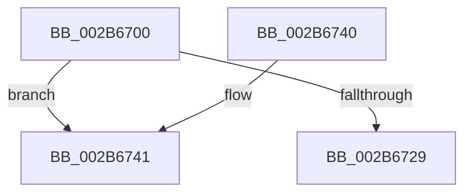

# MiSharedVaToPartition

- RVA: `0x002B6700`–`0x002B674F` (길이 `79` bytes)
- VA: `0x00000001402B6700`
- 실행 섹션: `.text`
- PDB 이름 있음: `예`; PDB Function 태그: `아니요`
- unwind 정보 RVA: `0x0006D9D0`
- 디코드: `20`개 명령, `79/79` bytes 표시
- 미해석 바이트: `0` (있으면 어셈블리에 `.byte`로 보존)

> 이 문서는 커널 이미지의 기계어와 PDB 기호를 분석해 생성했습니다. 4번과 5번은 함수 원형과 자료형을 바이너리 사용 방식에서 추정한 C 해석이며 원본 소스 복구 결과는 아닙니다.

## 1. Dependencies

- 직접 호출 지점: **1**; 고유 호출 대상: **1**
- 직접 호출자로 확인된 함수: **3**
- RIP 상대 이미지 참조: **3**

### Outgoing calls
- `0x002B671B` → [MI_READ_PTE_LOCK_FREE](../28/MI_READ_PTE_LOCK_FREE_function_002828A0.md) (function, `0x002828A0`)

### Direct callers
- [MiActOnPte](../24/MiActOnPte_function_00244C90.md) at `0x0024556C`
- [MiCreateSharedZeroPages](MiCreateSharedZeroPages_function_002B6318.md) at `0x002B639E`
- [MiResolvePageFileFault](../36/MiResolvePageFileFault_function_0036D968.md) at `0x0036EA01`

### Static image references
- `0x002B6720` → RVA `0x00E30094` (`.data`; read)
- `0x002B6729` → RVA `0x00E38D00` (`.data`; read)
- `0x002B6748` → RVA `0x00E30088` (`.data`; read)

## 2. Other-region calls and transfers

- 다른 실행 섹션으로 향하는 call: **0**
- 별도 외부 분기/꼬리 이동을 확인하지 못했습니다.

## 3. Assembly (complete function range)

```asm
002B6700  48 89 5C 24 10                  mov qword ptr [rsp + 0x10], rbx
002B6705  48 89 6C 24 18                  mov qword ptr [rsp + 0x18], rbp
002B670A  56                              push rsi
002B670B  48 83 EC 20                     sub rsp, 0x20
002B670F  48 8B E9                        mov rbp, rcx
002B6712  49 8B D8                        mov rbx, r8
002B6715  49 8B C8                        mov rcx, r8
002B6718  48 8B F2                        mov rsi, rdx
002B671B  E8 80 C1 FC FF                  call 0x1402828a0
002B6720  80 3D 6D 99 B7 00 00            cmp byte ptr [rip + 0xb7996d], 0
002B6727  75 18                           jne 0x1402b6741
002B6729  48 8D 05 D0 25 B8 00            lea rax, [rip + 0xb825d0]
002B6730  48 8B 5C 24 38                  mov rbx, qword ptr [rsp + 0x38]
002B6735  48 8B 6C 24 40                  mov rbp, qword ptr [rsp + 0x40]
002B673A  48 83 C4 20                     add rsp, 0x20
002B673E  5E                              pop rsi
002B673F  C3                              ret
002B6740  CC                              int3
002B6741  0F B7 8D AE 00 00 00            movzx ecx, word ptr [rbp + 0xae]
002B6748  48 8B 05 39 99 B7 00            mov rax, qword ptr [rip + 0xb79939]
```

## 4. C-style interpretation (structured pseudocode)

```c
__int64 __fastcall MiSharedVaToPartition(__int64 a1, __int64 a2, __int64 a3)
{
    __int64 result;
    __int64 v_rsp;
    unsigned __int64 v_stack_p10;
    unsigned __int64 v_stack_p18;

    v_stack_p10 = v_rbx;
    v_stack_p18 = v_rbp;
    v_rsp = (v_rsp) - (32);
    result = MI_READ_PTE_LOCK_FREE(a3, a2, a3, a4);
    if ((*(unsigned __int8 *)(v_rip + 12032365)) != 0) goto loc_002B6741;
    v_rsp = (v_rsp) + (32);
    return v_rip + 12068304;
loc_002B6741:
    return *(unsigned __int64 *)(v_rip + 12032313);
}
```

## 5. (Beta) C Style

```c
int64_t MiSharedVaToPartition(void *Arg1, int64_t Arg2, int64_t Arg3)
{
    uint8_t *arg1 = (uint8_t *)Arg1;

    int64_t result;
    int64_t local_rsp;
    uint64_t v_stack_p10;
    uint64_t v_stack_p18;

    v_stack_p10 = local_rbx;
    v_stack_p18 = local_rbp;
    local_rsp = (local_rsp) - (32);
    result = MI_READ_PTE_LOCK_FREE(Arg3, Arg2, Arg3, a4);
    if ((*(uint8_t *)(v_rip + 0xB7996D)) != 0) goto loc_002B6741;
    local_rsp = (local_rsp) + (32);
    return v_rip + 12068304;
loc_002B6741:
    return *(uint64_t *)(v_rip + 0xB79939);
}
```

### 관측된 메모리 오프셋

구조체 형식이 확인되지 않은 접근은 인자 기준의 오프셋으로만 기록했습니다.

| 기준 인자 | 오프셋 표현 | 폭 (bit) | 접근 |
|---|---:|---:|---|
| `Arg1` | `+ 0xAE` | `16` | `R` |

## 6. Execution-region graph

[열기: 2D/3D 그래프와 함수 탐색 컨트롤 패널](../../../control-panel.html?section=text&rva=0x002B6700&view=graph)

- 2D 그래프는 위에서 아래로 흐르고, 3D 그래프는 빈 공간을 드래그해 회전합니다. Shift+드래그는 이동, 휠은 확대·축소, 함수 노드 선택은 대상 보고서 이동입니다.

### Static fallback


