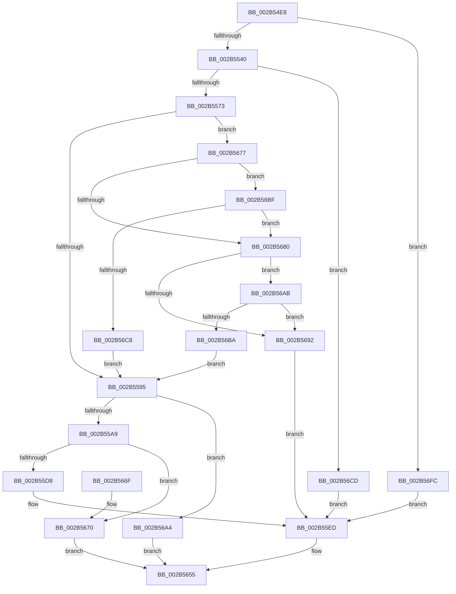

# MiStoreCheckCandidatePage

- RVA: `0x002B54E8`–`0x002B5721` (길이 `569` bytes)
- VA: `0x00000001402B54E8`
- 실행 섹션: `.text`
- PDB 이름 있음: `예`; PDB Function 태그: `아니요`
- unwind 정보 RVA: `0x0006D854`
- 디코드: `143`개 명령, `569/569` bytes 표시
- 미해석 바이트: `0` (있으면 어셈블리에 `.byte`로 보존)

> 이 문서는 커널 이미지의 기계어와 PDB 기호를 분석해 생성했습니다. 4번과 5번은 함수 원형과 자료형을 바이너리 사용 방식에서 추정한 C 해석이며 원본 소스 복구 결과는 아닙니다.

## 1. Dependencies

- 직접 호출 지점: **6**; 고유 호출 대상: **6**
- 직접 호출자로 확인된 함수: **1**
- RIP 상대 이미지 참조: **3**

### Outgoing calls
- `0x002B5565` → [MiGetSystemRegionType](../28/MiGetSystemRegionType_function_0028EC80.md) (function, `0x0028EC80`)
- `0x002B5598` → [MiGetTopLevelPfn](MiGetTopLevelPfn_function_002B44E0.md) (function, `0x002B44E0`)
- `0x002B55AC` → [MiGetPageTablePfnBuddyRaw](MiGetPageTablePfnBuddyRaw_function_002B4470.md) (function, `0x002B4470`)
- `0x002B55CB` → [MiIsStoreProcess](MiIsStoreProcess_function_002B62E0.md) (function, `0x002B62E0`)
- `0x002B55F3` → [MI_NODE_FROM_PFN](MI_NODE_FROM_PFN_function_002B0F30.md) (function, `0x002B0F30`)
- `0x002B5602` → [MiGetPfnPriority](../32/MiGetPfnPriority_function_003226F0.md) (function, `0x003226F0`)

### Direct callers
- [MiStoreWriteModifiedPages](MiStoreWriteModifiedPages_function_002B46C4.md) at `0x002B49EE`

### Static image references
- `0x002B5510` → RVA `0x00E30088` (`.data`; read)
- `0x002B5677` → RVA `0x00E2F380` (`.data`; read)
- `0x002B56BF` → RVA `0x00E2F390` (`.data`; read)

## 2. Other-region calls and transfers

- 다른 실행 섹션으로 향하는 call: **0**
- 별도 외부 분기/꼬리 이동을 확인하지 못했습니다.

## 3. Assembly (complete function range)

```asm
002B54E8  48 89 5C 24 18                  mov qword ptr [rsp + 0x18], rbx
002B54ED  89 54 24 10                     mov dword ptr [rsp + 0x10], edx
002B54F1  55                              push rbp
002B54F2  56                              push rsi
002B54F3  57                              push rdi
002B54F4  41 54                           push r12
002B54F6  41 55                           push r13
002B54F8  41 56                           push r14
002B54FA  41 57                           push r15
002B54FC  48 8B EC                        mov rbp, rsp
002B54FF  48 83 EC 30                     sub rsp, 0x30
002B5503  48 8B 41 28                     mov rax, qword ptr [rcx + 0x28]
002B5507  33 FF                           xor edi, edi
002B5509  48 C1 E8 2B                     shr rax, 0x2b
002B550D  4D 8B E1                        mov r12, r9
002B5510  4C 8B 0D 71 AB B7 00            mov r9, qword ptr [rip + 0xb7ab71]
002B5517  25 FF 03 00 00                  and eax, 0x3ff
002B551C  4D 8B E8                        mov r13, r8
002B551F  48 89 7D F0                     mov qword ptr [rbp - 0x10], rdi
002B5523  48 8B F1                        mov rsi, rcx
002B5526  44 8B F7                        mov r14d, edi
002B5529  49 8B 04 C1                     mov rax, qword ptr [r9 + rax*8]
002B552D  8B 80 B4 04 00 00               mov eax, dword ptr [rax + 0x4b4]
002B5533  48 8B 41 28                     mov rax, qword ptr [rcx + 0x28]
002B5537  48 85 C0                        test rax, rax
002B553A  0F 88 BC 01 00 00               js 0x1402b56fc
002B5540  48 8B 59 08                     mov rbx, qword ptr [rcx + 8]
002B5544  48 B9 00 00 00 00 00 00 00 80   movabs rcx, 0x8000000000000000
002B554E  48 0B D9                        or rbx, rcx
002B5551  48 B8 00 00 00 00 80 F6 FF FF   movabs rax, 0xfffff68000000000
002B555B  4C 8B F8                        mov r15, rax
002B555E  48 8B CB                        mov rcx, rbx
002B5561  49 C1 E7 19                     shl r15, 0x19
002B5565  E8 16 97 FD FF                  call 0x14028ec80
002B556A  83 F8 04                        cmp eax, 4
002B556D  0F 84 5A 01 00 00               je 0x1402b56cd
002B5573  48 C1 E3 19                     shl rbx, 0x19
002B5577  48 B8 FF FF FE FF FF 7F 00 00   movabs rax, 0x7ffffffeffff
002B5581  49 2B DF                        sub rbx, r15
002B5584  48 C1 FB 10                     sar rbx, 0x10
002B5588  48 89 5D F8                     mov qword ptr [rbp - 8], rbx
002B558C  48 3B D8                        cmp rbx, rax
002B558F  0F 87 E2 00 00 00               ja 0x1402b5677
002B5595  48 8B CE                        mov rcx, rsi
002B5598  E8 43 EF FF FF                  call 0x1402b44e0
002B559D  4C 8B C0                        mov r8, rax
002B55A0  48 3B C6                        cmp rax, rsi
002B55A3  0F 84 FB 00 00 00               je 0x1402b56a4
002B55A9  48 8B C8                        mov rcx, rax
002B55AC  E8 BF EE FF FF                  call 0x1402b4470
002B55B1  4C 8B F0                        mov r14, rax
002B55B4  48 89 45 F0                     mov qword ptr [rbp - 0x10], rax
002B55B8  48 B8 FF FF FF FF FF FF FF 7F   movabs rax, 0x7fffffffffffffff
002B55C2  F0 49 21 40 18                  lock and qword ptr [r8 + 0x18], rax
002B55C7  48 8B 4D F0                     mov rcx, qword ptr [rbp - 0x10]
002B55CB  E8 10 0D 00 00                  call 0x1402b62e0
002B55D0  85 C0                           test eax, eax
002B55D2  0F 85 98 00 00 00               jne 0x1402b5670
002B55D8  45 8B B6 FC 05 00 00            mov r14d, dword ptr [r14 + 0x5fc]
002B55DF  83 E3 FC                        and ebx, 0xfffffffc
002B55E2  41 C1 EE 12                     shr r14d, 0x12
002B55E6  41 83 E6 01                     and r14d, 1
002B55EA  89 5D F8                        mov dword ptr [rbp - 8], ebx
002B55ED  8B 5E 20                        mov ebx, dword ptr [rsi + 0x20]
002B55F0  48 8B CE                        mov rcx, rsi
002B55F3  E8 38 B9 FF FF                  call 0x1402b0f30
002B55F8  48 8B CE                        mov rcx, rsi
002B55FB  48 89 7D 40                     mov qword ptr [rbp + 0x40], rdi
002B55FF  44 8B D0                        mov r10d, eax
002B5602  E8 E9 D0 06 00                  call 0x1403226f0
002B5607  0F 10 45 F0                     movups xmm0, xmmword ptr [rbp - 0x10]
002B560B  41 83 E2 3F                     and r10d, 0x3f
002B560F  C1 EB 10                        shr ebx, 0x10
002B5612  83 E0 07                        and eax, 7
002B5615  45 03 D2                        add r10d, r10d
002B5618  45 0B D6                        or r10d, r14d
002B561B  80 E3 C0                        and bl, 0xc0
002B561E  41 C1 E2 04                     shl r10d, 4
002B5622  B9 00 0C 00 00                  mov ecx, 0xc00
002B5627  41 0B C2                        or eax, r10d
002B562A  BA 00 0C 01 00                  mov edx, 0x10c00
002B562F  C1 E0 0D                        shl eax, 0xd
002B5632  80 FB 40                        cmp bl, 0x40
002B5635  F3 41 0F 7F 04 24               movdqu xmmword ptr [r12], xmm0
002B563B  0F 45 CA                        cmovne ecx, edx
002B563E  48 8B 55 60                     mov rdx, qword ptr [rbp + 0x60]
002B5642  0B C1                           or eax, ecx
002B5644  89 45 40                        mov dword ptr [rbp + 0x40], eax
002B5647  48 8B 4D 40                     mov rcx, qword ptr [rbp + 0x40]
002B564B  8B 45 48                        mov eax, dword ptr [rbp + 0x48]
002B564E  48 89 0A                        mov qword ptr [rdx], rcx
002B5651  41 89 45 00                     mov dword ptr [r13], eax
002B5655  48 8B 9C 24 80 00 00 00         mov rbx, qword ptr [rsp + 0x80]
002B565D  8B C7                           mov eax, edi
002B565F  48 83 C4 30                     add rsp, 0x30
002B5663  41 5F                           pop r15
002B5665  41 5E                           pop r14
002B5667  41 5D                           pop r13
002B5669  41 5C                           pop r12
002B566B  5F                              pop rdi
002B566C  5E                              pop rsi
002B566D  5D                              pop rbp
002B566E  C3                              ret
002B566F  CC                              int3
002B5670  BF A7 01 00 C0                  mov edi, 0xc00001a7
002B5675  EB DE                           jmp 0x1402b5655
002B5677  48 3B 1D 02 9D B7 00            cmp rbx, qword ptr [rip + 0xb79d02]
002B567E  73 3F                           jae 0x1402b56bf
002B5680  48 B8 00 00 00 00 80 F6 FF FF   movabs rax, 0xfffff68000000000
002B568A  48 8B C0                        mov rax, rax
002B568D  48 3B D8                        cmp rbx, rax
002B5690  73 19                           jae 0x1402b56ab
002B5692  83 E3 FD                        and ebx, 0xfffffffd
002B5695  48 89 7D F0                     mov qword ptr [rbp - 0x10], rdi
002B5699  83 CB 01                        or ebx, 1
002B569C  89 5D F8                        mov dword ptr [rbp - 8], ebx
002B569F  E9 49 FF FF FF                  jmp 0x1402b55ed
002B56A4  BF 3B 02 00 C0                  mov edi, 0xc000023b
002B56A9  EB AA                           jmp 0x1402b5655
002B56AB  48 B8 FF FF FF FF FF F6 FF FF   movabs rax, 0xfffff6ffffffffff
002B56B5  48 3B D8                        cmp rbx, rax
002B56B8  77 D8                           ja 0x1402b5692
002B56BA  E9 D6 FE FF FF                  jmp 0x1402b5595
002B56BF  48 3B 1D CA 9C B7 00            cmp rbx, qword ptr [rip + 0xb79cca]
002B56C6  77 B8                           ja 0x1402b5680
002B56C8  E9 C8 FE FF FF                  jmp 0x1402b5595
002B56CD  48 8D 83 D8 FC FF FF            lea rax, [rbx - 0x328]
002B56D4  48 89 45 F0                     mov qword ptr [rbp - 0x10], rax
002B56D8  48 B8 68 DF BE 7D FB F6 FF FF   movabs rax, 0xfffff6fb7dbedf68
002B56E2  48 C1 E0 19                     shl rax, 0x19
002B56E6  49 2B C7                        sub rax, r15
002B56E9  48 C1 F8 10                     sar rax, 0x10
002B56ED  48 89 45 F8                     mov qword ptr [rbp - 8], rax
002B56F1  83 E0 FC                        and eax, 0xfffffffc
002B56F4  89 45 F8                        mov dword ptr [rbp - 8], eax
002B56F7  E9 F1 FE FF FF                  jmp 0x1402b55ed
002B56FC  48 8B 41 08                     mov rax, qword ptr [rcx + 8]
002B5700  48 B9 00 00 00 00 00 00 00 80   movabs rcx, 0x8000000000000000
002B570A  48 0B C1                        or rax, rcx
002B570D  48 89 7D F8                     mov qword ptr [rbp - 8], rdi
002B5711  48 89 45 F0                     mov qword ptr [rbp - 0x10], rax
002B5715  C7 45 F8 02 00 00 00            mov dword ptr [rbp - 8], 2
002B571C  E9 CC FE FF FF                  jmp 0x1402b55ed
```

## 4. C-style interpretation (structured pseudocode)

```c
__int64 __fastcall MiStoreCheckCandidatePage(__int64 a1, int a2, __int64 a3, __int64 a4, __int64 a5)
{
    __int64 result;
    __int64 v_r10;
    __int64 v_r14;
    __int64 v_r15;
    __int64 v_rbx;
    __int64 v_rdi;
    __int64 v_rsp;
    unsigned __int64 v_stack_m40;
    unsigned __int64 v_stack_m48;
    unsigned int v_stack_p10;
    unsigned __int64 v_stack_p18;
    unsigned __int64 v_stack_p8;

    v_stack_p18 = v_rbx;
    v_stack_p10 = a2;
    v_rsp = (v_rsp) - (48);
    v_rdi = 0;
    result = (*(unsigned __int64 *)(a1 + 40)) >> (43);
    result = (unsigned int)((result) & (0x3FFULL));
    v_stack_m48 = 0;
    if (sign_flag) goto loc_002B56FC;
    v_rbx = (*(unsigned __int64 *)(a1 + 8)) | (a1);
    v_r15 = (*(unsigned __int64 *)(a1 + 40)) << (25);
    result = MiGetSystemRegionType(v_rbx, a2, a3, *(unsigned __int64 *)(v_rip + 12036977));
    if (((unsigned int)(result)) == 4) goto loc_002B56CD;
    v_rbx = (v_rbx) << (25);
    v_rbx = (v_rbx) - (v_r15);
    v_rbx = (v_rbx) >> (16);
    v_stack_m40 = v_rbx;
    if (v_rbx > result) goto loc_002B5677;
loc_002B5595:
    result = MiGetTopLevelPfn(a1, a2, a3, *(unsigned __int64 *)(v_rip + 12036977));
    if (result == a1) goto loc_002B56A4;
    result = MiGetPageTablePfnBuddyRaw(result, a2, result, *(unsigned __int64 *)(v_rip + 12036977));
    v_stack_m48 = result;
    result = MiIsStoreProcess(v_stack_m48, a2, result, *(unsigned __int64 *)(v_rip + 12036977));
    if ((unsigned int)(result) != 0) goto loc_002B5670;
    v_rbx = (unsigned int)((v_rbx) & (0xFFFFFFFCULL));
    v_r14 = (unsigned int)(((unsigned int)(*(unsigned int *)(result + 1532))) >> (18));
    v_r14 = (unsigned int)((v_r14) & (1));
    v_stack_m40 = (unsigned int)(v_rbx);
loc_002B55ED:
    result = MI_NODE_FROM_PFN(a1, a2, result, *(unsigned __int64 *)(v_rip + 12036977));
    v_stack_p8 = 0;
    result = MiGetPfnPriority(a1, a2, result, *(unsigned __int64 *)(v_rip + 12036977));
    v_r10 = (unsigned int)(((unsigned int)((unsigned int)(result))) & (63));
    v_rbx = (unsigned int)(((unsigned int)(*(unsigned int *)(a1 + 32))) >> (16));
    result = (unsigned int)((result) & (7));
    v_r10 = (unsigned int)((v_r10) + ((unsigned int)(v_r10)));
    v_r10 = (unsigned int)((v_r10) | ((unsigned int)(v_r14)));
    v_rbx = (unsigned __int8)((v_rbx) & (192));
    v_r10 = (unsigned int)((v_r10) << (4));
    result = (unsigned int)((result) | ((unsigned int)(v_r10)));
    result = (unsigned int)((result) << (13));
    *(unsigned __int64 *)(a4) = v_xmm0;
    a1 = (unsigned int)(0xC00ULL);
    if (((unsigned __int8)(v_rbx)) != 64) { a1 = (unsigned int)((unsigned int)(0x10C00ULL)); }
    result = (unsigned int)((result) | ((unsigned int)(a1)));
    v_stack_p8 = (unsigned int)(result);
    *(unsigned __int64 *)(a5) = v_stack_p8;
    *(unsigned int *)(a3) = (unsigned int)((unsigned int)(v_stack_p10));
loc_002B5655:
    v_rsp = (v_rsp) + (48);
    return 0;
loc_002B5670:
    goto loc_002B5655;
loc_002B5677:
    if (v_stack_p18 >= (*(unsigned __int64 *)(v_rip + 12033282))) goto loc_002B56BF;
loc_002B5680:
    if (v_stack_p18 >= 0) goto loc_002B56AB;
loc_002B5692:
    v_rbx = (unsigned int)((v_stack_p18) & (0xFFFFFFFDULL));
    v_stack_m48 = (unsigned int)(0xC00001A7ULL);
    v_rbx = (unsigned int)((v_rbx) | (1));
    v_stack_m40 = (unsigned int)(v_rbx);
    goto loc_002B55ED;
loc_002B56A4:
    goto loc_002B5655;
loc_002B56AB:
    if (v_rbx > 0) goto loc_002B5692;
    goto loc_002B5595;
loc_002B56BF:
    if (v_rbx > (*(unsigned __int64 *)(v_rip + 12033226))) goto loc_002B5680;
    goto loc_002B5595;
loc_002B56CD:
    v_stack_m48 = v_rbx - 808;
    result = (v_rbx - 808) << (25);
    result = (result) - (v_r15);
    result = (result) >> (16);
    v_stack_m40 = result;
    result = (unsigned int)((result) & (0xFFFFFFFCULL));
    v_stack_m40 = (unsigned int)(result);
    goto loc_002B55ED;
loc_002B56FC:
    result = (*(unsigned __int64 *)(v_stack_p8 + 8)) | (v_stack_p8);
    v_stack_m40 = (unsigned int)(0xC000023BULL);
    v_stack_m48 = result;
    v_stack_m40 = 2;
    goto loc_002B55ED;
}
```

## 5. (Beta) C Style

```c
int64_t MiStoreCheckCandidatePage(void *Arg1, int32_t Arg2, void *Arg3, void *Arg4, void *Arg5)
{
    uint8_t *arg1 = (uint8_t *)Arg1;
    uint8_t *arg3 = (uint8_t *)Arg3;
    uint8_t *arg4 = (uint8_t *)Arg4;
    uint8_t *arg5 = (uint8_t *)Arg5;

    int64_t result;
    int64_t local_r10;
    int64_t local_r14;
    int64_t local_r15;
    int64_t local_rbx;
    int64_t local_rdi;
    int64_t local_rsp;
    uint64_t v_stack_m40;
    uint64_t v_stack_m48;
    uint32_t v_stack_p10;
    uint64_t v_stack_p18;
    uint64_t v_stack_p8;

    v_stack_p18 = local_rbx;
    v_stack_p10 = Arg2;
    local_rsp = (local_rsp) - (48);
    local_rdi = 0;
    result = (*(uint64_t *)(arg1 + 0x28)) >> (43);
    result = (uint32_t)((result) & (0x3FFULL));
    v_stack_m48 = 0;
    if (sign_flag) goto loc_002B56FC;
    local_rbx = (*(uint64_t *)(arg1 + 0x8)) | (Arg1);
    local_r15 = (*(uint64_t *)(arg1 + 0x28)) << (25);
    result = MiGetSystemRegionType(local_rbx, Arg2, Arg3, *(uint64_t *)(v_rip + 0xB7AB71));
    if (((uint32_t)(result)) == 4) goto loc_002B56CD;
    local_rbx = (local_rbx) << (25);
    local_rbx = (local_rbx) - (local_r15);
    local_rbx = (local_rbx) >> (16);
    v_stack_m40 = local_rbx;
    if (local_rbx > result) goto loc_002B5677;
loc_002B5595:
    result = MiGetTopLevelPfn(Arg1, Arg2, Arg3, *(uint64_t *)(v_rip + 0xB7AB71));
    if (result == Arg1) goto loc_002B56A4;
    result = MiGetPageTablePfnBuddyRaw(result, Arg2, result, *(uint64_t *)(v_rip + 0xB7AB71));
    v_stack_m48 = result;
    result = MiIsStoreProcess(v_stack_m48, Arg2, result, *(uint64_t *)(v_rip + 0xB7AB71));
    if ((uint32_t)(result) != 0) goto loc_002B5670;
    local_rbx = (uint32_t)((local_rbx) & (0xFFFFFFFCULL));
    local_r14 = (uint32_t)(((uint32_t)(*(uint32_t *)(result + 0x5FC))) >> (18));
    local_r14 = (uint32_t)((local_r14) & (1));
    v_stack_m40 = (uint32_t)(local_rbx);
loc_002B55ED:
    result = MI_NODE_FROM_PFN(Arg1, Arg2, result, *(uint64_t *)(v_rip + 0xB7AB71));
    v_stack_p8 = 0;
    result = MiGetPfnPriority(Arg1, Arg2, result, *(uint64_t *)(v_rip + 0xB7AB71));
    local_r10 = (uint32_t)(((uint32_t)((uint32_t)(result))) & (63));
    local_rbx = (uint32_t)(((uint32_t)(*(uint32_t *)(arg1 + 0x20))) >> (16));
    result = (uint32_t)((result) & (7));
    local_r10 = (uint32_t)((local_r10) + ((uint32_t)(local_r10)));
    local_r10 = (uint32_t)((local_r10) | ((uint32_t)(local_r14)));
    local_rbx = (uint8_t)((local_rbx) & (192));
    local_r10 = (uint32_t)((local_r10) << (4));
    result = (uint32_t)((result) | ((uint32_t)(local_r10)));
    result = (uint32_t)((result) << (13));
    *(uint64_t *)(arg4) = v_xmm0;
    Arg1 = (uint32_t)(0xC00ULL);
    if (((uint8_t)(local_rbx)) != 64) { Arg1 = (uint32_t)((uint32_t)(0x10C00ULL)); }
    result = (uint32_t)((result) | ((uint32_t)(Arg1)));
    v_stack_p8 = (uint32_t)(result);
    *(uint64_t *)(arg5) = v_stack_p8;
    *(uint32_t *)(arg3) = (uint32_t)((uint32_t)(v_stack_p10));
loc_002B5655:
    local_rsp = (local_rsp) + (48);
    return 0;
loc_002B5670:
    goto loc_002B5655;
loc_002B5677:
    if (v_stack_p18 >= (*(uint64_t *)(v_rip + 0xB79D02))) goto loc_002B56BF;
loc_002B5680:
    if (v_stack_p18 >= 0) goto loc_002B56AB;
loc_002B5692:
    local_rbx = (uint32_t)((v_stack_p18) & (0xFFFFFFFDULL));
    v_stack_m48 = (uint32_t)(0xC00001A7ULL);
    local_rbx = (uint32_t)((local_rbx) | (1));
    v_stack_m40 = (uint32_t)(local_rbx);
    goto loc_002B55ED;
loc_002B56A4:
    goto loc_002B5655;
loc_002B56AB:
    if (local_rbx > 0) goto loc_002B5692;
    goto loc_002B5595;
loc_002B56BF:
    if (local_rbx > (*(uint64_t *)(v_rip + 0xB79CCA))) goto loc_002B5680;
    goto loc_002B5595;
loc_002B56CD:
    v_stack_m48 = local_rbx - 808;
    result = (local_rbx - 808) << (25);
    result = (result) - (local_r15);
    result = (result) >> (16);
    v_stack_m40 = result;
    result = (uint32_t)((result) & (0xFFFFFFFCULL));
    v_stack_m40 = (uint32_t)(result);
    goto loc_002B55ED;
loc_002B56FC:
    result = (*(uint64_t *)(v_stack_p8 + 0x8)) | (v_stack_p8);
    v_stack_m40 = (uint32_t)(0xC000023BULL);
    v_stack_m48 = result;
    v_stack_m40 = 2;
    goto loc_002B55ED;
}
```

### 관측된 메모리 오프셋

구조체 형식이 확인되지 않은 접근은 인자 기준의 오프셋으로만 기록했습니다.

| 기준 인자 | 오프셋 표현 | 폭 (bit) | 접근 |
|---|---:|---:|---|
| `Arg1` | `+ 0x8` | `64` | `R` |
| `Arg1` | `+ 0x20` | `32` | `R` |
| `Arg1` | `+ 0x28` | `64` | `R` |
| `Arg3` | `+ 0x0` | `32` | `W` |
| `Arg4` | `+ 0x0` | `128` | `W` |
| `Arg5` | `+ 0x0` | `64` | `W` |

## 6. Execution-region graph

[열기: 2D/3D 그래프와 함수 탐색 컨트롤 패널](../../../control-panel.html?section=text&rva=0x002B54E8&view=graph)

- 2D 그래프는 위에서 아래로 흐르고, 3D 그래프는 빈 공간을 드래그해 회전합니다. Shift+드래그는 이동, 휠은 확대·축소, 함수 노드 선택은 대상 보고서 이동입니다.

### Static fallback


