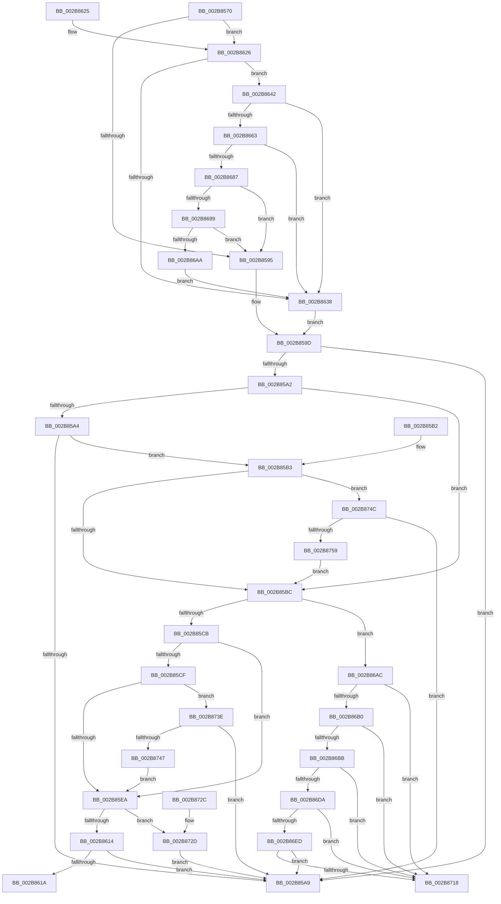

# MiUpdatePfnPriority

- RVA: `0x002B8570`–`0x002B875E` (길이 `494` bytes)
- VA: `0x00000001402B8570`
- 실행 섹션: `.text`
- PDB 이름 있음: `예`; PDB Function 태그: `아니요`
- unwind 정보 RVA: `0x0006DBAC`
- 디코드: `135`개 명령, `494/494` bytes 표시
- 미해석 바이트: `0` (있으면 어셈블리에 `.byte`로 보존)

> 이 문서는 커널 이미지의 기계어와 PDB 기호를 분석해 생성했습니다. 4번과 5번은 함수 원형과 자료형을 바이너리 사용 방식에서 추정한 C 해석이며 원본 소스 복구 결과는 아닙니다.

## 1. Dependencies

- 직접 호출 지점: **3**; 고유 호출 대상: **3**
- 직접 호출자로 확인된 함수: **7**
- RIP 상대 이미지 참조: **2**

### Outgoing calls
- `0x002B867E` → [MiIsDecayPfn](MiIsDecayPfn_function_002B9240.md) (function, `0x002B9240`)
- `0x002B869C` → [MiGetPfnSlabType](../28/MiGetPfnSlabType_function_0028E2D0.md) (function, `0x0028E2D0`)
- `0x002B871E` → [MiRelinkStandbyPage](MiRelinkStandbyPage_function_002B9D30.md) (function, `0x002B9D30`)

### Direct callers
- [MiCombineWithExisting](../22/MiCombineWithExisting_function_0022B4B8.md) at `0x0022B658`
- [MiActOnPte](../24/MiActOnPte_function_00244C90.md) at `0x0024516A`
- [MiActOnPte](../24/MiActOnPte_function_00244C90.md) at `0x0024567C`
- [MiPfPutPagesInTransition](../36/MiPfPutPagesInTransition_function_003640EC.md) at `0x00364707`
- [MiUpdatePrefetchPriority](../40/MiUpdatePrefetchPriority_function_00402CB0.md) at `0x00402DCC`
- [NtLockVirtualMemory](../40/NtLockVirtualMemory_function_004088A0.md) at `0x00408CC9`
- [MiDeprioritizeVirtualAddresses](../42/MiDeprioritizeVirtualAddresses_function_0042AD1C.md) at `0x0042AF67`
- [sub_006D7070](../6D/Unknown_function_006D7070.md) at `0x006D709D`

### Static image references
- `0x002B8642` → RVA `0x00E2DCE0` (`.data`; read)
- `0x002B86BF` → RVA `0x00E30088` (`.data`; read)

## 2. Other-region calls and transfers

- 다른 실행 섹션으로 향하는 call: **0**
- 별도 외부 분기/꼬리 이동을 확인하지 못했습니다.

## 3. Assembly (complete function range)

```asm
002B8570  40 53                           push rbx
002B8572  48 83 EC 20                     sub rsp, 0x20
002B8576  44 8B 49 20                     mov r9d, dword ptr [rcx + 0x20]
002B857A  44 8B DA                        mov r11d, edx
002B857D  8B 41 20                        mov eax, dword ptr [rcx + 0x20]
002B8580  4C 8B D1                        mov r10, rcx
002B8583  C1 E8 18                        shr eax, 0x18
002B8586  B3 FF                           mov bl, 0xff
002B8588  44 89 4C 24 38                  mov dword ptr [rsp + 0x38], r9d
002B858D  A8 08                           test al, 8
002B858F  0F 85 91 00 00 00               jne 0x1402b8626
002B8595  0F B6 4C 24 3B                  movzx ecx, byte ptr [rsp + 0x3b]
002B859A  83 E1 07                        and ecx, 7
002B859D  44 3B D9                        cmp r11d, ecx
002B85A0  74 07                           je 0x1402b85a9
002B85A2  73 18                           jae 0x1402b85bc
002B85A4  45 85 C0                        test r8d, r8d
002B85A7  75 0A                           jne 0x1402b85b3
002B85A9  0F B6 C3                        movzx eax, bl
002B85AC  48 83 C4 20                     add rsp, 0x20
002B85B0  5B                              pop rbx
002B85B1  C3                              ret
002B85B2  CC                              int3
002B85B3  83 F9 05                        cmp ecx, 5
002B85B6  0F 87 90 01 00 00               ja 0x1402b874c
002B85BC  41 0F B6 42 22                  movzx eax, byte ptr [r10 + 0x22]
002B85C1  24 07                           and al, 7
002B85C3  3C 02                           cmp al, 2
002B85C5  0F 84 E1 00 00 00               je 0x1402b86ac
002B85CB  3C 06                           cmp al, 6
002B85CD  75 1B                           jne 0x1402b85ea
002B85CF  49 8B 42 18                     mov rax, qword ptr [r10 + 0x18]
002B85D3  48 BA FF FF FF FF FF FF FF 3F   movabs rdx, 0x3fffffffffffffff
002B85DD  48 23 C2                        and rax, rdx
002B85E0  48 83 F8 01                     cmp rax, 1
002B85E4  0F 87 54 01 00 00               ja 0x1402b873e
002B85EA  41 8B 52 20                     mov edx, dword ptr [r10 + 0x20]
002B85EE  89 54 24 38                     mov dword ptr [rsp + 0x38], edx
002B85F2  C1 EA 18                        shr edx, 0x18
002B85F5  0F B6 C2                        movzx eax, dl
002B85F8  41 32 C3                        xor al, r11b
002B85FB  24 07                           and al, 7
002B85FD  32 C2                           xor al, dl
002B85FF  88 44 24 3B                     mov byte ptr [rsp + 0x3b], al
002B8603  8B 44 24 38                     mov eax, dword ptr [rsp + 0x38]
002B8607  41 89 42 20                     mov dword ptr [r10 + 0x20], eax
002B860B  83 F9 05                        cmp ecx, 5
002B860E  0F 82 19 01 00 00               jb 0x1402b872d
002B8614  41 83 FB 05                     cmp r11d, 5
002B8618  73 8F                           jae 0x1402b85a9
002B861A  B3 07                           mov bl, 7
002B861C  0F B6 C3                        movzx eax, bl
002B861F  48 83 C4 20                     add rsp, 0x20
002B8623  5B                              pop rbx
002B8624  C3                              ret
002B8625  CC                              int3
002B8626  48 BA 00 00 00 00 00 DE FF FF   movabs rdx, 0xffffde0000000000
002B8630  48 8B C2                        mov rax, rdx
002B8633  4C 3B D0                        cmp r10, rax
002B8636  73 0A                           jae 0x1402b8642
002B8638  B9 05 00 00 00                  mov ecx, 5
002B863D  E9 5B FF FF FF                  jmp 0x1402b859d
002B8642  48 8B 05 97 56 B7 00            mov rax, qword ptr [rip + 0xb75697]
002B8649  48 8D 0C 40                     lea rcx, [rax + rax*2]
002B864D  48 C1 E1 04                     shl rcx, 4
002B8651  48 B8 30 00 00 00 00 DE FF FF   movabs rax, 0xffffde0000000030
002B865B  48 03 C8                        add rcx, rax
002B865E  4C 3B D1                        cmp r10, rcx
002B8661  73 D5                           jae 0x1402b8638
002B8663  48 8B C2                        mov rax, rdx
002B8666  49 8B CA                        mov rcx, r10
002B8669  48 2B C8                        sub rcx, rax
002B866C  48 B8 AB AA AA AA AA AA AA AA   movabs rax, 0xaaaaaaaaaaaaaaab
002B8676  48 C1 F9 04                     sar rcx, 4
002B867A  48 0F AF C8                     imul rcx, rax
002B867E  E8 BD 0B 00 00                  call 0x1402b9240
002B8683  85 C0                           test eax, eax
002B8685  75 B1                           jne 0x1402b8638
002B8687  41 C1 E9 10                     shr r9d, 0x10
002B868B  41 80 E1 07                     and r9b, 7
002B868F  41 80 F9 06                     cmp r9b, 6
002B8693  0F 84 FC FE FF FF               je 0x1402b8595
002B8699  49 8B CA                        mov rcx, r10
002B869C  E8 2F 5C FD FF                  call 0x14028e2d0
002B86A1  83 F8 09                        cmp eax, 9
002B86A4  0F 85 EB FE FF FF               jne 0x1402b8595
002B86AA  EB 8C                           jmp 0x1402b8638
002B86AC  85 C9                           test ecx, ecx
002B86AE  75 68                           jne 0x1402b8718
002B86B0  41 8B 42 10                     mov eax, dword ptr [r10 + 0x10]
002B86B4  48 0F BA E0 0A                  bt rax, 0xa
002B86B9  72 5D                           jb 0x1402b8718
002B86BB  49 8B 42 28                     mov rax, qword ptr [r10 + 0x28]
002B86BF  48 8B 0D C2 79 B7 00            mov rcx, qword ptr [rip + 0xb779c2]
002B86C6  48 C1 E8 2B                     shr rax, 0x2b
002B86CA  25 FF 03 00 00                  and eax, 0x3ff
002B86CF  48 8B 04 C1                     mov rax, qword ptr [rcx + rax*8]
002B86D3  8B 40 04                        mov eax, dword ptr [rax + 4]
002B86D6  84 C0                           test al, al
002B86D8  78 3E                           js 0x1402b8718
002B86DA  49 8B 4A 28                     mov rcx, qword ptr [r10 + 0x28]
002B86DE  49 8B 42 10                     mov rax, qword ptr [r10 + 0x10]
002B86E2  0F B6 D0                        movzx edx, al
002B86E5  C0 EA 02                        shr dl, 2
002B86E8  F6 C2 01                        test dl, 1
002B86EB  74 2B                           je 0x1402b8718
002B86ED  48 8B 15 94 79 B7 00            mov rdx, qword ptr [rip + 0xb77994]
002B86F4  48 C1 E9 2B                     shr rcx, 0x2b
002B86F8  81 E1 FF 03 00 00               and ecx, 0x3ff
002B86FE  48 C1 E8 0C                     shr rax, 0xc
002B8702  83 E0 0F                        and eax, 0xf
002B8705  4C 8B 04 CA                     mov r8, qword ptr [rdx + rcx*8]
002B8709  41 8B 88 B4 04 00 00            mov ecx, dword ptr [r8 + 0x4b4]
002B8710  3B C1                           cmp eax, ecx
002B8712  0F 84 91 FE FF FF               je 0x1402b85a9
002B8718  41 8B D3                        mov edx, r11d
002B871B  49 8B CA                        mov rcx, r10
002B871E  E8 0D 16 00 00                  call 0x1402b9d30
002B8723  0F B6 C3                        movzx eax, bl
002B8726  48 83 C4 20                     add rsp, 0x20
002B872A  5B                              pop rbx
002B872B  C3                              ret
002B872C  CC                              int3
002B872D  33 C0                           xor eax, eax
002B872F  0F B6 DB                        movzx ebx, bl
002B8732  41 83 FB 05                     cmp r11d, 5
002B8736  0F 44 D8                        cmove ebx, eax
002B8739  E9 6B FE FF FF                  jmp 0x1402b85a9
002B873E  44 3B D9                        cmp r11d, ecx
002B8741  0F 82 62 FE FF FF               jb 0x1402b85a9
002B8747  E9 9E FE FF FF                  jmp 0x1402b85ea
002B874C  49 8B 42 28                     mov rax, qword ptr [r10 + 0x28]
002B8750  48 85 C0                        test rax, rax
002B8753  0F 88 50 FE FF FF               js 0x1402b85a9
002B8759  E9 5E FE FF FF                  jmp 0x1402b85bc
```

## 4. C-style interpretation (structured pseudocode)

```c
__int64 __fastcall MiUpdatePfnPriority(__int64 a1, int a2, int a3)
{
    __int64 result;
    __int64 v_rbx;
    __int64 v_rsp;
    unsigned int v_stack_p10;
    unsigned __int8 v_stack_p13;
    unsigned int v_stack_p38;
    unsigned __int8 v_stack_p3B;

    v_rsp = (v_rsp) - (32);
    result = (unsigned int)(((unsigned int)(*(unsigned int *)(a1 + 32))) >> (24));
    v_stack_p10 = (unsigned int)((unsigned int)(*(unsigned int *)(a1 + 32)));
    if ((((unsigned __int8)(result)) & (8)) != 0) goto loc_002B8626;
loc_002B8595:
    a1 = (unsigned int)((v_stack_p13) & (7));
loc_002B859D:
    if (((unsigned int)((unsigned int)(a2))) == ((unsigned int)(a1))) goto loc_002B85A9;
    if (((unsigned int)((unsigned int)(a2))) >= ((unsigned int)(a1))) goto loc_002B85BC;
    if (a3 != 0) goto loc_002B85B3;
loc_002B85A9:
    v_rsp = (v_rsp) + (32);
    return 255;
loc_002B85B3:
    if (((unsigned int)(a1)) > 5) goto loc_002B874C;
loc_002B85BC:
    result = (unsigned __int8)((*(unsigned __int8 *)(a1 + 34)) & (7));
    if (((unsigned __int8)(result)) == 2) goto loc_002B86AC;
    if (((unsigned __int8)(result)) != 6) goto loc_002B85EA;
    result = (*(unsigned __int64 *)(a1 + 24)) & (a2);
    if (result > 1) goto loc_002B873E;
loc_002B85EA:
    v_stack_p38 = (unsigned int)((unsigned int)(*(unsigned int *)(a1 + 32)));
    a2 = (unsigned int)(((unsigned int)(*(unsigned int *)(a1 + 32))) >> (24));
    result = (unsigned __int8)(((unsigned __int8)(a2)) ^ ((unsigned __int8)((unsigned int)(a2))));
    result = (unsigned __int8)((result) & (7));
    result = (unsigned __int8)((result) ^ ((unsigned __int8)(a2)));
    v_stack_p3B = (unsigned __int8)(result);
    *(unsigned int *)(a1 + 32) = (unsigned int)((unsigned int)(v_stack_p38));
    if (((unsigned int)(a1)) < 5) goto loc_002B872D;
    if (((unsigned int)((unsigned int)(a2))) >= 5) goto loc_002B85A9;
    v_rsp = (v_rsp) + (32);
    return 7;
loc_002B8626:
    if (a1 >= a2) goto loc_002B8642;
loc_002B8638:
    goto loc_002B859D;
loc_002B8642:
    a1 = (*(unsigned __int64 *)(v_rip + 12015255) + *(unsigned __int64 *)(v_rip + 12015255) * 2) << (4);
    a1 = (a1) + (*(unsigned __int64 *)(v_rip + 12015255));
    if (a1 >= a1) goto loc_002B8638;
    a1 = (a1) - (a2);
    a1 = (a1) >> (4);
    a1 = (a1) * (a2);
    result = MiIsDecayPfn(a1, a2, a3, (unsigned int)(*(unsigned int *)(a1 + 32)));
    if ((unsigned int)(result) != 0) goto loc_002B8638;
    a4 = (unsigned int)(((unsigned int)(*(unsigned int *)(a1 + 32))) >> (16));
    a4 = (unsigned __int8)((a4) & (7));
    if (((unsigned __int8)(a4)) == 6) goto loc_002B8595;
    result = MiGetPfnSlabType(a1, a2, a3, a4);
    if (((unsigned int)(result)) != 9) goto loc_002B8595;
    goto loc_002B8638;
loc_002B86AC:
    if ((unsigned int)(a1) != 0) goto loc_002B8718;
    if (condition_is_below) goto loc_002B8718;
    result = (*(unsigned __int64 *)(a1 + 40)) >> (43);
    result = (unsigned int)((result) & (0x3FFULL));
    if (sign_flag) goto loc_002B8718;
    a2 = (unsigned __int8)(((unsigned __int8)(*(unsigned __int64 *)(a1 + 16))) >> (2));
    if ((((unsigned __int8)(a2)) & (1)) == 0) goto loc_002B8718;
    a1 = (*(unsigned __int64 *)(a1 + 40)) >> (43);
    a1 = (unsigned int)((a1) & (0x3FFULL));
    result = (*(unsigned __int64 *)(a1 + 16)) >> (12);
    result = (unsigned int)((result) & (15));
    if (((unsigned int)(result)) == ((unsigned int)((unsigned int)(*(unsigned int *)(*(unsigned __int64 *)(*(unsigned __int64 *)(v_rip + 12024212) + a1 * 8) + 1204))))) goto loc_002B85A9;
loc_002B8718:
    result = MiRelinkStandbyPage(a1, (unsigned int)((unsigned int)((unsigned int)(a2))), *(unsigned __int64 *)(*(unsigned __int64 *)(v_rip + 12024212) + a1 * 8), a4);
    v_rsp = (v_rsp) + (32);
    return 7;
loc_002B872D:
    result = 0;
    v_rbx = 7;
    if (((unsigned int)((unsigned int)(a2))) == 5) { v_rbx = 0; }
    goto loc_002B85A9;
loc_002B873E:
    if (((unsigned int)((unsigned int)(a2))) < ((unsigned int)(a1))) goto loc_002B85A9;
    goto loc_002B85EA;
loc_002B874C:
    if (sign_flag) goto loc_002B85A9;
    goto loc_002B85BC;
}
```

## 5. (Beta) C Style

```c
int64_t MiUpdatePfnPriority(void *Arg1, int32_t Arg2, int32_t Arg3)
{
    uint8_t *arg1 = (uint8_t *)Arg1;

    int64_t result;
    int64_t local_rbx;
    int64_t local_rsp;
    uint32_t v_stack_p10;
    uint8_t v_stack_p13;
    uint32_t v_stack_p38;
    uint8_t v_stack_p3B;

    local_rsp = (local_rsp) - (32);
    result = (uint32_t)(((uint32_t)(*(uint32_t *)(arg1 + 0x20))) >> (24));
    v_stack_p10 = (uint32_t)((uint32_t)(*(uint32_t *)(arg1 + 0x20)));
    if ((((uint8_t)(result)) & (8)) != 0) goto loc_002B8626;
loc_002B8595:
    Arg1 = (uint32_t)((v_stack_p13) & (7));
loc_002B859D:
    if (((uint32_t)((uint32_t)(Arg2))) == ((uint32_t)(Arg1))) goto loc_002B85A9;
    if (((uint32_t)((uint32_t)(Arg2))) >= ((uint32_t)(Arg1))) goto loc_002B85BC;
    if (Arg3 != 0) goto loc_002B85B3;
loc_002B85A9:
    local_rsp = (local_rsp) + (32);
    return 255;
loc_002B85B3:
    if (((uint32_t)(Arg1)) > 5) goto loc_002B874C;
loc_002B85BC:
    result = (uint8_t)((*(uint8_t *)(arg1 + 0x22)) & (7));
    if (((uint8_t)(result)) == 2) goto loc_002B86AC;
    if (((uint8_t)(result)) != 6) goto loc_002B85EA;
    result = (*(uint64_t *)(arg1 + 0x18)) & (Arg2);
    if (result > 1) goto loc_002B873E;
loc_002B85EA:
    v_stack_p38 = (uint32_t)((uint32_t)(*(uint32_t *)(arg1 + 0x20)));
    Arg2 = (uint32_t)(((uint32_t)(*(uint32_t *)(arg1 + 0x20))) >> (24));
    result = (uint8_t)(((uint8_t)(Arg2)) ^ ((uint8_t)((uint32_t)(Arg2))));
    result = (uint8_t)((result) & (7));
    result = (uint8_t)((result) ^ ((uint8_t)(Arg2)));
    v_stack_p3B = (uint8_t)(result);
    *(uint32_t *)(arg1 + 0x20) = (uint32_t)((uint32_t)(v_stack_p38));
    if (((uint32_t)(Arg1)) < 5) goto loc_002B872D;
    if (((uint32_t)((uint32_t)(Arg2))) >= 5) goto loc_002B85A9;
    local_rsp = (local_rsp) + (32);
    return 7;
loc_002B8626:
    if (Arg1 >= Arg2) goto loc_002B8642;
loc_002B8638:
    goto loc_002B859D;
loc_002B8642:
    Arg1 = (*(uint64_t *)(v_rip + 0xB75697) + *(uint64_t *)(v_rip + 0xB75697) * 2) << (4);
    Arg1 = (Arg1) + (*(uint64_t *)(v_rip + 0xB75697));
    if (Arg1 >= Arg1) goto loc_002B8638;
    Arg1 = (Arg1) - (Arg2);
    Arg1 = (Arg1) >> (4);
    Arg1 = (Arg1) * (Arg2);
    result = MiIsDecayPfn(Arg1, Arg2, Arg3, (uint32_t)(*(uint32_t *)(arg1 + 0x20)));
    if ((uint32_t)(result) != 0) goto loc_002B8638;
    a4 = (uint32_t)(((uint32_t)(*(uint32_t *)(arg1 + 0x20))) >> (16));
    a4 = (uint8_t)((a4) & (7));
    if (((uint8_t)(a4)) == 6) goto loc_002B8595;
    result = MiGetPfnSlabType(Arg1, Arg2, Arg3, a4);
    if (((uint32_t)(result)) != 9) goto loc_002B8595;
    goto loc_002B8638;
loc_002B86AC:
    if ((uint32_t)(Arg1) != 0) goto loc_002B8718;
    if (condition_is_below) goto loc_002B8718;
    result = (*(uint64_t *)(arg1 + 0x28)) >> (43);
    result = (uint32_t)((result) & (0x3FFULL));
    if (sign_flag) goto loc_002B8718;
    Arg2 = (uint8_t)(((uint8_t)(*(uint64_t *)(arg1 + 0x10))) >> (2));
    if ((((uint8_t)(Arg2)) & (1)) == 0) goto loc_002B8718;
    Arg1 = (*(uint64_t *)(arg1 + 0x28)) >> (43);
    Arg1 = (uint32_t)((Arg1) & (0x3FFULL));
    result = (*(uint64_t *)(arg1 + 0x10)) >> (12);
    result = (uint32_t)((result) & (15));
    if (((uint32_t)(result)) == ((uint32_t)((uint32_t)(*(uint32_t *)(*(uint64_t *)(*(uint64_t *)(v_rip + 0xB77994) + arg1 * 8) + 0x4B4))))) goto loc_002B85A9;
loc_002B8718:
    result = MiRelinkStandbyPage(Arg1, (uint32_t)((uint32_t)((uint32_t)(Arg2))), *(uint64_t *)(*(uint64_t *)(v_rip + 0xB77994) + arg1 * 8), a4);
    local_rsp = (local_rsp) + (32);
    return 7;
loc_002B872D:
    result = 0;
    local_rbx = 7;
    if (((uint32_t)((uint32_t)(Arg2))) == 5) { local_rbx = 0; }
    goto loc_002B85A9;
loc_002B873E:
    if (((uint32_t)((uint32_t)(Arg2))) < ((uint32_t)(Arg1))) goto loc_002B85A9;
    goto loc_002B85EA;
loc_002B874C:
    if (sign_flag) goto loc_002B85A9;
    goto loc_002B85BC;
}
```

### 관측된 메모리 오프셋

구조체 형식이 확인되지 않은 접근은 인자 기준의 오프셋으로만 기록했습니다.

| 기준 인자 | 오프셋 표현 | 폭 (bit) | 접근 |
|---|---:|---:|---|
| `Arg1` | `+ 0x20` | `32` | `R` |

## 6. Execution-region graph

[열기: 2D/3D 그래프와 함수 탐색 컨트롤 패널](../../../control-panel.html?section=text&rva=0x002B8570&view=graph)

- 2D 그래프는 위에서 아래로 흐르고, 3D 그래프는 빈 공간을 드래그해 회전합니다. Shift+드래그는 이동, 휠은 확대·축소, 함수 노드 선택은 대상 보고서 이동입니다.

### Static fallback


