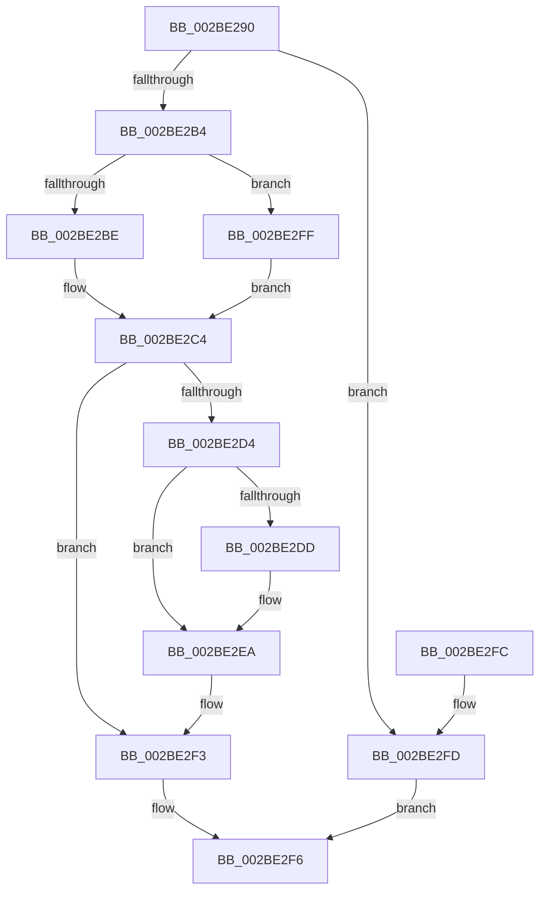

# MmDisableModifiedWriteOfSection

- RVA: `0x002BE290`–`0x002BE307` (길이 `119` bytes)
- VA: `0x00000001402BE290`
- 실행 섹션: `.text`
- PDB 이름 있음: `예`; PDB Function 태그: `아니요`
- unwind 정보 RVA: `0x0006E2E8`
- 디코드: `35`개 명령, `119/119` bytes 표시
- 미해석 바이트: `0` (있으면 어셈블리에 `.byte`로 보존)

> 이 문서는 커널 이미지의 기계어와 PDB 기호를 분석해 생성했습니다. 4번과 5번은 함수 원형과 자료형을 바이너리 사용 방식에서 추정한 C 해석이며 원본 소스 복구 결과는 아닙니다.

## 1. Dependencies

- 직접 호출 지점: **3**; 고유 호출 대상: **3**
- 직접 호출자로 확인된 함수: **1**
- RIP 상대 이미지 참조: **1**

### Outgoing calls
- `0x002BE2A7` → [MiLockSectionControlArea](MiLockSectionControlArea_function_002BC930.md) (function, `0x002BC930`)
- `0x002BE2C8` → [ExReleaseSpinLockExclusiveFromDpcLevel](../24/ExReleaseSpinLockExclusiveFromDpcLevel_function_002497E0.md) (function, `0x002497E0`)
- `0x002BE2E5` → [KiLowerIrqlProcessIrqlFlags](../4F/KiLowerIrqlProcessIrqlFlags_function_004F5698.md) (function, `0x004F5698`)

### Direct callers
- [CcInitializeCacheMapInternal](../3C/CcInitializeCacheMapInternal_function_003CC720.md) at `0x003CCFAF`

### Static image references
- `0x002BE2D4` → RVA `0x00FC6D20` (`ALMOSTRO`; read)

## 2. Other-region calls and transfers

- 다른 실행 섹션으로 향하는 call: **0**
- 별도 외부 분기/꼬리 이동을 확인하지 못했습니다.

## 3. Assembly (complete function range)

```asm
002BE290  40 57                           push rdi
002BE292  48 83 EC 20                     sub rsp, 0x20
002BE296  BF 01 00 00 00                  mov edi, 1
002BE29B  C6 44 24 38 00                  mov byte ptr [rsp + 0x38], 0
002BE2A0  8B D7                           mov edx, edi
002BE2A2  4C 8D 44 24 38                  lea r8, [rsp + 0x38]
002BE2A7  E8 84 E6 FF FF                  call 0x1402bc930
002BE2AC  48 8B C8                        mov rcx, rax
002BE2AF  48 85 C0                        test rax, rax
002BE2B2  74 49                           je 0x1402be2fd
002BE2B4  48 83 79 28 00                  cmp qword ptr [rcx + 0x28], 0
002BE2B9  8B 40 38                        mov eax, dword ptr [rax + 0x38]
002BE2BC  75 41                           jne 0x1402be2ff
002BE2BE  83 C8 08                        or eax, 8
002BE2C1  89 41 38                        mov dword ptr [rcx + 0x38], eax
002BE2C4  48 83 C1 48                     add rcx, 0x48
002BE2C8  E8 13 B5 F8 FF                  call 0x1402497e0
002BE2CD  80 7C 24 38 11                  cmp byte ptr [rsp + 0x38], 0x11
002BE2D2  74 1F                           je 0x1402be2f3
002BE2D4  83 3D 45 8A D0 00 00            cmp dword ptr [rip + 0xd08a45], 0
002BE2DB  74 0D                           je 0x1402be2ea
002BE2DD  44 0F 20 C1                     mov rcx, cr8
002BE2E1  8A 54 24 38                     mov dl, byte ptr [rsp + 0x38]
002BE2E5  E8 AE 73 23 00                  call 0x1404f5698
002BE2EA  0F B6 4C 24 38                  movzx ecx, byte ptr [rsp + 0x38]
002BE2EF  44 0F 22 C1                     mov cr8, rcx
002BE2F3  40 8A C7                        mov al, dil
002BE2F6  48 83 C4 20                     add rsp, 0x20
002BE2FA  5F                              pop rdi
002BE2FB  C3                              ret
002BE2FC  CC                              int3
002BE2FD  EB F7                           jmp 0x1402be2f6
002BE2FF  C1 E8 03                        shr eax, 3
002BE302  40 22 F8                        and dil, al
002BE305  EB BD                           jmp 0x1402be2c4
```

## 4. C-style interpretation (structured pseudocode)

```c
__int64 __fastcall MmDisableModifiedWriteOfSection(void)
{
    __int64 result;
    __int64 v_rdi;
    __int64 v_rsp;
    unsigned __int8 v_stack_p10;

    v_rsp = (v_rsp) - (32);
    v_stack_p10 = 0;
    result = MiLockSectionControlArea(a1, 1, v_stack_p10, a4);
    if (result == 0) goto loc_002BE2FD;
    if ((*(unsigned __int64 *)(result + 40)) != 0) goto loc_002BE2FF;
    result = (unsigned int)(((unsigned int)(*(unsigned int *)(result + 56))) | (8));
    *(unsigned int *)(result + 56) = (unsigned int)(result);
loc_002BE2C4:
    a1 = (result) + (72);
    result = ExReleaseSpinLockExclusiveFromDpcLevel(a1, 1, v_stack_p10, a4);
    if (v_stack_p10 == 17) goto loc_002BE2F3;
    if ((*(unsigned int *)(v_rip + 13666885)) != 0) {
        a1 = v_cr8;
        a2 = v_stack_p10;
        result = KiLowerIrqlProcessIrqlFlags(a1, a2, v_stack_p10, a4);
    }
loc_002BE2F3:
loc_002BE2F6:
    v_rsp = (v_rsp) + (32);
    return 1;
loc_002BE2FD:
    goto loc_002BE2F6;
loc_002BE2FF:
    result = (unsigned int)((1) >> (3));
    v_rdi = (unsigned __int8)((1) & ((unsigned __int8)(result)));
    goto loc_002BE2C4;
}
```

## 5. (Beta) C Style

```c
void MmDisableModifiedWriteOfSection(void)
{
    int64_t result;
    int64_t local_rdi;
    int64_t local_rsp;
    uint8_t v_stack_p10;

    local_rsp = (local_rsp) - (32);
    v_stack_p10 = 0;
    result = MiLockSectionControlArea(a1, 1, v_stack_p10, a4);
    if (result == 0) goto loc_002BE2FD;
    if ((*(uint64_t *)(result + 0x28)) != 0) goto loc_002BE2FF;
    result = (uint32_t)(((uint32_t)(*(uint32_t *)(result + 0x38))) | (8));
    *(uint32_t *)(result + 0x38) = (uint32_t)(result);
loc_002BE2C4:
    a1 = (result) + (72);
    result = ExReleaseSpinLockExclusiveFromDpcLevel(a1, 1, v_stack_p10, a4);
    if (v_stack_p10 == 17) goto loc_002BE2F3;
    if ((*(uint32_t *)(v_rip + 0xD08A45)) != 0) {
        a1 = v_cr8;
        a2 = v_stack_p10;
        result = KiLowerIrqlProcessIrqlFlags(a1, a2, v_stack_p10, a4);
    }
loc_002BE2F3:
loc_002BE2F6:
    local_rsp = (local_rsp) + (32);
    return 1;
loc_002BE2FD:
    goto loc_002BE2F6;
loc_002BE2FF:
    result = (uint32_t)((1) >> (3));
    local_rdi = (uint8_t)((1) & ((uint8_t)(result)));
    goto loc_002BE2C4;
}
```

## 6. Execution-region graph

[열기: 2D/3D 그래프와 함수 탐색 컨트롤 패널](../../../control-panel.html?section=text&rva=0x002BE290&view=graph)

- 2D 그래프는 위에서 아래로 흐르고, 3D 그래프는 빈 공간을 드래그해 회전합니다. Shift+드래그는 이동, 휠은 확대·축소, 함수 노드 선택은 대상 보고서 이동입니다.

### Static fallback


