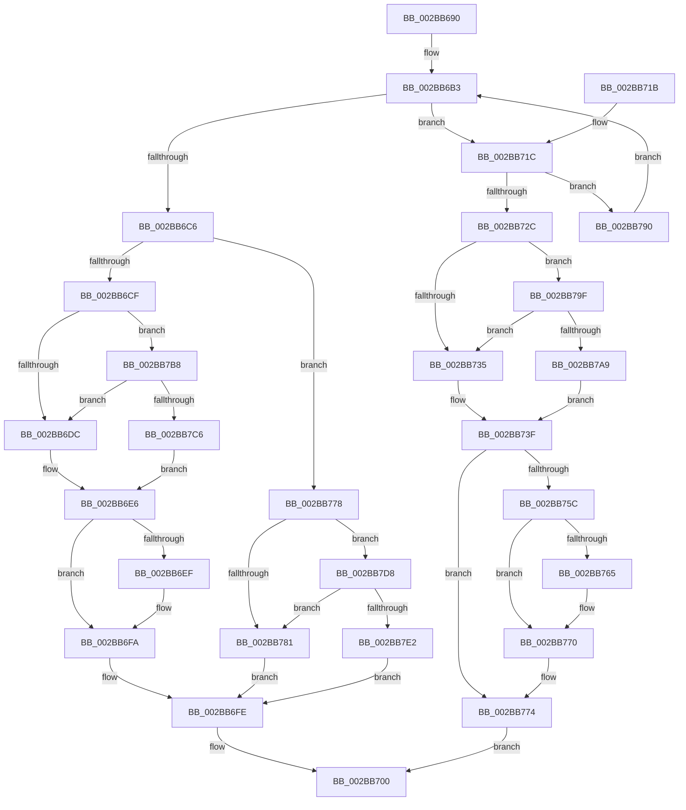

# MmDoesFileHaveUserWritableReferences

- RVA: `0x002BB690`–`0x002BB7F4` (길이 `356` bytes)
- VA: `0x00000001402BB690`
- 실행 섹션: `.text`
- PDB 이름 있음: `예`; PDB Function 태그: `아니요`
- unwind 정보 RVA: `0x0006DDAC`
- 디코드: `89`개 명령, `356/356` bytes 표시
- 미해석 바이트: `0` (있으면 어셈블리에 `.byte`로 보존)

> 이 문서는 커널 이미지의 기계어와 PDB 기호를 분석해 생성했습니다. 4번과 5번은 함수 원형과 자료형을 바이너리 사용 방식에서 추정한 C 해석이며 원본 소스 복구 결과는 아닙니다.

## 1. Dependencies

- 직접 호출 지점: **10**; 고유 호출 대상: **7**
- 직접 호출자로 확인된 함수: **2**
- RIP 상대 이미지 참조: **5**

### Outgoing calls
- `0x002BB6B6` → [ExAcquireSpinLockExclusive](../24/ExAcquireSpinLockExclusive_function_00248690.md) (function, `0x00248690`)
- `0x002BB6F5` → [KiLowerIrqlProcessIrqlFlags](../4F/KiLowerIrqlProcessIrqlFlags_function_004F5698.md) (function, `0x004F5698`)
- `0x002BB723` → [ExTryAcquireSpinLockExclusiveAtDpcLevel](ExTryAcquireSpinLockExclusiveAtDpcLevel_function_002BB800.md) (function, `0x002BB800`)
- `0x002BB742` → [MiDoesControlAreaHaveUserWritableReferences](MiDoesControlAreaHaveUserWritableReferences_function_002BB830.md) (function, `0x002BB830`)
- `0x002BB752` → [ExReleaseSpinLockExclusiveFromDpcLevel](../24/ExReleaseSpinLockExclusiveFromDpcLevel_function_002497E0.md) (function, `0x002497E0`)
- `0x002BB76B` → [KiLowerIrqlProcessIrqlFlags](../4F/KiLowerIrqlProcessIrqlFlags_function_004F5698.md) (function, `0x004F5698`)
- `0x002BB795` → [MiReleaseSpinLockExclusive](../24/MiReleaseSpinLockExclusive_function_002482C0.md) (function, `0x002482C0`)
- `0x002BB7B1` → [ExpReleaseSpinLockExclusiveFromDpcLevelInstrumented](../2C/ExpReleaseSpinLockExclusiveFromDpcLevelInstrumented_function_002C0F44.md) (function, `0x002C0F44`)
- `0x002BB7CE` → [ExpReleaseSpinLockExclusiveFromDpcLevelInstrumented](../2C/ExpReleaseSpinLockExclusiveFromDpcLevelInstrumented_function_002C0F44.md) (function, `0x002C0F44`)
- `0x002BB7EA` → [ExpReleaseSpinLockExclusiveFromDpcLevelInstrumented](../2C/ExpReleaseSpinLockExclusiveFromDpcLevelInstrumented_function_002C0F44.md) (function, `0x002C0F44`)

### Direct callers
- [FsRtlpRequestExclusiveOplock](../3F/FsRtlpRequestExclusiveOplock_function_003F3800.md) at `0x003F3A37`
- [FsRtlpRequestShareableOplock](../4E/FsRtlpRequestShareableOplock_function_004E6EC8.md) at `0x004E711E`

### Static image references
- `0x002BB6AC` → RVA `0x00E2CD00` (`.data`; read)
- `0x002BB6CF` → RVA `0x00FC6B06` (`ALMOSTRO`; read)
- `0x002BB6DC` → RVA `0x00E2CD00` (`.data`; write)
- `0x002BB6E6` → RVA `0x00FC6D20` (`ALMOSTRO`; read)
- `0x002BB79F` → RVA `0x00F0DE58` (`.data`; read)

## 2. Other-region calls and transfers

- 다른 실행 섹션으로 향하는 call: **0**
- 별도 외부 분기/꼬리 이동을 확인하지 못했습니다.

## 3. Assembly (complete function range)

```asm
002BB690  48 8B C4                        mov rax, rsp
002BB693  48 89 58 08                     mov qword ptr [rax + 8], rbx
002BB697  48 89 70 10                     mov qword ptr [rax + 0x10], rsi
002BB69B  48 89 78 18                     mov qword ptr [rax + 0x18], rdi
002BB69F  4C 89 70 20                     mov qword ptr [rax + 0x20], r14
002BB6A3  41 57                           push r15
002BB6A5  48 83 EC 20                     sub rsp, 0x20
002BB6A9  4C 8B F1                        mov r14, rcx
002BB6AC  4C 8D 3D 4D 16 B7 00            lea r15, [rip + 0xb7164d]
002BB6B3  49 8B CF                        mov rcx, r15
002BB6B6  E8 D5 CF F8 FF                  call 0x140248690
002BB6BB  49 8B 36                        mov rsi, qword ptr [r14]
002BB6BE  0F B6 D8                        movzx ebx, al
002BB6C1  48 85 F6                        test rsi, rsi
002BB6C4  75 56                           jne 0x1402bb71c
002BB6C6  80 FB 11                        cmp bl, 0x11
002BB6C9  0F 84 A9 00 00 00               je 0x1402bb778
002BB6CF  F6 05 30 B4 D0 00 01            test byte ptr [rip + 0xd0b430], 1
002BB6D6  0F 85 DC 00 00 00               jne 0x1402bb7b8
002BB6DC  C7 05 1A 16 B7 00 00 00 00 00   mov dword ptr [rip + 0xb7161a], 0
002BB6E6  83 3D 33 B6 D0 00 00            cmp dword ptr [rip + 0xd0b633], 0
002BB6ED  74 0B                           je 0x1402bb6fa
002BB6EF  44 0F 20 C1                     mov rcx, cr8
002BB6F3  8A D3                           mov dl, bl
002BB6F5  E8 9E 9F 23 00                  call 0x1404f5698
002BB6FA  44 0F 22 C3                     mov cr8, rbx
002BB6FE  33 C0                           xor eax, eax
002BB700  48 8B 5C 24 30                  mov rbx, qword ptr [rsp + 0x30]
002BB705  48 8B 74 24 38                  mov rsi, qword ptr [rsp + 0x38]
002BB70A  48 8B 7C 24 40                  mov rdi, qword ptr [rsp + 0x40]
002BB70F  4C 8B 74 24 48                  mov r14, qword ptr [rsp + 0x48]
002BB714  48 83 C4 20                     add rsp, 0x20
002BB718  41 5F                           pop r15
002BB71A  C3                              ret
002BB71B  CC                              int3
002BB71C  48 8D 7E 48                     lea rdi, [rsi + 0x48]
002BB720  48 8B CF                        mov rcx, rdi
002BB723  E8 D8 00 00 00                  call 0x1402bb800
002BB728  85 C0                           test eax, eax
002BB72A  74 64                           je 0x1402bb790
002BB72C  F6 05 D3 B3 D0 00 01            test byte ptr [rip + 0xd0b3d3], 1
002BB733  75 6A                           jne 0x1402bb79f
002BB735  C7 05 C1 15 B7 00 00 00 00 00   mov dword ptr [rip + 0xb715c1], 0
002BB73F  48 8B CE                        mov rcx, rsi
002BB742  E8 E9 00 00 00                  call 0x1402bb830
002BB747  33 F6                           xor esi, esi
002BB749  48 8B CF                        mov rcx, rdi
002BB74C  85 C0                           test eax, eax
002BB74E  40 0F 95 C6                     setne sil
002BB752  E8 89 E0 F8 FF                  call 0x1402497e0
002BB757  80 FB 11                        cmp bl, 0x11
002BB75A  74 18                           je 0x1402bb774
002BB75C  83 3D BD B5 D0 00 00            cmp dword ptr [rip + 0xd0b5bd], 0
002BB763  74 0B                           je 0x1402bb770
002BB765  44 0F 20 C1                     mov rcx, cr8
002BB769  8A D3                           mov dl, bl
002BB76B  E8 28 9F 23 00                  call 0x1404f5698
002BB770  44 0F 22 C3                     mov cr8, rbx
002BB774  8B C6                           mov eax, esi
002BB776  EB 88                           jmp 0x1402bb700
002BB778  F6 05 87 B3 D0 00 01            test byte ptr [rip + 0xd0b387], 1
002BB77F  75 57                           jne 0x1402bb7d8
002BB781  C7 05 75 15 B7 00 00 00 00 00   mov dword ptr [rip + 0xb71575], 0
002BB78B  E9 6E FF FF FF                  jmp 0x1402bb6fe
002BB790  8A D3                           mov dl, bl
002BB792  49 8B CF                        mov rcx, r15
002BB795  E8 26 CB F8 FF                  call 0x1402482c0
002BB79A  E9 14 FF FF FF                  jmp 0x1402bb6b3
002BB79F  8B 05 B3 26 C5 00               mov eax, dword ptr [rip + 0xc526b3]
002BB7A5  85 C0                           test eax, eax
002BB7A7  75 8C                           jne 0x1402bb735
002BB7A9  48 8B 54 24 28                  mov rdx, qword ptr [rsp + 0x28]
002BB7AE  49 8B CF                        mov rcx, r15
002BB7B1  E8 8E 57 00 00                  call 0x1402c0f44
002BB7B6  EB 87                           jmp 0x1402bb73f
002BB7B8  8B 05 9A 26 C5 00               mov eax, dword ptr [rip + 0xc5269a]
002BB7BE  85 C0                           test eax, eax
002BB7C0  0F 85 16 FF FF FF               jne 0x1402bb6dc
002BB7C6  48 8B 54 24 28                  mov rdx, qword ptr [rsp + 0x28]
002BB7CB  49 8B CF                        mov rcx, r15
002BB7CE  E8 71 57 00 00                  call 0x1402c0f44
002BB7D3  E9 0E FF FF FF                  jmp 0x1402bb6e6
002BB7D8  8B 05 7A 26 C5 00               mov eax, dword ptr [rip + 0xc5267a]
002BB7DE  85 C0                           test eax, eax
002BB7E0  75 9F                           jne 0x1402bb781
002BB7E2  48 8B 54 24 28                  mov rdx, qword ptr [rsp + 0x28]
002BB7E7  49 8B CF                        mov rcx, r15
002BB7EA  E8 55 57 00 00                  call 0x1402c0f44
002BB7EF  E9 0A FF FF FF                  jmp 0x1402bb6fe
```

## 4. C-style interpretation (structured pseudocode)

```c
__int64 __fastcall MmDoesFileHaveUserWritableReferences(__int64 a1)
{
    __int64 result;
    __int64 v_rsi;
    __int64 v_rsp;
    unsigned __int64 v_stack_p10;
    unsigned __int64 v_stack_p18;
    unsigned __int64 v_stack_p20;
    unsigned __int64 v_stack_p28;
    unsigned __int64 v_stack_p8;

    *(unsigned __int64 *)(v_rsp + 8) = v_rbx;
    *(unsigned __int64 *)(v_rsp + 16) = v_rsi;
    *(unsigned __int64 *)(v_rsp + 24) = v_rdi;
    *(unsigned __int64 *)(v_rsp + 32) = v_r14;
    v_rsp = (v_rsp) - (32);
loc_002BB6B3:
    result = ExAcquireSpinLockExclusive(v_rip + 11998797, a2, a3, a4);
    if (*(unsigned __int64 *)(a1) != 0) goto loc_002BB71C;
    if (((unsigned __int8)((unsigned __int8)(result))) == 17) goto loc_002BB778;
    if (((*(unsigned __int8 *)(v_rip + 13677616)) & (1)) != 0) goto loc_002BB7B8;
loc_002BB6DC:
    *(unsigned int *)(v_rip + 11998746) = 0;
loc_002BB6E6:
    if ((*(unsigned int *)(v_rip + 13678131)) != 0) {
        a1 = v_cr8;
        a2 = (unsigned __int8)((unsigned __int8)(result));
        result = KiLowerIrqlProcessIrqlFlags(a1, a2, a3, a4);
    }
loc_002BB6FE:
    result = 0;
loc_002BB700:
    v_rsp = (v_rsp) + (32);
    return result;
loc_002BB71C:
    result = ExTryAcquireSpinLockExclusiveAtDpcLevel(v_stack_p10 + 72, a2, a3, a4);
    if ((unsigned int)(result) == 0) goto loc_002BB790;
    if (((*(unsigned __int8 *)(v_rip + 13677523)) & (1)) != 0) goto loc_002BB79F;
loc_002BB735:
    *(unsigned int *)(v_rip + 11998657) = 0;
loc_002BB73F:
    result = MiDoesControlAreaHaveUserWritableReferences(v_stack_p10, a2, a3, a4);
    v_rsi = 0;
    v_rsi = ((unsigned int)(result) != 0) ? 1 : 0;
    result = ExReleaseSpinLockExclusiveFromDpcLevel(v_stack_p10 + 72, a2, a3, a4);
    if (((unsigned __int8)(v_stack_p8)) == 17) goto loc_002BB774;
    if ((*(unsigned int *)(v_rip + 13678013)) != 0) {
        a1 = (unsigned __int8)(result);
        a2 = (unsigned __int8)(v_stack_p8);
        result = KiLowerIrqlProcessIrqlFlags(a1, a2, a3, a4);
    }
loc_002BB774:
    goto loc_002BB700;
loc_002BB778:
    if (((*(unsigned __int8 *)(v_rip + 13677447)) & (1)) != 0) goto loc_002BB7D8;
loc_002BB781:
    *(unsigned int *)(v_rip + 11998581) = 0;
    goto loc_002BB6FE;
loc_002BB790:
    result = MiReleaseSpinLockExclusive(v_rip + 11998797, (unsigned __int8)(v_stack_p8), a3, a4);
    goto loc_002BB6B3;
loc_002BB79F:
    if ((unsigned int)((unsigned int)(*(unsigned int *)(v_rip + 12920499))) != 0) goto loc_002BB735;
    result = ExpReleaseSpinLockExclusiveFromDpcLevelInstrumented(v_rip + 11998797, v_stack_p28, a3, a4);
    goto loc_002BB73F;
loc_002BB7B8:
    if ((unsigned int)((unsigned int)(*(unsigned int *)(v_rip + 12920474))) != 0) goto loc_002BB6DC;
    result = ExpReleaseSpinLockExclusiveFromDpcLevelInstrumented(v_rip + 11998797, v_stack_p28, a3, a4);
    goto loc_002BB6E6;
loc_002BB7D8:
    if ((unsigned int)((unsigned int)(*(unsigned int *)(v_rip + 12920442))) != 0) goto loc_002BB781;
    result = ExpReleaseSpinLockExclusiveFromDpcLevelInstrumented(v_rip + 11998797, v_stack_p28, a3, a4);
    goto loc_002BB6FE;
}
```

## 5. (Beta) C Style

```c
int64_t MmDoesFileHaveUserWritableReferences(void *Arg1)
{
    uint8_t *arg1 = (uint8_t *)Arg1;

    int64_t result;
    int64_t local_rsi;
    int64_t local_rsp;
    uint64_t v_stack_p10;
    uint64_t v_stack_p18;
    uint64_t v_stack_p20;
    uint64_t v_stack_p28;
    uint64_t v_stack_p8;

    *(uint64_t *)(local_rsp + 0x8) = local_rbx;
    *(uint64_t *)(local_rsp + 0x10) = local_rsi;
    *(uint64_t *)(local_rsp + 0x18) = local_rdi;
    *(uint64_t *)(local_rsp + 0x20) = local_r14;
    local_rsp = (local_rsp) - (32);
loc_002BB6B3:
    result = ExAcquireSpinLockExclusive(v_rip + 11998797, a2, a3, a4);
    if (*(uint64_t *)(arg1) != 0) goto loc_002BB71C;
    if (((uint8_t)((uint8_t)(result))) == 17) goto loc_002BB778;
    if (((*(uint8_t *)(v_rip + 0xD0B430)) & (1)) != 0) goto loc_002BB7B8;
loc_002BB6DC:
    *(uint32_t *)(v_rip + 0xB7161A) = 0;
loc_002BB6E6:
    if ((*(uint32_t *)(v_rip + 0xD0B633)) != 0) {
        Arg1 = v_cr8;
        a2 = (uint8_t)((uint8_t)(result));
        result = KiLowerIrqlProcessIrqlFlags(Arg1, a2, a3, a4);
    }
loc_002BB6FE:
    result = 0;
loc_002BB700:
    local_rsp = (local_rsp) + (32);
    return result;
loc_002BB71C:
    result = ExTryAcquireSpinLockExclusiveAtDpcLevel(v_stack_p10 + 72, a2, a3, a4);
    if ((uint32_t)(result) == 0) goto loc_002BB790;
    if (((*(uint8_t *)(v_rip + 0xD0B3D3)) & (1)) != 0) goto loc_002BB79F;
loc_002BB735:
    *(uint32_t *)(v_rip + 0xB715C1) = 0;
loc_002BB73F:
    result = MiDoesControlAreaHaveUserWritableReferences(v_stack_p10, a2, a3, a4);
    local_rsi = 0;
    local_rsi = ((uint32_t)(result) != 0) ? 1 : 0;
    result = ExReleaseSpinLockExclusiveFromDpcLevel(v_stack_p10 + 72, a2, a3, a4);
    if (((uint8_t)(v_stack_p8)) == 17) goto loc_002BB774;
    if ((*(uint32_t *)(v_rip + 0xD0B5BD)) != 0) {
        Arg1 = (uint8_t)(result);
        a2 = (uint8_t)(v_stack_p8);
        result = KiLowerIrqlProcessIrqlFlags(Arg1, a2, a3, a4);
    }
loc_002BB774:
    goto loc_002BB700;
loc_002BB778:
    if (((*(uint8_t *)(v_rip + 0xD0B387)) & (1)) != 0) goto loc_002BB7D8;
loc_002BB781:
    *(uint32_t *)(v_rip + 0xB71575) = 0;
    goto loc_002BB6FE;
loc_002BB790:
    result = MiReleaseSpinLockExclusive(v_rip + 11998797, (uint8_t)(v_stack_p8), a3, a4);
    goto loc_002BB6B3;
loc_002BB79F:
    if ((uint32_t)((uint32_t)(*(uint32_t *)(v_rip + 0xC526B3))) != 0) goto loc_002BB735;
    result = ExpReleaseSpinLockExclusiveFromDpcLevelInstrumented(v_rip + 11998797, v_stack_p28, a3, a4);
    goto loc_002BB73F;
loc_002BB7B8:
    if ((uint32_t)((uint32_t)(*(uint32_t *)(v_rip + 0xC5269A))) != 0) goto loc_002BB6DC;
    result = ExpReleaseSpinLockExclusiveFromDpcLevelInstrumented(v_rip + 11998797, v_stack_p28, a3, a4);
    goto loc_002BB6E6;
loc_002BB7D8:
    if ((uint32_t)((uint32_t)(*(uint32_t *)(v_rip + 0xC5267A))) != 0) goto loc_002BB781;
    result = ExpReleaseSpinLockExclusiveFromDpcLevelInstrumented(v_rip + 11998797, v_stack_p28, a3, a4);
    goto loc_002BB6FE;
}
```

### 관측된 메모리 오프셋

구조체 형식이 확인되지 않은 접근은 인자 기준의 오프셋으로만 기록했습니다.

| 기준 인자 | 오프셋 표현 | 폭 (bit) | 접근 |
|---|---:|---:|---|
| `Arg1` | `+ 0x0` | `64` | `R` |

## 6. Execution-region graph

[열기: 2D/3D 그래프와 함수 탐색 컨트롤 패널](../../../control-panel.html?section=text&rva=0x002BB690&view=graph)

- 2D 그래프는 위에서 아래로 흐르고, 3D 그래프는 빈 공간을 드래그해 회전합니다. Shift+드래그는 이동, 휠은 확대·축소, 함수 노드 선택은 대상 보고서 이동입니다.

### Static fallback


