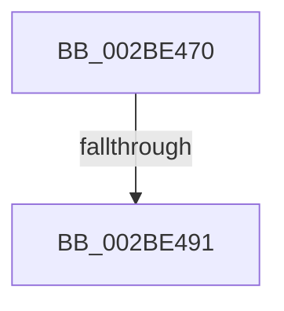

# MmEnoughMemoryForWrite

- RVA: `0x002BE470`–`0x002BE4AF` (길이 `63` bytes)
- VA: `0x00000001402BE470`
- 실행 섹션: `.text`
- PDB 이름 있음: `예`; PDB Function 태그: `아니요`
- unwind 정보 RVA: `0x0006E314`
- 디코드: `17`개 명령, `63/63` bytes 표시
- 미해석 바이트: `0` (있으면 어셈블리에 `.byte`로 보존)

> 이 문서는 커널 이미지의 기계어와 PDB 기호를 분석해 생성했습니다. 4번과 5번은 함수 원형과 자료형을 바이너리 사용 방식에서 추정한 C 해석이며 원본 소스 복구 결과는 아닙니다.

## 1. Dependencies

- 직접 호출 지점: **0**; 고유 호출 대상: **0**
- 직접 호출자로 확인된 함수: **1**
- RIP 상대 이미지 참조: **2**

### Outgoing calls
- 직접 디코드된 call 명령이 없습니다.

### Direct callers
- [CcCanIWriteStreamEx](../38/CcCanIWriteStreamEx_function_0038993C.md) at `0x00389AA3`
- [CcCanIWriteStreamEx](../38/CcCanIWriteStreamEx_function_0038993C.md) at `0x00389B18`

### Static image references
- `0x002BE491` → RVA `0x00E38D00` (`.data`; read)
- `0x002BE498` → RVA `0x00FC521C` (`ALMOSTRO`; read)

## 2. Other-region calls and transfers

- 다른 실행 섹션으로 향하는 call: **0**
- call이 아닌 외부 분기/꼬리 이동: **1**
  - `0x002BE48B` → [sub_002BE5B1](Unknown_function_002BE5B1.md) (`tail-transfer`)

## 3. Assembly (complete function range)

```asm
002BE470  40 53                           push rbx
002BE472  55                              push rbp
002BE473  56                              push rsi
002BE474  57                              push rdi
002BE475  48 83 EC 28                     sub rsp, 0x28
002BE479  33 F6                           xor esi, esi
002BE47B  C6 44 24 50 11                  mov byte ptr [rsp + 0x50], 0x11
002BE480  32 DB                           xor bl, bl
002BE482  48 8B F9                        mov rdi, rcx
002BE485  8D 6E 01                        lea ebp, [rsi + 1]
002BE488  48 85 C9                        test rcx, rcx
002BE48B  0F 85 20 01 00 00               jne 0x1402be5b1
002BE491  4C 8D 05 68 A8 B7 00            lea r8, [rip + 0xb7a868]
002BE498  38 1D 7E 6D D0 00               cmp byte ptr [rip + 0xd06d7e], bl
002BE49E  BA C2 01 00 00                  mov edx, 0x1c2
002BE4A3  4D 8B 88 00 49 00 00            mov r9, qword ptr [r8 + 0x4900]
002BE4AA  B8 00 40 00 00                  mov eax, 0x4000
```

## 4. C-style interpretation (structured pseudocode)

```c
__int64 __fastcall MmEnoughMemoryForWrite(__int64 a1)
{
    __int64 v_rbx;
    __int64 v_rsi;
    __int64 v_rsp;
    unsigned __int8 v_stack_p8;

    v_rsp = (v_rsp) - (40);
    v_rsi = 0;
    v_stack_p8 = 17;
    v_rbx = 0;
    return (unsigned int)(0x4000ULL);
}
```

## 5. (Beta) C Style

```c
int64_t MmEnoughMemoryForWrite(int64_t Arg1)
{
    int64_t local_rbx;
    int64_t local_rsi;
    int64_t local_rsp;
    uint8_t v_stack_p8;

    local_rsp = (local_rsp) - (40);
    local_rsi = 0;
    v_stack_p8 = 17;
    local_rbx = 0;
    return (uint32_t)(0x4000ULL);
}
```

## 6. Execution-region graph

[열기: 2D/3D 그래프와 함수 탐색 컨트롤 패널](../../../control-panel.html?section=text&rva=0x002BE470&view=graph)

- 2D 그래프는 위에서 아래로 흐르고, 3D 그래프는 빈 공간을 드래그해 회전합니다. Shift+드래그는 이동, 휠은 확대·축소, 함수 노드 선택은 대상 보고서 이동입니다.

### Static fallback


