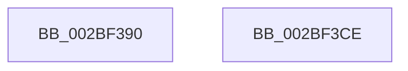

# PoFxSetComponentLatency

- RVA: `0x002BF390`–`0x002BF3CF` (길이 `63` bytes)
- VA: `0x00000001402BF390`
- 실행 섹션: `.text`
- PDB 이름 있음: `예`; PDB Function 태그: `아니요`
- unwind 정보 RVA: `0x00060BC4`
- 디코드: `19`개 명령, `63/63` bytes 표시
- 미해석 바이트: `0` (있으면 어셈블리에 `.byte`로 보존)

> 이 문서는 커널 이미지의 기계어와 PDB 기호를 분석해 생성했습니다. 4번과 5번은 함수 원형과 자료형을 바이너리 사용 방식에서 추정한 C 해석이며 원본 소스 복구 결과는 아닙니다.

## 1. Dependencies

- 직접 호출 지점: **2**; 고유 호출 대상: **2**
- 직접 호출자로 확인된 함수: **1**
- RIP 상대 이미지 참조: **0**

### Outgoing calls
- `0x002BF3AB` → [PopDiagTraceFxComponentLatency](PopDiagTraceFxComponentLatency_function_002BF5C4.md) (function, `0x002BF5C4`)
- `0x002BF3B9` → [PopPepComponentSetLatency](PopPepComponentSetLatency_function_002BF3D8.md) (function, `0x002BF3D8`)

### Direct callers
- [DifPoFxSetComponentLatencyWrapper](../63/DifPoFxSetComponentLatencyWrapper_function_00639B60.md) at `0x00639C44`

### Static image references
- 디코드된 RIP-relative 메모리 참조가 없습니다.

## 2. Other-region calls and transfers

- 다른 실행 섹션으로 향하는 call: **0**
- 별도 외부 분기/꼬리 이동을 확인하지 못했습니다.

## 3. Assembly (complete function range)

```asm
002BF390  48 89 5C 24 08                  mov qword ptr [rsp + 8], rbx
002BF395  48 89 74 24 10                  mov qword ptr [rsp + 0x10], rsi
002BF39A  57                              push rdi
002BF39B  48 83 EC 20                     sub rsp, 0x20
002BF39F  48 8B F1                        mov rsi, rcx
002BF3A2  49 8B D8                        mov rbx, r8
002BF3A5  48 8B 49 30                     mov rcx, qword ptr [rcx + 0x30]
002BF3A9  8B FA                           mov edi, edx
002BF3AB  E8 14 02 00 00                  call 0x1402bf5c4
002BF3B0  48 8B 4E 38                     mov rcx, qword ptr [rsi + 0x38]
002BF3B4  4C 8B C3                        mov r8, rbx
002BF3B7  8B D7                           mov edx, edi
002BF3B9  E8 1A 00 00 00                  call 0x1402bf3d8
002BF3BE  48 8B 5C 24 30                  mov rbx, qword ptr [rsp + 0x30]
002BF3C3  48 8B 74 24 38                  mov rsi, qword ptr [rsp + 0x38]
002BF3C8  48 83 C4 20                     add rsp, 0x20
002BF3CC  5F                              pop rdi
002BF3CD  C3                              ret
002BF3CE  CC                              int3
```

## 4. C-style interpretation (structured pseudocode)

```c
__int64 __fastcall PoFxSetComponentLatency(__int64 a1, int a2, __int64 a3)
{
    __int64 result;
    __int64 v_rsp;
    unsigned __int64 v_stack_p10;
    unsigned __int64 v_stack_p8;

    v_stack_p8 = v_rbx;
    v_stack_p10 = v_rsi;
    v_rsp = (v_rsp) - (32);
    result = PopDiagTraceFxComponentLatency(*(unsigned __int64 *)(a1 + 48), a2, a3, a4);
    result = PopPepComponentSetLatency(*(unsigned __int64 *)(a1 + 56), (unsigned int)((unsigned int)((unsigned int)(a2))), a3, a4);
    v_rsp = (v_rsp) + (32);
    return result;
}
```

## 5. (Beta) C Style

```c
int64_t PoFxSetComponentLatency(void *Arg1, int32_t Arg2, int64_t Arg3)
{
    uint8_t *arg1 = (uint8_t *)Arg1;

    int64_t result;
    int64_t local_rsp;
    uint64_t v_stack_p10;
    uint64_t v_stack_p8;

    v_stack_p8 = local_rbx;
    v_stack_p10 = local_rsi;
    local_rsp = (local_rsp) - (32);
    result = PopDiagTraceFxComponentLatency(*(uint64_t *)(arg1 + 0x30), Arg2, Arg3, a4);
    result = PopPepComponentSetLatency(*(uint64_t *)(arg1 + 0x38), (uint32_t)((uint32_t)((uint32_t)(Arg2))), Arg3, a4);
    local_rsp = (local_rsp) + (32);
    return result;
}
```

### 관측된 메모리 오프셋

구조체 형식이 확인되지 않은 접근은 인자 기준의 오프셋으로만 기록했습니다.

| 기준 인자 | 오프셋 표현 | 폭 (bit) | 접근 |
|---|---:|---:|---|
| `Arg1` | `+ 0x30` | `64` | `R` |
| `Arg1` | `+ 0x38` | `64` | `R` |

## 6. Execution-region graph

[열기: 2D/3D 그래프와 함수 탐색 컨트롤 패널](../../../control-panel.html?section=text&rva=0x002BF390&view=graph)

- 2D 그래프는 위에서 아래로 흐르고, 3D 그래프는 빈 공간을 드래그해 회전합니다. Shift+드래그는 이동, 휠은 확대·축소, 함수 노드 선택은 대상 보고서 이동입니다.

### Static fallback


