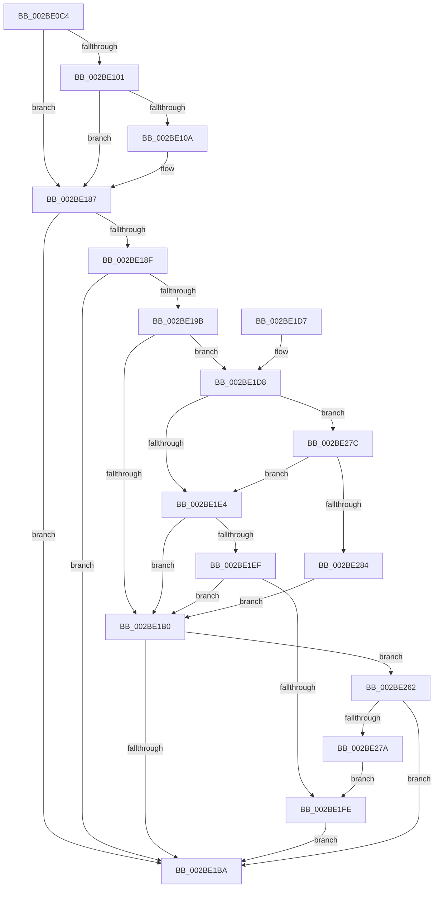

# PopDiagTraceFxComponentIdleState

- RVA: `0x002BE0C4`–`0x002BE289` (길이 `453` bytes)
- VA: `0x00000001402BE0C4`
- 실행 섹션: `.text`
- PDB 이름 있음: `예`; PDB Function 태그: `아니요`
- unwind 정보 RVA: `0x0006E2CC`
- 디코드: `101`개 명령, `453/453` bytes 표시
- 미해석 바이트: `0` (있으면 어셈블리에 `.byte`로 보존)

> 이 문서는 커널 이미지의 기계어와 PDB 기호를 분석해 생성했습니다. 4번과 5번은 함수 원형과 자료형을 바이너리 사용 방식에서 추정한 C 해석이며 원본 소스 복구 결과는 아닙니다.

## 1. Dependencies

- 직접 호출 지점: **3**; 고유 호출 대상: **3**
- 직접 호출자로 확인된 함수: **2**
- RIP 상대 이미지 참조: **4**

### Outgoing calls
- `0x002BE1C1` → [_security_check_cookie](../6A/_security_check_cookie_function_006AC640.md) (function, `0x006AC640`)
- `0x002BE258` → [EtwWriteEx](../25/EtwWriteEx_function_0025F0D0.md) (function, `0x0025F0D0`)
- `0x002BE26D` → [EtwpLevelKeywordEnabled](../2F/EtwpLevelKeywordEnabled_function_002FD110.md) (function, `0x002FD110`)

### Direct callers
- [sub_002BD95A](Unknown_function_002BD95A.md) at `0x002BDA56`
- [PoFxCompleteIdleState](../46/PoFxCompleteIdleState_function_004666C0.md) at `0x00466732`

### Static image references
- `0x002BE0DE` → RVA `0x00E0A740` (`.data`; read)
- `0x002BE187` → RVA `0x00E67858` (`.data`; read)
- `0x002BE18F` → RVA `0x00F0B408` (`.data`; read)
- `0x002BE20D` → RVA `0x00010958` (`.rdata`; read)

## 2. Other-region calls and transfers

- 다른 실행 섹션으로 향하는 call: **0**
- 별도 외부 분기/꼬리 이동을 확인하지 못했습니다.

## 3. Assembly (complete function range)

```asm
002BE0C4  48 8B C4                        mov rax, rsp
002BE0C7  48 89 58 20                     mov qword ptr [rax + 0x20], rbx
002BE0CB  44 89 40 18                     mov dword ptr [rax + 0x18], r8d
002BE0CF  89 50 10                        mov dword ptr [rax + 0x10], edx
002BE0D2  55                              push rbp
002BE0D3  48 8D 68 A1                     lea rbp, [rax - 0x5f]
002BE0D7  48 81 EC 90 00 00 00            sub rsp, 0x90
002BE0DE  48 8B 05 5B C6 B4 00            mov rax, qword ptr [rip + 0xb4c65b]
002BE0E5  48 33 C4                        xor rax, rsp
002BE0E8  48 89 45 47                     mov qword ptr [rbp + 0x47], rax
002BE0EC  33 DB                           xor ebx, ebx
002BE0EE  48 89 4D 0F                     mov qword ptr [rbp + 0xf], rcx
002BE0F2  45 8B D8                        mov r11d, r8d
002BE0F5  44 8B D2                        mov r10d, edx
002BE0F8  48 85 C9                        test rcx, rcx
002BE0FB  0F 84 86 00 00 00               je 0x1402be187
002BE101  4C 8B 49 50                     mov r9, qword ptr [rcx + 0x50]
002BE105  4D 85 C9                        test r9, r9
002BE108  74 7D                           je 0x1402be187
002BE10A  8D 43 01                        lea eax, [rbx + 1]
002BE10D  F0 41 0F C1 81 80 03 00 00      lock xadd dword ptr [r9 + 0x380], eax
002BE116  33 D2                           xor edx, edx
002BE118  41 F7 B1 70 03 00 00            div dword ptr [r9 + 0x370]
002BE11F  48 A1 08 00 00 00 80 F7 FF FF   movabs rax, qword ptr [0xfffff78000000008]
002BE129  4C 8D 04 52                     lea r8, [rdx + rdx*2]
002BE12D  49 8B 91 78 03 00 00            mov rdx, qword ptr [r9 + 0x378]
002BE134  4A 89 04 C2                     mov qword ptr [rdx + r8*8], rax
002BE138  42 C6 44 C2 08 08               mov byte ptr [rdx + r8*8 + 8], 8
002BE13E  46 88 54 C2 09                  mov byte ptr [rdx + r8*8 + 9], r10b
002BE143  65 48 8B 04 25 20 00 00 00      mov rax, qword ptr gs:[0x20]
002BE14C  0F B7 48 24                     movzx ecx, word ptr [rax + 0x24]
002BE150  66 42 89 4C C2 0A               mov word ptr [rdx + r8*8 + 0xa], cx
002BE156  65 48 8B 04 25 88 01 00 00      mov rax, qword ptr gs:[0x188]
002BE15F  0F B7 88 08 05 00 00            movzx ecx, word ptr [rax + 0x508]
002BE166  66 42 89 4C C2 0C               mov word ptr [rdx + r8*8 + 0xc], cx
002BE16C  65 48 8B 04 25 88 01 00 00      mov rax, qword ptr gs:[0x188]
002BE175  0F B7 88 10 05 00 00            movzx ecx, word ptr [rax + 0x510]
002BE17C  66 42 89 4C C2 0E               mov word ptr [rdx + r8*8 + 0xe], cx
002BE182  4E 89 5C C2 10                  mov qword ptr [rdx + r8*8 + 0x10], r11
002BE187  38 1D CB 96 BA 00               cmp byte ptr [rip + 0xba96cb], bl
002BE18D  74 2B                           je 0x1402be1ba
002BE18F  48 8B 15 72 D2 C4 00            mov rdx, qword ptr [rip + 0xc4d272]
002BE196  48 85 D2                        test rdx, rdx
002BE199  74 1F                           je 0x1402be1ba
002BE19B  48 8B 4A 20                     mov rcx, qword ptr [rdx + 0x20]
002BE19F  41 B8 00 01 00 00               mov r8d, 0x100
002BE1A5  41 BA 04 00 00 00               mov r10d, 4
002BE1AB  39 59 60                        cmp dword ptr [rcx + 0x60], ebx
002BE1AE  75 28                           jne 0x1402be1d8
002BE1B0  66 39 5A 66                     cmp word ptr [rdx + 0x66], bx
002BE1B4  0F 85 A8 00 00 00               jne 0x1402be262
002BE1BA  48 8B 4D 47                     mov rcx, qword ptr [rbp + 0x47]
002BE1BE  48 33 CC                        xor rcx, rsp
002BE1C1  E8 7A E4 3E 00                  call 0x1406ac640
002BE1C6  48 8B 9C 24 B8 00 00 00         mov rbx, qword ptr [rsp + 0xb8]
002BE1CE  48 81 C4 90 00 00 00            add rsp, 0x90
002BE1D5  5D                              pop rbp
002BE1D6  C3                              ret
002BE1D7  CC                              int3
002BE1D8  8A 41 64                        mov al, byte ptr [rcx + 0x64]
002BE1DB  41 3A C2                        cmp al, r10b
002BE1DE  0F 82 98 00 00 00               jb 0x1402be27c
002BE1E4  8B 41 68                        mov eax, dword ptr [rcx + 0x68]
002BE1E7  8B 41 70                        mov eax, dword ptr [rcx + 0x70]
002BE1EA  49 85 C0                        test r8, rax
002BE1ED  74 C1                           je 0x1402be1b0
002BE1EF  48 8B 49 78                     mov rcx, qword ptr [rcx + 0x78]
002BE1F3  48 8B C1                        mov rax, rcx
002BE1F6  49 23 C0                        and rax, r8
002BE1F9  48 3B C1                        cmp rax, rcx
002BE1FC  75 B2                           jne 0x1402be1b0
002BE1FE  48 8B 0D 03 D2 C4 00            mov rcx, qword ptr [rip + 0xc4d203]
002BE205  48 8D 45 0F                     lea rax, [rbp + 0xf]
002BE209  48 89 45 17                     mov qword ptr [rbp + 0x17], rax
002BE20D  48 8D 15 44 27 D5 FF            lea rdx, [rip - 0x2ad8bc]
002BE214  48 8D 45 6F                     lea rax, [rbp + 0x6f]
002BE218  48 C7 45 1F 08 00 00 00         mov qword ptr [rbp + 0x1f], 8
002BE220  48 89 45 27                     mov qword ptr [rbp + 0x27], rax
002BE224  41 B9 01 00 00 00               mov r9d, 1
002BE22A  48 8D 45 77                     lea rax, [rbp + 0x77]
002BE22E  4C 89 55 2F                     mov qword ptr [rbp + 0x2f], r10
002BE232  48 89 45 37                     mov qword ptr [rbp + 0x37], rax
002BE236  45 33 C0                        xor r8d, r8d
002BE239  48 8D 45 17                     lea rax, [rbp + 0x17]
002BE23D  4C 89 55 3F                     mov qword ptr [rbp + 0x3f], r10
002BE241  48 89 44 24 38                  mov qword ptr [rsp + 0x38], rax
002BE246  C7 44 24 30 03 00 00 00         mov dword ptr [rsp + 0x30], 3
002BE24E  48 89 5C 24 28                  mov qword ptr [rsp + 0x28], rbx
002BE253  48 89 5C 24 20                  mov qword ptr [rsp + 0x20], rbx
002BE258  E8 73 0E FA FF                  call 0x14025f0d0
002BE25D  E9 58 FF FF FF                  jmp 0x1402be1ba
002BE262  48 8B 4A 28                     mov rcx, qword ptr [rdx + 0x28]
002BE266  41 8A D2                        mov dl, r10b
002BE269  48 83 C1 60                     add rcx, 0x60
002BE26D  E8 9E EE 03 00                  call 0x1402fd110
002BE272  84 C0                           test al, al
002BE274  0F 84 40 FF FF FF               je 0x1402be1ba
002BE27A  EB 82                           jmp 0x1402be1fe
002BE27C  84 C0                           test al, al
002BE27E  0F 84 60 FF FF FF               je 0x1402be1e4
002BE284  E9 27 FF FF FF                  jmp 0x1402be1b0
```

## 4. C-style interpretation (structured pseudocode)

```c
__int64 __fastcall PopDiagTraceFxComponentIdleState(__int64 a1, int a2, int a3)
{
    __int64 result;
    __int64 v_rbx;
    __int64 v_rsp;
    unsigned __int64 v_stack_p20;
    unsigned __int64 v_stack_p28;
    unsigned int v_stack_p30;
    unsigned __int64 v_stack_p38;

    *(unsigned __int64 *)(v_rsp + 32) = v_rbx;
    *(unsigned int *)(v_rsp + 24) = a3;
    *(unsigned int *)(v_rsp + 16) = a2;
    v_rsp = (v_rsp) - (144);
    result = (*(unsigned __int64 *)(v_rip + 11847259)) ^ (v_rsp);
    *(unsigned __int64 *)(v_rsp - 95 + 71) = result;
    v_rbx = 0;
    *(unsigned __int64 *)(v_rsp - 95 + 15) = a1;
    if (a1 == 0) goto loc_002BE187;
    if (*(unsigned __int64 *)(a1 + 80) != 0) {
        result = v_rbx + 1;
        a2 = 0;
        a3 = a2 + a2 * 2;
        a2 = *(unsigned __int64 *)(*(unsigned __int64 *)(a1 + 80) + 888);
        *(unsigned __int64 *)(a2 + a3 * 8) = result;
        *(unsigned __int8 *)(a2 + a3 * 8 + 8) = 8;
        *(unsigned __int8 *)(a2 + a3 * 8 + 9) = (unsigned __int8)((unsigned int)(a2));
        result = *(unsigned __int64 *)(gs_base + (0 + 32));
        a1 = *(unsigned __int16 *)(result + 36);
        *(unsigned __int16 *)(a2 + a3 * 8 + 10) = (unsigned __int16)(a1);
        result = *(unsigned __int64 *)(gs_base + (0 + 392));
        a1 = *(unsigned __int16 *)(result + 1288);
        *(unsigned __int16 *)(a2 + a3 * 8 + 12) = (unsigned __int16)(a1);
        result = *(unsigned __int64 *)(gs_base + (0 + 392));
        a1 = *(unsigned __int16 *)(result + 1296);
        *(unsigned __int16 *)(a2 + a3 * 8 + 14) = (unsigned __int16)(a1);
        *(unsigned __int64 *)(a2 + a3 * 8 + 16) = (unsigned int)(a3);
    }
    if ((*(unsigned __int8 *)(v_rip + 12228299)) == 0) goto loc_002BE1BA;
    if (*(unsigned __int64 *)(v_rip + 12898930) == 0) goto loc_002BE1BA;
    if ((*(unsigned int *)(*(unsigned __int64 *)(*(unsigned __int64 *)(v_rip + 12898930) + 32) + 96)) != 0) goto loc_002BE1D8;
loc_002BE1B0:
    if ((*(unsigned __int16 *)(*(unsigned __int64 *)(v_rip + 12898930) + 102)) != 0) goto loc_002BE262;
loc_002BE1BA:
    a1 = (*(unsigned __int64 *)(v_rsp - 95 + 71)) ^ (v_rsp);
    result = _security_check_cookie(a1, *(unsigned __int64 *)(v_rip + 12898930), 256, *(unsigned __int64 *)(a1 + 80));
    v_rsp = (v_rsp) + (144);
    return result;
loc_002BE1D8:
    if (((unsigned __int8)(*(unsigned __int8 *)(a1 + 100))) < 4) goto loc_002BE27C;
loc_002BE1E4:
    if (((256) & ((unsigned int)(*(unsigned int *)(a1 + 112)))) == 0) goto loc_002BE1B0;
    result = (*(unsigned __int64 *)(a1 + 120)) & (256);
    if (result != (*(unsigned __int64 *)(a1 + 120))) goto loc_002BE1B0;
loc_002BE1FE:
    *(unsigned __int64 *)(v_rsp - 95 + 23) = v_rsp - 95 + 15;
    *(unsigned __int64 *)(v_rsp - 95 + 31) = 8;
    *(unsigned __int64 *)(v_rsp - 95 + 39) = v_rsp - 95 + 111;
    *(unsigned __int64 *)(v_rsp - 95 + 47) = 4;
    *(unsigned __int64 *)(v_rsp - 95 + 55) = v_rsp - 95 + 119;
    a3 = 0;
    *(unsigned __int64 *)(v_rsp - 95 + 63) = 4;
    v_stack_p38 = v_rsp - 95 + 23;
    v_stack_p30 = 3;
    v_stack_p28 = v_stack_p20;
    v_stack_p20 = v_stack_p20;
    result = EtwWriteEx(*(unsigned __int64 *)(v_rip + 12898819), v_rip - 2807996, a3, 1);
    goto loc_002BE1BA;
loc_002BE262:
    a1 = (*(unsigned __int64 *)(v_rip - 2807996 + 40)) + (96);
    result = EtwpLevelKeywordEnabled(a1, 4, a3, 1);
    if ((unsigned __int8)(result) == 0) goto loc_002BE1BA;
    goto loc_002BE1FE;
loc_002BE27C:
    if ((unsigned __int8)(result) == 0) goto loc_002BE1E4;
    goto loc_002BE1B0;
}
```

## 5. (Beta) C Style

```c
int64_t PopDiagTraceFxComponentIdleState(int64_t Arg1, int32_t Arg2, int32_t Arg3)
{
    int64_t result;
    int64_t local_rbx;
    int64_t local_rsp;
    uint64_t v_stack_p20;
    uint64_t v_stack_p28;
    uint32_t v_stack_p30;
    uint64_t v_stack_p38;

    *(uint64_t *)(local_rsp + 0x20) = local_rbx;
    *(uint32_t *)(local_rsp + 0x18) = Arg3;
    *(uint32_t *)(local_rsp + 0x10) = Arg2;
    local_rsp = (local_rsp) - (144);
    result = (*(uint64_t *)(v_rip + 0xB4C65B)) ^ (local_rsp);
    *(uint64_t *)(local_rsp - 0x5F + 0x47) = result;
    local_rbx = 0;
    *(uint64_t *)(local_rsp - 0x5F + 0xF) = Arg1;
    if (Arg1 == 0) goto loc_002BE187;
    if (*(uint64_t *)(Arg1 + 0x50) != 0) {
        result = local_rbx + 1;
        Arg2 = 0;
        Arg3 = Arg2 + Arg2 * 2;
        Arg2 = *(uint64_t *)(*(uint64_t *)(Arg1 + 0x50) + 0x378);
        *(uint64_t *)(Arg2 + Arg3 * 8) = result;
        *(uint8_t *)(Arg2 + Arg3 * 8 + 0x8) = 8;
        *(uint8_t *)(Arg2 + Arg3 * 8 + 0x9) = (uint8_t)((uint32_t)(Arg2));
        result = *(uint64_t *)(gs_base + (0 + 0x20));
        Arg1 = *(uint16_t *)(result + 0x24);
        *(uint16_t *)(Arg2 + Arg3 * 8 + 0xA) = (uint16_t)(Arg1);
        result = *(uint64_t *)(gs_base + (0 + 0x188));
        Arg1 = *(uint16_t *)(result + 0x508);
        *(uint16_t *)(Arg2 + Arg3 * 8 + 0xC) = (uint16_t)(Arg1);
        result = *(uint64_t *)(gs_base + (0 + 0x188));
        Arg1 = *(uint16_t *)(result + 0x510);
        *(uint16_t *)(Arg2 + Arg3 * 8 + 0xE) = (uint16_t)(Arg1);
        *(uint64_t *)(Arg2 + Arg3 * 8 + 0x10) = (uint32_t)(Arg3);
    }
    if ((*(uint8_t *)(v_rip + 0xBA96CB)) == 0) goto loc_002BE1BA;
    if (*(uint64_t *)(v_rip + 0xC4D272) == 0) goto loc_002BE1BA;
    if ((*(uint32_t *)(*(uint64_t *)(*(uint64_t *)(v_rip + 0xC4D272) + 0x20) + 0x60)) != 0) goto loc_002BE1D8;
loc_002BE1B0:
    if ((*(uint16_t *)(*(uint64_t *)(v_rip + 0xC4D272) + 0x66)) != 0) goto loc_002BE262;
loc_002BE1BA:
    Arg1 = (*(uint64_t *)(local_rsp - 0x5F + 0x47)) ^ (local_rsp);
    result = _security_check_cookie(Arg1, *(uint64_t *)(v_rip + 0xC4D272), 256, *(uint64_t *)(Arg1 + 0x50));
    local_rsp = (local_rsp) + (144);
    return result;
loc_002BE1D8:
    if (((uint8_t)(*(uint8_t *)(Arg1 + 0x64))) < 4) goto loc_002BE27C;
loc_002BE1E4:
    if (((256) & ((uint32_t)(*(uint32_t *)(Arg1 + 0x70)))) == 0) goto loc_002BE1B0;
    result = (*(uint64_t *)(Arg1 + 0x78)) & (256);
    if (result != (*(uint64_t *)(Arg1 + 0x78))) goto loc_002BE1B0;
loc_002BE1FE:
    *(uint64_t *)(local_rsp - 0x5F + 0x17) = local_rsp - 95 + 15;
    *(uint64_t *)(local_rsp - 0x5F + 0x1F) = 8;
    *(uint64_t *)(local_rsp - 0x5F + 0x27) = local_rsp - 95 + 111;
    *(uint64_t *)(local_rsp - 0x5F + 0x2F) = 4;
    *(uint64_t *)(local_rsp - 0x5F + 0x37) = local_rsp - 95 + 119;
    Arg3 = 0;
    *(uint64_t *)(local_rsp - 0x5F + 0x3F) = 4;
    v_stack_p38 = local_rsp - 95 + 23;
    v_stack_p30 = 3;
    v_stack_p28 = v_stack_p20;
    v_stack_p20 = v_stack_p20;
    result = EtwWriteEx(*(uint64_t *)(v_rip + 0xC4D203), v_rip - 2807996, Arg3, 1);
    goto loc_002BE1BA;
loc_002BE262:
    Arg1 = (*(uint64_t *)(v_rip - 0x2AD8BC + 0x28)) + (96);
    result = EtwpLevelKeywordEnabled(Arg1, 4, Arg3, 1);
    if ((uint8_t)(result) == 0) goto loc_002BE1BA;
    goto loc_002BE1FE;
loc_002BE27C:
    if ((uint8_t)(result) == 0) goto loc_002BE1E4;
    goto loc_002BE1B0;
}
```

## 6. Execution-region graph

[열기: 2D/3D 그래프와 함수 탐색 컨트롤 패널](../../../control-panel.html?section=text&rva=0x002BE0C4&view=graph)

- 2D 그래프는 위에서 아래로 흐르고, 3D 그래프는 빈 공간을 드래그해 회전합니다. Shift+드래그는 이동, 휠은 확대·축소, 함수 노드 선택은 대상 보고서 이동입니다.

### Static fallback


