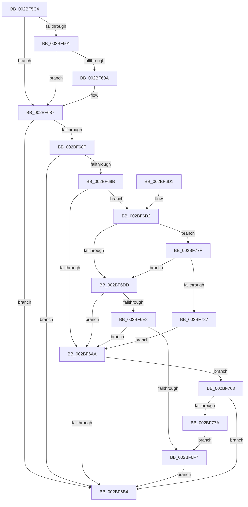

# PopDiagTraceFxComponentLatency

- RVA: `0x002BF5C4`–`0x002BF78C` (길이 `456` bytes)
- VA: `0x00000001402BF5C4`
- 실행 섹션: `.text`
- PDB 이름 있음: `예`; PDB Function 태그: `아니요`
- unwind 정보 RVA: `0x0006E4A4`
- 디코드: `100`개 명령, `456/456` bytes 표시
- 미해석 바이트: `0` (있으면 어셈블리에 `.byte`로 보존)

> 이 문서는 커널 이미지의 기계어와 PDB 기호를 분석해 생성했습니다. 4번과 5번은 함수 원형과 자료형을 바이너리 사용 방식에서 추정한 C 해석이며 원본 소스 복구 결과는 아닙니다.

## 1. Dependencies

- 직접 호출 지점: **3**; 고유 호출 대상: **3**
- 직접 호출자로 확인된 함수: **1**
- RIP 상대 이미지 참조: **4**

### Outgoing calls
- `0x002BF6BB` → [_security_check_cookie](../6A/_security_check_cookie_function_006AC640.md) (function, `0x006AC640`)
- `0x002BF759` → [EtwWriteEx](../25/EtwWriteEx_function_0025F0D0.md) (function, `0x0025F0D0`)
- `0x002BF76D` → [EtwpLevelKeywordEnabled](../2F/EtwpLevelKeywordEnabled_function_002FD110.md) (function, `0x002FD110`)

### Direct callers
- [PoFxSetComponentLatency](PoFxSetComponentLatency_function_002BF390.md) at `0x002BF3AB`

### Static image references
- `0x002BF5DE` → RVA `0x00E0A740` (`.data`; read)
- `0x002BF687` → RVA `0x00E67858` (`.data`; read)
- `0x002BF68F` → RVA `0x00F0B408` (`.data`; read)
- `0x002BF706` → RVA `0x00010948` (`.rdata`; read)

## 2. Other-region calls and transfers

- 다른 실행 섹션으로 향하는 call: **0**
- 별도 외부 분기/꼬리 이동을 확인하지 못했습니다.

## 3. Assembly (complete function range)

```asm
002BF5C4  48 8B C4                        mov rax, rsp
002BF5C7  48 89 58 20                     mov qword ptr [rax + 0x20], rbx
002BF5CB  4C 89 40 18                     mov qword ptr [rax + 0x18], r8
002BF5CF  89 50 10                        mov dword ptr [rax + 0x10], edx
002BF5D2  55                              push rbp
002BF5D3  48 8D 68 A1                     lea rbp, [rax - 0x5f]
002BF5D7  48 81 EC 90 00 00 00            sub rsp, 0x90
002BF5DE  48 8B 05 5B B1 B4 00            mov rax, qword ptr [rip + 0xb4b15b]
002BF5E5  48 33 C4                        xor rax, rsp
002BF5E8  48 89 45 47                     mov qword ptr [rbp + 0x47], rax
002BF5EC  33 DB                           xor ebx, ebx
002BF5EE  48 89 4D 0F                     mov qword ptr [rbp + 0xf], rcx
002BF5F2  4D 8B D0                        mov r10, r8
002BF5F5  44 8B DA                        mov r11d, edx
002BF5F8  48 85 C9                        test rcx, rcx
002BF5FB  0F 84 86 00 00 00               je 0x1402bf687
002BF601  4C 8B 49 50                     mov r9, qword ptr [rcx + 0x50]
002BF605  4D 85 C9                        test r9, r9
002BF608  74 7D                           je 0x1402bf687
002BF60A  8D 43 01                        lea eax, [rbx + 1]
002BF60D  F0 41 0F C1 81 80 03 00 00      lock xadd dword ptr [r9 + 0x380], eax
002BF616  33 D2                           xor edx, edx
002BF618  41 F7 B1 70 03 00 00            div dword ptr [r9 + 0x370]
002BF61F  48 A1 08 00 00 00 80 F7 FF FF   movabs rax, qword ptr [0xfffff78000000008]
002BF629  4C 8D 04 52                     lea r8, [rdx + rdx*2]
002BF62D  49 8B 91 78 03 00 00            mov rdx, qword ptr [r9 + 0x378]
002BF634  4A 89 04 C2                     mov qword ptr [rdx + r8*8], rax
002BF638  42 C6 44 C2 08 09               mov byte ptr [rdx + r8*8 + 8], 9
002BF63E  46 88 5C C2 09                  mov byte ptr [rdx + r8*8 + 9], r11b
002BF643  65 48 8B 04 25 20 00 00 00      mov rax, qword ptr gs:[0x20]
002BF64C  0F B7 48 24                     movzx ecx, word ptr [rax + 0x24]
002BF650  66 42 89 4C C2 0A               mov word ptr [rdx + r8*8 + 0xa], cx
002BF656  65 48 8B 04 25 88 01 00 00      mov rax, qword ptr gs:[0x188]
002BF65F  0F B7 88 08 05 00 00            movzx ecx, word ptr [rax + 0x508]
002BF666  66 42 89 4C C2 0C               mov word ptr [rdx + r8*8 + 0xc], cx
002BF66C  65 48 8B 04 25 88 01 00 00      mov rax, qword ptr gs:[0x188]
002BF675  0F B7 88 10 05 00 00            movzx ecx, word ptr [rax + 0x510]
002BF67C  66 42 89 4C C2 0E               mov word ptr [rdx + r8*8 + 0xe], cx
002BF682  4E 89 54 C2 10                  mov qword ptr [rdx + r8*8 + 0x10], r10
002BF687  38 1D CB 81 BA 00               cmp byte ptr [rip + 0xba81cb], bl
002BF68D  74 25                           je 0x1402bf6b4
002BF68F  48 8B 15 72 BD C4 00            mov rdx, qword ptr [rip + 0xc4bd72]
002BF696  48 85 D2                        test rdx, rdx
002BF699  74 19                           je 0x1402bf6b4
002BF69B  48 8B 4A 20                     mov rcx, qword ptr [rdx + 0x20]
002BF69F  41 B8 00 01 00 00               mov r8d, 0x100
002BF6A5  39 59 60                        cmp dword ptr [rcx + 0x60], ebx
002BF6A8  75 28                           jne 0x1402bf6d2
002BF6AA  66 39 5A 66                     cmp word ptr [rdx + 0x66], bx
002BF6AE  0F 85 AF 00 00 00               jne 0x1402bf763
002BF6B4  48 8B 4D 47                     mov rcx, qword ptr [rbp + 0x47]
002BF6B8  48 33 CC                        xor rcx, rsp
002BF6BB  E8 80 CF 3E 00                  call 0x1406ac640
002BF6C0  48 8B 9C 24 B8 00 00 00         mov rbx, qword ptr [rsp + 0xb8]
002BF6C8  48 81 C4 90 00 00 00            add rsp, 0x90
002BF6CF  5D                              pop rbp
002BF6D0  C3                              ret
002BF6D1  CC                              int3
002BF6D2  8A 41 64                        mov al, byte ptr [rcx + 0x64]
002BF6D5  3C 04                           cmp al, 4
002BF6D7  0F 82 A2 00 00 00               jb 0x1402bf77f
002BF6DD  8B 41 68                        mov eax, dword ptr [rcx + 0x68]
002BF6E0  8B 41 70                        mov eax, dword ptr [rcx + 0x70]
002BF6E3  49 85 C0                        test r8, rax
002BF6E6  74 C2                           je 0x1402bf6aa
002BF6E8  48 8B 49 78                     mov rcx, qword ptr [rcx + 0x78]
002BF6EC  48 8B C1                        mov rax, rcx
002BF6EF  49 23 C0                        and rax, r8
002BF6F2  48 3B C1                        cmp rax, rcx
002BF6F5  75 B3                           jne 0x1402bf6aa
002BF6F7  48 8B 0D 0A BD C4 00            mov rcx, qword ptr [rip + 0xc4bd0a]
002BF6FE  48 8D 45 0F                     lea rax, [rbp + 0xf]
002BF702  48 89 45 17                     mov qword ptr [rbp + 0x17], rax
002BF706  48 8D 15 3B 12 D5 FF            lea rdx, [rip - 0x2aedc5]
002BF70D  48 8D 45 6F                     lea rax, [rbp + 0x6f]
002BF711  48 C7 45 1F 08 00 00 00         mov qword ptr [rbp + 0x1f], 8
002BF719  48 89 45 27                     mov qword ptr [rbp + 0x27], rax
002BF71D  41 B9 01 00 00 00               mov r9d, 1
002BF723  48 8D 45 77                     lea rax, [rbp + 0x77]
002BF727  48 C7 45 2F 04 00 00 00         mov qword ptr [rbp + 0x2f], 4
002BF72F  48 89 45 37                     mov qword ptr [rbp + 0x37], rax
002BF733  45 33 C0                        xor r8d, r8d
002BF736  48 8D 45 17                     lea rax, [rbp + 0x17]
002BF73A  48 C7 45 3F 08 00 00 00         mov qword ptr [rbp + 0x3f], 8
002BF742  48 89 44 24 38                  mov qword ptr [rsp + 0x38], rax
002BF747  C7 44 24 30 03 00 00 00         mov dword ptr [rsp + 0x30], 3
002BF74F  48 89 5C 24 28                  mov qword ptr [rsp + 0x28], rbx
002BF754  48 89 5C 24 20                  mov qword ptr [rsp + 0x20], rbx
002BF759  E8 72 F9 F9 FF                  call 0x14025f0d0
002BF75E  E9 51 FF FF FF                  jmp 0x1402bf6b4
002BF763  48 8B 4A 28                     mov rcx, qword ptr [rdx + 0x28]
002BF767  B2 04                           mov dl, 4
002BF769  48 83 C1 60                     add rcx, 0x60
002BF76D  E8 9E D9 03 00                  call 0x1402fd110
002BF772  84 C0                           test al, al
002BF774  0F 84 3A FF FF FF               je 0x1402bf6b4
002BF77A  E9 78 FF FF FF                  jmp 0x1402bf6f7
002BF77F  84 C0                           test al, al
002BF781  0F 84 56 FF FF FF               je 0x1402bf6dd
002BF787  E9 1E FF FF FF                  jmp 0x1402bf6aa
```

## 4. C-style interpretation (structured pseudocode)

```c
__int64 __fastcall PopDiagTraceFxComponentLatency(__int64 a1, int a2, __int64 a3)
{
    __int64 result;
    __int64 v_rbx;
    __int64 v_rsp;
    unsigned __int64 v_stack_p20;
    unsigned __int64 v_stack_p28;
    unsigned int v_stack_p30;
    unsigned __int64 v_stack_p38;

    *(unsigned __int64 *)(v_rsp + 32) = v_rbx;
    *(unsigned __int64 *)(v_rsp + 24) = a3;
    *(unsigned int *)(v_rsp + 16) = a2;
    v_rsp = (v_rsp) - (144);
    result = (*(unsigned __int64 *)(v_rip + 11841883)) ^ (v_rsp);
    *(unsigned __int64 *)(v_rsp - 95 + 71) = result;
    v_rbx = 0;
    *(unsigned __int64 *)(v_rsp - 95 + 15) = a1;
    if (a1 == 0) goto loc_002BF687;
    if (*(unsigned __int64 *)(a1 + 80) != 0) {
        result = v_rbx + 1;
        a2 = 0;
        a3 = a2 + a2 * 2;
        a2 = *(unsigned __int64 *)(*(unsigned __int64 *)(a1 + 80) + 888);
        *(unsigned __int64 *)(a2 + a3 * 8) = result;
        *(unsigned __int8 *)(a2 + a3 * 8 + 8) = 9;
        *(unsigned __int8 *)(a2 + a3 * 8 + 9) = (unsigned __int8)((unsigned int)(a2));
        result = *(unsigned __int64 *)(gs_base + (0 + 32));
        a1 = *(unsigned __int16 *)(result + 36);
        *(unsigned __int16 *)(a2 + a3 * 8 + 10) = (unsigned __int16)(a1);
        result = *(unsigned __int64 *)(gs_base + (0 + 392));
        a1 = *(unsigned __int16 *)(result + 1288);
        *(unsigned __int16 *)(a2 + a3 * 8 + 12) = (unsigned __int16)(a1);
        result = *(unsigned __int64 *)(gs_base + (0 + 392));
        a1 = *(unsigned __int16 *)(result + 1296);
        *(unsigned __int16 *)(a2 + a3 * 8 + 14) = (unsigned __int16)(a1);
        *(unsigned __int64 *)(a2 + a3 * 8 + 16) = a3;
    }
    if ((*(unsigned __int8 *)(v_rip + 12222923)) == 0) goto loc_002BF6B4;
    if (*(unsigned __int64 *)(v_rip + 12893554) == 0) goto loc_002BF6B4;
    if ((*(unsigned int *)(*(unsigned __int64 *)(*(unsigned __int64 *)(v_rip + 12893554) + 32) + 96)) != 0) goto loc_002BF6D2;
loc_002BF6AA:
    if ((*(unsigned __int16 *)(*(unsigned __int64 *)(v_rip + 12893554) + 102)) != 0) goto loc_002BF763;
loc_002BF6B4:
    a1 = (*(unsigned __int64 *)(v_rsp - 95 + 71)) ^ (v_rsp);
    result = _security_check_cookie(a1, *(unsigned __int64 *)(v_rip + 12893554), 256, *(unsigned __int64 *)(a1 + 80));
    v_rsp = (v_rsp) + (144);
    return result;
loc_002BF6D2:
    if (((unsigned __int8)(*(unsigned __int8 *)(a1 + 100))) < 4) goto loc_002BF77F;
loc_002BF6DD:
    if (((256) & ((unsigned int)(*(unsigned int *)(a1 + 112)))) == 0) goto loc_002BF6AA;
    result = (*(unsigned __int64 *)(a1 + 120)) & (256);
    if (result != (*(unsigned __int64 *)(a1 + 120))) goto loc_002BF6AA;
loc_002BF6F7:
    *(unsigned __int64 *)(v_rsp - 95 + 23) = v_rsp - 95 + 15;
    *(unsigned __int64 *)(v_rsp - 95 + 31) = 8;
    *(unsigned __int64 *)(v_rsp - 95 + 39) = v_rsp - 95 + 111;
    *(unsigned __int64 *)(v_rsp - 95 + 47) = 4;
    *(unsigned __int64 *)(v_rsp - 95 + 55) = v_rsp - 95 + 119;
    a3 = 0;
    *(unsigned __int64 *)(v_rsp - 95 + 63) = 8;
    v_stack_p38 = v_rsp - 95 + 23;
    v_stack_p30 = 3;
    v_stack_p28 = v_stack_p20;
    v_stack_p20 = v_stack_p20;
    result = EtwWriteEx(*(unsigned __int64 *)(v_rip + 12893450), v_rip - 2813381, a3, 1);
    goto loc_002BF6B4;
loc_002BF763:
    a1 = (*(unsigned __int64 *)(v_rip - 2813381 + 40)) + (96);
    result = EtwpLevelKeywordEnabled(a1, 4, a3, 1);
    if ((unsigned __int8)(result) == 0) goto loc_002BF6B4;
    goto loc_002BF6F7;
loc_002BF77F:
    if ((unsigned __int8)(result) == 0) goto loc_002BF6DD;
    goto loc_002BF6AA;
}
```

## 5. (Beta) C Style

```c
int64_t PopDiagTraceFxComponentLatency(int64_t Arg1, int32_t Arg2, int64_t Arg3)
{
    int64_t result;
    int64_t local_rbx;
    int64_t local_rsp;
    uint64_t v_stack_p20;
    uint64_t v_stack_p28;
    uint32_t v_stack_p30;
    uint64_t v_stack_p38;

    *(uint64_t *)(local_rsp + 0x20) = local_rbx;
    *(uint64_t *)(local_rsp + 0x18) = Arg3;
    *(uint32_t *)(local_rsp + 0x10) = Arg2;
    local_rsp = (local_rsp) - (144);
    result = (*(uint64_t *)(v_rip + 0xB4B15B)) ^ (local_rsp);
    *(uint64_t *)(local_rsp - 0x5F + 0x47) = result;
    local_rbx = 0;
    *(uint64_t *)(local_rsp - 0x5F + 0xF) = Arg1;
    if (Arg1 == 0) goto loc_002BF687;
    if (*(uint64_t *)(Arg1 + 0x50) != 0) {
        result = local_rbx + 1;
        Arg2 = 0;
        Arg3 = Arg2 + Arg2 * 2;
        Arg2 = *(uint64_t *)(*(uint64_t *)(Arg1 + 0x50) + 0x378);
        *(uint64_t *)(Arg2 + Arg3 * 8) = result;
        *(uint8_t *)(Arg2 + Arg3 * 8 + 0x8) = 9;
        *(uint8_t *)(Arg2 + Arg3 * 8 + 0x9) = (uint8_t)((uint32_t)(Arg2));
        result = *(uint64_t *)(gs_base + (0 + 0x20));
        Arg1 = *(uint16_t *)(result + 0x24);
        *(uint16_t *)(Arg2 + Arg3 * 8 + 0xA) = (uint16_t)(Arg1);
        result = *(uint64_t *)(gs_base + (0 + 0x188));
        Arg1 = *(uint16_t *)(result + 0x508);
        *(uint16_t *)(Arg2 + Arg3 * 8 + 0xC) = (uint16_t)(Arg1);
        result = *(uint64_t *)(gs_base + (0 + 0x188));
        Arg1 = *(uint16_t *)(result + 0x510);
        *(uint16_t *)(Arg2 + Arg3 * 8 + 0xE) = (uint16_t)(Arg1);
        *(uint64_t *)(Arg2 + Arg3 * 8 + 0x10) = Arg3;
    }
    if ((*(uint8_t *)(v_rip + 0xBA81CB)) == 0) goto loc_002BF6B4;
    if (*(uint64_t *)(v_rip + 0xC4BD72) == 0) goto loc_002BF6B4;
    if ((*(uint32_t *)(*(uint64_t *)(*(uint64_t *)(v_rip + 0xC4BD72) + 0x20) + 0x60)) != 0) goto loc_002BF6D2;
loc_002BF6AA:
    if ((*(uint16_t *)(*(uint64_t *)(v_rip + 0xC4BD72) + 0x66)) != 0) goto loc_002BF763;
loc_002BF6B4:
    Arg1 = (*(uint64_t *)(local_rsp - 0x5F + 0x47)) ^ (local_rsp);
    result = _security_check_cookie(Arg1, *(uint64_t *)(v_rip + 0xC4BD72), 256, *(uint64_t *)(Arg1 + 0x50));
    local_rsp = (local_rsp) + (144);
    return result;
loc_002BF6D2:
    if (((uint8_t)(*(uint8_t *)(Arg1 + 0x64))) < 4) goto loc_002BF77F;
loc_002BF6DD:
    if (((256) & ((uint32_t)(*(uint32_t *)(Arg1 + 0x70)))) == 0) goto loc_002BF6AA;
    result = (*(uint64_t *)(Arg1 + 0x78)) & (256);
    if (result != (*(uint64_t *)(Arg1 + 0x78))) goto loc_002BF6AA;
loc_002BF6F7:
    *(uint64_t *)(local_rsp - 0x5F + 0x17) = local_rsp - 95 + 15;
    *(uint64_t *)(local_rsp - 0x5F + 0x1F) = 8;
    *(uint64_t *)(local_rsp - 0x5F + 0x27) = local_rsp - 95 + 111;
    *(uint64_t *)(local_rsp - 0x5F + 0x2F) = 4;
    *(uint64_t *)(local_rsp - 0x5F + 0x37) = local_rsp - 95 + 119;
    Arg3 = 0;
    *(uint64_t *)(local_rsp - 0x5F + 0x3F) = 8;
    v_stack_p38 = local_rsp - 95 + 23;
    v_stack_p30 = 3;
    v_stack_p28 = v_stack_p20;
    v_stack_p20 = v_stack_p20;
    result = EtwWriteEx(*(uint64_t *)(v_rip + 0xC4BD0A), v_rip - 2813381, Arg3, 1);
    goto loc_002BF6B4;
loc_002BF763:
    Arg1 = (*(uint64_t *)(v_rip - 0x2AEDC5 + 0x28)) + (96);
    result = EtwpLevelKeywordEnabled(Arg1, 4, Arg3, 1);
    if ((uint8_t)(result) == 0) goto loc_002BF6B4;
    goto loc_002BF6F7;
loc_002BF77F:
    if ((uint8_t)(result) == 0) goto loc_002BF6DD;
    goto loc_002BF6AA;
}
```

## 6. Execution-region graph

[열기: 2D/3D 그래프와 함수 탐색 컨트롤 패널](../../../control-panel.html?section=text&rva=0x002BF5C4&view=graph)

- 2D 그래프는 위에서 아래로 흐르고, 3D 그래프는 빈 공간을 드래그해 회전합니다. Shift+드래그는 이동, 휠은 확대·축소, 함수 노드 선택은 대상 보고서 이동입니다.

### Static fallback


