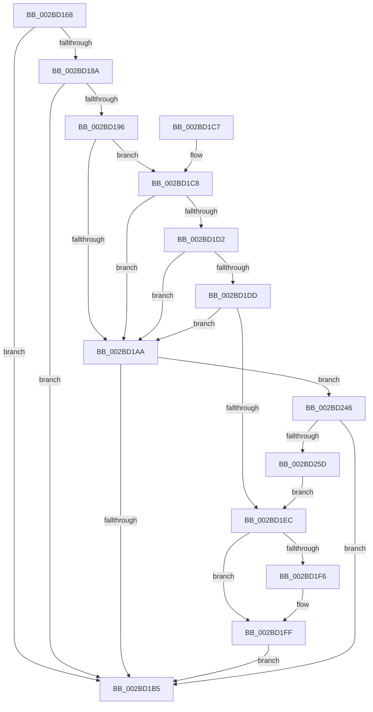

# PopDiagTraceFxDefaultPepWorkerStart

- RVA: `0x002BD168`–`0x002BD25F` (길이 `247` bytes)
- VA: `0x00000001402BD168`
- 실행 섹션: `.text`
- PDB 이름 있음: `예`; PDB Function 태그: `아니요`
- unwind 정보 RVA: `0x0006E1C8`
- 디코드: `62`개 명령, `247/247` bytes 표시
- 미해석 바이트: `0` (있으면 어셈블리에 `.byte`로 보존)

> 이 문서는 커널 이미지의 기계어와 PDB 기호를 분석해 생성했습니다. 4번과 5번은 함수 원형과 자료형을 바이너리 사용 방식에서 추정한 C 해석이며 원본 소스 복구 결과는 아닙니다.

## 1. Dependencies

- 직접 호출 지점: **3**; 고유 호출 대상: **3**
- 직접 호출자로 확인된 함수: **1**
- RIP 상대 이미지 참조: **4**

### Outgoing calls
- `0x002BD1BD` → [_security_check_cookie](../6A/_security_check_cookie_function_006AC640.md) (function, `0x006AC640`)
- `0x002BD23C` → [EtwWriteEx](../25/EtwWriteEx_function_0025F0D0.md) (function, `0x0025F0D0`)
- `0x002BD250` → [EtwpLevelKeywordEnabled](../2F/EtwpLevelKeywordEnabled_function_002FD110.md) (function, `0x002FD110`)

### Direct callers
- [PopPepWork](PopPepWork_function_002BCBC0.md) at `0x002BCC68`

### Static image references
- `0x002BD16C` → RVA `0x00E0A740` (`.data`; read)
- `0x002BD181` → RVA `0x00E67858` (`.data`; read)
- `0x002BD18A` → RVA `0x00F0B408` (`.data`; read)
- `0x002BD210` → RVA `0x00010968` (`.rdata`; read)

## 2. Other-region calls and transfers

- 다른 실행 섹션으로 향하는 call: **0**
- 별도 외부 분기/꼬리 이동을 확인하지 못했습니다.

## 3. Assembly (complete function range)

```asm
002BD168  48 83 EC 78                     sub rsp, 0x78
002BD16C  48 8B 05 CD D5 B4 00            mov rax, qword ptr [rip + 0xb4d5cd]
002BD173  48 33 C4                        xor rax, rsp
002BD176  48 89 44 24 60                  mov qword ptr [rsp + 0x60], rax
002BD17B  45 33 DB                        xor r11d, r11d
002BD17E  4C 8B D1                        mov r10, rcx
002BD181  44 38 1D D0 A6 BA 00            cmp byte ptr [rip + 0xbaa6d0], r11b
002BD188  74 2B                           je 0x1402bd1b5
002BD18A  48 8B 15 77 E2 C4 00            mov rdx, qword ptr [rip + 0xc4e277]
002BD191  48 85 D2                        test rdx, rdx
002BD194  74 1F                           je 0x1402bd1b5
002BD196  48 8B 4A 20                     mov rcx, qword ptr [rdx + 0x20]
002BD19A  45 8D 4B 01                     lea r9d, [r11 + 1]
002BD19E  41 B8 00 01 00 00               mov r8d, 0x100
002BD1A4  44 39 59 60                     cmp dword ptr [rcx + 0x60], r11d
002BD1A8  75 1E                           jne 0x1402bd1c8
002BD1AA  66 44 39 5A 66                  cmp word ptr [rdx + 0x66], r11w
002BD1AF  0F 85 91 00 00 00               jne 0x1402bd246
002BD1B5  48 8B 4C 24 60                  mov rcx, qword ptr [rsp + 0x60]
002BD1BA  48 33 CC                        xor rcx, rsp
002BD1BD  E8 7E F4 3E 00                  call 0x1406ac640
002BD1C2  48 83 C4 78                     add rsp, 0x78
002BD1C6  C3                              ret
002BD1C7  CC                              int3
002BD1C8  8A 41 64                        mov al, byte ptr [rcx + 0x64]
002BD1CB  41 2A C1                        sub al, r9b
002BD1CE  3C 02                           cmp al, 2
002BD1D0  76 D8                           jbe 0x1402bd1aa
002BD1D2  8B 41 68                        mov eax, dword ptr [rcx + 0x68]
002BD1D5  8B 41 70                        mov eax, dword ptr [rcx + 0x70]
002BD1D8  49 85 C0                        test r8, rax
002BD1DB  74 CD                           je 0x1402bd1aa
002BD1DD  48 8B 49 78                     mov rcx, qword ptr [rcx + 0x78]
002BD1E1  48 8B C1                        mov rax, rcx
002BD1E4  49 23 C0                        and rax, r8
002BD1E7  48 3B C1                        cmp rax, rcx
002BD1EA  75 BE                           jne 0x1402bd1aa
002BD1EC  4C 89 5C 24 40                  mov qword ptr [rsp + 0x40], r11
002BD1F1  4D 85 D2                        test r10, r10
002BD1F4  74 09                           je 0x1402bd1ff
002BD1F6  49 8B 42 30                     mov rax, qword ptr [r10 + 0x30]
002BD1FA  48 89 44 24 40                  mov qword ptr [rsp + 0x40], rax
002BD1FF  48 8B 0D 02 E2 C4 00            mov rcx, qword ptr [rip + 0xc4e202]
002BD206  48 8D 44 24 40                  lea rax, [rsp + 0x40]
002BD20B  48 89 44 24 50                  mov qword ptr [rsp + 0x50], rax
002BD210  48 8D 15 51 37 D5 FF            lea rdx, [rip - 0x2ac8af]
002BD217  48 8D 44 24 50                  lea rax, [rsp + 0x50]
002BD21C  48 C7 44 24 58 08 00 00 00      mov qword ptr [rsp + 0x58], 8
002BD225  48 89 44 24 38                  mov qword ptr [rsp + 0x38], rax
002BD22A  45 33 C0                        xor r8d, r8d
002BD22D  44 89 4C 24 30                  mov dword ptr [rsp + 0x30], r9d
002BD232  4C 89 5C 24 28                  mov qword ptr [rsp + 0x28], r11
002BD237  4C 89 5C 24 20                  mov qword ptr [rsp + 0x20], r11
002BD23C  E8 8F 1E FA FF                  call 0x14025f0d0
002BD241  E9 6F FF FF FF                  jmp 0x1402bd1b5
002BD246  48 8B 4A 28                     mov rcx, qword ptr [rdx + 0x28]
002BD24A  B2 04                           mov dl, 4
002BD24C  48 83 C1 60                     add rcx, 0x60
002BD250  E8 BB FE 03 00                  call 0x1402fd110
002BD255  84 C0                           test al, al
002BD257  0F 84 58 FF FF FF               je 0x1402bd1b5
002BD25D  EB 8D                           jmp 0x1402bd1ec
```

## 4. C-style interpretation (structured pseudocode)

```c
__int64 __fastcall PopDiagTraceFxDefaultPepWorkerStart(__int64 a1)
{
    __int64 result;
    __int64 v_r11;
    __int64 v_rsp;
    unsigned __int64 v_stack_m18;
    unsigned __int64 v_stack_p20;
    unsigned __int64 v_stack_p28;
    unsigned int v_stack_p30;
    unsigned __int64 v_stack_p38;
    unsigned __int64 v_stack_p40;
    unsigned __int64 v_stack_p50;
    unsigned __int64 v_stack_p58;

    v_rsp = (v_rsp) - (120);
    result = (*(unsigned __int64 *)(v_rip + 11851213)) ^ (v_rsp);
    v_stack_m18 = result;
    v_r11 = 0;
    if ((*(unsigned __int8 *)(v_rip + 12232400)) == 0) goto loc_002BD1B5;
    if (*(unsigned __int64 *)(v_rip + 12903031) == 0) goto loc_002BD1B5;
    if ((*(unsigned int *)(*(unsigned __int64 *)(*(unsigned __int64 *)(v_rip + 12903031) + 32) + 96)) != 0) goto loc_002BD1C8;
loc_002BD1AA:
    if ((*(unsigned __int16 *)(*(unsigned __int64 *)(v_rip + 12903031) + 102)) != 0) goto loc_002BD246;
loc_002BD1B5:
    a1 = (v_stack_m18) ^ (v_rsp);
    result = _security_check_cookie(a1, *(unsigned __int64 *)(v_rip + 12903031), 256, v_r11 + 1);
    v_rsp = (v_rsp) + (120);
    return result;
loc_002BD1C8:
    result = (unsigned __int8)((*(unsigned __int8 *)(a1 + 100)) - ((unsigned __int8)(v_r11 + 1)));
    if (((unsigned __int8)(result)) <= 2) goto loc_002BD1AA;
    if (((256) & ((unsigned int)(*(unsigned int *)(a1 + 112)))) == 0) goto loc_002BD1AA;
    result = (*(unsigned __int64 *)(a1 + 120)) & (256);
    if (result != (*(unsigned __int64 *)(a1 + 120))) goto loc_002BD1AA;
loc_002BD1EC:
    v_stack_p40 = 0;
    if (a1 != 0) {
        result = *(unsigned __int64 *)(a1 + 48);
        v_stack_p40 = result;
    }
    v_stack_p50 = v_stack_p40;
    v_stack_p58 = 8;
    v_stack_p38 = v_stack_p50;
    a3 = 0;
    v_stack_p30 = (unsigned int)(v_r11 + 1);
    v_stack_p28 = 0;
    v_stack_p20 = 0;
    result = EtwWriteEx(*(unsigned __int64 *)(v_rip + 12902914), v_rip - 2803887, a3, v_r11 + 1);
    goto loc_002BD1B5;
loc_002BD246:
    a1 = (*(unsigned __int64 *)(v_rip - 2803887 + 40)) + (96);
    result = EtwpLevelKeywordEnabled(a1, 4, a3, v_r11 + 1);
    if ((unsigned __int8)(result) == 0) goto loc_002BD1B5;
    goto loc_002BD1EC;
}
```

## 5. (Beta) C Style

```c
int64_t PopDiagTraceFxDefaultPepWorkerStart(int64_t Arg1)
{
    int64_t result;
    int64_t local_r11;
    int64_t local_rsp;
    uint64_t v_stack_m18;
    uint64_t v_stack_p20;
    uint64_t v_stack_p28;
    uint32_t v_stack_p30;
    uint64_t v_stack_p38;
    uint64_t v_stack_p40;
    uint64_t v_stack_p50;
    uint64_t v_stack_p58;

    local_rsp = (local_rsp) - (120);
    result = (*(uint64_t *)(v_rip + 0xB4D5CD)) ^ (local_rsp);
    v_stack_m18 = result;
    local_r11 = 0;
    if ((*(uint8_t *)(v_rip + 0xBAA6D0)) == 0) goto loc_002BD1B5;
    if (*(uint64_t *)(v_rip + 0xC4E277) == 0) goto loc_002BD1B5;
    if ((*(uint32_t *)(*(uint64_t *)(*(uint64_t *)(v_rip + 0xC4E277) + 0x20) + 0x60)) != 0) goto loc_002BD1C8;
loc_002BD1AA:
    if ((*(uint16_t *)(*(uint64_t *)(v_rip + 0xC4E277) + 0x66)) != 0) goto loc_002BD246;
loc_002BD1B5:
    Arg1 = (v_stack_m18) ^ (local_rsp);
    result = _security_check_cookie(Arg1, *(uint64_t *)(v_rip + 0xC4E277), 256, local_r11 + 1);
    local_rsp = (local_rsp) + (120);
    return result;
loc_002BD1C8:
    result = (uint8_t)((*(uint8_t *)(Arg1 + 0x64)) - ((uint8_t)(local_r11 + 1)));
    if (((uint8_t)(result)) <= 2) goto loc_002BD1AA;
    if (((256) & ((uint32_t)(*(uint32_t *)(Arg1 + 0x70)))) == 0) goto loc_002BD1AA;
    result = (*(uint64_t *)(Arg1 + 0x78)) & (256);
    if (result != (*(uint64_t *)(Arg1 + 0x78))) goto loc_002BD1AA;
loc_002BD1EC:
    v_stack_p40 = 0;
    if (Arg1 != 0) {
        result = *(uint64_t *)(Arg1 + 0x30);
        v_stack_p40 = result;
    }
    v_stack_p50 = v_stack_p40;
    v_stack_p58 = 8;
    v_stack_p38 = v_stack_p50;
    a3 = 0;
    v_stack_p30 = (uint32_t)(local_r11 + 1);
    v_stack_p28 = 0;
    v_stack_p20 = 0;
    result = EtwWriteEx(*(uint64_t *)(v_rip + 0xC4E202), v_rip - 2803887, a3, local_r11 + 1);
    goto loc_002BD1B5;
loc_002BD246:
    Arg1 = (*(uint64_t *)(v_rip - 0x2AC8AF + 0x28)) + (96);
    result = EtwpLevelKeywordEnabled(Arg1, 4, a3, local_r11 + 1);
    if ((uint8_t)(result) == 0) goto loc_002BD1B5;
    goto loc_002BD1EC;
}
```

## 6. Execution-region graph

[열기: 2D/3D 그래프와 함수 탐색 컨트롤 패널](../../../control-panel.html?section=text&rva=0x002BD168&view=graph)

- 2D 그래프는 위에서 아래로 흐르고, 3D 그래프는 빈 공간을 드래그해 회전합니다. Shift+드래그는 이동, 휠은 확대·축소, 함수 노드 선택은 대상 보고서 이동입니다.

### Static fallback


