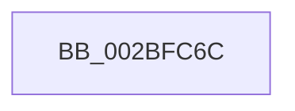

# PopFxBugCheck

- RVA: `0x002BFC6C`–`0x002BFC89` (길이 `29` bytes)
- VA: `0x00000001402BFC6C`
- 실행 섹션: `.text`
- PDB 이름 있음: `예`; PDB Function 태그: `아니요`
- unwind 정보 RVA: `0x000622F0`
- 디코드: `8`개 명령, `29/29` bytes 표시
- 미해석 바이트: `0` (있으면 어셈블리에 `.byte`로 보존)

> 이 문서는 커널 이미지의 기계어와 PDB 기호를 분석해 생성했습니다. 4번과 5번은 함수 원형과 자료형을 바이너리 사용 방식에서 추정한 C 해석이며 원본 소스 복구 결과는 아닙니다.

## 1. Dependencies

- 직접 호출 지점: **1**; 고유 호출 대상: **1**
- 직접 호출자로 확인된 함수: **56**
- RIP 상대 이미지 참조: **0**

### Outgoing calls
- `0x002BFC83` → [KeBugCheckEx](../4F/KeBugCheckEx_function_004FD660.md) (function, `0x004FD660`)

### Direct callers
- [PopPluginComponentActive](../24/PopPluginComponentActive_function_0024B800.md) at `0x0024B8FB`
- [PopPluginComponentActive](../24/PopPluginComponentActive_function_0024B800.md) at `0x0024B916`
- [PopPepProcessEvent](../24/PopPepProcessEvent_function_0024B930.md) at `0x0024C63F`
- [PopPepProcessEvent](../24/PopPepProcessEvent_function_0024B930.md) at `0x0024CC5B`
- [PopPepTriggerActivity](../24/PopPepTriggerActivity_function_0024CDB0.md) at `0x0024D0BE`
- [PopFxDerefAndCompleteDirectedPowerTransition](../26/PopFxDerefAndCompleteDirectedPowerTransition_function_0026D8F8.md) at `0x0026D91D`
- [PopFxDerefAndCompleteDirectedPowerTransition](../26/PopFxDerefAndCompleteDirectedPowerTransition_function_0026D8F8.md) at `0x0026D951`
- [PopFxHandleReportDevicePoweredOn](../26/PopFxHandleReportDevicePoweredOn_function_0026D980.md) at `0x0026DA83`
- [PopFxDisableWorkOrderWatchdog](PopFxDisableWorkOrderWatchdog_function_002BC858.md) at `0x002BC924`
- [sub_002BD41B](Unknown_function_002BD41B.md) at `0x002BD45D`
- [sub_002BD41B](Unknown_function_002BD41B.md) at `0x002BD48F`
- [sub_002BD41B](Unknown_function_002BD41B.md) at `0x002BD517`
- [sub_002BD41B](Unknown_function_002BD41B.md) at `0x002BD53A`
- [sub_002BD41B](Unknown_function_002BD41B.md) at `0x002BD56C`
- [sub_002BD41B](Unknown_function_002BD41B.md) at `0x002BD589`
- [sub_002BD41B](Unknown_function_002BD41B.md) at `0x002BD5A9`
- [sub_002BD41B](Unknown_function_002BD41B.md) at `0x002BD5C9`
- [sub_002BD6E6](Unknown_function_002BD6E6.md) at `0x002BD82A`
- [sub_002BD6E6](Unknown_function_002BD6E6.md) at `0x002BD91E`
- [sub_002BD946](Unknown_function_002BD946.md) at `0x002BD954`
- [sub_002BD95A](Unknown_function_002BD95A.md) at `0x002BD9DA`
- [sub_002BD95A](Unknown_function_002BD95A.md) at `0x002BD9FD`
- [sub_002BD95A](Unknown_function_002BD95A.md) at `0x002BDB29`
- [sub_002BD95A](Unknown_function_002BD95A.md) at `0x002BDCAB`
- [sub_002BD95A](Unknown_function_002BD95A.md) at `0x002BDCDA`
- [sub_002BD95A](Unknown_function_002BD95A.md) at `0x002BDD0D`
- [sub_002BD95A](Unknown_function_002BD95A.md) at `0x002BDD2C`
- [PopPluginComponentIdleState](PopPluginComponentIdleState_function_002BE310.md) at `0x002BE462`
- [PopFxActivateComponentDependents](PopFxActivateComponentDependents_function_002BE9F0.md) at `0x002BECAF`
- [PopFxActivateComponentDependents](PopFxActivateComponentDependents_function_002BE9F0.md) at `0x002BED51`
- [PopPepUpdateIdleStateRefCount](PopPepUpdateIdleStateRefCount_function_002BF930.md) at `0x002BFC21`
- [PopPepUpdateIdleStateRefCount](PopPepUpdateIdleStateRefCount_function_002BF930.md) at `0x002BFC35`
- [PopPepUpdateIdleStateRefCount](PopPepUpdateIdleStateRefCount_function_002BF930.md) at `0x002BFC49`
- [PopPepUpdateIdleStateRefCount](PopPepUpdateIdleStateRefCount_function_002BF930.md) at `0x002BFC5D`
- [PopFxReferenceDevice](PopFxReferenceDevice_function_002BFD9C.md) at `0x002BFDFA`
- [PopFxIdleComponent](../2C/PopFxIdleComponent_function_002C01D8.md) at `0x002C03DA`
- [PopFxIdleComponent](../2C/PopFxIdleComponent_function_002C01D8.md) at `0x002C03F1`
- [PopFxIdleComponent](../2C/PopFxIdleComponent_function_002C01D8.md) at `0x002C0406`
- [PoFxActivateComponent](../2D/PoFxActivateComponent_function_002D9D30.md) at `0x002D9D82`
- [PoFxActivateComponent](../2D/PoFxActivateComponent_function_002D9D30.md) at `0x002D9D99`
- [PoFxActivateComponent](../2D/PoFxActivateComponent_function_002D9D30.md) at `0x002D9DB0`
- [PopFxCompleteDevicePowerRequired](../39/PopFxCompleteDevicePowerRequired_function_003908AC.md) at `0x00390985`
- [PopFxCompleteDevicePowerRequired](../39/PopFxCompleteDevicePowerRequired_function_003908AC.md) at `0x00390998`
- [PoFxCompleteIdleCondition](../46/PoFxCompleteIdleCondition_function_00461CC0.md) at `0x00461D30`
- [PopFxIdleTimeoutDpcRoutine](../49/PopFxIdleTimeoutDpcRoutine_function_00492B80.md) at `0x00492C40`
- [PopTranslateDependencyArray](../49/PopTranslateDependencyArray_function_004994D8.md) at `0x004994F4`
- [PopPluginPrepareDevice](../49/PopPluginPrepareDevice_function_0049A0C8.md) at `0x0049A16D`
- [PopFxActivateDevice](../4A/PopFxActivateDevice_function_004A0DC8.md) at `0x004A0F3A`
- [PopFxActivateDevice](../4A/PopFxActivateDevice_function_004A0DC8.md) at `0x004A0F4F`
- [PoFxCompleteDevicePowerNotRequired](../4A/PoFxCompleteDevicePowerNotRequired_function_004A3BE0.md) at `0x004A3C6D`
- [PopFxIssueComponentPerfStateChanges](../4C/PopFxIssueComponentPerfStateChanges_function_004C1940.md) at `0x004C1988`
- [PopFxIssueComponentPerfStateChanges](../4C/PopFxIssueComponentPerfStateChanges_function_004C1940.md) at `0x004C19AC`
- [PopFxIssueComponentPerfStateChanges](../4C/PopFxIssueComponentPerfStateChanges_function_004C1940.md) at `0x004C19CB`
- [PopPluginRequestComponentPerfState](../4C/PopPluginRequestComponentPerfState_function_004C1C58.md) at `0x004C1CAC`
- [PopFxAcpiForwardPepAcpiNotifyRequest](../4C/PopFxAcpiForwardPepAcpiNotifyRequest_function_004C7650.md) at `0x004C7685`
- [PopPepInitializeVetoMasks](../4C/PopPepInitializeVetoMasks_function_004C9350.md) at `0x004C965E`
- [PopPepInitializeVetoMasks](../4C/PopPepInitializeVetoMasks_function_004C9350.md) at `0x004C9855`
- [PopPluginRegisterDevice](../4C/PopPluginRegisterDevice_function_004CF8FC.md) at `0x004CF98C`
- [PopPluginAbandonDevice](../4E/PopPluginAbandonDevice_function_004E3EAC.md) at `0x004E3EF1`
- [PopFxAcpiForwardPepWorkRequest](../4F/PopFxAcpiForwardPepWorkRequest_function_004F65A4.md) at `0x004F65C4`
- [PopFxCompleteDirectedPowerTransition](../4F/PopFxCompleteDirectedPowerTransition_function_004FB330.md) at `0x004FB4A3`
- [PoFxIssueComponentPerfStateChangeMultiple](../5D/PoFxIssueComponentPerfStateChangeMultiple_function_005D1A60.md) at `0x005D1A87`
- [PoFxIssueComponentPerfStateChangeMultiple](../5D/PoFxIssueComponentPerfStateChangeMultiple_function_005D1A60.md) at `0x005D1AA8`
- [PoFxIssueComponentPerfStateChangeMultiple](../5D/PoFxIssueComponentPerfStateChangeMultiple_function_005D1A60.md) at `0x005D1AC8`
- [PoFxRegisterDripsWatchdogCallback](../5D/PoFxRegisterDripsWatchdogCallback_function_005D1BD0.md) at `0x005D1C1A`
- [PopFxIssueDirectedPowerTransition](../5D/PopFxIssueDirectedPowerTransition_function_005D2E2C.md) at `0x005D2E6E`
- [PopFxIssueDirectedPowerTransition](../5D/PopFxIssueDirectedPowerTransition_function_005D2E2C.md) at `0x005D2EC7`
- [PopFxIssueDirectedPowerTransition](../5D/PopFxIssueDirectedPowerTransition_function_005D2E2C.md) at `0x005D2F5A`
- [PopFxQueryCurrentComponentPerfState](../5D/PopFxQueryCurrentComponentPerfState_function_005D30BC.md) at `0x005D3138`
- [PopFxTransitionCriticalResource](../5D/PopFxTransitionCriticalResource_function_005D36F0.md) at `0x005D372D`
- [PopFxTransitionCriticalResource](../5D/PopFxTransitionCriticalResource_function_005D36F0.md) at `0x005D374A`
- [PopFxTransitionCriticalResource](../5D/PopFxTransitionCriticalResource_function_005D36F0.md) at `0x005D3765`
- [PopFxWorkOrderWatchdog](../5D/PopFxWorkOrderWatchdog_function_005D3A40.md) at `0x005D3A5B`
- [PopPluginQueryComponentPerfSet](../5D/PopPluginQueryComponentPerfSet_function_005D3AB8.md) at `0x005D3B19`
- [PopPluginQueryComponentPerfSetName](../5D/PopPluginQueryComponentPerfSetName_function_005D3B64.md) at `0x005D3BCA`
- [PopPluginQueryComponentPerfStates](../5D/PopPluginQueryComponentPerfStates_function_005D3BF0.md) at `0x005D3C35`
- [PopPluginUnregisterDevice](../5D/PopPluginUnregisterDevice_function_005D3D40.md) at `0x005D3D74`
- [PopFxDebuggerPowerCriticalTransitionCallback](../5D/PopFxDebuggerPowerCriticalTransitionCallback_function_005DA4A0.md) at `0x005DA4BA`
- [PopPepInitializeDebuggerMasks](../5D/PopPepInitializeDebuggerMasks_function_005DCB94.md) at `0x005DCC4B`
- [PopPluginAcpiNotificationStrict](../5E/PopPluginAcpiNotificationStrict_function_005E1DC4.md) at `0x005E1DF1`
- [sub_006DBF28](../6D/Unknown_function_006DBF28.md) at `0x006DBF6C`
- [sub_006DBF28](../6D/Unknown_function_006DBF28.md) at `0x006DBF80`
- [PoFxRegisterComponentPerfStates](../../page/75/PoFxRegisterComponentPerfStates_function_00758780.md) at `0x007587A0`
- [PoFxRegisterComponentPerfStates](../../page/75/PoFxRegisterComponentPerfStates_function_00758780.md) at `0x007587CB`
- [PopFxInitializeSocSubsystemStaticInfo](../../page/75/PopFxInitializeSocSubsystemStaticInfo_function_00758EC8.md) at `0x00758F78`
- [PopFxInitializeSocSubsystemStaticInfo](../../page/75/PopFxInitializeSocSubsystemStaticInfo_function_00758EC8.md) at `0x00758F97`
- [PopFxInitializeSocSubsystemStaticInfo](../../page/75/PopFxInitializeSocSubsystemStaticInfo_function_00758EC8.md) at `0x00759206`
- [PopFxInitializeSocSubsystemStaticInfo](../../page/75/PopFxInitializeSocSubsystemStaticInfo_function_00758EC8.md) at `0x0075921F`
- [PopFxPepPerfInfoQuery](../../page/75/PopFxPepPerfInfoQuery_function_00759564.md) at `0x0075973E`
- [PopFxRegisterDevice](../../page/75/PopFxRegisterDevice_function_00759B80.md) at `0x00759D03`
- [PopFxRegisterDeviceWorker](../../page/75/PopFxRegisterDeviceWorker_function_00759E20.md) at `0x0075A55F`
- [PopFxResetSocSubsystemAccounting](../../page/75/PopFxResetSocSubsystemAccounting_function_0075A6A0.md) at `0x0075A6F9`
- [PopPluginInitializeSocSubsystemStaticInfo](../../page/75/PopPluginInitializeSocSubsystemStaticInfo_function_0075A98C.md) at `0x0075A9E3`
- [PopPluginInitializeSocSubsystemStaticInfo](../../page/75/PopPluginInitializeSocSubsystemStaticInfo_function_0075A98C.md) at `0x0075AA13`
- [PopPluginInitializeSocSubsystemStaticInfo](../../page/75/PopPluginInitializeSocSubsystemStaticInfo_function_0075A98C.md) at `0x0075AA49`
- [PopPluginInitializeSocSubsystemStaticInfo](../../page/75/PopPluginInitializeSocSubsystemStaticInfo_function_0075A98C.md) at `0x0075AA76`
- [PopPluginInitializeSocSubsystemStaticInfo](../../page/75/PopPluginInitializeSocSubsystemStaticInfo_function_0075A98C.md) at `0x0075AA97`
- [PopPluginQuerySocSubsystemMetadata](../../page/75/PopPluginQuerySocSubsystemMetadata_function_0075AABC.md) at `0x0075ABAB`
- [PopPluginQuerySocSubsystemMetadata](../../page/75/PopPluginQuerySocSubsystemMetadata_function_0075AABC.md) at `0x0075AC66`
- [PopPluginQuerySocSubsystemMetadata](../../page/75/PopPluginQuerySocSubsystemMetadata_function_0075AABC.md) at `0x0075AC85`
- [PopPluginQuerySocSubsystemMetadata](../../page/75/PopPluginQuerySocSubsystemMetadata_function_0075AABC.md) at `0x0075AC9C`
- [PopDripsWatchdogTakeAction](../../page/77/PopDripsWatchdogTakeAction_function_007732D0.md) at `0x00773557`
- [PopDripsWatchdogTakeAction](../../page/77/PopDripsWatchdogTakeAction_function_007732D0.md) at `0x00773595`
- [PopPluginQuerySocSubsystemBlockingTime](../../page/97/PopPluginQuerySocSubsystemBlockingTime_function_0097A6A4.md) at `0x0097A75B`
- [PopPluginQuerySocSubsystemBlockingTime](../../page/97/PopPluginQuerySocSubsystemBlockingTime_function_0097A6A4.md) at `0x0097A774`
- [PopFxLogSocSubsystemMetadata](../../page/97/PopFxLogSocSubsystemMetadata_function_0097AC1C.md) at `0x0097AF92`
- [PopFxLogSocSubsystemMetadata](../../page/97/PopFxLogSocSubsystemMetadata_function_0097AC1C.md) at `0x0097AFAD`

### Static image references
- 디코드된 RIP-relative 메모리 참조가 없습니다.

## 2. Other-region calls and transfers

- 다른 실행 섹션으로 향하는 call: **0**
- 별도 외부 분기/꼬리 이동을 확인하지 못했습니다.

## 3. Assembly (complete function range)

```asm
002BFC6C  48 83 EC 38                     sub rsp, 0x38
002BFC70  4C 89 4C 24 20                  mov qword ptr [rsp + 0x20], r9
002BFC75  4D 8B C8                        mov r9, r8
002BFC78  4C 8B C2                        mov r8, rdx
002BFC7B  48 8B D1                        mov rdx, rcx
002BFC7E  B9 A0 00 00 00                  mov ecx, 0xa0
002BFC83  E8 D8 D9 23 00                  call 0x1404fd660
002BFC88  CC                              int3
```

## 4. C-style interpretation (structured pseudocode)

```c
__int64 __fastcall PopFxBugCheck(__int64 a1, __int64 a2, __int64 a3, __int64 a4)
{
    __int64 result;
    __int64 v_rsp;
    unsigned __int64 v_stack_m18;

    v_rsp = (v_rsp) - (56);
    v_stack_m18 = a4;
    result = KeBugCheckEx(160, a1, a2, a3);
    return result;
}
```

## 5. (Beta) C Style

```c
int64_t PopFxBugCheck(int64_t Arg1, int64_t Arg2, int64_t Arg3, int64_t Arg4)
{
    int64_t result;
    int64_t local_rsp;
    uint64_t v_stack_m18;

    local_rsp = (local_rsp) - (56);
    v_stack_m18 = Arg4;
    result = KeBugCheckEx(160, Arg1, Arg2, Arg3);
    return result;
}
```

## 6. Execution-region graph

[열기: 2D/3D 그래프와 함수 탐색 컨트롤 패널](../../../control-panel.html?section=text&rva=0x002BFC6C&view=graph)

- 2D 그래프는 위에서 아래로 흐르고, 3D 그래프는 빈 공간을 드래그해 회전합니다. Shift+드래그는 이동, 휠은 확대·축소, 함수 노드 선택은 대상 보고서 이동입니다.

### Static fallback


