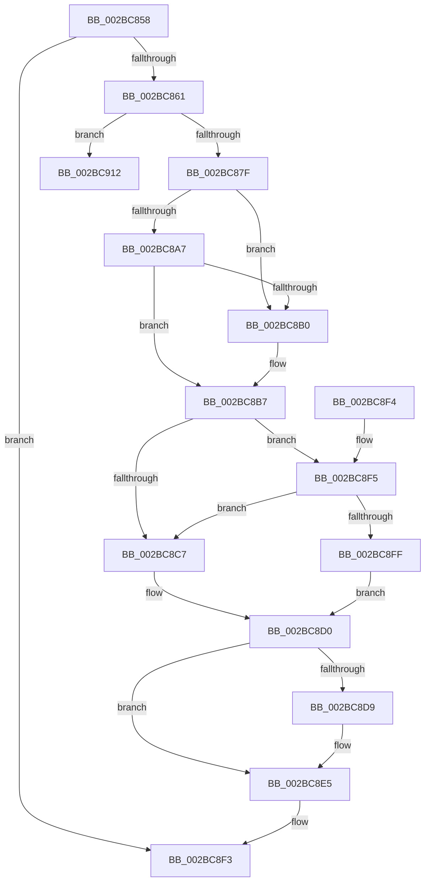

# PopFxDisableWorkOrderWatchdog

- RVA: `0x002BC858`–`0x002BC92A` (길이 `210` bytes)
- VA: `0x00000001402BC858`
- 실행 섹션: `.text`
- PDB 이름 있음: `예`; PDB Function 태그: `아니요`
- unwind 정보 RVA: `0x0006E180`
- 디코드: `52`개 명령, `210/210` bytes 표시
- 미해석 바이트: `0` (있으면 어셈블리에 `.byte`로 보존)

> 이 문서는 커널 이미지의 기계어와 PDB 기호를 분석해 생성했습니다. 4번과 5번은 함수 원형과 자료형을 바이너리 사용 방식에서 추정한 C 해석이며 원본 소스 복구 결과는 아닙니다.

## 1. Dependencies

- 직접 호출 지점: **5**; 고유 호출 대상: **5**
- 직접 호출자로 확인된 함수: **2**
- RIP 상대 이미지 참조: **5**

### Outgoing calls
- `0x002BC872` → [KeCancelTimer](../23/KeCancelTimer_function_002327E0.md) (function, `0x002327E0`)
- `0x002BC886` → [KeAcquireSpinLockRaiseToDpc](../20/KeAcquireSpinLockRaiseToDpc_function_00208470.md) (function, `0x00208470`)
- `0x002BC8E0` → [KiLowerIrqlProcessIrqlFlags](../4F/KiLowerIrqlProcessIrqlFlags_function_004F5698.md) (function, `0x004F5698`)
- `0x002BC90B` → [KiReleaseSpinLockInstrumented](../39/KiReleaseSpinLockInstrumented_function_00392EF0.md) (function, `0x00392EF0`)
- `0x002BC924` → [PopFxBugCheck](PopFxBugCheck_function_002BFC6C.md) (function, `0x002BFC6C`)

### Direct callers
- [PopFxDispatchPluginWorkOnce](PopFxDispatchPluginWorkOnce_function_002BC69C.md) at `0x002BC797`
- [PopFxCompleteDirectedPowerTransition](../4F/PopFxCompleteDirectedPowerTransition_function_004FB330.md) at `0x004FB397`

### Static image references
- `0x002BC87F` → RVA `0x00F0E550` (`.data`; read)
- `0x002BC8BE` → RVA `0x00FC6B06` (`ALMOSTRO`; read)
- `0x002BC8C7` → RVA `0x00F0E550` (`.data`; read/write)
- `0x002BC8D0` → RVA `0x00FC6D20` (`ALMOSTRO`; read)
- `0x002BC8F5` → RVA `0x00F0DE58` (`.data`; read)

## 2. Other-region calls and transfers

- 다른 실행 섹션으로 향하는 call: **0**
- 별도 외부 분기/꼬리 이동을 확인하지 못했습니다.

## 3. Assembly (complete function range)

```asm
002BC858  48 85 C9                        test rcx, rcx
002BC85B  0F 84 92 00 00 00               je 0x1402bc8f3
002BC861  48 89 5C 24 08                  mov qword ptr [rsp + 8], rbx
002BC866  57                              push rdi
002BC867  48 83 EC 20                     sub rsp, 0x20
002BC86B  48 8B D9                        mov rbx, rcx
002BC86E  48 83 C1 10                     add rcx, 0x10
002BC872  E8 69 5F F7 FF                  call 0x1402327e0
002BC877  84 C0                           test al, al
002BC879  0F 84 93 00 00 00               je 0x1402bc912
002BC87F  48 8D 0D CA 1C C5 00            lea rcx, [rip + 0xc51cca]
002BC886  E8 E5 BB F4 FF                  call 0x140208470
002BC88B  48 83 A3 A8 00 00 00 00         and qword ptr [rbx + 0xa8], 0
002BC893  48 83 A3 98 00 00 00 00         and qword ptr [rbx + 0x98], 0
002BC89B  0F B6 F8                        movzx edi, al
002BC89E  48 8B 03                        mov rax, qword ptr [rbx]
002BC8A1  48 39 58 08                     cmp qword ptr [rax + 8], rbx
002BC8A5  75 09                           jne 0x1402bc8b0
002BC8A7  48 8B 53 08                     mov rdx, qword ptr [rbx + 8]
002BC8AB  48 39 1A                        cmp qword ptr [rdx], rbx
002BC8AE  74 07                           je 0x1402bc8b7
002BC8B0  B9 03 00 00 00                  mov ecx, 3
002BC8B5  CD 29                           int 0x29
002BC8B7  48 89 02                        mov qword ptr [rdx], rax
002BC8BA  48 89 50 08                     mov qword ptr [rax + 8], rdx
002BC8BE  F6 05 41 A2 D0 00 01            test byte ptr [rip + 0xd0a241], 1
002BC8C5  75 2E                           jne 0x1402bc8f5
002BC8C7  F0 48 83 25 80 1C C5 00 00      lock and qword ptr [rip + 0xc51c80], 0
002BC8D0  83 3D 49 A4 D0 00 00            cmp dword ptr [rip + 0xd0a449], 0
002BC8D7  74 0C                           je 0x1402bc8e5
002BC8D9  44 0F 20 C1                     mov rcx, cr8
002BC8DD  40 8A D7                        mov dl, dil
002BC8E0  E8 B3 8D 23 00                  call 0x1404f5698
002BC8E5  44 0F 22 C7                     mov cr8, rdi
002BC8E9  48 8B 5C 24 30                  mov rbx, qword ptr [rsp + 0x30]
002BC8EE  48 83 C4 20                     add rsp, 0x20
002BC8F2  5F                              pop rdi
002BC8F3  C3                              ret
002BC8F4  CC                              int3
002BC8F5  8B 05 5D 15 C5 00               mov eax, dword ptr [rip + 0xc5155d]
002BC8FB  85 C0                           test eax, eax
002BC8FD  75 C8                           jne 0x1402bc8c7
002BC8FF  48 8B 54 24 28                  mov rdx, qword ptr [rsp + 0x28]
002BC904  48 8D 0D 45 1C C5 00            lea rcx, [rip + 0xc51c45]
002BC90B  E8 E0 65 0D 00                  call 0x140392ef0
002BC910  EB BE                           jmp 0x1402bc8d0
002BC912  4C 8B 83 A8 00 00 00            mov r8, qword ptr [rbx + 0xa8]
002BC919  45 33 C9                        xor r9d, r9d
002BC91C  48 8B D3                        mov rdx, rbx
002BC91F  B9 18 06 00 00                  mov ecx, 0x618
002BC924  E8 43 33 00 00                  call 0x1402bfc6c
002BC929  CC                              int3
```

## 4. C-style interpretation (structured pseudocode)

```c
__int64 __fastcall PopFxDisableWorkOrderWatchdog(__int64 a1, __int64 a2, __int64 a3, int a4)
{
    __int64 result;
    __int64 v_rsp;
    unsigned __int64 v_stack_p28;
    unsigned __int64 v_stack_p8;

    if (a1 == 0) goto loc_002BC8F3;
    v_stack_p8 = v_rbx;
    v_rsp = (v_rsp) - (32);
    a1 = (a1) + (16);
    result = KeCancelTimer(a1, a2, a3, a4);
    if ((unsigned __int8)(result) == 0) goto loc_002BC912;
    result = KeAcquireSpinLockRaiseToDpc(v_rip + 12917962, a2, a3, a4);
    if ((*(unsigned __int64 *)(*(unsigned __int64 *)(a1) + 8)) != a1) goto loc_002BC8B0;
    if ((*(unsigned __int64 *)(*(unsigned __int64 *)(a1 + 8))) != a1) {
        a1 = 3;
    }
    *(unsigned __int64 *)(*(unsigned __int64 *)(a1 + 8)) = *(unsigned __int64 *)(a1);
    *(unsigned __int64 *)(*(unsigned __int64 *)(a1) + 8) = *(unsigned __int64 *)(a1 + 8);
    if (((*(unsigned __int8 *)(v_rip + 13673025)) & (1)) != 0) goto loc_002BC8F5;
loc_002BC8C7:
loc_002BC8D0:
    result = *(unsigned __int64 *)(a1);
    if ((*(unsigned int *)(v_rip + 13673545)) != 0) {
        a1 = v_cr8;
        a2 = (unsigned __int8)((unsigned __int8)(result));
        result = KiLowerIrqlProcessIrqlFlags(a1, a2, a3, a4);
    }
    v_rsp = (v_rsp) + (32);
loc_002BC8F3:
    return result;
loc_002BC8F5:
    if ((unsigned int)((unsigned int)(*(unsigned int *)(v_rip + 12916061))) != 0) goto loc_002BC8C7;
    result = KiReleaseSpinLockInstrumented(v_rip + 12917829, v_stack_p28, a3, a4);
    goto loc_002BC8D0;
loc_002BC912:
    a4 = 0;
    result = PopFxBugCheck((unsigned int)(0x618ULL), v_stack_p8, *(unsigned __int64 *)(v_stack_p8 + 168), a4);
    return result;
}
```

## 5. (Beta) C Style

```c
int64_t PopFxDisableWorkOrderWatchdog(int64_t Arg1, int64_t Arg2, int64_t Arg3, int32_t Arg4)
{
    int64_t result;
    int64_t local_rsp;
    uint64_t v_stack_p28;
    uint64_t v_stack_p8;

    if (Arg1 == 0) goto loc_002BC8F3;
    v_stack_p8 = local_rbx;
    local_rsp = (local_rsp) - (32);
    Arg1 = (Arg1) + (16);
    result = KeCancelTimer(Arg1, Arg2, Arg3, Arg4);
    if ((uint8_t)(result) == 0) goto loc_002BC912;
    result = KeAcquireSpinLockRaiseToDpc(v_rip + 12917962, Arg2, Arg3, Arg4);
    if ((*(uint64_t *)(*(uint64_t *)(Arg1) + 0x8)) != Arg1) goto loc_002BC8B0;
    if ((*(uint64_t *)(*(uint64_t *)(Arg1 + 0x8))) != Arg1) {
        Arg1 = 3;
    }
    *(uint64_t *)(*(uint64_t *)(Arg1 + 0x8)) = *(uint64_t *)(Arg1);
    *(uint64_t *)(*(uint64_t *)(Arg1) + 0x8) = *(uint64_t *)(Arg1 + 0x8);
    if (((*(uint8_t *)(v_rip + 0xD0A241)) & (1)) != 0) goto loc_002BC8F5;
loc_002BC8C7:
loc_002BC8D0:
    result = *(uint64_t *)(Arg1);
    if ((*(uint32_t *)(v_rip + 0xD0A449)) != 0) {
        Arg1 = v_cr8;
        Arg2 = (uint8_t)((uint8_t)(result));
        result = KiLowerIrqlProcessIrqlFlags(Arg1, Arg2, Arg3, Arg4);
    }
    local_rsp = (local_rsp) + (32);
loc_002BC8F3:
    return result;
loc_002BC8F5:
    if ((uint32_t)((uint32_t)(*(uint32_t *)(v_rip + 0xC5155D))) != 0) goto loc_002BC8C7;
    result = KiReleaseSpinLockInstrumented(v_rip + 12917829, v_stack_p28, Arg3, Arg4);
    goto loc_002BC8D0;
loc_002BC912:
    Arg4 = 0;
    result = PopFxBugCheck((uint32_t)(0x618ULL), v_stack_p8, *(uint64_t *)(v_stack_p8 + 0xA8), Arg4);
    return result;
}
```

## 6. Execution-region graph

[열기: 2D/3D 그래프와 함수 탐색 컨트롤 패널](../../../control-panel.html?section=text&rva=0x002BC858&view=graph)

- 2D 그래프는 위에서 아래로 흐르고, 3D 그래프는 빈 공간을 드래그해 회전합니다. Shift+드래그는 이동, 휠은 확대·축소, 함수 노드 선택은 대상 보고서 이동입니다.

### Static fallback


